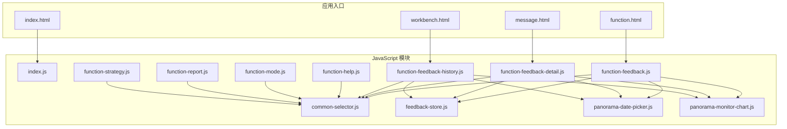
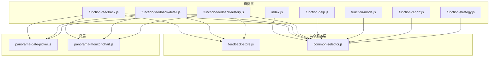
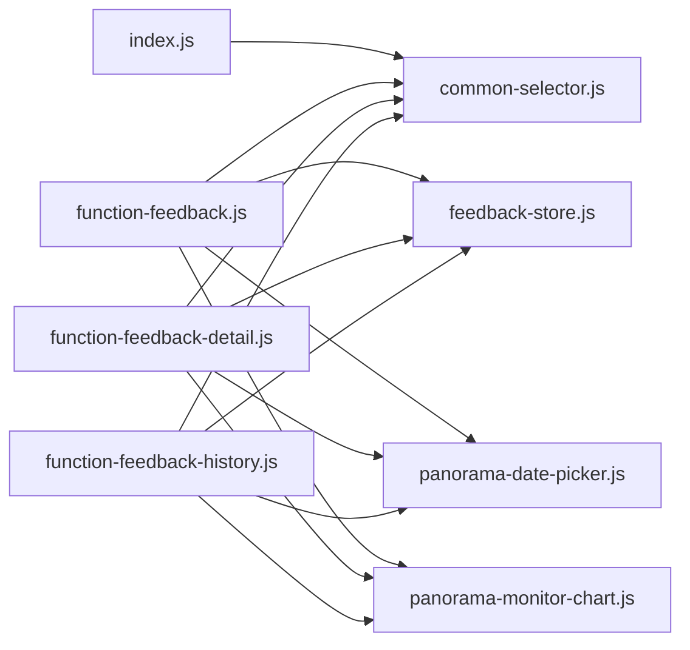
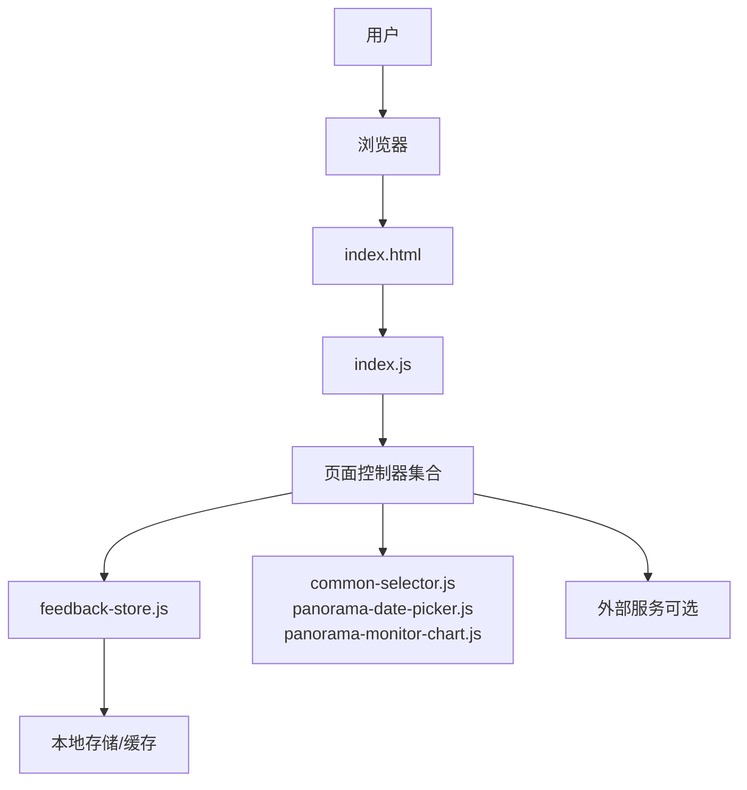
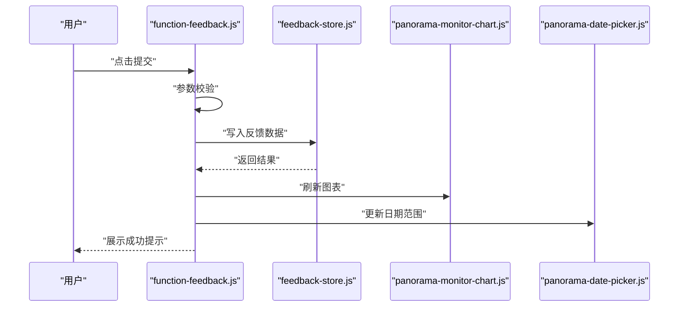

# JavaScript模块架构

<cite>
**本文引用的文件**   
- [index.js](file://app/js/index.js)
- [common-selector.js](file://app/js/common-selector.js)
- [feedback-store.js](file://app/js/feedback-store.js)
- [function-feedback.js](file://app/js/function-feedback.js)
- [function-feedback-detail.js](file://app/js/function-feedback-detail.js)
- [function-feedback-history.js](file://app/js/function-feedback-history.js)
- [function-help.js](file://app/js/function-help.js)
- [function-mode.js](file://app/js/function-mode.js)
- [function-report.js](file://app/js/function-report.js)
- [function-strategy.js](file://app/js/function-strategy.js)
- [panorama-date-picker.js](file://app/js/panorama-date-picker.js)
- [panorama-monitor-chart.js](file://app/js/panorama-monitor-chart.js)
- [index.html](file://app/index.html)
- [function.html](file://app/function.html)
- [message.html](file://app/message.html)
- [workbench.html](file://app/workbench.html)
</cite>

## 目录
1. [简介](#简介)
2. [项目结构](#项目结构)
3. [核心组件](#核心组件)
4. [架构总览](#架构总览)
5. [详细组件分析](#详细组件分析)
6. [依赖关系分析](#依赖关系分析)
7. [性能考量](#性能考量)
8. [故障排查指南](#故障排查指南)
9. [结论](#结论)
10. [附录](#附录)

## 简介
本文件为 MG-Mini 前端应用的 JavaScript 模块架构文档，聚焦于 app/js 目录下的模块化设计、组件交互、数据流与集成模式。文档面向技术与非技术读者，提供从高层系统上下文到代码级组件分解的完整说明，涵盖安全性、监控与灾难恢复等横切关注点，并给出基础设施要求、可扩展性与部署拓扑建议。

## 项目结构
MG-Mini 采用“按功能页面组织”的前端结构：每个业务页面对应一个 HTML 模板与一个对应的 JS 模块，公共能力通过独立模块复用。JS 模块主要位于 app/js，样式位于 app/css，静态资源位于 app/images 与 app/fonts。HTML 页面作为入口挂载各功能模块。

图表来源 
- [index.html](file://app/index.html)
- [function.html](file://app/function.html)
- [message.html](file://app/message.html)
- [workbench.html](file://app/workbench.html)
- [index.js](file://app/js/index.js)
- [common-selector.js](file://app/js/common-selector.js)
- [feedback-store.js](file://app/js/feedback-store.js)
- [function-feedback.js](file://app/js/function-feedback.js)
- [function-feedback-detail.js](file://app/js/function-feedback-detail.js)
- [function-feedback-history.js](file://app/js/function-feedback-history.js)
- [function-help.js](file://app/js/function-help.js)
- [function-mode.js](file://app/js/function-mode.js)
- [function-report.js](file://app/js/function-report.js)
- [function-strategy.js](file://app/js/function-strategy.js)
- [panorama-date-picker.js](file://app/js/panorama-date-picker.js)
- [panorama-monitor-chart.js](file://app/js/panorama-monitor-chart.js)

章节来源
- [index.html](file://app/index.html)
- [function.html](file://app/function.html)
- [message.html](file://app/message.html)
- [workbench.html](file://app/workbench.html)

## 核心组件
- 页面控制器（Page Controller）
  - 职责：负责页面生命周期初始化、事件绑定、路由/视图切换、调用领域服务与渲染。
  - 典型模块：index.js、function-feedback.js、function-feedback-detail.js、function-feedback-history.js、function-help.js、function-mode.js、function-report.js、function-strategy.js。
- 共享选择器（Common Selector）
  - 职责：封装通用 DOM 选择与操作、表单校验、UI 状态同步，降低页面间重复逻辑。
  - 典型模块：common-selector.js。
- 反馈数据层（Feedback Store）
  - 职责：集中管理反馈相关数据的增删改查、缓存策略、事件发布与订阅，供多个页面消费。
  - 典型模块：feedback-store.js。
- 全景工具（Panorama Utilities）
  - 职责：日期选择器与监控图表的封装，提供统一 API 与配置项。
  - 典型模块：panorama-date-picker.js、panorama-monitor-chart.js。

章节来源
- [index.js](file://app/js/index.js)
- [common-selector.js](file://app/js/common-selector.js)
- [feedback-store.js](file://app/js/feedback-store.js)
- [function-feedback.js](file://app/js/function-feedback.js)
- [function-feedback-detail.js](file://app/js/function-feedback-detail.js)
- [function-feedback-history.js](file://app/js/function-feedback-history.js)
- [function-help.js](file://app/js/function-help.js)
- [function-mode.js](file://app/js/function-mode.js)
- [function-report.js](file://app/js/function-report.js)
- [function-strategy.js](file://app/js/function-strategy.js)
- [panorama-date-picker.js](file://app/js/panorama-date-picker.js)
- [panorama-monitor-chart.js](file://app/js/panorama-monitor-chart.js)

## 架构总览
MG-Mini 采用“页面控制器 + 共享服务 + 工具库”的分层架构。页面控制器负责 UI 与交互；共享服务（如反馈数据层）提供跨页面的数据与状态；工具库（选择器、日期选择器、图表）提供可复用的能力。模块之间通过明确的接口进行通信，避免紧耦合。

图表来源 
- [index.js](file://app/js/index.js)
- [common-selector.js](file://app/js/common-selector.js)
- [feedback-store.js](file://app/js/feedback-store.js)
- [function-feedback.js](file://app/js/function-feedback.js)
- [function-feedback-detail.js](file://app/js/function-feedback-detail.js)
- [function-feedback-history.js](file://app/js/function-feedback-history.js)
- [function-help.js](file://app/js/function-help.js)
- [function-mode.js](file://app/js/function-mode.js)
- [function-report.js](file://app/js/function-report.js)
- [function-strategy.js](file://app/js/function-strategy.js)
- [panorama-date-picker.js](file://app/js/panorama-date-picker.js)
- [panorama-monitor-chart.js](file://app/js/panorama-monitor-chart.js)

## 详细组件分析

### 反馈数据层（feedback-store.js）
- 职责边界
  - 维护反馈数据的内存状态与持久化策略（如 localStorage）。
  - 提供统一的增删改查接口与事件通知机制。
  - 处理数据校验、默认值填充与版本兼容。
- 关键能力
  - 数据模型定义与序列化/反序列化。
  - 批量操作与事务式更新。
  - 错误分类与上报（网络异常、存储限制、格式错误）。
- 复杂度与优化
  - 读写路径 O(1)/O(n) 取决于数据结构；对高频读取场景建议引入索引或缓存。
  - 大对象序列化需考虑分片与懒加载。
- 错误处理
  - 捕获并转换底层异常为领域错误码。
  - 提供降级策略（离线可用、回退默认值）。

章节来源
- [feedback-store.js](file://app/js/feedback-store.js)

### 共享选择器（common-selector.js）
- 职责边界
  - 封装常用 DOM 查询、事件绑定、表单校验与 UI 状态同步。
  - 提供一致的 API 给各页面控制器使用。
- 关键能力
  - 安全的选择器注入与沙箱隔离（避免全局污染）。
  - 输入过滤与 XSS 防护。
  - 可配置的验证规则与错误提示。
- 扩展性
  - 插件化注册机制，便于新增校验器或 UI 组件。

章节来源
- [common-selector.js](file://app/js/common-selector.js)

### 日期选择器（panorama-date-picker.js）
- 职责边界
  - 提供日期范围选择、格式化、本地化与键盘导航。
  - 与页面控制器解耦，仅暴露配置与回调。
- 关键能力
  - 最小/最大日期约束、禁用区间、快捷选择。
  - 无障碍支持（ARIA 属性、焦点管理）。
- 性能
  - 虚拟滚动与按需渲染，减少初始开销。

章节来源
- [panorama-date-picker.js](file://app/js/panorama-date-picker.js)

### 监控图表（panorama-monitor-chart.js）
- 职责边界
  - 封装图表绘制、数据绑定、交互与响应式适配。
  - 提供主题切换与导出能力。
- 关键能力
  - 增量更新与动画过渡。
  - 数据聚合与采样以降低渲染压力。
  - 错误边界与降级（无数据占位图）。
- 兼容性
  - Canvas/SVG 双后端，自动选择最优方案。

章节来源
- [panorama-monitor-chart.js](file://app/js/panorama-monitor-chart.js)

### 页面控制器（以 function-feedback.js 为例）
- 职责边界
  - 页面初始化、事件监听、调用反馈数据层与工具库、渲染视图。
  - 协调日期选择器与图表的生命周期。
- 关键流程
  - 用户操作触发 -> 参数校验 -> 调用 store -> 更新 UI -> 上报埋点。
- 错误处理
  - 捕获异步错误，展示友好提示，记录诊断信息。

章节来源
- [function-feedback.js](file://app/js/function-feedback.js)
- [feedback-store.js](file://app/js/feedback-store.js)
- [panorama-date-picker.js](file://app/js/panorama-date-picker.js)
- [panorama-monitor-chart.js](file://app/js/panorama-monitor-chart.js)

### 页面控制器（function-feedback-detail.js 与 function-feedback-history.js）
- 职责边界
  - detail：单条反馈详情查看与编辑，联动 store 与选择器。
  - history：列表分页、筛选、排序与批量操作。
- 数据流
  - 通过 store 的事件订阅实现跨页状态同步。
- 性能
  - 列表虚拟化、懒加载与去抖搜索。

章节来源
- [function-feedback-detail.js](file://app/js/function-feedback-detail.js)
- [function-feedback-history.js](file://app/js/function-feedback-history.js)
- [feedback-store.js](file://app/js/feedback-store.js)
- [common-selector.js](file://app/js/common-selector.js)

### 其他页面控制器（help、mode、report、strategy）
- 职责边界
  - 各自页面特定的交互逻辑与数据绑定。
  - 复用 common-selector 与工具库，保持低耦合。
- 扩展点
  - 通过配置驱动行为，便于多环境或多租户定制。

章节来源
- [function-help.js](file://app/js/function-help.js)
- [function-mode.js](file://app/js/function-mode.js)
- [function-report.js](file://app/js/function-report.js)
- [function-strategy.js](file://app/js/function-strategy.js)
- [common-selector.js](file://app/js/common-selector.js)

### 入口与路由（index.js）
- 职责边界
  - 应用启动、基础配置、全局事件总线与路由分发。
  - 根据当前页面加载对应控制器模块。
- 关键能力
  - 模块懒加载与错误重试。
  - 全局日志与性能指标采集。

章节来源
- [index.js](file://app/js/index.js)

## 依赖关系分析
- 页面控制器依赖共享服务与工具库，不直接相互依赖，降低循环依赖风险。
- feedback-store 被多个页面控制器消费，形成稳定的“一对多”依赖。
- 工具库（选择器、日期选择器、图表）被广泛复用，具备高内聚低耦合特性。

图表来源 
- [index.js](file://app/js/index.js)
- [common-selector.js](file://app/js/common-selector.js)
- [feedback-store.js](file://app/js/feedback-store.js)
- [function-feedback.js](file://app/js/function-feedback.js)
- [function-feedback-detail.js](file://app/js/function-feedback-detail.js)
- [function-feedback-history.js](file://app/js/function-feedback-history.js)
- [panorama-date-picker.js](file://app/js/panorama-date-picker.js)
- [panorama-monitor-chart.js](file://app/js/panorama-monitor-chart.js)

章节来源
- [index.js](file://app/js/index.js)
- [common-selector.js](file://app/js/common-selector.js)
- [feedback-store.js](file://app/js/feedback-store.js)
- [function-feedback.js](file://app/js/function-feedback.js)
- [function-feedback-detail.js](file://app/js/function-feedback-detail.js)
- [function-feedback-history.js](file://app/js/function-feedback-history.js)
- [panorama-date-picker.js](file://app/js/panorama-date-picker.js)
- [panorama-monitor-chart.js](file://app/js/panorama-monitor-chart.js)

## 性能考量
- 模块懒加载：仅在进入页面时加载对应控制器，减少首屏体积。
- 数据层优化：对频繁读写的反馈数据建立索引，避免全量遍历。
- 渲染优化：图表与列表采用虚拟化与增量更新，降低重排重绘。
- 网络请求：合并请求、缓存策略与失败重试，提升用户体验。
- 内存管理：及时解绑事件与释放引用，防止内存泄漏。

## 故障排查指南
- 常见问题定位
  - 页面空白：检查入口脚本是否加载成功、模块依赖是否缺失。
  - 数据不同步：确认 store 事件订阅是否正确、数据变更是否触发更新。
  - 图表不显示：检查数据格式、容器尺寸与后端兼容性。
- 调试建议
  - 启用开发日志与错误上报，收集堆栈与环境信息。
  - 使用浏览器开发者工具的 Network、Performance 与 Memory 面板。
- 恢复策略
  - 提供降级视图与默认数据，保证基本可用性。
  - 支持一键刷新与重置状态。

章节来源
- [feedback-store.js](file://app/js/feedback-store.js)
- [panorama-monitor-chart.js](file://app/js/panorama-monitor-chart.js)
- [index.js](file://app/js/index.js)

## 结论
MG-Mini 的 JavaScript 模块架构以页面控制器为核心，结合共享服务与工具库，实现了清晰的职责划分与松耦合的模块关系。通过明确的数据流与错误处理策略，系统在可维护性、可扩展性与性能方面具备良好的基础。未来可在模块懒加载、数据层索引与监控埋点等方面持续优化。

## 附录

### 系统上下文图

[本图为概念性上下文图，不直接映射具体源码文件]

### 组件交互序列（反馈提交）

图表来源 
- [function-feedback.js](file://app/js/function-feedback.js)
- [feedback-store.js](file://app/js/feedback-store.js)
- [panorama-monitor-chart.js](file://app/js/panorama-monitor-chart.js)
- [panorama-date-picker.js](file://app/js/panorama-date-picker.js)

### 技术栈与兼容性
- 运行环境：现代浏览器（ES6+），建议使用最新稳定版。
- 第三方依赖：图表与日期选择器可能依赖可视化库与国际化库，需在构建阶段引入。
- 兼容性策略：提供 Polyfill 与降级方案，确保在旧版浏览器中的基本可用。

### 基础设施与部署拓扑
- 构建与打包：使用模块化打包工具（如 Webpack/Vite）进行资源合并与压缩。
- 部署方式：静态资源托管（CDN/Nginx），支持版本化与灰度发布。
- 监控与告警：接入前端监控平台，采集错误、性能与用户行为指标。
- 灾难恢复：启用缓存与离线包，支持快速回滚与热修复。

### 安全性与隐私
- 输入校验与输出编码，防范 XSS 与注入攻击。
- 敏感数据脱敏与加密传输（HTTPS）。
- 权限控制与访问审计，限制越权操作。

### 可扩展性考虑
- 插件化架构：新增页面或功能通过插件注册，无需修改核心逻辑。
- 配置驱动：通过配置文件切换行为与主题，支持多租户。
- 数据层抽象：屏蔽存储细节，便于迁移至服务端或分布式缓存。