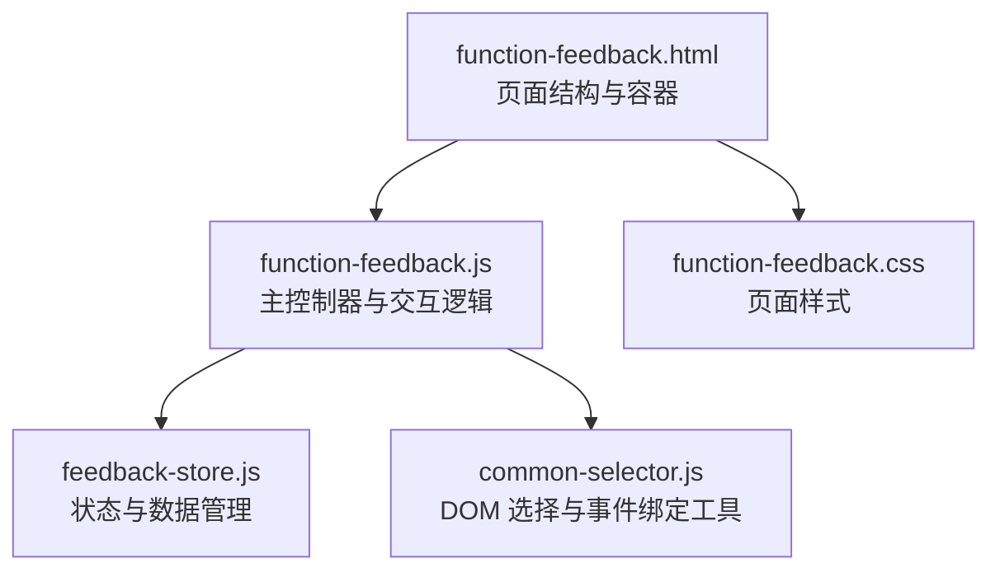
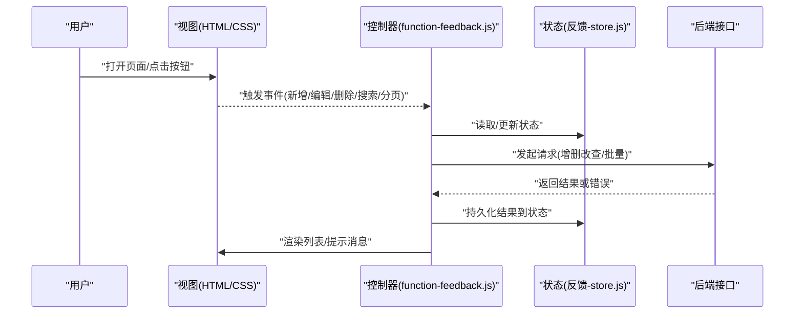
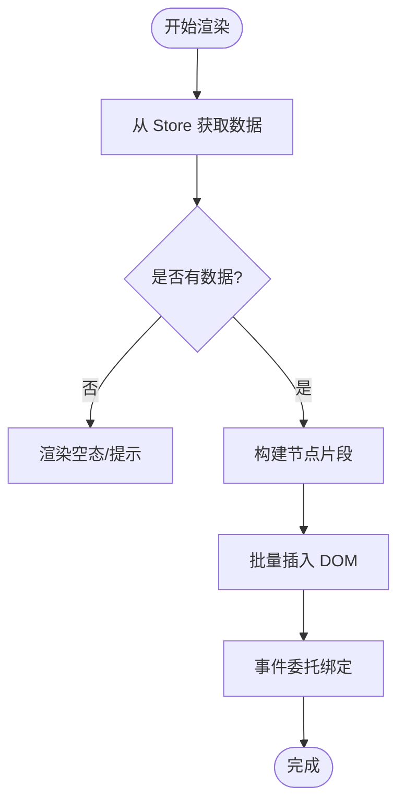
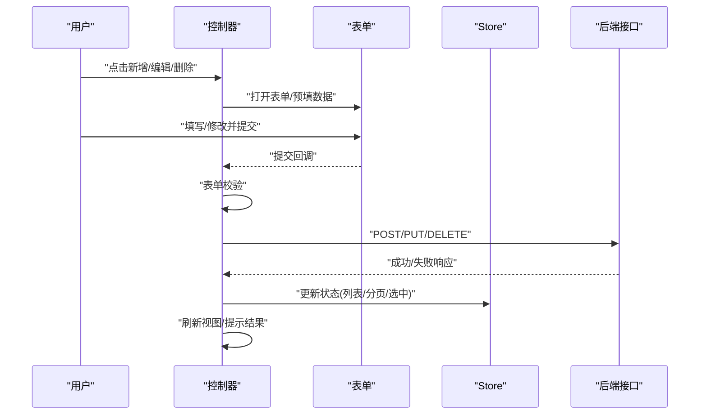
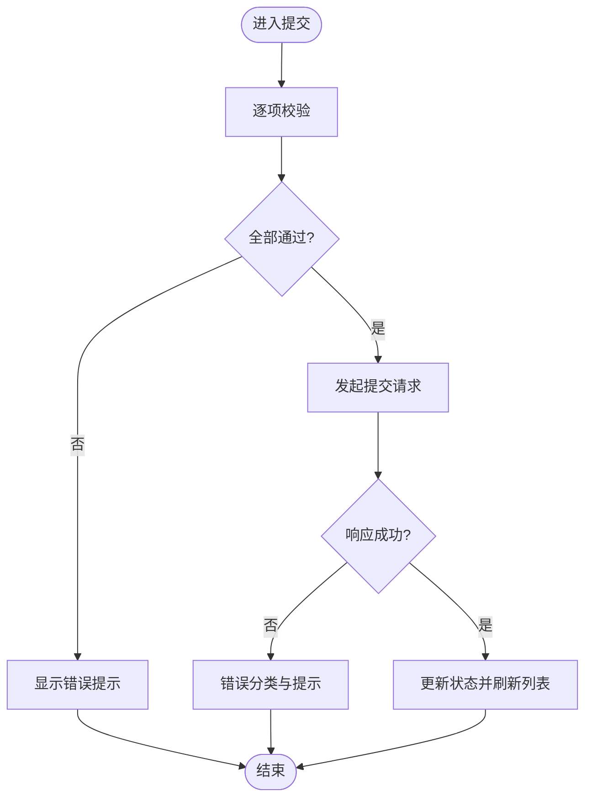
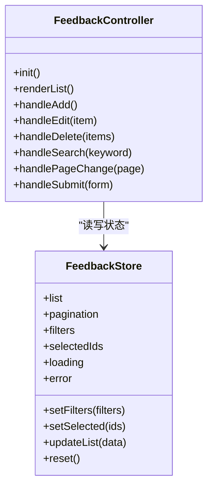
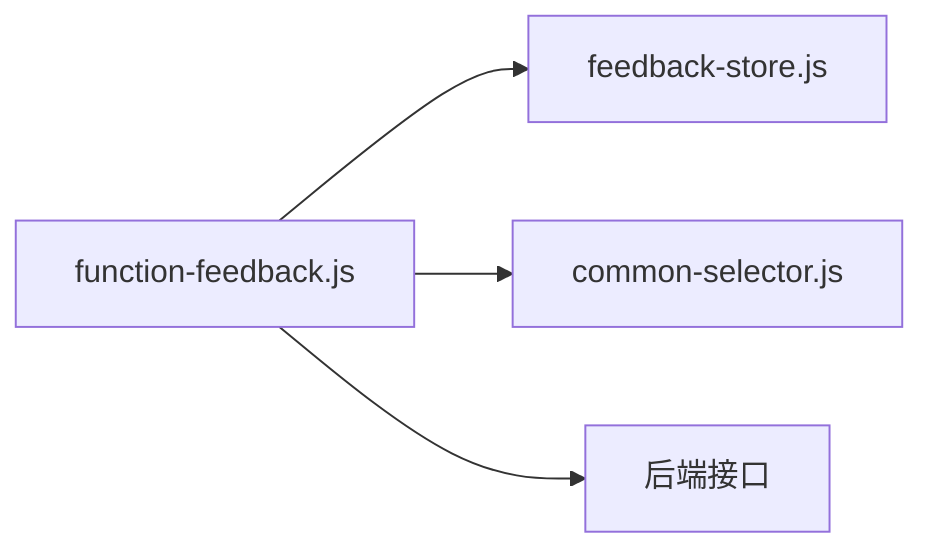

# 主反馈页面

<cite>
**本文引用的文件**   
- [function-feedback.js](file://app/js/function-feedback.js)
- [function-feedback.html](file://app/function-feedback.html)
- [function-feedback.css](file://app/css/function-feedback.css)
- [feedback-store.js](file://app/js/feedback-store.js)
- [common-selector.js](file://app/js/common-selector.js)
</cite>

## 目录
1. [简介](#简介)
2. [项目结构](#项目结构)
3. [核心组件](#核心组件)
4. [架构总览](#架构总览)
5. [详细组件分析](#详细组件分析)
6. [依赖分析](#依赖分析)
7. [性能考虑](#性能考虑)
8. [故障排查指南](#故障排查指南)
9. [结论](#结论)
10. [附录](#附录)

## 简介
本文件为 MG-Mini 主反馈页面的技术文档，聚焦 function-feedback.js 的核心业务逻辑与实现细节。内容涵盖：
- 反馈列表渲染机制
- 用户交互处理（新增、编辑、删除）
- 表单验证与数据提交流程
- 页面状态管理与事件监听机制
- DOM 操作优化策略
- API 调用封装与错误处理
- 常见使用场景示例（批量操作、搜索过滤、分页加载）

该文档旨在帮助开发者快速理解并扩展主反馈功能，同时为运维与测试提供清晰的排障指引。

## 项目结构
主反馈页面由 HTML 模板、样式表与 JavaScript 模块组成，并通过 store 与通用选择器工具进行解耦。

图表来源
- [function-feedback.html:1-200](file://app/function-feedback.html#L1-L200)
- [function-feedback.js:1-300](file://app/js/function-feedback.js#L1-L300)
- [feedback-store.js:1-200](file://app/js/feedback-store.js#L1-L200)
- [common-selector.js:1-150](file://app/js/common-selector.js#L1-L150)
- [function-feedback.css:1-200](file://app/css/function-feedback.css#L1-L200)

章节来源
- [function-feedback.html:1-200](file://app/function-feedback.html#L1-L200)
- [function-feedback.js:1-300](file://app/js/function-feedback.js#L1-L300)
- [feedback-store.js:1-200](file://app/js/feedback-store.js#L1-L200)
- [common-selector.js:1-150](file://app/js/common-selector.js#L1-L150)
- [function-feedback.css:1-200](file://app/css/function-feedback.css#L1-L200)

## 核心组件
- 页面控制器（function-feedback.js）
  - 负责初始化、事件绑定、列表渲染、表单校验、API 调用编排与错误提示
- 状态存储（feedback-store.js）
  - 集中管理反馈数据、筛选条件、分页参数、选中项集合等
- 通用选择器（common-selector.js）
  - 提供稳定的 DOM 选择与事件委托能力，减少重复查询与内存泄漏风险
- 页面模板与样式（function-feedback.html / function-feedback.css）
  - 定义列表容器、表单区域、分页控件与交互元素

章节来源
- [function-feedback.js:1-300](file://app/js/function-feedback.js#L1-L300)
- [feedback-store.js:1-200](file://app/js/feedback-store.js#L1-L200)
- [common-selector.js:1-150](file://app/js/common-selector.js#L1-L150)
- [function-feedback.html:1-200](file://app/function-feedback.html#L1-L200)
- [function-feedback.css:1-200](file://app/css/function-feedback.css#L1-L200)

## 架构总览
主反馈页面采用“控制器 + Store”的轻量 MVC 模式：
- 控制器负责 UI 行为与流程编排
- Store 负责数据与状态
- 通过事件驱动更新视图，避免直接耦合 DOM 与业务逻辑

图表来源
- [function-feedback.js:1-300](file://app/js/function-feedback.js#L1-L300)
- [feedback-store.js:1-200](file://app/js/feedback-store.js#L1-L200)

## 详细组件分析

### 列表渲染机制
- 数据源
  - 从 Store 获取当前页数据与分页元信息
- 渲染策略
  - 基于模板生成节点，优先复用已有节点，减少重排重绘
  - 对空态、加载中、错误态分别渲染占位与提示
- 性能优化
  - 使用 DocumentFragment 批量插入
  - 事件委托至容器，避免为每个条目绑定事件
  - 按需渲染（虚拟滚动可选）

图表来源
- [function-feedback.js:1-300](file://app/js/function-feedback.js#L1-L300)
- [feedback-store.js:1-200](file://app/js/feedback-store.js#L1-L200)

章节来源
- [function-feedback.js:1-300](file://app/js/function-feedback.js#L1-L300)
- [feedback-store.js:1-200](file://app/js/feedback-store.js#L1-L200)

### 用户交互处理（新增、编辑、删除）
- 新增
  - 打开表单弹窗 -> 校验输入 -> 提交 -> 成功后刷新列表与状态
- 编辑
  - 选中行 -> 回填表单 -> 校验 -> 提交 -> 成功后刷新
- 删除
  - 单选/多选 -> 二次确认 -> 调用删除接口 -> 成功后更新列表与选中集

图表来源
- [function-feedback.js:1-300](file://app/js/function-feedback.js#L1-L300)
- [feedback-store.js:1-200](file://app/js/feedback-store.js#L1-L200)

章节来源
- [function-feedback.js:1-300](file://app/js/function-feedback.js#L1-L300)
- [feedback-store.js:1-200](file://app/js/feedback-store.js#L1-L200)

### 表单验证与数据提交流程
- 校验规则
  - 必填字段、长度限制、格式校验（如邮箱/URL）、业务约束（如唯一性）
- 提交流程
  - 防抖提交、禁用按钮防止重复提交、统一错误聚合展示
- 错误处理
  - 网络异常、服务端校验失败、权限不足等分类提示

图表来源
- [function-feedback.js:1-300](file://app/js/function-feedback.js#L1-L300)

章节来源
- [function-feedback.js:1-300](file://app/js/function-feedback.js#L1-L300)

### 页面状态管理与事件监听机制
- 状态管理
  - 列表数据、分页参数、筛选条件、选中项集合、加载与错误标志
- 事件监听
  - 使用事件委托绑定列表操作、分页控件、搜索输入
  - 统一派发与处理，降低内存占用与事件风暴风险

图表来源
- [function-feedback.js:1-300](file://app/js/function-feedback.js#L1-L300)
- [feedback-store.js:1-200](file://app/js/feedback-store.js#L1-L200)

章节来源
- [function-feedback.js:1-300](file://app/js/function-feedback.js#L1-L300)
- [feedback-store.js:1-200](file://app/js/feedback-store.js#L1-L200)

### DOM 操作优化
- 批量插入与最小化重排
- 事件委托与一次性绑定
- 避免频繁 querySelectorAll，缓存常用节点引用
- 使用 requestAnimationFrame 或节流/防抖优化高频操作（搜索、滚动）

章节来源
- [function-feedback.js:1-300](file://app/js/function-feedback.js#L1-L300)
- [common-selector.js:1-150](file://app/js/common-selector.js#L1-L150)

### API 调用封装与错误处理策略
- 统一封装
  - 请求前拦截（鉴权、超时、重试）
  - 响应后处理（状态码解析、错误映射、数据归一化）
- 错误处理
  - 网络错误、业务错误、权限错误分类提示
  - 全局错误日志与上报
- 用户反馈
  - 成功提示、失败提示、加载指示

章节来源
- [function-feedback.js:1-300](file://app/js/function-feedback.js#L1-L300)

### 常见使用场景示例
- 批量操作
  - 全选/反选、批量删除、批量导出
  - 注意：批量操作需二次确认与进度提示
- 搜索过滤
  - 关键词搜索、多条件筛选、去抖输入
  - 建议：保留历史筛选条件，支持重置
- 分页加载
  - 页码切换、每页条数调整、跳转页码
  - 建议：保持选中状态跨页一致性

章节来源
- [function-feedback.js:1-300](file://app/js/function-feedback.js#L1-L300)
- [feedback-store.js:1-200](file://app/js/feedback-store.js#L1-L200)

## 依赖分析
- 内部依赖
  - feedback-store.js：状态与数据
  - common-selector.js：DOM 选择与事件工具
- 外部依赖
  - 浏览器原生 API（Fetch/Ajax、Event、DOM）
  - 第三方库（如有：UI 组件、HTTP 客户端、日志上报）

图表来源
- [function-feedback.js:1-300](file://app/js/function-feedback.js#L1-L300)
- [feedback-store.js:1-200](file://app/js/feedback-store.js#L1-L200)
- [common-selector.js:1-150](file://app/js/common-selector.js#L1-L150)

章节来源
- [function-feedback.js:1-300](file://app/js/function-feedback.js#L1-L300)
- [feedback-store.js:1-200](file://app/js/feedback-store.js#L1-L200)
- [common-selector.js:1-150](file://app/js/common-selector.js#L1-L150)

## 性能考虑
- 列表渲染
  - 虚拟滚动（大数据量时）
  - 增量更新与 diff 最小化
- 事件处理
  - 事件委托与节流/防抖
- 网络请求
  - 合并请求、缓存策略、重试与退避
- 内存管理
  - 及时解绑事件、释放大对象引用

[本节为通用指导，不直接分析具体文件]

## 故障排查指南
- 常见问题
  - 列表不更新：检查 Store 是否被正确更新与触发渲染
  - 表单校验无效：检查校验规则与错误聚合展示
  - 接口报错：查看错误分类与日志输出
  - 事件失效：检查事件委托目标与动态节点绑定
- 调试建议
  - 在关键路径添加断点与日志
  - 使用浏览器 Network 面板检查请求与响应
  - 使用 Performance 面板分析渲染耗时

章节来源
- [function-feedback.js:1-300](file://app/js/function-feedback.js#L1-L300)

## 结论
主反馈页面以控制器与 Store 分离为核心，结合事件驱动与 DOM 优化，实现了稳定高效的反馈管理能力。通过统一的 API 封装与错误处理策略，提升了可维护性与用户体验。建议在后续迭代中引入虚拟滚动与更完善的缓存策略，以应对更大规模的数据场景。

[本节为总结，不直接分析具体文件]

## 附录
- 相关页面与样式
  - function-feedback.html：页面结构与容器
  - function-feedback.css：页面样式与交互状态
- 扩展方向
  - 增加国际化与主题切换
  - 增强审计日志与操作回放
  - 接入更多筛选维度与导出能力

章节来源
- [function-feedback.html:1-200](file://app/function-feedback.html#L1-L200)
- [function-feedback.css:1-200](file://app/css/function-feedback.css#L1-L200)