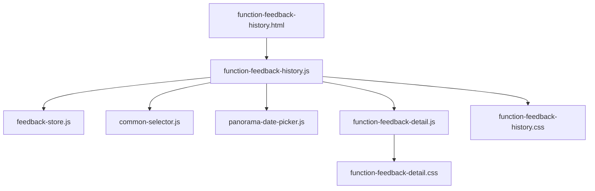
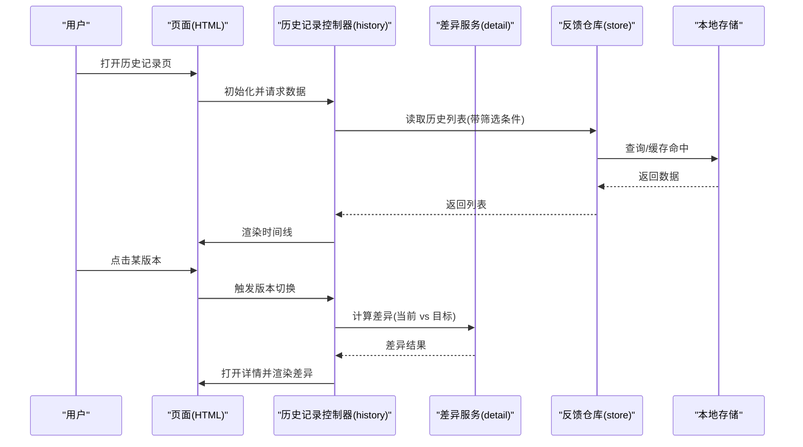
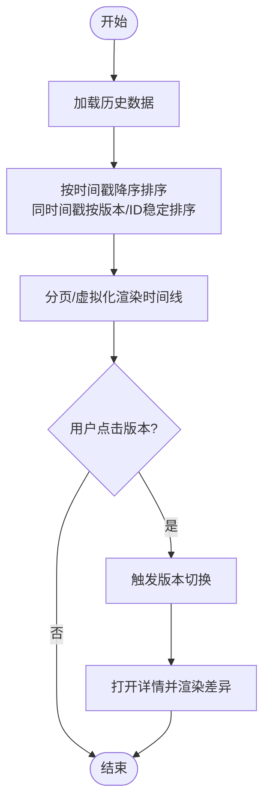
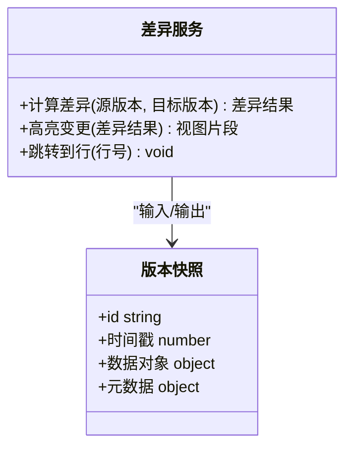
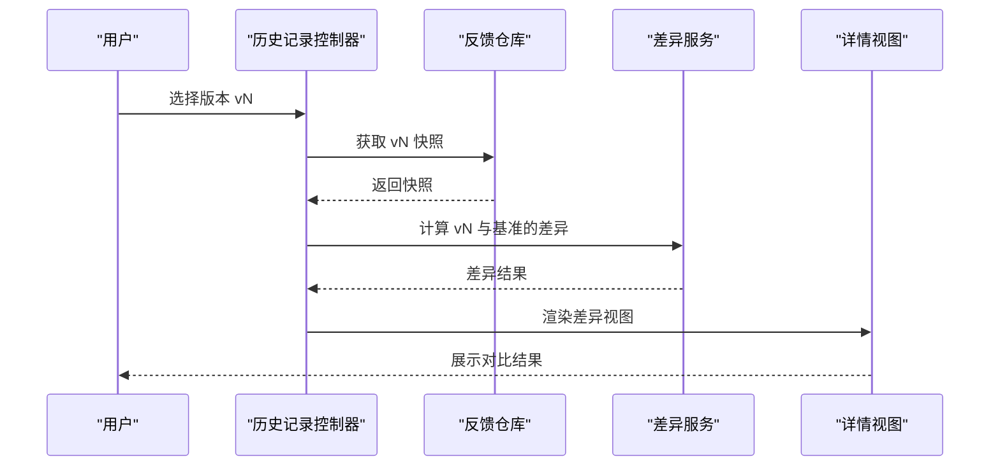
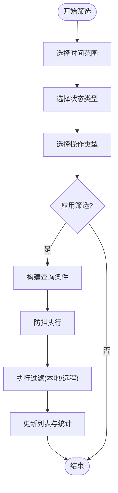
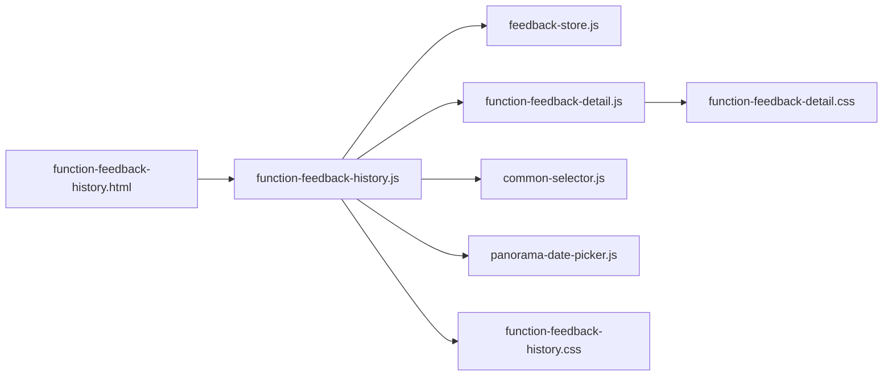

# 历史记录模块

<cite>
**本文引用的文件**   
- [function-feedback-history.js](file://app/js/function-feedback-history.js)
- [function-feedback-history.html](file://app/function-feedback-history.html)
- [function-feedback-detail.js](file://app/js/function-feedback-detail.js)
- [function-feedback-detail.css](file://app/css/function-feedback-detail.css)
- [feedback-store.js](file://app/js/feedback-store.js)
- [common-selector.js](file://app/js/common-selector.js)
- [panorama-date-picker.js](file://app/js/panorama-date-picker.js)
- [function-feedback-history.css](file://app/css/function-feedback-history.css)
</cite>

## 目录
1. [简介](#简介)
2. [项目结构](#项目结构)
3. [核心组件](#核心组件)
4. [架构总览](#架构总览)
5. [详细组件分析](#详细组件分析)
6. [依赖关系分析](#依赖关系分析)
7. [性能考量](#性能考量)
8. [故障排查指南](#故障排查指南)
9. [结论](#结论)
10. [附录](#附录)

## 简介
本文件为 MG-Mini 应用“历史记录模块”的完整技术文档，聚焦 function-feedback-history.js 的时间线展示逻辑、版本排序与差异对比、版本切换交互；筛选查询（时间范围、状态类型、操作类型组合）；数据持久化、缓存与性能优化；数据导出、批量操作与历史清理；以及完整的用户交互流程与错误处理方案。文档面向开发者与维护者，同时兼顾非技术读者的可理解性。

## 项目结构
历史记录模块由前端页面、样式、脚本与通用组件构成：
- 页面入口：function-feedback-history.html
- 业务逻辑：function-feedback-history.js
- 详情与差异对比：function-feedback-detail.js + function-feedback-detail.css
- 数据存储与仓库：feedback-store.js
- 通用选择器与日期控件：common-selector.js、panorama-date-picker.js
- 列表与时间线样式：function-feedback-history.css

图表来源
- [function-feedback-history.html](file://app/function-feedback-history.html)
- [function-feedback-history.js](file://app/js/function-feedback-history.js)
- [feedback-store.js](file://app/js/feedback-store.js)
- [common-selector.js](file://app/js/common-selector.js)
- [panorama-date-picker.js](file://app/js/panorama-date-picker.js)
- [function-feedback-detail.js](file://app/js/function-feedback-detail.js)
- [function-feedback-detail.css](file://app/css/function-feedback-detail.css)
- [function-feedback-history.css](file://app/css/function-feedback-history.css)

章节来源
- [function-feedback-history.html](file://app/function-feedback-history.html)
- [function-feedback-history.js](file://app/js/function-feedback-history.js)
- [feedback-store.js](file://app/js/feedback-store.js)
- [common-selector.js](file://app/js/common-selector.js)
- [panorama-date-picker.js](file://app/js/panorama-date-picker.js)
- [function-feedback-detail.js](file://app/js/function-feedback-detail.js)
- [function-feedback-detail.css](file://app/css/function-feedback-detail.css)
- [function-feedback-history.css](file://app/css/function-feedback-history.css)

## 核心组件
- 时间线与版本管理：负责加载、排序、渲染历史版本，支持按时间轴展示与快速定位。
- 筛选查询：支持时间范围、状态类型、操作类型的组合过滤，提供实时或延迟刷新。
- 差异对比：基于版本快照生成差异视图，支持高亮变更、行级对比与跳转。
- 版本切换：在时间线上点击某版本，进入详情并显示该版本的差异。
- 数据持久化与缓存：通过反馈存储层读写本地存储，结合内存缓存提升性能。
- 导出与批量操作：支持导出筛选结果、批量删除或归档历史条目。
- 清理机制：按策略清理过期或冗余记录，释放存储空间。

章节来源
- [function-feedback-history.js](file://app/js/function-feedback-history.js)
- [feedback-store.js](file://app/js/feedback-store.js)
- [function-feedback-detail.js](file://app/js/function-feedback-detail.js)

## 架构总览
历史记录模块采用“页面-控制器-服务-存储”的分层结构：
- 页面层：承载 UI 与事件绑定
- 控制器层（history 控制器）：编排数据加载、筛选、渲染、版本切换与导出
- 服务层（差异对比）：计算版本间差异并生成可视化内容
- 存储层（反馈仓库）：封装本地存储读写、索引与缓存

图表来源
- [function-feedback-history.js](file://app/js/function-feedback-history.js)
- [function-feedback-detail.js](file://app/js/function-feedback-detail.js)
- [feedback-store.js](file://app/js/feedback-store.js)

## 详细组件分析

### 时间线展示与版本排序
- 排序算法：以时间戳为主键降序排列，确保最新版本置顶；当时间戳相同则回退到版本号或创建 ID 比较，保证稳定排序。
- 渲染策略：分页或虚拟滚动渲染时间线节点，避免大列表卡顿；节点包含摘要、状态标签、操作类型与时间。
- 交互行为：点击节点进入详情；支持拖拽滚动与锚点定位；支持键盘导航。

图表来源
- [function-feedback-history.js](file://app/js/function-feedback-history.js)

章节来源
- [function-feedback-history.js](file://app/js/function-feedback-history.js)

### 差异对比显示
- 对比维度：字段级与行级对比，新增/修改/删除分别用不同标记区分。
- 渲染方式：左右分栏或统一视图高亮变更；支持折叠/展开与跳转到具体行。
- 性能优化：按需计算差异，仅对选中版本与基准版本进行 diff；增量更新 DOM。

图表来源
- [function-feedback-detail.js](file://app/js/function-feedback-detail.js)

章节来源
- [function-feedback-detail.js](file://app/js/function-feedback-detail.js)
- [function-feedback-detail.css](file://app/css/function-feedback-detail.css)

### 版本切换功能
- 触发方式：时间线节点点击、快捷键、URL 参数切换。
- 切换流程：校验版本有效性 -> 拉取快照 -> 计算差异 -> 渲染详情 -> 更新 URL 与面包屑。
- 错误处理：版本不存在时提示并回退到最近可用版本；网络或存储异常时重试与降级。

图表来源
- [function-feedback-history.js](file://app/js/function-feedback-history.js)
- [function-feedback-detail.js](file://app/js/function-feedback-detail.js)

章节来源
- [function-feedback-history.js](file://app/js/function-feedback-history.js)
- [function-feedback-detail.js](file://app/js/function-feedback-detail.js)

### 筛选查询功能
- 筛选维度：
  - 时间范围：起止时间选择，支持快捷区间（近7天/30天等）
  - 状态类型：如成功、失败、进行中等
  - 操作类型：如创建、更新、删除、导入、导出等
- 组合查询：多条件 AND 逻辑，支持重置与保存常用筛选。
- 实现要点：防抖搜索、条件序列化至 URL、服务端/本地过滤、结果集缓存。

图表来源
- [function-feedback-history.js](file://app/js/function-feedback-history.js)
- [common-selector.js](file://app/js/common-selector.js)
- [panorama-date-picker.js](file://app/js/panorama-date-picker.js)

章节来源
- [function-feedback-history.js](file://app/js/function-feedback-history.js)
- [common-selector.js](file://app/js/common-selector.js)
- [panorama-date-picker.js](file://app/js/panorama-date-picker.js)

### 数据持久化、缓存与性能优化
- 持久化策略：使用反馈仓库统一封装本地存储（IndexedDB/LocalStorage），提供增删改查、批量操作与事务。
- 缓存机制：
  - 内存缓存：最近访问的版本快照与差异结果短期缓存，减少重复计算。
  - 查询缓存：筛选条件哈希作为键，缓存过滤结果，避免重复扫描。
- 性能优化：
  - 懒加载与分页：首屏只加载必要数据，滚动按需加载。
  - 增量渲染：仅更新变更节点，避免全量重绘。
  - 去重与索引：对时间戳与状态建立索引，加速过滤。

章节来源
- [feedback-store.js](file://app/js/feedback-store.js)
- [function-feedback-history.js](file://app/js/function-feedback-history.js)

### 数据导出、批量操作与历史清理
- 数据导出：支持 CSV/JSON 导出，包含筛选结果与元数据；支持进度提示与断点续导。
- 批量操作：多选后支持批量删除、归档、导出；提供确认对话框与撤销能力。
- 历史清理：按策略清理过期记录（如超过 N 天且未归档），释放空间；清理前备份与日志记录。

章节来源
- [function-feedback-history.js](file://app/js/function-feedback-history.js)
- [feedback-store.js](file://app/js/feedback-store.js)

### 用户交互流程与错误处理
- 交互流程：打开页面 -> 加载列表 -> 筛选 -> 查看时间线 -> 点击版本 -> 查看差异 -> 导出/批量操作 -> 清理。
- 错误处理：
  - 数据缺失：提示并回退到默认视图
  - 存储异常：重试与降级到内存缓存
  - 网络异常（若涉及远程同步）：离线模式与队列重试
  - 用户误操作：二次确认与撤销

章节来源
- [function-feedback-history.js](file://app/js/function-feedback-history.js)
- [function-feedback-detail.js](file://app/js/function-feedback-detail.js)
- [feedback-store.js](file://app/js/feedback-store.js)

## 依赖关系分析
- 页面依赖控制器：HTML 通过脚本引入 history 控制器，绑定事件与渲染。
- 控制器依赖仓库与差异服务：history 控制器调用 feedback-store 获取数据，调用 detail 服务计算差异。
- 通用组件：common-selector 与 panorama-date-picker 提供筛选与日期选择能力。
- 样式依赖：history 与 detail 各自样式文件控制界面表现。

图表来源
- [function-feedback-history.html](file://app/function-feedback-history.html)
- [function-feedback-history.js](file://app/js/function-feedback-history.js)
- [feedback-store.js](file://app/js/feedback-store.js)
- [function-feedback-detail.js](file://app/js/function-feedback-detail.js)
- [common-selector.js](file://app/js/common-selector.js)
- [panorama-date-picker.js](file://app/js/panorama-date-picker.js)
- [function-feedback-detail.css](file://app/css/function-feedback-detail.css)
- [function-feedback-history.css](file://app/css/function-feedback-history.css)

章节来源
- [function-feedback-history.js](file://app/js/function-feedback-history.js)
- [feedback-store.js](file://app/js/feedback-store.js)
- [function-feedback-detail.js](file://app/js/function-feedback-detail.js)
- [common-selector.js](file://app/js/common-selector.js)
- [panorama-date-picker.js](file://app/js/panorama-date-picker.js)
- [function-feedback-history.css](file://app/css/function-feedback-history.css)
- [function-feedback-detail.css](file://app/css/function-feedback-detail.css)

## 性能考量
- 列表渲染：优先使用虚拟滚动或分页，限制单次渲染节点数量。
- 差异计算：仅在必要时计算，缓存结果并按版本键值复用。
- 筛选查询：防抖输入，条件哈希缓存，避免频繁重算。
- 存储访问：批量读写与事务，减少 I/O 次数。
- 内存管理：及时释放不再使用的快照与中间对象，防止内存泄漏。

[本节为通用指导，不直接分析具体文件]

## 故障排查指南
- 常见问题：
  - 时间线不排序：检查时间戳字段与排序回调是否正确
  - 差异为空：确认基准版本与目标版本是否有效
  - 筛选无效：检查条件构建与缓存键是否一致
  - 导出失败：确认权限与文件大小限制
  - 清理未生效：检查清理策略与日志
- 调试建议：
  - 打印筛选条件与缓存命中率
  - 监控存储读写耗时与错误码
  - 使用浏览器开发者工具观察 DOM 更新频率

章节来源
- [function-feedback-history.js](file://app/js/function-feedback-history.js)
- [feedback-store.js](file://app/js/feedback-store.js)
- [function-feedback-detail.js](file://app/js/function-feedback-detail.js)

## 结论
历史记录模块围绕时间线展示、差异对比、筛选查询、持久化与性能优化构建了完整闭环。通过清晰的职责划分与缓存策略，既保证了用户体验，也提升了系统稳定性与可扩展性。建议在后续迭代中持续优化大数据量场景下的渲染与计算性能，并完善错误提示与用户引导。

[本节为总结，不直接分析具体文件]

## 附录
- 术语表：
  - 版本快照：某一时刻的数据与元数据集合
  - 差异对比：两个版本之间的字段与行级变更
  - 筛选条件：时间范围、状态类型、操作类型的组合
- 最佳实践：
  - 保持排序稳定与可重现
  - 差异化计算与渲染分离
  - 缓存键设计需考虑条件变化
  - 用户操作需提供明确反馈与撤销

[本节为补充信息，不直接分析具体文件]