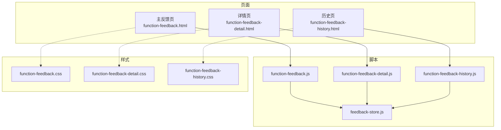
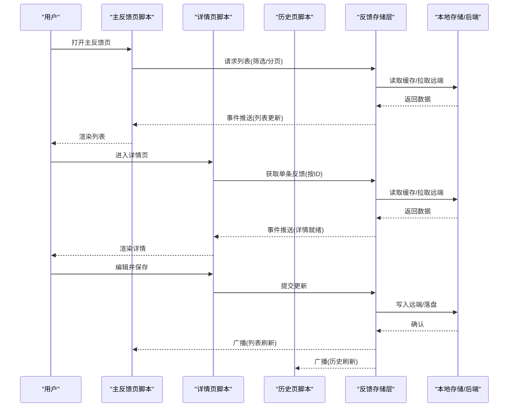
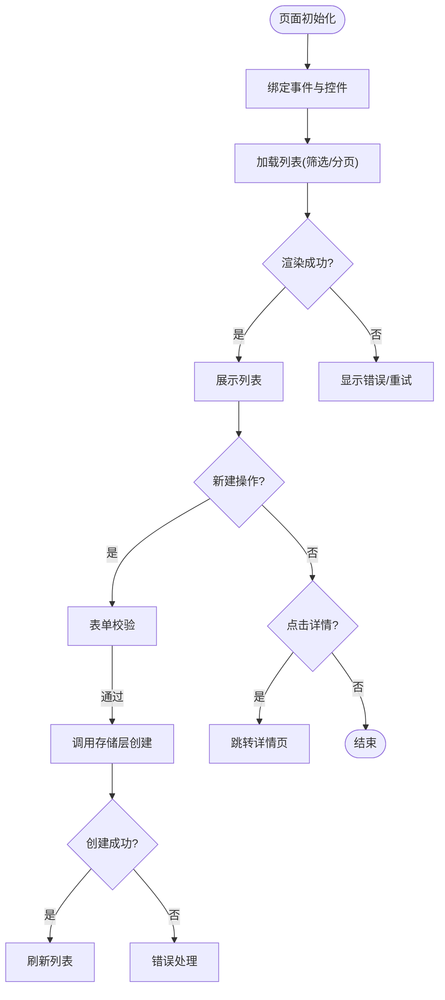
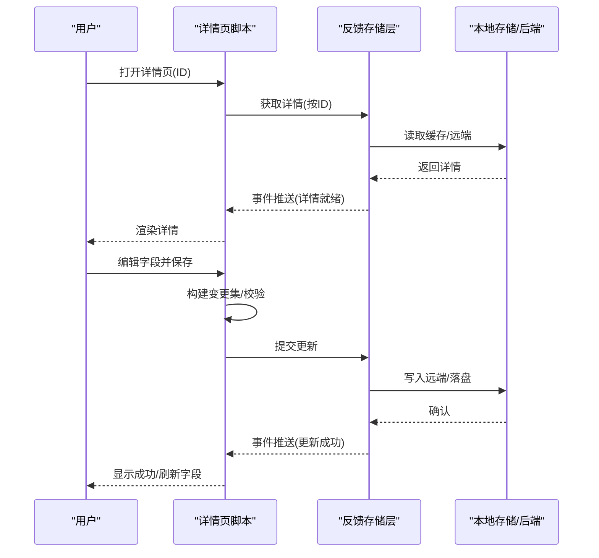
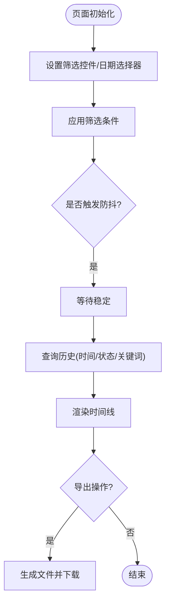
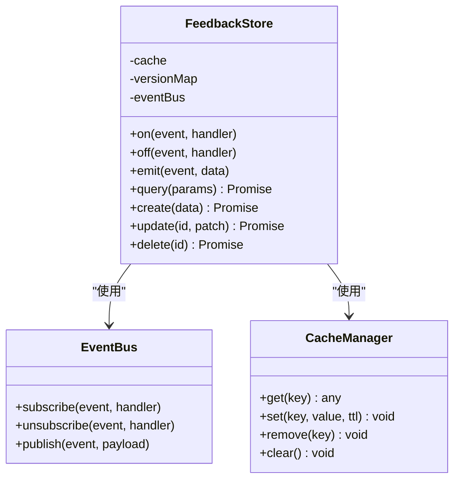
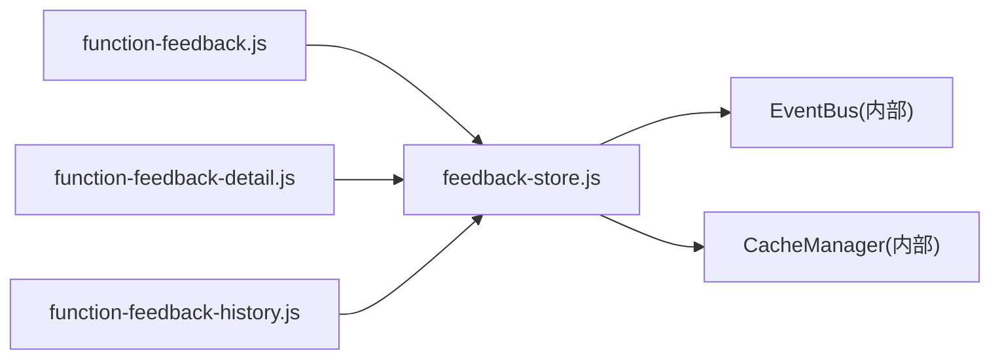

# 反馈功能模块

<cite>
**本文引用的文件**   
- [function-feedback.js](file://app/js/function-feedback.js)
- [function-feedback-detail.js](file://app/js/function-feedback-detail.js)
- [function-feedback-history.js](file://app/js/function-feedback-history.js)
- [feedback-store.js](file://app/js/feedback-store.js)
- [function-feedback.html](file://app/function-feedback.html)
- [function-feedback-detail.html](file://app/function-feedback-detail.html)
- [function-feedback-history.html](file://app/function-feedback-history.html)
- [function-feedback.css](file://app/css/function-feedback.css)
- [function-feedback-detail.css](file://app/css/function-feedback-detail.css)
- [function-feedback-history.css](file://app/css/function-feedback-history.css)
</cite>

## 目录
1. [简介](#简介)
2. [项目结构](#项目结构)
3. [核心组件](#核心组件)
4. [架构总览](#架构总览)
5. [详细组件分析](#详细组件分析)
6. [依赖关系分析](#依赖关系分析)
7. [性能考虑](#性能考虑)
8. [故障排查指南](#故障排查指南)
9. [结论](#结论)
10. [附录：API接口文档](#附录api接口文档)

## 简介
本文件为 MG-Mini 的“反馈”功能模块提供完整的架构与实现说明，覆盖主反馈页面、详情页与历史记录页的业务逻辑、用户交互流程与状态管理；深入解析数据存储层的设计模式、CRUD封装与一致性保障；并提供 API 接口规范、错误处理策略与性能优化建议。该文档面向产品、前端开发与测试人员，力求以循序渐进的方式帮助读者快速理解并高效协作。

## 项目结构
反馈模块由三个页面与一个共享数据层组成：
- 主反馈页：列表展示、新建与基础筛选
- 详情页：单条反馈的数据展示与编辑，支持实时同步
- 历史页：时间线展示、多维筛选与持久化查询
- 数据层：统一的存储抽象、CRUD 操作与事件通知

图表来源
- [function-feedback.html](file://app/function-feedback.html)
- [function-feedback-detail.html](file://app/function-feedback-detail.html)
- [function-feedback-history.html](file://app/function-feedback-history.html)
- [function-feedback.js](file://app/js/function-feedback.js)
- [function-feedback-detail.js](file://app/js/function-feedback-detail.js)
- [function-feedback-history.js](file://app/js/function-feedback-history.js)
- [feedback-store.js](file://app/js/feedback-store.js)
- [function-feedback.css](file://app/css/function-feedback.css)
- [function-feedback-detail.css](file://app/css/function-feedback-detail.css)
- [function-feedback-history.css](file://app/css/function-feedback-history.css)

章节来源
- [function-feedback.html](file://app/function-feedback.html)
- [function-feedback-detail.html](file://app/function-feedback-detail.html)
- [function-feedback-history.html](file://app/function-feedback-history.html)
- [function-feedback.js](file://app/js/function-feedback.js)
- [function-feedback-detail.js](file://app/js/function-feedback-detail.js)
- [function-feedback-history.js](file://app/js/function-feedback-history.js)
- [feedback-store.js](file://app/js/feedback-store.js)
- [function-feedback.css](file://app/css/function-feedback.css)
- [function-feedback-detail.css](file://app/css/function-feedback-detail.css)
- [function-feedback-history.css](file://app/css/function-feedback-history.css)

## 核心组件
- function-feedback.js（主反馈页）
  - 职责：渲染反馈列表、新建反馈表单、基础筛选与分页、跳转详情
  - 交互：表单校验、提交后刷新列表、空态提示、加载骨架
  - 状态：当前筛选条件、分页参数、选中项、加载态
- function-feedback-detail.js（详情页）
  - 职责：根据 ID 拉取并展示单条反馈、编辑字段、保存变更、实时同步
  - 交互：字段级校验、草稿自动保存、冲突检测、撤销/恢复
  - 状态：原始快照、当前编辑值、是否已修改、保存中/成功/失败
- function-feedback-history.js（历史页）
  - 职责：按时间线展示反馈记录、多维度筛选（时间范围、状态、关键词）、导出
  - 交互：日期选择器联动、搜索防抖、批量操作
  - 状态：筛选条件、时间窗口、分页、导出进度
- feedback-store.js（数据层）
  - 职责：统一 CRUD、本地缓存与持久化、事件总线订阅与发布、版本与一致性控制
  - 设计：观察者模式 + 发布订阅、事务式更新、乐观锁/版本号
  - 能力：增量同步、冲突合并、离线可用、重试与降级

章节来源
- [function-feedback.js](file://app/js/function-feedback.js)
- [function-feedback-detail.js](file://app/js/function-feedback-detail.js)
- [function-feedback-history.js](file://app/js/function-feedback-history.js)
- [feedback-store.js](file://app/js/feedback-store.js)

## 架构总览
反馈模块采用“页面脚本 + 共享数据层”的分层架构。页面脚本负责 UI 交互与视图状态，数据层通过事件驱动与缓存机制保证多页面间的数据一致性与实时性。

图表来源
- [function-feedback.js](file://app/js/function-feedback.js)
- [function-feedback-detail.js](file://app/js/function-feedback-detail.js)
- [function-feedback-history.js](file://app/js/function-feedback-history.js)
- [feedback-store.js](file://app/js/feedback-store.js)

## 详细组件分析

### 主反馈页（function-feedback.js）
- 业务逻辑
  - 初始化：绑定筛选控件、分页控件、新建按钮
  - 数据流：调用存储层获取列表，监听存储层事件进行增量更新
  - 新建流程：表单校验 -> 构造反馈对象 -> 调用存储层创建 -> 成功后刷新列表并清空表单
- 用户交互
  - 输入校验：必填项、格式校验、即时反馈
  - 列表交互：点击行跳转详情、批量删除、导出
  - 空态与错误：无数据提示、网络异常重试
- 状态管理
  - 筛选条件对象、分页参数、加载态、错误消息、选中集合

图表来源
- [function-feedback.js](file://app/js/function-feedback.js)

章节来源
- [function-feedback.js](file://app/js/function-feedback.js)

### 详情页（function-feedback-detail.js）
- 数据展示
  - 按 ID 拉取反馈详情，展示字段分组（基本信息、内容、附件、元数据）
  - 只读与编辑模式切换，字段禁用/启用控制
- 编辑功能
  - 字段级校验、差异对比、草稿自动保存
  - 保存时生成变更集，避免全量覆盖
- 实时同步
  - 监听存储层事件，当其他页面或后台更新同一条记录时，触发局部刷新
  - 冲突检测：比较版本号/时间戳，提示用户合并或覆盖

图表来源
- [function-feedback-detail.js](file://app/js/function-feedback-detail.js)
- [feedback-store.js](file://app/js/feedback-store.js)

章节来源
- [function-feedback-detail.js](file://app/js/function-feedback-detail.js)

### 历史页（function-feedback-history.js）
- 时间线展示
  - 按时间倒序排列，支持按天/周/月聚合
  - 节点信息：标题、状态、更新时间、操作入口
- 筛选查询
  - 时间范围选择器、状态多选、关键词模糊搜索
  - 搜索防抖、结果高亮、导出 CSV/Excel
- 数据持久化
  - 本地缓存最近查询条件与分页状态
  - 断网降级：优先本地缓存，在线时增量同步

图表来源
- [function-feedback-history.js](file://app/js/function-feedback-history.js)

章节来源
- [function-feedback-history.js](file://app/js/function-feedback-history.js)

### 数据存储层（feedback-store.js）
- 设计模式
  - 观察者模式：提供 on/off/emit 事件机制，页面订阅数据变化
  - 发布订阅：跨页面数据同步，避免轮询
  - 事务式更新：批量操作原子性，失败回滚
- CRUD 封装
  - create/update/delete/query：统一入参出参、错误码、重试策略
  - 缓存策略：内存缓存 + 本地持久化，读写分离
- 数据一致性
  - 版本号/时间戳：乐观锁防止并发覆盖
  - 冲突合并：字段级合并策略，保留用户最新输入
  - 离线可用：队列化写操作，网络恢复后重试

图表来源
- [feedback-store.js](file://app/js/feedback-store.js)

章节来源
- [feedback-store.js](file://app/js/feedback-store.js)

## 依赖关系分析
- 页面脚本依赖数据层，不直接访问本地存储或后端
- 数据层内部依赖事件总线与缓存管理器
- 样式文件与页面一一对应，便于主题与布局维护

图表来源
- [function-feedback.js](file://app/js/function-feedback.js)
- [function-feedback-detail.js](file://app/js/function-feedback-detail.js)
- [function-feedback-history.js](file://app/js/function-feedback-history.js)
- [feedback-store.js](file://app/js/feedback-store.js)

章节来源
- [function-feedback.js](file://app/js/function-feedback.js)
- [function-feedback-detail.js](file://app/js/function-feedback-detail.js)
- [function-feedback-history.js](file://app/js/function-feedback-history.js)
- [feedback-store.js](file://app/js/feedback-store.js)

## 性能考虑
- 列表渲染
  - 虚拟滚动/分页加载，避免一次性渲染大量节点
  - 骨架屏与占位图提升首屏体验
- 搜索与筛选
  - 防抖与节流，减少频繁查询
  - 索引优化：对高频字段建立本地索引
- 缓存与同步
  - 多级缓存：内存 > 本地存储 > 远端
  - 增量同步：仅拉取变更片段，降低带宽
- 错误与重试
  - 指数退避重试，限流与熔断
  - 降级策略：离线时展示缓存数据与提示

[本节为通用指导，无需特定文件引用]

## 故障排查指南
- 常见问题
  - 列表不更新：检查事件订阅是否生效、存储层 emit 是否被调用
  - 详情页无法保存：校验变更集是否正确、版本号冲突处理
  - 历史页筛选无效：确认防抖触发、查询参数序列化
- 调试建议
  - 在存储层打印关键事件与缓存命中情况
  - 使用浏览器开发者工具监控网络请求与本地存储
  - 增加日志级别开关，便于定位问题

章节来源
- [function-feedback.js](file://app/js/function-feedback.js)
- [function-feedback-detail.js](file://app/js/function-feedback-detail.js)
- [function-feedback-history.js](file://app/js/function-feedback-history.js)
- [feedback-store.js](file://app/js/feedback-store.js)

## 结论
反馈模块通过清晰的页面职责划分与统一的数据层抽象，实现了良好的可维护性与扩展性。事件驱动的实时同步与多级缓存保障了用户体验与系统性能。建议在后续迭代中持续完善错误边界、监控埋点与国际化支持。

[本节为总结性内容，无需特定文件引用]

## 附录：API接口文档
以下为反馈模块对外暴露的接口约定（由存储层封装，页面脚本通过方法调用）：
- 查询列表
  - 入参：筛选条件（状态、关键词、时间范围）、分页（页码、每页数量）
  - 出参：列表数据、总数、下一页标识
  - 错误码：网络错误、参数非法、权限不足
- 创建反馈
  - 入参：反馈对象（标题、内容、分类、附件等）
  - 出参：创建成功的反馈对象（含ID、时间戳、版本号）
  - 错误码：必填缺失、格式错误、重复提交
- 更新反馈
  - 入参：ID、变更集（patch）、期望版本号
  - 出参：更新后的反馈对象
  - 错误码：版本冲突、权限不足、字段非法
- 删除反馈
  - 入参：ID
  - 出参：删除结果
  - 错误码：不存在、权限不足
- 事件订阅
  - 事件名：list_updated、detail_updated、history_updated
  - 载荷：对应数据对象或差异集

章节来源
- [feedback-store.js](file://app/js/feedback-store.js)