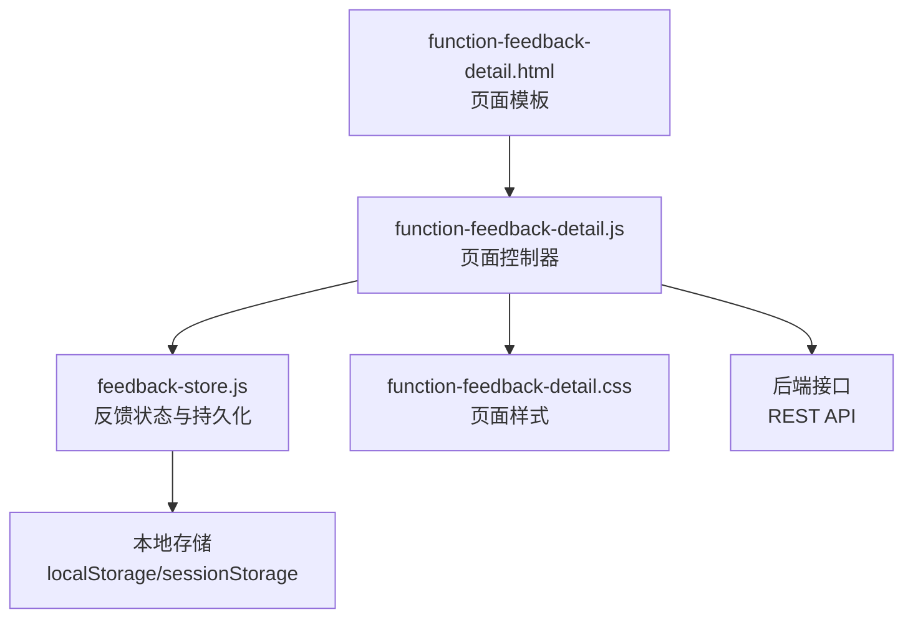
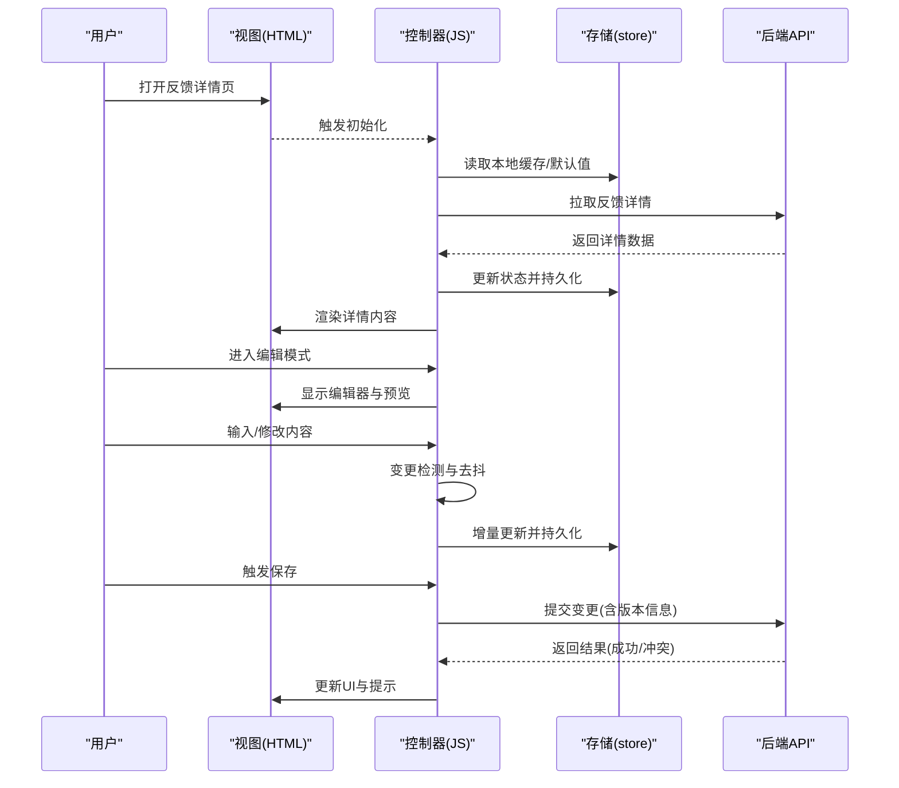
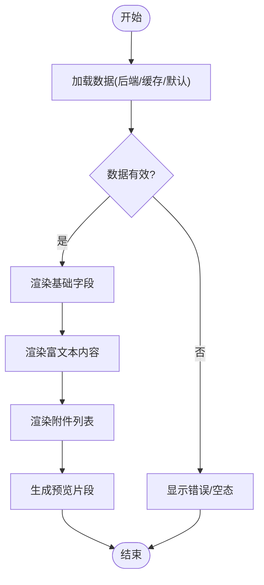
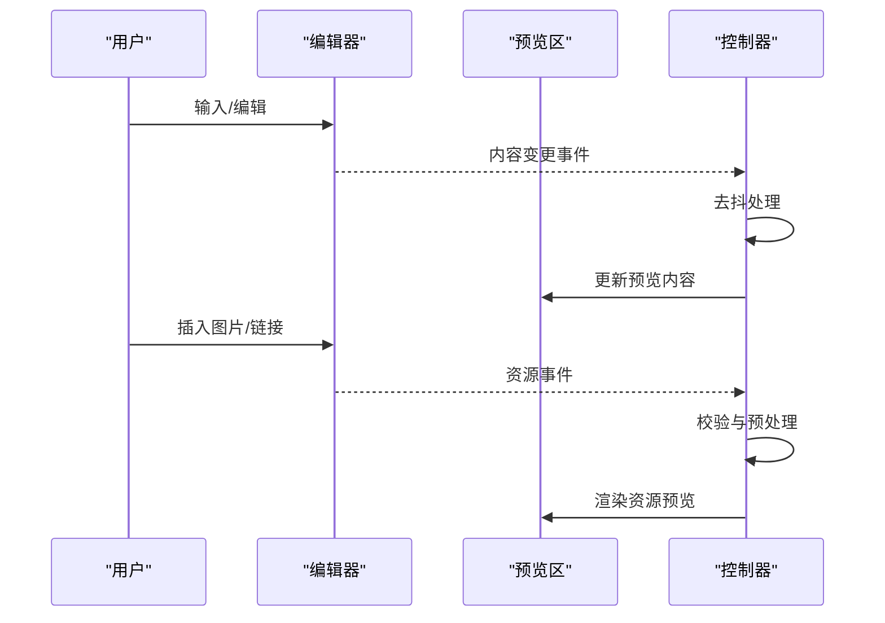
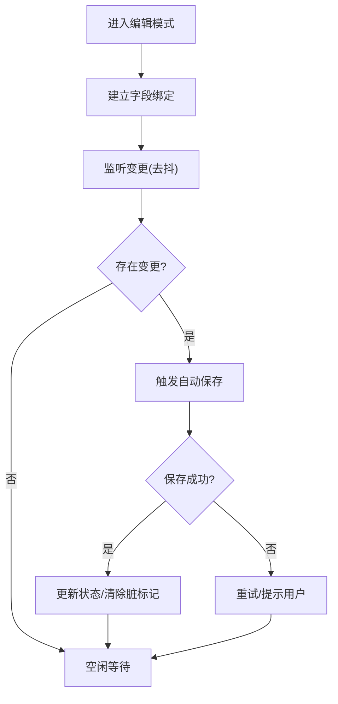
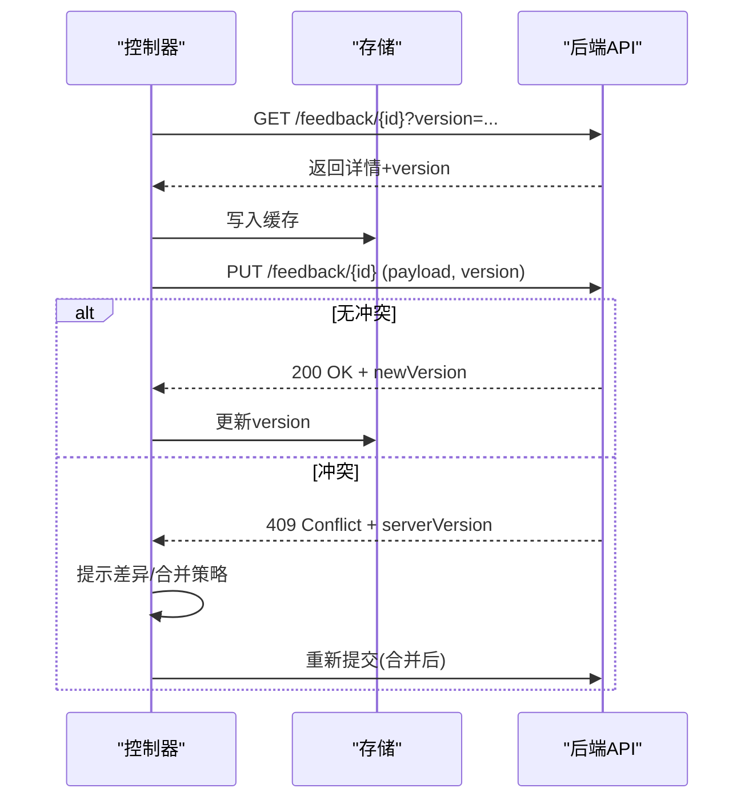
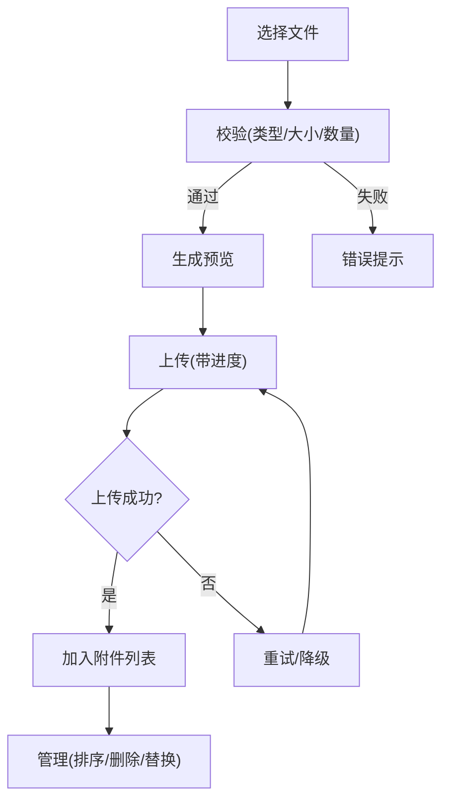
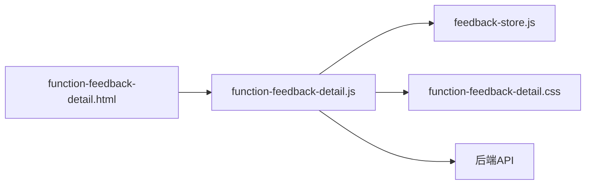

# 反馈详情页

<cite>
**本文引用的文件**   
- [function-feedback-detail.js](file://app/js/function-feedback-detail.js)
- [function-feedback-detail.html](file://app/function-feedback-detail.html)
- [function-feedback-detail.css](file://app/css/function-feedback-detail.css)
- [feedback-store.js](file://app/js/feedback-store.js)
</cite>

## 目录
1. [简介](#简介)
2. [项目结构](#项目结构)
3. [核心组件](#核心组件)
4. [架构总览](#架构总览)
5. [详细组件分析](#详细组件分析)
6. [依赖关系分析](#依赖关系分析)
7. [性能考量](#性能考量)
8. [故障排查指南](#故障排查指南)
9. [结论](#结论)
10. [附录](#附录)

## 简介
本文件为 MG-Mini 的“反馈详情页”提供系统化、可落地的技术文档。重点围绕 function-feedback-detail.js 的数据展示与交互逻辑，涵盖：
- 反馈详情信息的动态渲染
- 富文本编辑器集成与实时预览
- 编辑模式下的数据绑定、变更检测与自动保存
- 与后端的数据同步策略、冲突解决与版本控制
- 文件上传、图片预览与附件管理
- 表单验证规则、错误处理与用户体验优化

## 项目结构
反馈详情页由 HTML 模板、样式与 JS 逻辑组成，并通过反馈存储模块进行状态管理与持久化。

图表来源
- [function-feedback-detail.html:1-200](file://app/function-feedback-detail.html#L1-L200)
- [function-feedback-detail.js:1-300](file://app/js/function-feedback-detail.js#L1-L300)
- [feedback-store.js:1-200](file://app/js/feedback-store.js#L1-L200)
- [function-feedback-detail.css:1-200](file://app/css/function-feedback-detail.css#L1-L200)

章节来源
- [function-feedback-detail.html:1-200](file://app/function-feedback-detail.html#L1-L200)
- [function-feedback-detail.js:1-300](file://app/js/function-feedback-detail.js#L1-L300)
- [feedback-store.js:1-200](file://app/js/feedback-store.js#L1-L200)
- [function-feedback-detail.css:1-200](file://app/css/function-feedback-detail.css#L1-L200)

## 核心组件
- 页面控制器（function-feedback-detail.js）
  - 负责 DOM 初始化、事件绑定、数据加载与渲染、富文本编辑器集成、实时预览、编辑模式切换、变更检测与自动保存、文件上传与预览、表单校验与错误提示。
- 反馈存储（feedback-store.js）
  - 提供统一的反馈数据模型、状态管理、变更追踪、本地持久化与并发访问保护。
- 页面模板（function-feedback-detail.html）
  - 定义反馈详情布局、富文本编辑器容器、预览区域、附件列表与操作按钮等。
- 样式（function-feedback-detail.css）
  - 定义编辑器、预览区、附件卡片、错误提示与响应式布局样式。

章节来源
- [function-feedback-detail.js:1-300](file://app/js/function-feedback-detail.js#L1-L300)
- [feedback-store.js:1-200](file://app/js/feedback-store.js#L1-L200)
- [function-feedback-detail.html:1-200](file://app/function-feedback-detail.html#L1-L200)
- [function-feedback-detail.css:1-200](file://app/css/function-feedback-detail.css#L1-L200)

## 架构总览
反馈详情页采用“控制器 + 存储 + 模板”的分层架构：
- 控制器负责 UI 行为与业务编排
- 存储负责数据模型与持久化
- 模板负责结构与占位
- 通过 REST API 与后端同步

图表来源
- [function-feedback-detail.js:1-300](file://app/js/function-feedback-detail.js#L1-L300)
- [feedback-store.js:1-200](file://app/js/feedback-store.js#L1-L200)

## 详细组件分析

### 数据展示与动态渲染
- 数据源优先级：后端详情 > 本地缓存 > 默认值
- 渲染流程：解析字段 -> 填充模板节点 -> 处理富文本内容 -> 生成预览片段 -> 附加列表渲染
- 关键职责：
  - 字段映射与类型转换
  - 富文本内容的转义与安全渲染
  - 空态与错误态的 UI 呈现

章节来源
- [function-feedback-detail.js:1-300](file://app/js/function-feedback-detail.js#L1-L300)
- [function-feedback-detail.html:1-200](file://app/function-feedback-detail.html#L1-L200)

### 富文本编辑器集成与实时预览
- 集成要点：
  - 编辑器实例初始化与销毁
  - 内容双向绑定（编辑器 <-> 预览）
  - 工具栏事件监听与自定义扩展
  - 粘贴过滤与 XSS 防护
- 实时预览：
  - 输入去抖（防抖时间建议 200-300ms）
  - 增量更新预览区域
  - 滚动位置保持与焦点管理

章节来源
- [function-feedback-detail.js:1-300](file://app/js/function-feedback-detail.js#L1-L300)
- [function-feedback-detail.html:1-200](file://app/function-feedback-detail.html#L1-L200)

### 编辑模式的数据绑定、变更检测与自动保存
- 数据绑定：
  - 单向绑定用于只读展示，双向绑定用于编辑态
  - 字段级绑定与批量绑定结合
- 变更检测：
  - 基于对象快照对比或脏标记机制
  - 支持撤销/重做栈（可选）
- 自动保存：
  - 输入停止后延迟保存（如 1s）
  - 网络失败重试与降级策略
  - 冲突时提示用户合并或覆盖

章节来源
- [function-feedback-detail.js:1-300](file://app/js/function-feedback-detail.js#L1-L300)
- [feedback-store.js:1-200](file://app/js/feedback-store.js#L1-L200)

### 与后端的数据同步、冲突解决与版本控制
- 同步策略：
  - 首次加载拉取详情，后续增量提交
  - 离线优先：本地缓存 + 队列异步同步
- 冲突解决：
  - 服务端版本号（ETag/Last-Modified/自定义 version）
  - 客户端检测到冲突时，提示差异合并或强制覆盖
- 幂等性：
  - 使用唯一请求 ID 避免重复提交
  - 服务端对同一请求幂等处理

章节来源
- [function-feedback-detail.js:1-300](file://app/js/function-feedback-detail.js#L1-L300)
- [feedback-store.js:1-200](file://app/js/feedback-store.js#L1-L200)

### 文件上传、图片预览与附件管理
- 上传流程：
  - 选择文件 -> 校验（大小、类型、数量）-> 生成预览 -> 分片/直传 -> 进度反馈 -> 成功后加入附件列表
- 预览能力：
  - 图片预览（缩略图/大图查看）
  - 视频/音频预览（浏览器原生控件）
  - 文档预览（在线预览或下载）
- 附件管理：
  - 排序、重命名、删除、替换
  - 断点续传与失败重试
  - 多端一致性（云端与本地列表同步）

章节来源
- [function-feedback-detail.js:1-300](file://app/js/function-feedback-detail.js#L1-L300)
- [function-feedback-detail.html:1-200](file://app/function-feedback-detail.html#L1-L200)

### 表单验证规则、错误处理与用户体验优化
- 验证规则：
  - 必填项、长度范围、格式校验（邮箱、URL、日期等）
  - 富文本内容安全校验（过滤危险标签/脚本）
  - 附件限制（类型、大小、数量）
- 错误处理：
  - 即时校验与失焦校验
  - 统一错误提示（顶部/行内/气泡）
  - 网络异常重试与降级提示
- 体验优化：
  - 骨架屏与占位符
  - 操作反馈（成功/失败 Toast）
  - 快捷键与无障碍支持（可选）

章节来源
- [function-feedback-detail.js:1-300](file://app/js/function-feedback-detail.js#L1-L300)
- [function-feedback-detail.css:1-200](file://app/css/function-feedback-detail.css#L1-L200)

## 依赖关系分析
- 页面控制器依赖：
  - 反馈存储模块（状态与持久化）
  - DOM 模板（HTML）
  - 样式（CSS）
  - 后端接口（REST）
- 耦合与内聚：
  - 控制器高内聚于页面交互编排
  - 存储模块低耦合，便于单元测试与复用
- 外部依赖：
  - 富文本编辑器库（按需引入）
  - 文件上传组件（按需引入）

图表来源
- [function-feedback-detail.js:1-300](file://app/js/function-feedback-detail.js#L1-L300)
- [feedback-store.js:1-200](file://app/js/feedback-store.js#L1-L200)
- [function-feedback-detail.html:1-200](file://app/function-feedback-detail.html#L1-L200)
- [function-feedback-detail.css:1-200](file://app/css/function-feedback-detail.css#L1-L200)

章节来源
- [function-feedback-detail.js:1-300](file://app/js/function-feedback-detail.js#L1-L300)
- [feedback-store.js:1-200](file://app/js/feedback-store.js#L1-L200)

## 性能考量
- 渲染性能：
  - 虚拟滚动（长列表附件）
  - 懒加载与按需渲染
  - 富文本内容增量更新
- 网络性能：
  - 请求合并与去抖
  - 缓存策略（强缓存/协商缓存）
  - 大文件分片上传与并行
- 内存管理：
  - 及时释放编辑器实例与事件监听
  - 避免闭包泄漏

[本节为通用指导，不直接分析具体文件]

## 故障排查指南
- 常见问题定位：
  - 数据未渲染：检查数据源与字段映射
  - 编辑器无法输入：检查实例初始化与事件绑定
  - 自动保存失败：检查网络状态与重试策略
  - 附件上传失败：检查类型/大小限制与服务器响应
- 调试建议：
  - 开启控制台日志与网络面板
  - 使用断点跟踪变更检测与保存流程
  - 模拟冲突场景验证合并逻辑

章节来源
- [function-feedback-detail.js:1-300](file://app/js/function-feedback-detail.js#L1-L300)
- [feedback-store.js:1-200](file://app/js/feedback-store.js#L1-L200)

## 结论
反馈详情页以清晰的层次与职责划分，实现了从数据加载、富文本编辑、实时预览到自动保存与附件管理的完整闭环。通过版本控制与冲突解决机制，保障了多端协作的一致性与可靠性。建议在后续迭代中持续优化性能与可用性，提升用户体验。

[本节为总结性内容，不直接分析具体文件]

## 附录
- 术语说明：
  - 富文本编辑器：支持图文混排、媒体嵌入的文本编辑组件
  - 变更检测：比较前后数据差异以触发最小化更新
  - 版本控制：通过版本号或时间戳保证数据一致性
- 最佳实践：
  - 明确数据流向与边界条件
  - 强化错误提示与用户引导
  - 重视可测试性与可维护性

[本节为补充信息，不直接分析具体文件]