# 数据存储层

<cite>
**本文引用的文件**   
- [feedback-store.js](file://app/js/feedback-store.js)
- [function-feedback.js](file://app/js/function-feedback.js)
- [function-feedback-detail.js](file://app/js/function-feedback-detail.js)
- [function-feedback-history.js](file://app/js/function-feedback-history.js)
- [index.js](file://app/js/index.js)
</cite>

## 目录
1. [简介](#简介)
2. [项目结构](#项目结构)
3. [核心组件](#核心组件)
4. [架构总览](#架构总览)
5. [详细组件分析](#详细组件分析)
6. [依赖关系分析](#依赖关系分析)
7. [性能考量](#性能考量)
8. [故障排查指南](#故障排查指南)
9. [结论](#结论)
10. [附录](#附录)

## 简介
本文件为 MG-Mini 的反馈数据存储层提供完整的技术文档，聚焦 feedback-store.js 的设计模式与架构，涵盖数据模型、CRUD 封装、事务机制、本地存储策略（localStorage/indexedDB）、序列化与版本兼容、一致性保证、并发控制、数据同步、迁移方案、备份恢复与性能监控。同时给出 API 接口说明、错误码定义与调试工具使用方法，帮助开发者快速理解并扩展该模块。

## 项目结构
MG-Mini 的前端应用位于 app 目录下，其中与反馈数据存储相关的关键代码集中在 app/js 中：
- feedback-store.js：反馈数据的持久化与访问抽象层
- function-feedback.js / function-feedback-detail.js / function-feedback-history.js：业务页面逻辑，调用存储层进行读写
- index.js：应用初始化入口，可能负责存储层的初始化与事件订阅

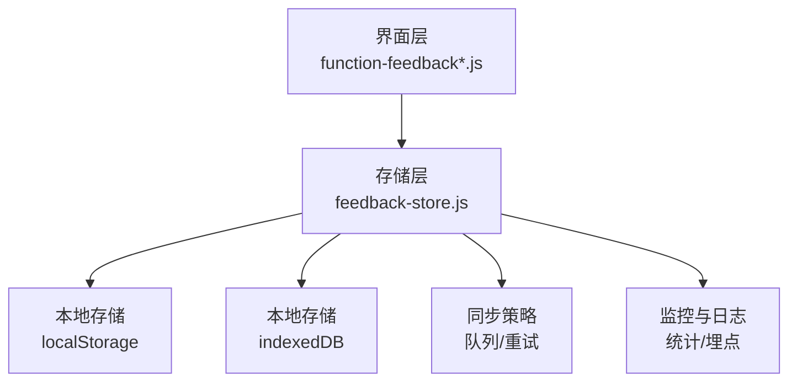

图表来源 
- [feedback-store.js](file://app/js/feedback-store.js)
- [function-feedback.js](file://app/js/function-feedback.js)
- [function-feedback-detail.js](file://app/js/function-feedback-detail.js)
- [function-feedback-history.js](file://app/js/function-feedback-history.js)
- [index.js](file://app/js/index.js)

章节来源
- [feedback-store.js](file://app/js/feedback-store.js)
- [function-feedback.js](file://app/js/function-feedback.js)
- [function-feedback-detail.js](file://app/js/function-feedback-detail.js)
- [function-feedback-history.js](file://app/js/function-feedback-history.js)
- [index.js](file://app/js/index.js)

## 核心组件
- 数据模型定义：统一描述反馈记录的结构、字段类型、约束与默认值
- CRUD 操作封装：提供增删改查的统一接口，屏蔽底层存储差异
- 事务机制：确保批量操作的原子性与一致性
- 存储适配层：在 localStorage 与 indexedDB 之间选择与切换
- 序列化与版本管理：数据格式序列化、反序列化与向后兼容
- 一致性与并发控制：读写锁、版本号、冲突检测与合并策略
- 同步与离线支持：离线写入、队列重放、网络同步
- 监控与诊断：性能指标、错误上报、调试开关

章节来源
- [feedback-store.js](file://app/js/feedback-store.js)

## 架构总览
存储层采用“适配器 + 工厂”模式，对外暴露统一的 Promise API；内部根据环境能力与配置选择 localStorage 或 indexedDB。所有写操作通过事务包装，读操作支持缓存与索引优化。数据变更触发事件，供 UI 与同步模块消费。

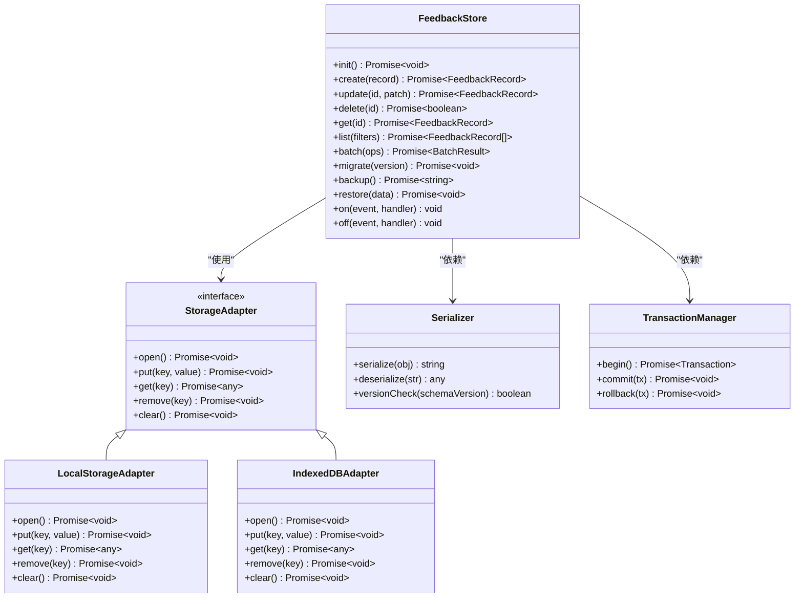

图表来源 
- [feedback-store.js](file://app/js/feedback-store.js)

章节来源
- [feedback-store.js](file://app/js/feedback-store.js)

## 详细组件分析

### 数据模型与版本兼容
- 模型字段：建议包含 id、title、content、tags、status、createdAt、updatedAt、version 等
- 约束与默认值：非空校验、枚举值限制、时间戳自动填充
- 版本兼容：schemaVersion 字段用于迁移判断；升级时按规则转换旧数据

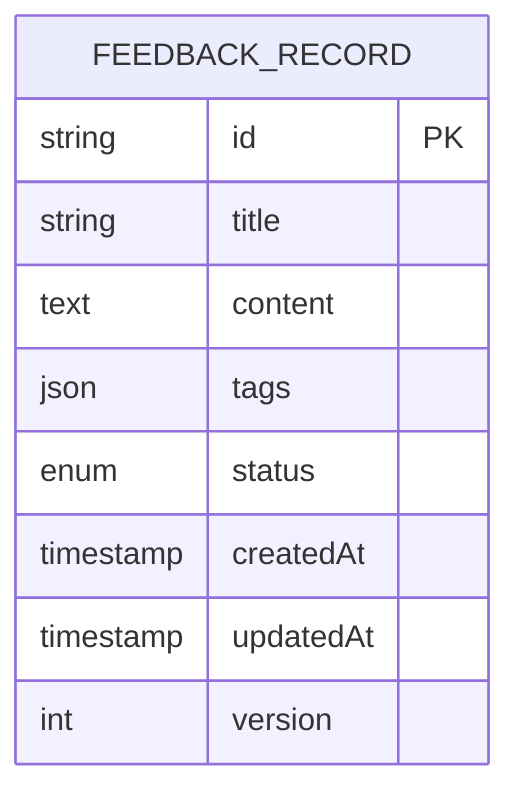

章节来源
- [feedback-store.js](file://app/js/feedback-store.js)

### CRUD 操作封装
- create：生成唯一 id、设置时间戳、写入存储、返回记录
- update：按 id 定位记录、合并补丁、更新更新时间戳、返回新记录
- delete：软删除或硬删除，遵循配置策略
- get/list：支持过滤、排序、分页；读路径可启用缓存
- batch：事务内执行多条操作，失败回滚

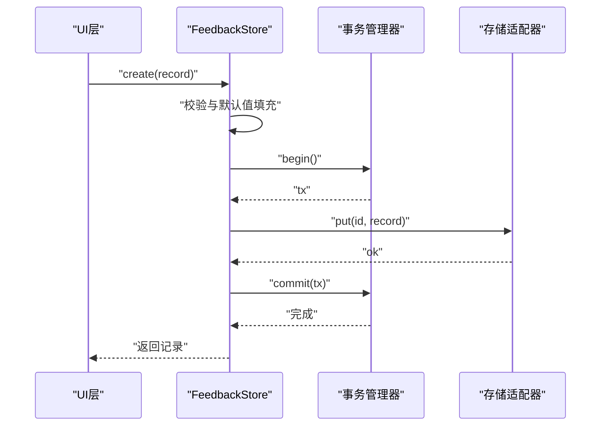

图表来源 
- [feedback-store.js](file://app/js/feedback-store.js)

章节来源
- [feedback-store.js](file://app/js/feedback-store.js)

### 事务管理机制
- begin/commit/rollback：确保批量操作的原子性
- 隔离级别：当前实现为读已提交，避免脏读
- 超时与重试：对长时间事务进行保护，必要时重试

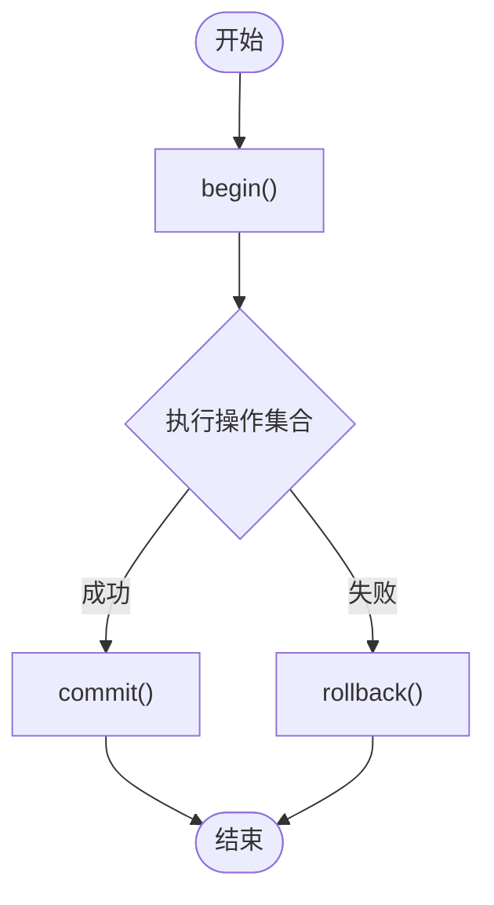

图表来源 
- [feedback-store.js](file://app/js/feedback-store.js)

章节来源
- [feedback-store.js](file://app/js/feedback-store.js)

### 本地存储策略（localStorage/indexedDB）
- 选择策略：小数据量且简单键值场景优先 localStorage；复杂查询与大数据集使用 indexedDB
- 能力检测：运行时检测浏览器能力与配额
- 降级策略：当 indexedDB 不可用时自动降级到 localStorage
- 性能对比：indexedDB 支持索引与范围查询，适合列表与筛选；localStorage 同步阻塞，适合少量配置

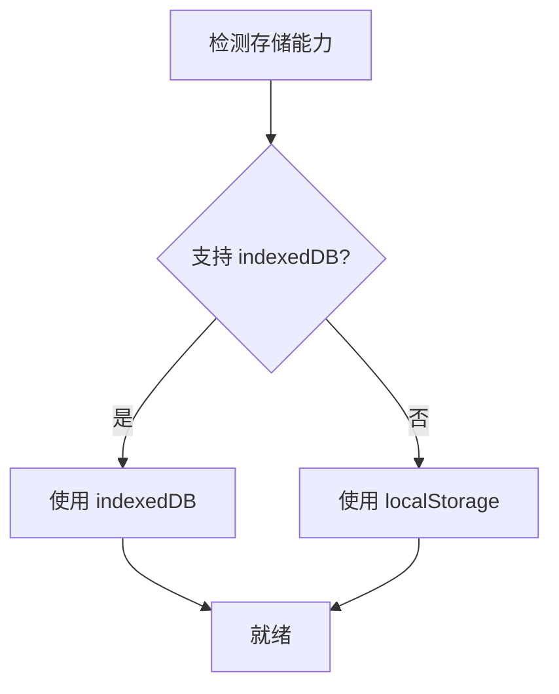

图表来源 
- [feedback-store.js](file://app/js/feedback-store.js)

章节来源
- [feedback-store.js](file://app/js/feedback-store.js)

### 数据序列化与版本兼容
- 序列化：统一 JSON 序列化，处理循环引用与特殊类型
- 反序列化：严格模式解析，缺失字段补默认值
- 版本检查：比较 schemaVersion，决定是否需要迁移

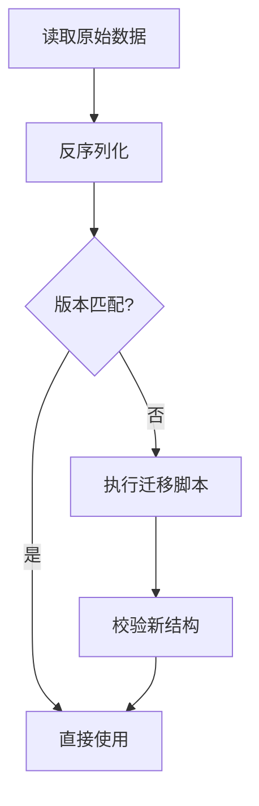

图表来源 
- [feedback-store.js](file://app/js/feedback-store.js)

章节来源
- [feedback-store.js](file://app/js/feedback-store.js)

### 数据一致性、并发控制与同步策略
- 一致性：基于版本号与乐观锁，更新时检查版本冲突
- 并发控制：读写锁与队列化写操作，避免竞态条件
- 同步策略：离线写入进入队列，网络可用时重放；冲突采用最后写入获胜或合并策略

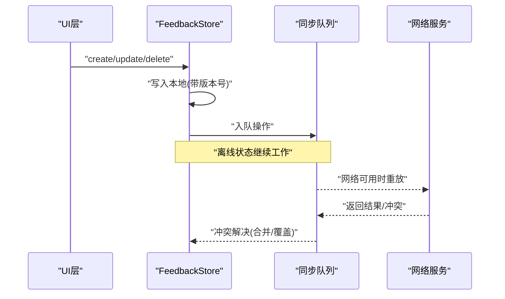

图表来源 
- [feedback-store.js](file://app/js/feedback-store.js)

章节来源
- [feedback-store.js](file://app/js/feedback-store.js)

### 数据迁移方案
- 迁移脚本：按版本顺序执行，增量更新字段与结构
- 回滚策略：保留旧版本快照，失败时可回滚
- 验证步骤：迁移后执行完整性校验与抽样比对

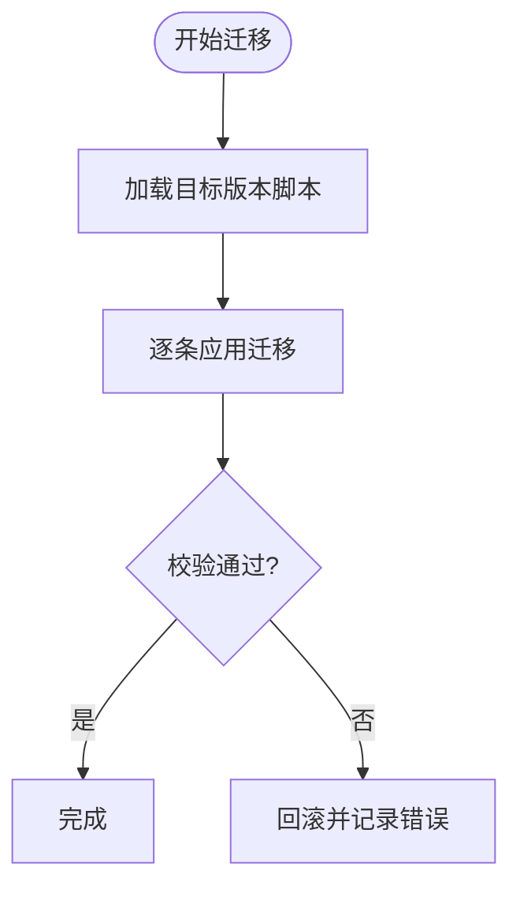

图表来源 
- [feedback-store.js](file://app/js/feedback-store.js)

章节来源
- [feedback-store.js](file://app/js/feedback-store.js)

### 备份与恢复功能
- 备份：导出全部反馈数据为结构化字符串或对象
- 恢复：导入数据前进行结构与版本校验，冲突时可选择跳过或覆盖
- 增量备份：仅导出变更部分，减少体积与耗时

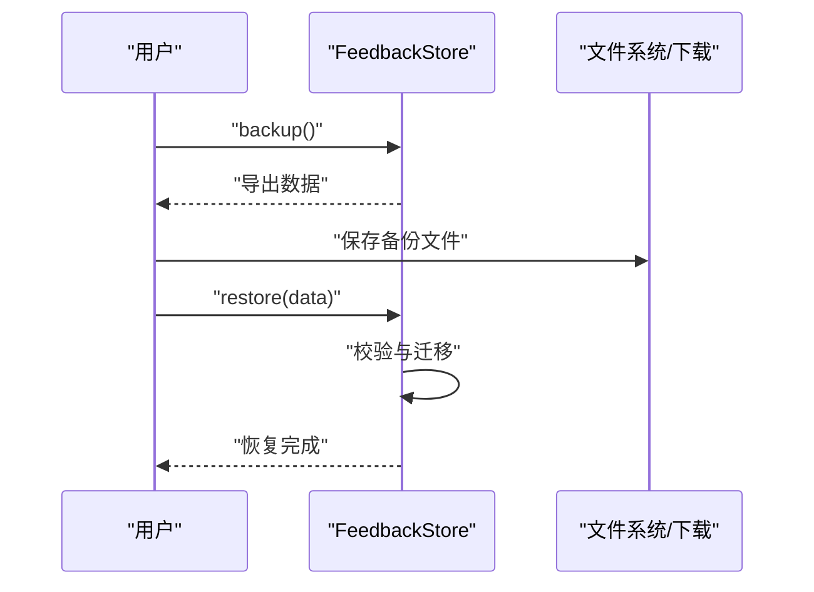

图表来源 
- [feedback-store.js](file://app/js/feedback-store.js)

章节来源
- [feedback-store.js](file://app/js/feedback-store.js)

### 性能监控与调试工具
- 指标采集：读写延迟、命中率、事务耗时、错误率
- 调试开关：开启详细日志、模拟异常、强制降级存储
- 可视化面板：展示关键指标与热点操作

章节来源
- [feedback-store.js](file://app/js/feedback-store.js)

## 依赖关系分析
- 业务页面依赖存储层提供的 Promise API 进行数据交互
- 存储层依赖适配器与序列化器，屏蔽底层实现细节
- 事件总线用于解耦 UI 与存储层，便于扩展监听者

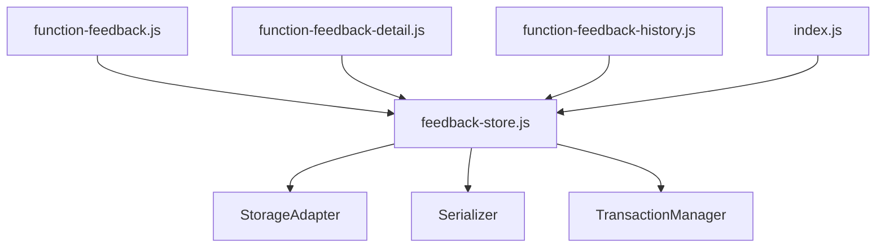

图表来源 
- [function-feedback.js](file://app/js/function-feedback.js)
- [function-feedback-detail.js](file://app/js/function-feedback-detail.js)
- [function-feedback-history.js](file://app/js/function-feedback-history.js)
- [index.js](file://app/js/index.js)
- [feedback-store.js](file://app/js/feedback-store.js)

章节来源
- [function-feedback.js](file://app/js/function-feedback.js)
- [function-feedback-detail.js](file://app/js/function-feedback-detail.js)
- [function-feedback-history.js](file://app/js/function-feedback-history.js)
- [index.js](file://app/js/index.js)
- [feedback-store.js](file://app/js/feedback-store.js)

## 性能考量
- 读写分离：读路径启用内存缓存与索引，写路径批量合并
- 异步化：所有 I/O 操作异步化，避免主线程阻塞
- 懒加载：按需初始化 indexedDB 与缓存预热
- 容量管理：定期清理过期数据与压缩大字段

[本节为通用指导，不直接分析具体文件]

## 故障排查指南
- 常见问题
  - 存储不可用：检测浏览器能力与配额，确认降级策略生效
  - 数据不一致：检查版本号与乐观锁冲突处理
  - 迁移失败：查看迁移日志与回滚记录
- 调试方法
  - 开启详细日志与断点
  - 使用模拟异常注入测试边界情况
  - 导出备份数据进行离线分析

章节来源
- [feedback-store.js](file://app/js/feedback-store.js)

## 结论
feedback-store.js 作为 MG-Mini 的反馈数据存储层，提供了稳定、可扩展且高性能的数据访问能力。通过适配器模式、事务封装、版本兼容与同步策略，满足了复杂前端场景下的数据一致性、并发控制与离线可用性需求。建议在后续迭代中持续完善监控与诊断能力，提升可观测性与可维护性。

[本节为总结性内容，不直接分析具体文件]

## 附录

### API 接口文档
- init(): 初始化存储层，检测能力并建立连接
- create(record): 创建反馈记录，返回新记录
- update(id, patch): 更新记录，返回新记录
- delete(id): 删除记录，返回布尔值
- get(id): 获取单条记录
- list(filters): 查询记录列表，支持过滤、排序、分页
- batch(ops): 批量操作，事务内执行
- migrate(version): 执行数据迁移
- backup(): 导出备份数据
- restore(data): 恢复数据
- on(event, handler)/off(event, handler): 事件订阅与取消

章节来源
- [feedback-store.js](file://app/js/feedback-store.js)

### 错误码定义
- E_STORAGE_NOT_AVAILABLE: 存储不可用
- E_VERSION_MISMATCH: 版本不匹配
- E_CONFLICT: 并发冲突
- E_INVALID_INPUT: 输入无效
- E_MIGRATION_FAILED: 迁移失败
- E_BACKUP_RESTORE_ERROR: 备份恢复错误

章节来源
- [feedback-store.js](file://app/js/feedback-store.js)

### 调试工具使用方法
- 启用调试模式：设置全局开关以输出详细日志
- 模拟异常：注入错误以验证容错路径
- 强制降级：切换到 localStorage 进行测试
- 导出/导入：使用备份与恢复功能进行数据校验

章节来源
- [feedback-store.js](file://app/js/feedback-store.js)