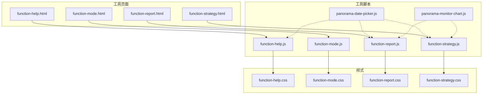
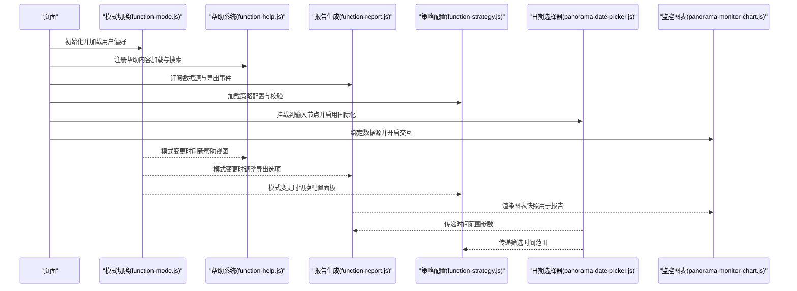
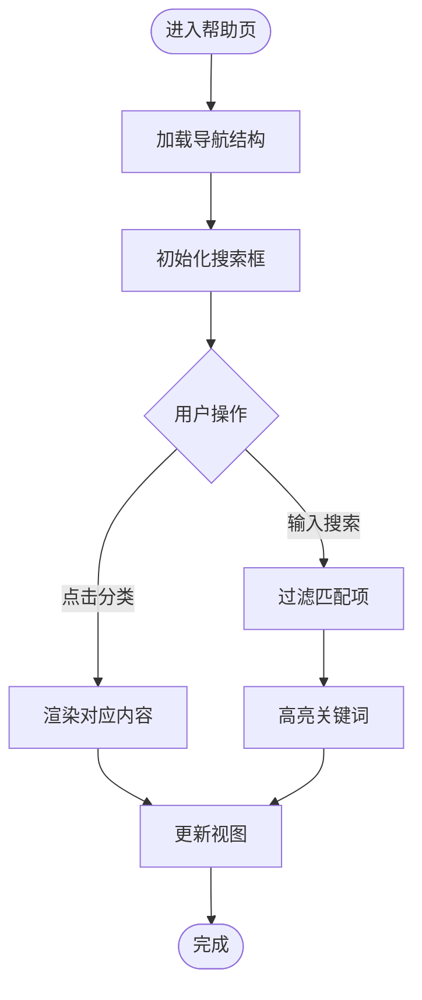
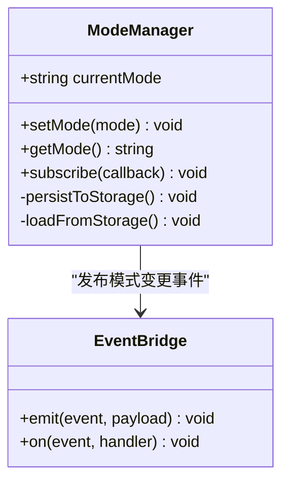
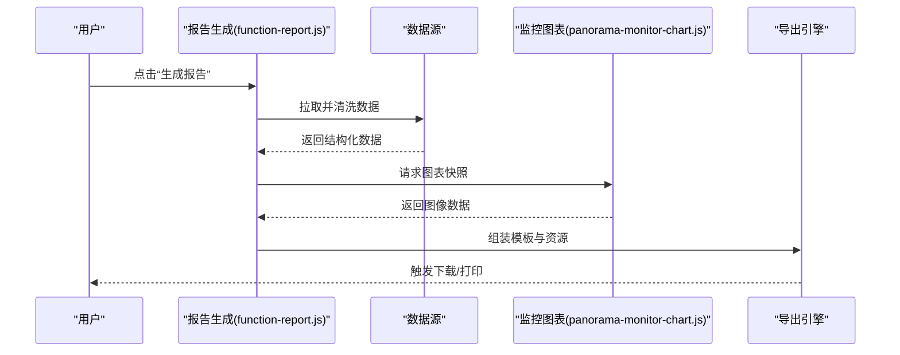
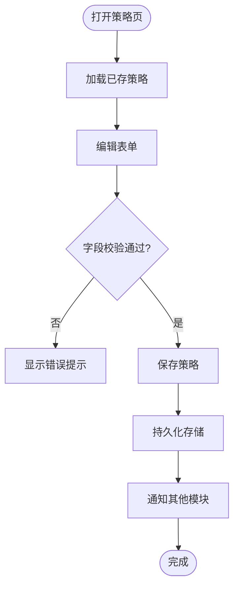
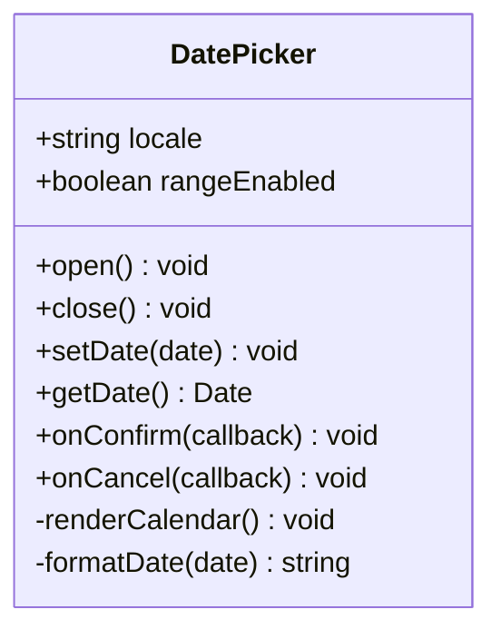
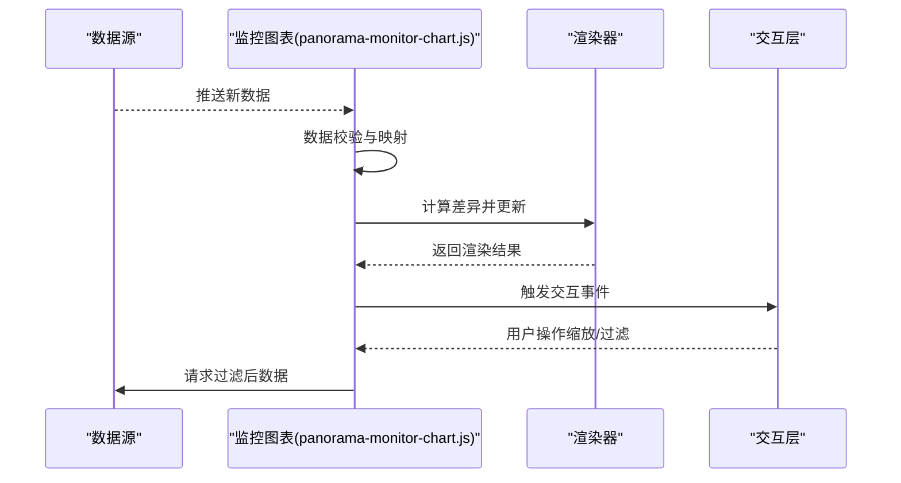
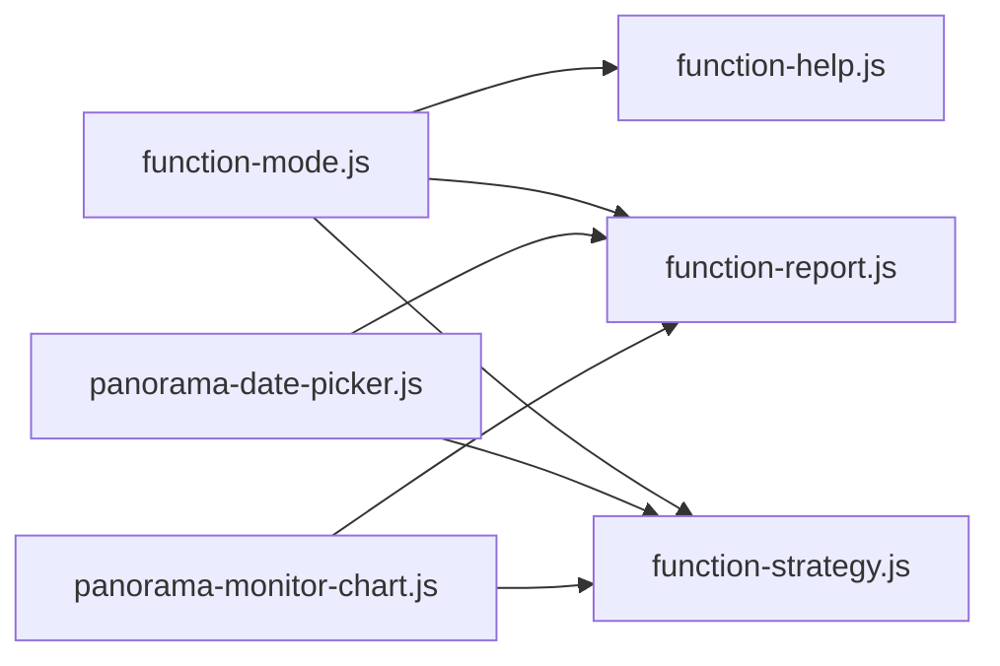

# 工具模块

<cite>
**本文引用的文件**   
- [function-help.js](file://app/js/function-help.js)
- [function-mode.js](file://app/js/function-mode.js)
- [function-report.js](file://app/js/function-report.js)
- [function-strategy.js](file://app/js/function-strategy.js)
- [panorama-date-picker.js](file://app/js/panorama-date-picker.js)
- [panorama-monitor-chart.js](file://app/js/panorama-monitor-chart.js)
- [function-help.html](file://app/function-help.html)
- [function-mode.html](file://app/function-mode.html)
- [function-report.html](file://app/function-report.html)
- [function-strategy.html](file://app/function-strategy.html)
- [function-help.css](file://app/css/function-help.css)
- [function-mode.css](file://app/css/function-mode.css)
- [function-report.css](file://app/css/function-report.css)
- [function-strategy.css](file://app/css/function-strategy.css)
</cite>

## 目录
1. [简介](#简介)
2. [项目结构](#项目结构)
3. [核心组件](#核心组件)
4. [架构总览](#架构总览)
5. [详细组件分析](#详细组件分析)
6. [依赖关系分析](#依赖关系分析)
7. [性能考量](#性能考量)
8. [故障排查指南](#故障排查指南)
9. [结论](#结论)
10. [附录：API参考与最佳实践](#附录api参考与最佳实践)

## 简介
本文件为 MG-Mini 工具模块的综合文档，聚焦以下六个核心脚本及其配套页面与样式：
- function-help.js：帮助系统的交互设计与内容管理
- function-mode.js：模式切换功能的实现机制与用户状态管理
- function-report.js：报告生成模块的数据处理与导出能力
- function-strategy.js：策略配置的业务逻辑与参数校验
- panorama-date-picker.js：日期选择器的自定义实现与国际化支持
- panorama-monitor-chart.js：监控图表的数据绑定、渲染优化与交互响应

文档从系统架构、组件职责、数据流、错误处理与性能特征等维度展开，并提供可视化图示、使用示例与最佳实践，帮助开发者快速理解并高效集成。

## 项目结构
MG-Mini 的工具模块采用“功能页 + JS + CSS”的模块化组织方式。每个工具对应一个 HTML 页面、一个主 JS 脚本以及一个样式文件，便于独立维护与按需加载。

**图示来源** 
- [function-help.html](file://app/function-help.html)
- [function-mode.html](file://app/function-mode.html)
- [function-report.html](file://app/function-report.html)
- [function-strategy.html](file://app/function-strategy.html)
- [function-help.js](file://app/js/function-help.js)
- [function-mode.js](file://app/js/function-mode.js)
- [function-report.js](file://app/js/function-report.js)
- [function-strategy.js](file://app/js/function-strategy.js)
- [panorama-date-picker.js](file://app/js/panorama-date-picker.js)
- [panorama-monitor-chart.js](file://app/js/panorama-monitor-chart.js)
- [function-help.css](file://app/css/function-help.css)
- [function-mode.css](file://app/css/function-mode.css)
- [function-report.css](file://app/css/function-report.css)
- [function-strategy.css](file://app/css/function-strategy.css)

**章节来源**
- [function-help.html](file://app/function-help.html)
- [function-mode.html](file://app/function-mode.html)
- [function-report.html](file://app/function-report.html)
- [function-strategy.html](file://app/function-strategy.html)
- [function-help.js](file://app/js/function-help.js)
- [function-mode.js](file://app/js/function-mode.js)
- [function-report.js](file://app/js/function-report.js)
- [function-strategy.js](file://app/js/function-strategy.js)
- [panorama-date-picker.js](file://app/js/panorama-date-picker.js)
- [panorama-monitor-chart.js](file://app/js/panorama-monitor-chart.js)
- [function-help.css](file://app/css/function-help.css)
- [function-mode.css](file://app/css/function-mode.css)
- [function-report.css](file://app/css/function-report.css)
- [function-strategy.css](file://app/css/function-strategy.css)

## 核心组件
本节概述各工具的职责边界与协作关系，为后续深入分析奠定基础。

- 帮助系统（function-help.js）
  - 负责帮助内容的动态加载、分类导航、搜索过滤与键盘快捷键支持
  - 通过事件总线或 DOM 事件驱动 UI 更新，确保内容与视图解耦
- 模式切换（function-mode.js）
  - 提供多工作模式切换（如编辑/预览/调试），持久化用户偏好到本地存储
  - 监听全局状态变化，联动其他工具刷新界面与行为
- 报告生成（function-report.js）
  - 聚合业务数据，执行格式化与计算，支持多种导出格式（如 CSV/PDF/图片）
  - 与图表组件协同，将可视化结果嵌入报告
- 策略配置（function-strategy.js）
  - 管理策略规则、阈值与优先级，提供表单校验与实时反馈
  - 将配置序列化为可持久化的数据结构，供其他模块消费
- 日期选择器（panorama-date-picker.js）
  - 自定义日历控件，支持范围选择、快捷预设与国际化文案
  - 暴露统一 API 供输入框、筛选条件与报表时间轴复用
- 监控图表（panorama-monitor-chart.js）
  - 基于数据源进行绑定与增量更新，支持缩放、图例切换、提示框交互
  - 内置渲染优化（如虚拟滚动、防抖节流）与错误降级

**章节来源**
- [function-help.js](file://app/js/function-help.js)
- [function-mode.js](file://app/js/function-mode.js)
- [function-report.js](file://app/js/function-report.js)
- [function-strategy.js](file://app/js/function-strategy.js)
- [panorama-date-picker.js](file://app/js/panorama-date-picker.js)
- [panorama-monitor-chart.js](file://app/js/panorama-monitor-chart.js)

## 架构总览
下图展示工具模块的整体交互流程：页面初始化后，各脚本分别注册事件监听与数据订阅；日期选择器与图表作为通用组件被多个工具复用；模式切换作为全局状态中枢，协调不同工具的显示与行为。

**图示来源** 
- [function-mode.js](file://app/js/function-mode.js)
- [function-help.js](file://app/js/function-help.js)
- [function-report.js](file://app/js/function-report.js)
- [function-strategy.js](file://app/js/function-strategy.js)
- [panorama-date-picker.js](file://app/js/panorama-date-picker.js)
- [panorama-monitor-chart.js](file://app/js/panorama-monitor-chart.js)

## 详细组件分析

### 帮助系统（function-help.js）
- 交互设计
  - 分类导航：左侧目录树，点击切换右侧内容区
  - 搜索过滤：实时匹配标题与正文，高亮关键词
  - 快捷键：Esc 关闭弹窗，Ctrl+F 聚焦搜索框
- 内容管理
  - 外部 JSON/Markdown 片段加载，缓存至内存避免重复请求
  - 懒加载：仅渲染当前可见条目，减少初始开销
- 错误处理
  - 网络失败回退到默认内容，提示用户重试
  - 解析异常捕获并记录日志，保证页面稳定

**图示来源** 
- [function-help.js](file://app/js/function-help.js)
- [function-help.css](file://app/css/function-help.css)

**章节来源**
- [function-help.js](file://app/js/function-help.js)
- [function-help.css](file://app/css/function-help.css)

### 模式切换（function-mode.js）
- 实现机制
  - 提供 setMode/getMode API，内部维护当前模式状态
  - 监听 localStorage 变化，跨标签页同步模式
- 用户状态管理
  - 首次访问设置默认模式，后续读取用户偏好
  - 模式变更触发事件，通知其他模块刷新
- 兼容性
  - 降级方案：不支持 localStorage 时回退到内存存储

**图示来源** 
- [function-mode.js](file://app/js/function-mode.js)

**章节来源**
- [function-mode.js](file://app/js/function-mode.js)
- [function-mode.css](file://app/css/function-mode.css)

### 报告生成（function-report.js）
- 数据处理
  - 聚合多数据源，执行单位换算、汇总统计与排序
  - 支持时间窗口裁剪与分组聚合
- 导出功能
  - 表格导出：CSV/Excel（通过 Blob 下载）
  - 图表导出：Canvas 截图转 PNG
  - 文档导出：HTML 模板填充生成 PDF（借助浏览器打印）
- 与图表协作
  - 调用图表组件获取渲染后的图像数据
  - 将关键指标以卡片形式嵌入报告

**图示来源** 
- [function-report.js](file://app/js/function-report.js)
- [panorama-monitor-chart.js](file://app/js/panorama-monitor-chart.js)

**章节来源**
- [function-report.js](file://app/js/function-report.js)
- [function-report.css](file://app/css/function-report.css)

### 策略配置（function-strategy.js）
- 业务逻辑
  - 定义策略规则集（名称、条件、权重、生效时间）
  - 支持规则组合（AND/OR）、优先级排序与冲突检测
- 参数验证
  - 前端即时校验（必填、数值范围、正则匹配）
  - 提交前二次校验，错误定位并提示
- 持久化
  - 序列化策略对象，保存至本地存储或后端接口
  - 版本化管理，支持回滚与对比

**图示来源** 
- [function-strategy.js](file://app/js/function-strategy.js)

**章节来源**
- [function-strategy.js](file://app/js/function-strategy.js)
- [function-strategy.css](file://app/css/function-strategy.css)

### 日期选择器（panorama-date-picker.js）
- 自定义实现
  - 基于原生 input 扩展，弹出层包含月历与快捷按钮
  - 支持单日期、日期范围、工作日选择与禁用日期
- 国际化支持
  - 多语言文案配置（月份名、星期、按钮文本）
  - 区域化日期格式（YYYY-MM-DD、DD/MM/YYYY）
- 事件与 API
  - 暴露 onConfirm/onCancel 回调
  - 提供 open/close/setDate/getDate 方法

**图示来源** 
- [panorama-date-picker.js](file://app/js/panorama-date-picker.js)

**章节来源**
- [panorama-date-picker.js](file://app/js/panorama-date-picker.js)

### 监控图表（panorama-monitor-chart.js）
- 数据绑定
  - 支持数组、对象、流式数据三种输入格式
  - 自动映射字段到 X/Y 轴、颜色、标签
- 渲染优化
  - 增量更新：仅重绘变化数据点
  - 防抖节流：高频更新场景下合并绘制
  - 虚拟滚动：大数据量时分页渲染
- 交互响应
  - 鼠标悬停提示、图例开关、缩放平移
  - 键盘导航与无障碍支持

**图示来源** 
- [panorama-monitor-chart.js](file://app/js/panorama-monitor-chart.js)

**章节来源**
- [panorama-monitor-chart.js](file://app/js/panorama-monitor-chart.js)

## 依赖关系分析
各工具之间通过事件与 API 松耦合协作，降低直接依赖，提升可维护性。

**图示来源** 
- [function-mode.js](file://app/js/function-mode.js)
- [function-help.js](file://app/js/function-help.js)
- [function-report.js](file://app/js/function-report.js)
- [function-strategy.js](file://app/js/function-strategy.js)
- [panorama-date-picker.js](file://app/js/panorama-date-picker.js)
- [panorama-monitor-chart.js](file://app/js/panorama-monitor-chart.js)

**章节来源**
- [function-mode.js](file://app/js/function-mode.js)
- [function-help.js](file://app/js/function-help.js)
- [function-report.js](file://app/js/function-report.js)
- [function-strategy.js](file://app/js/function-strategy.js)
- [panorama-date-picker.js](file://app/js/panorama-date-picker.js)
- [panorama-monitor-chart.js](file://app/js/panorama-monitor-chart.js)

## 性能考量
- 帮助系统：内容懒加载与搜索索引构建，避免首屏阻塞
- 模式切换：本地存储读写合并，减少频繁 I/O
- 报告生成：异步任务队列，分片导出大文件，避免主线程卡顿
- 策略配置：表单校验批量执行，错误一次性反馈
- 日期选择器：弹出层延迟渲染，按需创建实例
- 监控图表：增量更新与防抖节流，大数据量分页渲染

[本节为通用指导，不直接分析具体文件]

## 故障排查指南
- 帮助系统
  - 内容无法加载：检查网络请求与 JSON 格式，查看控制台错误
  - 搜索无结果：确认关键词匹配逻辑与大小写处理
- 模式切换
  - 状态不同步：检查 localStorage 权限与跨域限制
  - 事件未触发：确认订阅是否注册在初始化之后
- 报告生成
  - 导出失败：确认浏览器下载权限与 MIME 类型
  - 图表空白：检查数据源字段映射与空值处理
- 策略配置
  - 校验失败：核对字段类型与正则表达式
  - 保存无效：确认持久化接口可用与权限
- 日期选择器
  - 国际化缺失：检查语言包加载顺序与键名
  - 范围选择异常：确认起止日期合法性
- 监控图表
  - 渲染缓慢：检查数据量与更新频率，启用分页与节流
  - 交互失效：确认事件绑定与 DOM 生命周期

**章节来源**
- [function-help.js](file://app/js/function-help.js)
- [function-mode.js](file://app/js/function-mode.js)
- [function-report.js](file://app/js/function-report.js)
- [function-strategy.js](file://app/js/function-strategy.js)
- [panorama-date-picker.js](file://app/js/panorama-date-picker.js)
- [panorama-monitor-chart.js](file://app/js/panorama-monitor-chart.js)

## 结论
MG-Mini 工具模块以清晰的职责划分与松耦合架构为基础，提供了完善的帮助系统、灵活的模式切换、强大的报告生成、严谨的策略配置、易用的日期选择器与高性能的监控图表。通过统一的 API 与事件机制，各组件能够高效协作，满足复杂业务场景需求。建议在实际使用中遵循本文的最佳实践，以获得更稳定的体验与更高的开发效率。

[本节为总结性内容，不直接分析具体文件]

## 附录：API参考与最佳实践

### function-help.js
- 主要方法
  - 初始化帮助容器与导航
  - 加载指定分类内容
  - 执行搜索与高亮
  - 绑定快捷键
- 使用示例
  - 页面加载后调用初始化方法
  - 监听用户搜索输入，触发过滤
- 最佳实践
  - 预加载常用分类内容
  - 对搜索结果进行去重与分页

**章节来源**
- [function-help.js](file://app/js/function-help.js)

### function-mode.js
- 主要方法
  - 设置与获取当前模式
  - 订阅模式变更事件
  - 持久化用户偏好
- 使用示例
  - 在工具初始化时读取模式
  - 在模式变更时刷新相关视图
- 最佳实践
  - 提供默认模式与回退逻辑
  - 避免在高频操作中频繁写入存储

**章节来源**
- [function-mode.js](file://app/js/function-mode.js)

### function-report.js
- 主要方法
  - 聚合与清洗数据
  - 生成报告模板
  - 导出为多种格式
- 使用示例
  - 传入数据源与导出选项
  - 监听导出完成回调
- 最佳实践
  - 对大文件进行分片处理
  - 提供进度反馈与取消操作

**章节来源**
- [function-report.js](file://app/js/function-report.js)

### function-strategy.js
- 主要方法
  - 加载与保存策略配置
  - 执行字段校验与冲突检测
  - 序列化与反序列化策略对象
- 使用示例
  - 表单提交前调用校验
  - 成功后持久化并通知其他模块
- 最佳实践
  - 提供友好的错误提示与定位
  - 支持策略版本管理与回滚

**章节来源**
- [function-strategy.js](file://app/js/function-strategy.js)

### panorama-date-picker.js
- 主要方法
  - 打开/关闭选择器
  - 设置/获取日期
  - 绑定确认与取消回调
- 使用示例
  - 在输入框上挂载选择器
  - 监听确认事件更新表单
- 最佳实践
  - 合理设置可选日期范围
  - 提供国际化文案与格式

**章节来源**
- [panorama-date-picker.js](file://app/js/panorama-date-picker.js)

### panorama-monitor-chart.js
- 主要方法
  - 绑定数据源与配置
  - 更新图表与交互
  - 导出图表快照
- 使用示例
  - 初始化时传入数据与选项
  - 监听用户交互事件
- 最佳实践
  - 使用增量更新减少重绘
  - 对大数据量启用分页与节流

**章节来源**
- [panorama-monitor-chart.js](file://app/js/panorama-monitor-chart.js)