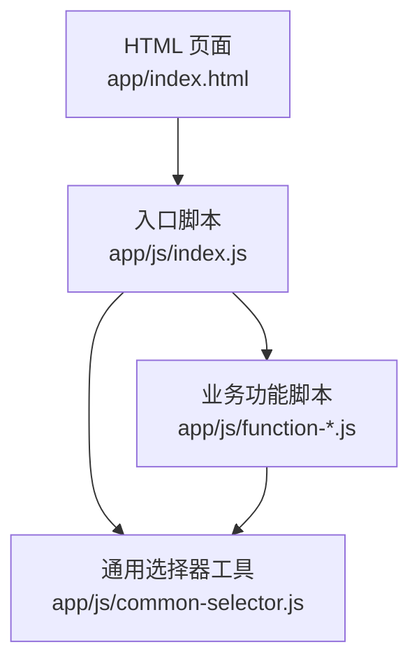
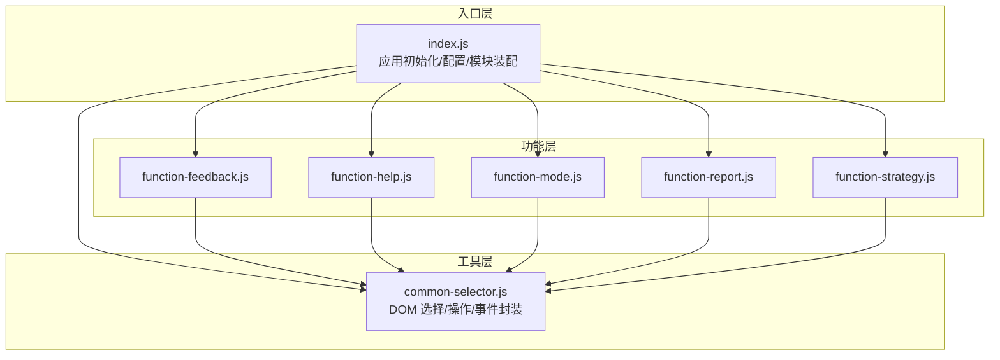
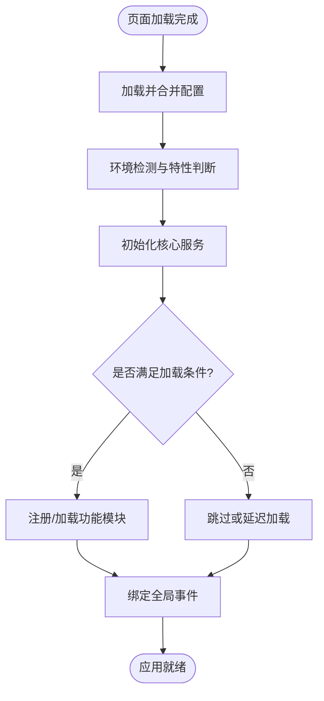
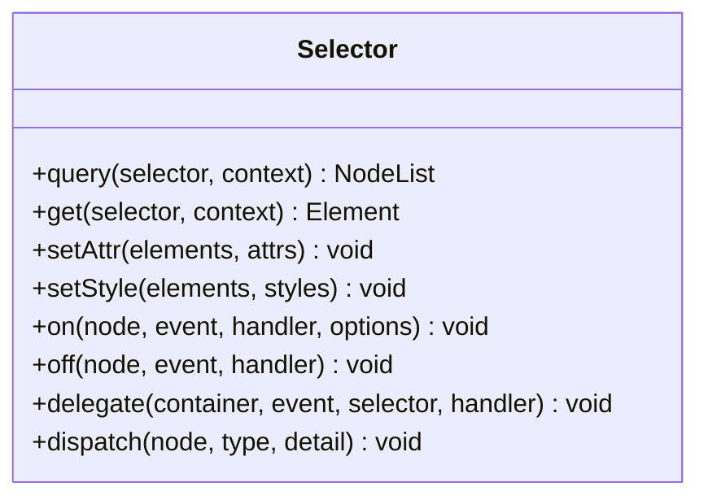
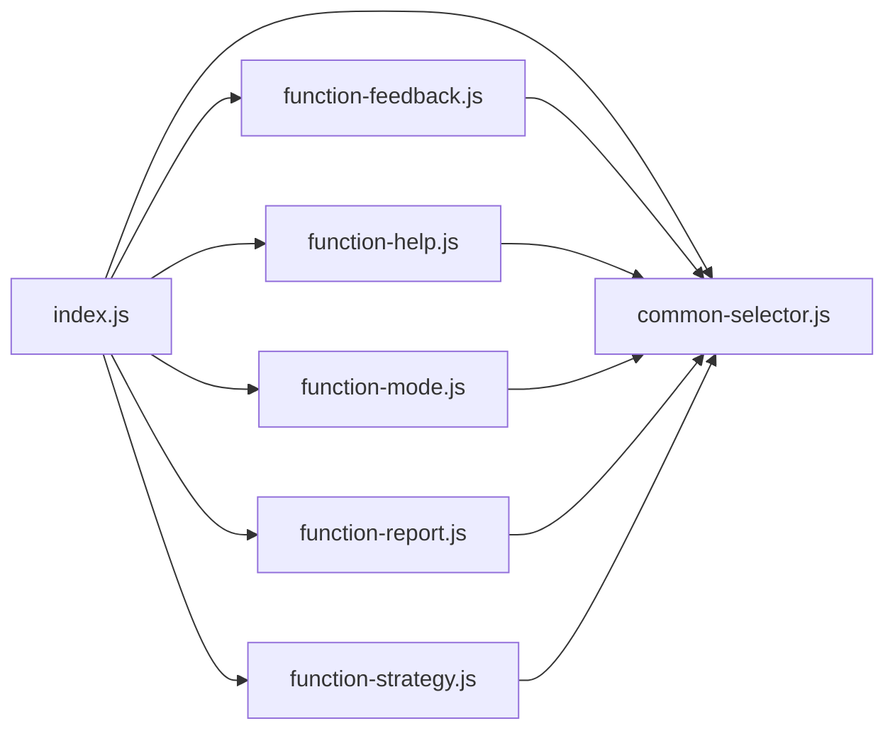

# 核心模块

<cite>
**本文引用的文件**   
- [index.js](file://app/js/index.js)
- [common-selector.js](file://app/js/common-selector.js)
</cite>

## 目录
1. [简介](#简介)
2. [项目结构](#项目结构)
3. [核心组件](#核心组件)
4. [架构总览](#架构总览)
5. [详细组件分析](#详细组件分析)
6. [依赖关系分析](#依赖关系分析)
7. [性能考虑](#性能考虑)
8. [故障排查指南](#故障排查指南)
9. [结论](#结论)
10. [附录](#附录)

## 简介
本文件为 MG-Mini 的核心 JavaScript 模块文档，聚焦以下目标：
- 解析 index.js 作为应用入口的初始化流程、全局配置管理与模块加载机制。
- 详解 common-selector.js 中通用选择器工具的实现原理、DOM 操作封装与事件处理模式。
- 提供使用示例路径、模块间依赖与通信方式说明。
- 给出错误处理策略与性能优化建议，兼顾初学者友好与高级开发者深度需求。

## 项目结构
MG-Mini 的前端代码位于 app/ 目录下，JavaScript 逻辑集中在 app/js/。核心入口与通用工具如下：
- 入口与页面脚本：app/js/index.js
- 通用 DOM 选择与事件工具：app/js/common-selector.js
- 功能模块脚本（如反馈、帮助、模式、报表、策略等）：app/js/function-*.js
- HTML 页面：app/*.html

图表来源
- [index.js](file://app/js/index.js)
- [common-selector.js](file://app/js/common-selector.js)

章节来源
- [index.js](file://app/js/index.js)
- [common-selector.js](file://app/js/common-selector.js)

## 核心组件
- 入口模块（index.js）
  - 负责应用启动、全局配置注入、按需加载或注册各功能模块、监听页面生命周期事件。
  - 典型职责包括：读取/合并默认配置与用户配置、暴露全局 API、初始化 UI 与数据层、挂载路由或视图切换逻辑。
- 通用选择器（common-selector.js）
  - 提供统一的 DOM 查询、元素操作、事件绑定与委托能力，屏蔽浏览器差异，简化上层调用。
  - 典型能力包括：按选择器获取元素集合、批量设置属性/样式、事件绑定/解绑、事件委托、跨节点查找与过滤。

章节来源
- [index.js](file://app/js/index.js)
- [common-selector.js](file://app/js/common-selector.js)

## 架构总览
整体采用“入口编排 + 工具库 + 功能模块”的分层结构：
- 入口层：统一初始化与装配，决定加载顺序与依赖关系。
- 工具层：common-selector.js 提供稳定的 DOM 与事件抽象。
- 功能层：各 function-*.js 实现具体业务，通过工具层访问 DOM 与事件。

图表来源
- [index.js](file://app/js/index.js)
- [common-selector.js](file://app/js/common-selector.js)

## 详细组件分析

### 入口模块（index.js）
- 初始化流程
  - 页面加载完成后触发入口函数，执行配置合并、环境检测、日志开关设置。
  - 根据当前页面或路由决定加载哪些功能模块，避免不必要的资源消耗。
  - 注册全局事件（如窗口尺寸变化、主题切换），并分发到对应模块。
- 全局配置管理
  - 定义默认配置对象，支持从 URL 参数、本地存储或后端接口覆盖。
  - 提供 get/set 方法以安全读写配置，并在变更时触发通知回调。
- 模块加载机制
  - 采用延迟加载或条件加载策略，减少首屏体积。
  - 模块间通过入口提供的总线或事件通道进行通信，降低耦合。
- 错误处理
  - 捕获关键初始化步骤异常，记录上下文信息并降级运行。
  - 对未捕获的全局错误进行兜底处理，保障页面可用性。

章节来源
- [index.js](file://app/js/index.js)

### 通用选择器（common-selector.js）
- 设计目标
  - 统一 DOM 查询与操作接口，屏蔽原生 API 的差异与冗余。
  - 提供事件绑定与委托能力，提升交互性能与可维护性。
- 核心能力
  - 选择器封装：支持 CSS 选择器、节点集合、元素数组的统一输入。
  - DOM 操作：批量设置属性、样式、文本内容；安全地插入/移除节点。
  - 事件处理：绑定/解绑事件、事件委托、自定义事件派发。
  - 遍历与过滤：基于选择器或回调筛选子节点、兄弟节点与祖先节点。
- 事件处理模式
  - 优先使用事件委托以减少监听器数量，提高内存效率。
  - 提供防抖/节流包装，避免高频事件导致的性能问题。
  - 支持命名空间的事件管理，便于集中清理与调试。

图表来源
- [common-selector.js](file://app/js/common-selector.js)

章节来源
- [common-selector.js](file://app/js/common-selector.js)

### 使用示例（路径指引）
- 在功能模块中使用通用选择器进行 DOM 操作与事件绑定：
  - 参考路径：[function-feedback.js](file://app/js/function-feedback.js)
  - 参考路径：[function-help.js](file://app/js/function-help.js)
  - 参考路径：[function-mode.js](file://app/js/function-mode.js)
  - 参考路径：[function-report.js](file://app/js/function-report.js)
  - 参考路径：[function-strategy.js](file://app/js/function-strategy.js)
- 在入口文件中加载与装配模块：
  - 参考路径：[index.js](file://app/js/index.js)

章节来源
- [index.js](file://app/js/index.js)
- [common-selector.js](file://app/js/common-selector.js)
- [function-feedback.js](file://app/js/function-feedback.js)
- [function-help.js](file://app/js/function-help.js)
- [function-mode.js](file://app/js/function-mode.js)
- [function-report.js](file://app/js/function-report.js)
- [function-strategy.js](file://app/js/function-strategy.js)

## 依赖关系分析
- 入口模块依赖
  - 依赖 common-selector.js 提供的 DOM/事件能力。
  - 依赖各功能模块，按页面或路由条件加载。
- 功能模块依赖
  - 普遍依赖 common-selector.js 进行 UI 交互与状态更新。
  - 模块之间通过入口层的事件总线或回调进行通信，避免直接耦合。
- 外部依赖
  - 仅依赖浏览器原生 DOM API，无第三方库依赖，保证轻量与稳定。

图表来源
- [index.js](file://app/js/index.js)
- [common-selector.js](file://app/js/common-selector.js)
- [function-feedback.js](file://app/js/function-feedback.js)
- [function-help.js](file://app/js/function-help.js)
- [function-mode.js](file://app/js/function-mode.js)
- [function-report.js](file://app/js/function-report.js)
- [function-strategy.js](file://app/js/function-strategy.js)

章节来源
- [index.js](file://app/js/index.js)
- [common-selector.js](file://app/js/common-selector.js)
- [function-feedback.js](file://app/js/function-feedback.js)
- [function-help.js](file://app/js/function-help.js)
- [function-mode.js](file://app/js/function-mode.js)
- [function-report.js](file://app/js/function-report.js)
- [function-strategy.js](file://app/js/function-strategy.js)

## 性能考虑
- 首屏优化
  - 入口模块按需加载功能脚本，减少初始 JS 体积。
  - 将非关键初始化推迟到用户交互后执行。
- DOM 操作优化
  - 使用 common-selector.js 的批量操作接口，减少重排重绘次数。
  - 优先使用事件委托，避免为每个子元素单独绑定监听器。
- 事件优化
  - 对滚动、resize、input 等高频率事件使用防抖/节流。
  - 及时解绑不再使用的事件监听器，防止内存泄漏。
- 配置与状态
  - 配置变更采用增量更新与订阅通知，避免全量刷新。
  - 缓存常用查询结果，减少重复计算。

## 故障排查指南
- 常见问题定位
  - 检查入口初始化顺序是否正确，确保依赖模块已加载。
  - 确认选择器表达式有效，避免空节点集合导致后续操作失败。
  - 核对事件绑定与解绑是否成对出现，防止重复绑定或内存泄漏。
- 错误处理策略
  - 在关键步骤包裹 try/catch，记录错误上下文并降级运行。
  - 对未捕获的全局错误进行兜底处理，保持页面可用。
- 调试建议
  - 启用日志开关，输出关键生命周期与事件流。
  - 使用浏览器开发者工具的 Network、Performance 面板分析加载与渲染瓶颈。

章节来源
- [index.js](file://app/js/index.js)
- [common-selector.js](file://app/js/common-selector.js)

## 结论
MG-Mini 的核心模块通过清晰的入口编排与稳定的通用选择器工具，实现了低耦合、高内聚的前端架构。入口模块负责配置与模块装配，通用选择器提供一致的 DOM/事件抽象，功能模块专注于业务实现。遵循本文的性能与错误处理建议，可在保证可维护性的同时获得良好的用户体验。

## 附录
- 术语表
  - 入口模块：应用启动与装配的中心点。
  - 通用选择器：封装 DOM 查询与事件能力的工具库。
  - 事件委托：将事件监听器绑定到父节点，利用冒泡处理子节点事件的模式。
  - 防抖/节流：限制函数执行频率的技术手段。
- 最佳实践
  - 始终通过入口模块加载与通信，避免模块间直接耦合。
  - 使用通用选择器的批量接口，减少 DOM 操作开销。
  - 对高频事件进行防抖/节流，提升交互流畅度。