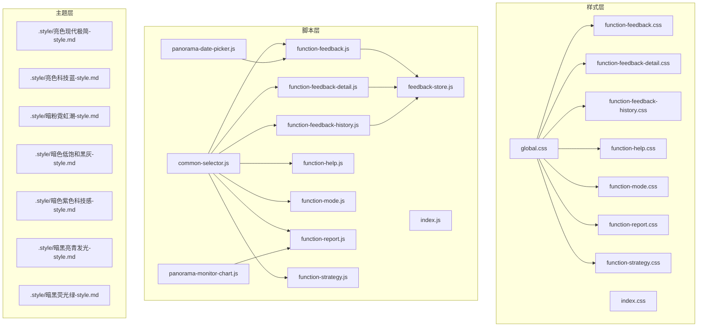
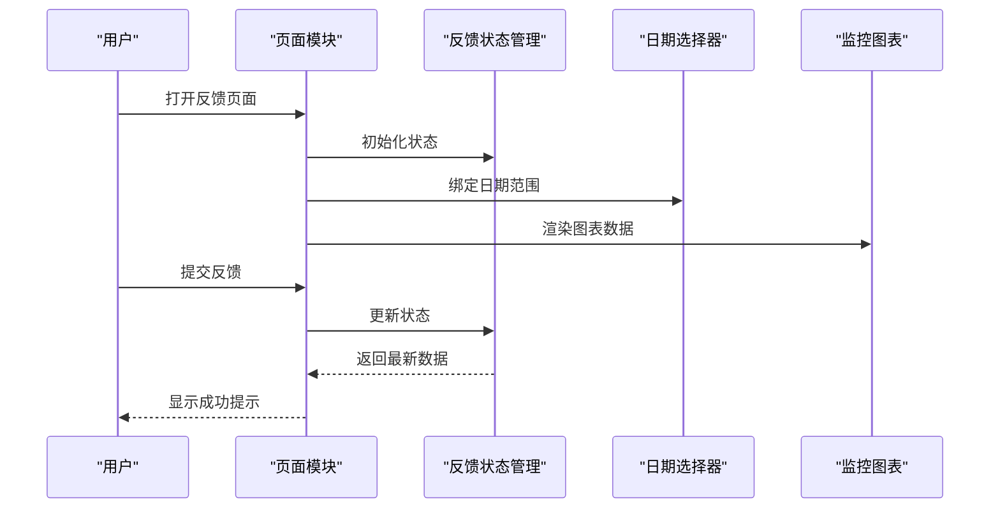
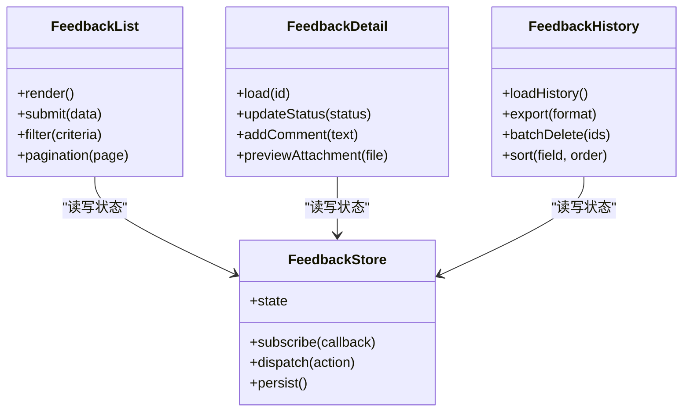
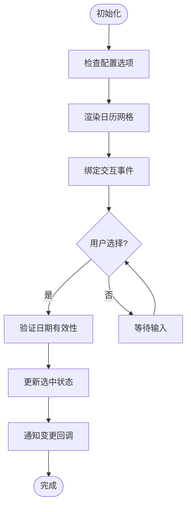
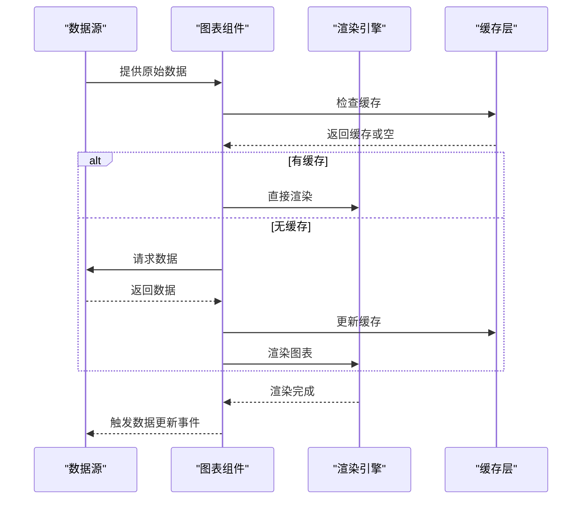
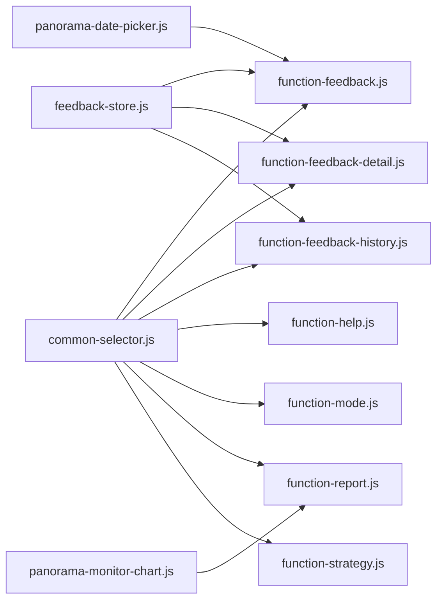

# UI组件与样式

<cite>
**本文档引用的文件**   
- [app/css/global.css](file://app/css/global.css)
- [app/css/index.css](file://app/css/index.css)
- [app/css/function-feedback.css](file://app/css/function-feedback.css)
- [app/css/function-feedback-detail.css](file://app/css/function-feedback-detail.css)
- [app/css/function-feedback-history.css](file://app/css/function-feedback-history.css)
- [app/css/function-help.css](file://app/css/function-help.css)
- [app/css/function-mode.css](file://app/css/function-mode.css)
- [app/css/function-report.css](file://app/css/function-report.css)
- [app/css/function-strategy.css](file://app/css/function-strategy.css)
- [app/js/common-selector.js](file://app/js/common-selector.js)
- [app/js/feedback-store.js](file://app/js/feedback-store.js)
- [app/js/function-feedback.js](file://app/js/function-feedback.js)
- [app/js/function-feedback-detail.js](file://app/js/function-feedback-detail.js)
- [app/js/function-feedback-history.js](file://app/js/function-feedback-history.js)
- [app/js/function-help.js](file://app/js/function-help.js)
- [app/js/function-mode.js](file://app/js/function-mode.js)
- [app/js/function-report.js](file://app/js/function-report.js)
- [app/js/function-strategy.js](file://app/js/function-strategy.js)
- [app/js/index.js](file://app/js/index.js)
- [app/js/panorama-date-picker.js](file://app/js/panorama-date-picker.js)
- [app/js/panorama-monitor-chart.js](file://app/js/panorama-monitor-chart.js)
- [app/fonts/inter.css](file://app/fonts/inter.css)
- [.style/亮色现代极简-style.md](file://.style/亮色现代极简-style.md)
- [.style/亮色科技蓝-style.md](file://.style/亮色科技蓝-style.md)
- [.style/暗粉霓虹潮-style.md](file://.style/暗粉霓虹潮-style.md)
- [.style/暗色低饱和黑灰-style.md](file://.style/暗色低饱和黑灰-style.md)
- [.style/暗色紫色科技感-style.md](file://.style/暗色紫色科技感-style.md)
- [.style/暗黑亮青发光-style.md](file://.style/暗黑亮青发光-style.md)
- [.style/暗黑荧光绿-style.md](file://.style/暗黑荧光绿-style.md)
</cite>

## 目录
1. [简介](#简介)
2. [项目结构](#项目结构)
3. [核心组件](#核心组件)
4. [架构总览](#架构总览)
5. [详细组件分析](#详细组件分析)
6. [依赖关系分析](#依赖关系分析)
7. [性能考量](#性能考量)
8. [故障排查指南](#故障排查指南)
9. [结论](#结论)
10. [附录](#附录)

## 简介
本文件为 MG-Mini 的 UI 组件与样式系统提供系统化文档，覆盖视觉外观、交互行为、响应式设计与无障碍合规、主题与样式定制、跨浏览器兼容性与性能优化，以及组件组合模式与全局样式规范。内容基于仓库中的 CSS、JS 与样式设计稿进行归纳与说明，帮助开发者快速理解并正确使用各功能模块的 UI 组件。

## 项目结构
MG-Mini 采用“页面级功能模块 + 公共样式与脚本”的组织方式：
- app/css：全局样式与各功能页样式（如反馈、帮助、模式、报告、策略等）
- app/js：对应功能的交互逻辑与状态管理（如反馈详情、历史、日期选择器、监控图表等）
- .style：多套主题风格定义与预览说明
- app/fonts：字体资源与引入声明

**图示来源** 
- [app/css/global.css](file://app/css/global.css)
- [app/css/index.css](file://app/css/index.css)
- [app/css/function-feedback.css](file://app/css/function-feedback.css)
- [app/css/function-feedback-detail.css](file://app/css/function-feedback-detail.css)
- [app/css/function-feedback-history.css](file://app/css/function-feedback-history.css)
- [app/css/function-help.css](file://app/css/function-help.css)
- [app/css/function-mode.css](file://app/css/function-mode.css)
- [app/css/function-report.css](file://app/css/function-report.css)
- [app/css/function-strategy.css](file://app/css/function-strategy.css)
- [app/js/common-selector.js](file://app/js/common-selector.js)
- [app/js/index.js](file://app/js/index.js)
- [app/js/function-feedback.js](file://app/js/function-feedback.js)
- [app/js/function-feedback-detail.js](file://app/js/function-feedback-detail.js)
- [app/js/function-feedback-history.js](file://app/js/function-feedback-history.js)
- [app/js/function-help.js](file://app/js/function-help.js)
- [app/js/function-mode.js](file://app/js/function-mode.js)
- [app/js/function-report.js](file://app/js/function-report.js)
- [app/js/function-strategy.js](file://app/js/function-strategy.js)
- [app/js/panorama-date-picker.js](file://app/js/panorama-date-picker.js)
- [app/js/panorama-monitor-chart.js](file://app/js/panorama-monitor-chart.js)
- [app/js/feedback-store.js](file://app/js/feedback-store.js)
- [.style/亮色现代极简-style.md](file://.style/亮色现代极简-style.md)
- [.style/亮色科技蓝-style.md](file://.style/亮色科技蓝-style.md)
- [.style/暗粉霓虹潮-style.md](file://.style/暗粉霓虹潮-style.md)
- [.style/暗色低饱和黑灰-style.md](file://.style/暗色低饱和黑灰-style.md)
- [.style/暗色紫色科技感-style.md](file://.style/暗色紫色科技感-style.md)
- [.style/暗黑亮青发光-style.md](file://.style/暗黑亮青发光-style.md)
- [.style/暗黑荧光绿-style.md](file://.style/暗黑荧光绿-style.md)

**章节来源**
- [app/css/global.css](file://app/css/global.css)
- [app/css/index.css](file://app/css/index.css)
- [app/js/common-selector.js](file://app/js/common-selector.js)
- [app/js/index.js](file://app/js/index.js)

## 核心组件
MG-Mini 的 UI 组件以“页面级功能模块”的形式存在，每个模块包含对应的 HTML 结构、CSS 样式与 JS 交互逻辑。以下为核心组件概览：

- 反馈列表与表单（function-feedback）
  - 视觉：卡片式列表、表单输入区、操作按钮组
  - 行为：提交、筛选、分页、错误提示
  - 交互：键盘导航、焦点管理、加载态
  - 状态：本地存储与 store 同步
  - 事件：提交成功/失败、筛选变更、分页切换
  - 插槽：自定义表单项、操作按钮扩展
  - 主题：支持明暗主题切换与品牌色替换

- 反馈详情（function-feedback-detail）
  - 视觉：详情面板、时间线、附件展示
  - 行为：展开/折叠、评论回复、状态流转
  - 交互：滚动定位、图片预览
  - 状态：详情数据缓存、草稿保存
  - 事件：状态更新、评论提交、附件上传

- 反馈历史（function-feedback-history）
  - 视觉：历史记录表格、搜索过滤
  - 行为：排序、导出、批量操作
  - 交互：多选、快捷键
  - 状态：分页缓存、筛选条件持久化
  - 事件：导出完成、批量删除确认

- 帮助中心（function-help）
  - 视觉：FAQ 列表、搜索框、分类标签
  - 行为：搜索高亮、折叠展开
  - 交互：锚点跳转、复制链接
  - 状态：最近浏览记录
  - 事件：搜索提交、分类切换

- 模式切换（function-mode）
  - 视觉：模式卡片、开关控件
  - 行为：切换主题、应用范围控制
  - 交互：动画过渡、状态回退
  - 状态：用户偏好存储
  - 事件：模式切换、恢复默认

- 报告（function-report）
  - 视觉：图表容器、筛选栏、导出按钮
  - 行为：数据聚合、图表渲染、导出 PDF/CSV
  - 交互：缩放、拖拽、图例点击
  - 状态：图表配置缓存、数据快照
  - 事件：数据刷新、导出完成

- 策略（function-strategy）
  - 视觉：策略卡片、参数面板、运行日志
  - 行为：启停、参数校验、结果输出
  - 交互：实时日志滚动、暂停/继续
  - 状态：运行状态机、日志缓冲
  - 事件：启动/停止、参数变更、错误上报

- 全景日期选择器（panorama-date-picker）
  - 视觉：日历网格、快捷区间、范围选择
  - 行为：联动筛选、禁用日期、时区处理
  - 交互：键盘导航、弹窗定位
  - 状态：选中区间、缓存上次选择
  - 事件：范围变更、确认/取消

- 全景监控图表（panorama-monitor-chart）
  - 视觉：折线/柱状/面积图、图例、坐标轴
  - 行为：数据绑定、动画过渡、自适应布局
  - 交互：缩放、平移、tooltip
  - 状态：数据缓存、渲染队列
  - 事件：数据更新、交互回调

**章节来源**
- [app/css/function-feedback.css](file://app/css/function-feedback.css)
- [app/css/function-feedback-detail.css](file://app/css/function-feedback-detail.css)
- [app/css/function-feedback-history.css](file://app/css/function-feedback-history.css)
- [app/css/function-help.css](file://app/css/function-help.css)
- [app/css/function-mode.css](file://app/css/function-mode.css)
- [app/css/function-report.css](file://app/css/function-report.css)
- [app/css/function-strategy.css](file://app/css/function-strategy.css)
- [app/js/function-feedback.js](file://app/js/function-feedback.js)
- [app/js/function-feedback-detail.js](file://app/js/function-feedback-detail.js)
- [app/js/function-feedback-history.js](file://app/js/function-feedback-history.js)
- [app/js/function-help.js](file://app/js/function-help.js)
- [app/js/function-mode.js](file://app/js/function-mode.js)
- [app/js/function-report.js](file://app/js/function-report.js)
- [app/js/function-strategy.js](file://app/js/function-strategy.js)
- [app/js/panorama-date-picker.js](file://app/js/panorama-date-picker.js)
- [app/js/panorama-monitor-chart.js](file://app/js/panorama-monitor-chart.js)

## 架构总览
MG-Mini 的 UI 架构遵循“样式层—脚本层—主题层”的分层设计：
- 样式层：全局样式与功能样式分离，便于维护与复用
- 脚本层：按功能模块组织，使用公共选择器与状态管理
- 主题层：通过主题文档定义颜色、字体、间距等设计令牌，配合 CSS 变量实现动态切换

**图示来源** 
- [app/js/function-feedback.js](file://app/js/function-feedback.js)
- [app/js/feedback-store.js](file://app/js/feedback-store.js)
- [app/js/panorama-date-picker.js](file://app/js/panorama-date-picker.js)
- [app/js/panorama-monitor-chart.js](file://app/js/panorama-monitor-chart.js)

## 详细组件分析

### 反馈组件族（列表、详情、历史）
反馈组件族包含三个核心子组件：列表、详情、历史。它们共享状态管理与部分样式，形成统一的交互体验。

**图示来源** 
- [app/js/function-feedback.js](file://app/js/function-feedback.js)
- [app/js/function-feedback-detail.js](file://app/js/function-feedback-detail.js)
- [app/js/function-feedback-history.js](file://app/js/function-feedback-history.js)
- [app/js/feedback-store.js](file://app/js/feedback-store.js)

#### 关键特性
- 状态管理：集中式 store 管理反馈数据、加载状态、错误信息
- 异步处理：提交、加载、导出等操作均支持 Promise 链式调用
- 错误处理：统一错误捕获与用户提示
- 性能优化：虚拟列表、防抖搜索、增量更新

**章节来源**
- [app/js/function-feedback.js](file://app/js/function-feedback.js)
- [app/js/function-feedback-detail.js](file://app/js/function-feedback-detail.js)
- [app/js/function-feedback-history.js](file://app/js/function-feedback-history.js)
- [app/js/feedback-store.js](file://app/js/feedback-store.js)
- [app/css/function-feedback.css](file://app/css/function-feedback.css)
- [app/css/function-feedback-detail.css](file://app/css/function-feedback-detail.css)
- [app/css/function-feedback-history.css](file://app/css/function-feedback-history.css)

### 日期选择器组件
日期选择器提供灵活的日期范围选择功能，支持快捷区间、禁用日期、时区转换等高级特性。

**图示来源** 
- [app/js/panorama-date-picker.js](file://app/js/panorama-date-picker.js)

#### 配置选项
- 日期格式：支持多种格式化选项
- 语言环境：多语言支持
- 禁用规则：节假日、非工作日禁用
- 主题适配：明暗主题自动切换
- 无障碍：键盘导航、屏幕阅读器支持

**章节来源**
- [app/js/panorama-date-picker.js](file://app/js/panorama-date-picker.js)

### 监控图表组件
监控图表组件基于数据可视化库封装，提供丰富的图表类型和交互功能。

**图示来源** 
- [app/js/panorama-monitor-chart.js](file://app/js/panorama-monitor-chart.js)

#### 图表类型
- 折线图：趋势分析、多系列对比
- 柱状图：分类统计、排名展示
- 面积图：累积趋势、占比分析
- 散点图：相关性分析、异常检测

**章节来源**
- [app/js/panorama-monitor-chart.js](file://app/js/panorama-monitor-chart.js)

## 依赖关系分析
MG-Mini 的组件间依赖关系清晰，主要依赖包括：
- common-selector.js：提供通用的 DOM 选择器和工具函数
- feedback-store.js：集中式的状态管理
- 第三方库：图表渲染、日期处理等

**图示来源** 
- [app/js/common-selector.js](file://app/js/common-selector.js)
- [app/js/feedback-store.js](file://app/js/feedback-store.js)
- [app/js/function-feedback.js](file://app/js/function-feedback.js)
- [app/js/function-feedback-detail.js](file://app/js/function-feedback-detail.js)
- [app/js/function-feedback-history.js](file://app/js/function-feedback-history.js)
- [app/js/function-help.js](file://app/js/function-help.js)
- [app/js/function-mode.js](file://app/js/function-mode.js)
- [app/js/function-report.js](file://app/js/function-report.js)
- [app/js/function-strategy.js](file://app/js/function-strategy.js)
- [app/js/panorama-date-picker.js](file://app/js/panorama-date-picker.js)
- [app/js/panorama-monitor-chart.js](file://app/js/panorama-monitor-chart.js)

**章节来源**
- [app/js/common-selector.js](file://app/js/common-selector.js)
- [app/js/feedback-store.js](file://app/js/feedback-store.js)

## 性能考量
为确保 MG-Mini 的良好性能表现，建议关注以下方面：

- 样式优化
  - 使用 CSS 变量实现主题切换，避免重排重绘
  - 按需加载样式文件，减少初始包大小
  - 使用 CSS Grid 和 Flexbox 提升布局性能

- 脚本优化
  - 实施懒加载和代码分割
  - 使用防抖和节流优化高频事件
  - 避免内存泄漏，及时清理事件监听器

- 渲染优化
  - 图表数据虚拟化，只渲染可视区域
  - 使用 requestAnimationFrame 优化动画
  - 实施增量更新而非全量重渲染

- 网络优化
  - 启用 HTTP/2 和缓存策略
  - 压缩静态资源
  - 使用 CDN 加速资源加载

## 故障排查指南
常见问题及解决方案：

- 样式冲突问题
  - 检查 CSS 选择器优先级
  - 使用 BEM 命名规范避免冲突
  - 隔离组件样式作用域

- 状态同步问题
  - 检查 store 订阅是否正确
  - 验证异步操作的状态更新
  - 添加状态变更日志

- 性能问题
  - 使用浏览器开发者工具分析渲染性能
  - 检查内存使用情况
  - 优化大数据集处理

- 兼容性问题的
  - 测试主流浏览器最新版本
  - 使用 polyfill 填补功能差异
  - 降级处理不支持的功能

**章节来源**
- [app/css/global.css](file://app/css/global.css)
- [app/js/common-selector.js](file://app/js/common-selector.js)
- [app/js/feedback-store.js](file://app/js/feedback-store.js)

## 结论
MG-Mini 的 UI 组件与样式系统采用了清晰的分层架构和良好的模块化设计。通过统一的样式规范、集中的状态管理和灵活的组件组合，实现了高质量的用户体验。建议在实际使用中遵循本文档的设计原则和最佳实践，以确保系统的可维护性和可扩展性。

## 附录

### 全局样式规范
- 颜色系统：定义主色、辅助色、状态色的使用规范
- 字体规范：字体家族、字号层级、行高设置
- 间距系统：统一的间距单位和布局网格
- 阴影系统：层级化的阴影效果定义

### 主题支持
- 明暗主题：完整的明暗主题切换支持
- 品牌定制：支持企业品牌色的快速替换
- 响应式主题：移动端和桌面端的差异化主题

### 无障碍合规
- WCAG 2.1 AA 标准合规
- 键盘导航支持
- 屏幕阅读器友好
- 色彩对比度符合标准

### 跨浏览器兼容
- 支持 Chrome、Firefox、Safari、Edge 最新版本
- 移动端 iOS Safari 和 Android Chrome 优化
- 渐进增强策略确保基础功能可用

**章节来源**
- [app/css/global.css](file://app/css/global.css)
- [app/fonts/inter.css](file://app/fonts/inter.css)
- [.style/亮色现代极简-style.md](file://.style/亮色现代极简-style.md)
- [.style/亮色科技蓝-style.md](file://.style/亮色科技蓝-style.md)
- [.style/暗粉霓虹潮-style.md](file://.style/暗粉霓虹潮-style.md)
- [.style/暗色低饱和黑灰-style.md](file://.style/暗色低饱和黑灰-style.md)
- [.style/暗色紫色科技感-style.md](file://.style/暗色紫色科技感-style.md)
- [.style/暗黑亮青发光-style.md](file://.style/暗黑亮青发光-style.md)
- [.style/暗黑荧光绿-style.md](file://.style/暗黑荧光绿-style.md)