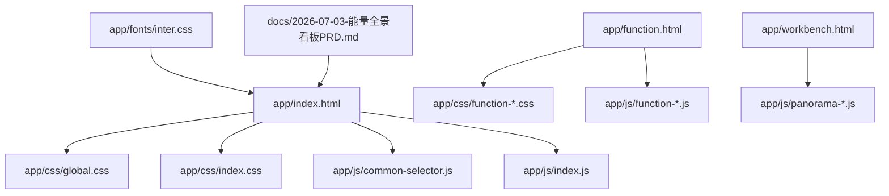
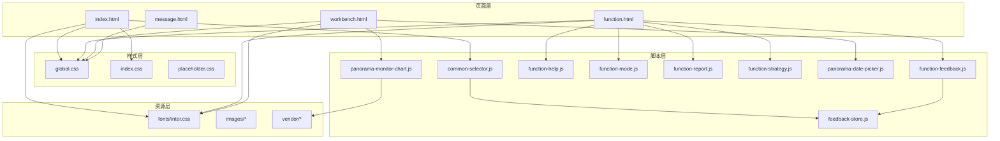
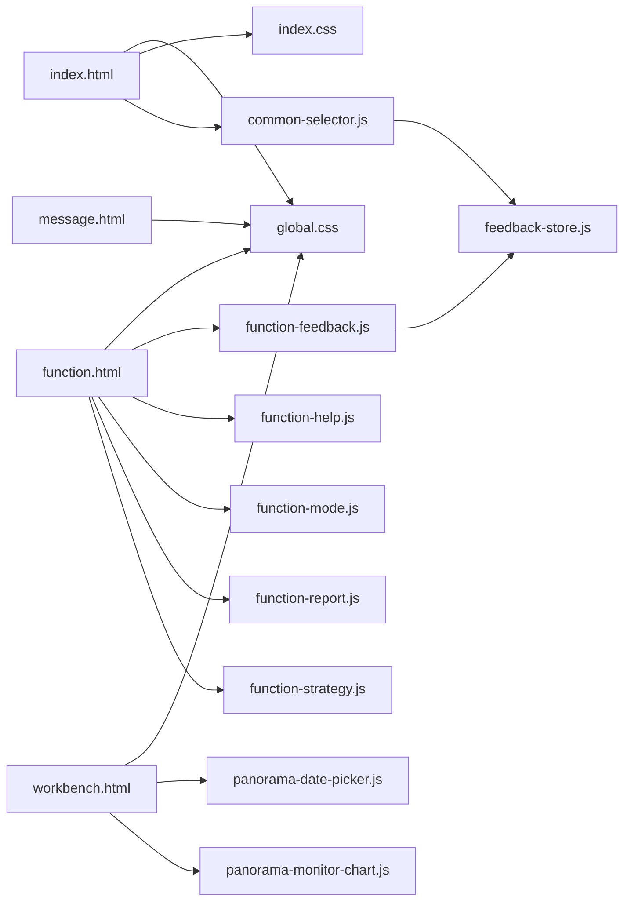

# 开发指南

<cite>
**本文档引用的文件**   
- [index.html](file://app/index.html)
- [function.html](file://app/function.html)
- [workbench.html](file://app/workbench.html)
- [message.html](file://app/message.html)
- [global.css](file://app/css/global.css)
- [index.css](file://app/css/index.css)
- [placeholder.css](file://app/css/placeholder.css)
- [common-selector.js](file://app/js/common-selector.js)
- [feedback-store.js](file://app/js/feedback-store.js)
- [function-feedback.js](file://app/js/function-feedback.js)
- [function-help.js](file://app/js/function-help.js)
- [function-mode.js](file://app/js/function-mode.js)
- [function-report.js](file://app/js/function-report.js)
- [function-strategy.js](file://app/js/function-strategy.js)
- [panorama-date-picker.js](file://app/js/panorama-date-picker.js)
- [panorama-monitor-chart.js](file://app/js/panorama-monitor-chart.js)
- [inter.css](file://app/fonts/inter.css)
- [2026-07-03-能量全景看板PRD.md](file://docs/2026-07-03-能量全景看板PRD.md)
</cite>

## 目录
1. [简介](#简介)
2. [项目结构](#项目结构)
3. [核心组件](#核心组件)
4. [架构总览](#架构总览)
5. [详细组件分析](#详细组件分析)
6. [依赖分析](#依赖分析)
7. [性能考虑](#性能考虑)
8. [故障排查指南](#故障排查指南)
9. [结论](#结论)
10. [附录](#附录)

## 简介
本指南面向MG-Mini项目的开发者，目标是帮助新加入的工程师快速上手并高效贡献代码。内容涵盖：
- 开发环境搭建与运行方式
- 代码规范与最佳实践
- 项目结构与文件组织约定、命名规范
- 新功能开发流程、代码审查流程与测试策略
- 样式主题定制（修改预设主题与创建新主题）
- 调试技巧、性能优化建议与常见问题解决方案
- 扩展现有功能、新增页面模块与集成第三方库的方法

## 项目结构
项目采用“按功能页面+资源分层”的组织方式：
- app 目录为应用主体
  - css：全局样式与各功能页样式
  - js：公共逻辑与各功能页脚本
  - fonts：字体资源
  - images：图片资源
  - vendor：第三方库（预留）
  - *.html：各页面入口
- docs：产品需求与设计文档
- .style：主题预览与说明文档

图表来源 
- [index.html](file://app/index.html)
- [global.css](file://app/css/global.css)
- [index.css](file://app/css/index.css)
- [common-selector.js](file://app/js/common-selector.js)
- [function.html](file://app/function.html)
- [workbench.html](file://app/workbench.html)
- [panorama-date-picker.js](file://app/js/panorama-date-picker.js)
- [panorama-monitor-chart.js](file://app/js/panorama-monitor-chart.js)
- [inter.css](file://app/fonts/inter.css)
- [2026-07-03-能量全景看板PRD.md](file://docs/2026-07-03-能量全景看板PRD.md)

章节来源
- [index.html](file://app/index.html)
- [function.html](file://app/function.html)
- [workbench.html](file://app/workbench.html)
- [message.html](file://app/message.html)
- [global.css](file://app/css/global.css)
- [index.css](file://app/css/index.css)
- [placeholder.css](file://app/css/placeholder.css)
- [common-selector.js](file://app/js/common-selector.js)
- [feedback-store.js](file://app/js/feedback-store.js)
- [function-feedback.js](file://app/js/function-feedback.js)
- [function-help.js](file://app/js/function-help.js)
- [function-mode.js](file://app/js/function-mode.js)
- [function-report.js](file://app/js/function-report.js)
- [function-strategy.js](file://app/js/function-strategy.js)
- [panorama-date-picker.js](file://app/js/panorama-date-picker.js)
- [panorama-monitor-chart.js](file://app/js/panorama-monitor-chart.js)
- [inter.css](file://app/fonts/inter.css)
- [2026-07-03-能量全景看板PRD.md](file://docs/2026-07-03-能量全景看板PRD.md)

## 核心组件
- 页面入口与路由
  - index.html：首页入口，加载全局样式与基础脚本
  - function.html：功能集入口，承载多个子功能页
  - workbench.html：工作台/看板页，集成日期选择器与监控图表
  - message.html：消息中心页
- 样式体系
  - global.css：全局变量、重置、布局基线
  - index.css：首页样式
  - placeholder.css：占位样式（用于未实现区域）
- 公共脚本
  - common-selector.js：通用选择器封装与DOM操作工具
  - feedback-store.js：反馈数据本地存储与状态管理
- 功能脚本
  - function-*.js：对应功能页的业务逻辑
  - panorama-*.js：看板相关能力（日期选择、图表渲染）

章节来源
- [index.html](file://app/index.html)
- [function.html](file://app/function.html)
- [workbench.html](file://app/workbench.html)
- [message.html](file://app/message.html)
- [global.css](file://app/css/global.css)
- [index.css](file://app/css/index.css)
- [placeholder.css](file://app/css/placeholder.css)
- [common-selector.js](file://app/js/common-selector.js)
- [feedback-store.js](file://app/js/feedback-store.js)
- [function-feedback.js](file://app/js/function-feedback.js)
- [function-help.js](file://app/js/function-help.js)
- [function-mode.js](file://app/js/function-mode.js)
- [function-report.js](file://app/js/function-report.js)
- [function-strategy.js](file://app/js/function-strategy.js)
- [panorama-date-picker.js](file://app/js/panorama-date-picker.js)
- [panorama-monitor-chart.js](file://app/js/panorama-monitor-chart.js)

## 架构总览
整体采用“页面驱动 + 模块化脚本”的前端架构：
- HTML 作为页面骨架与入口
- CSS 分层：全局样式与页面样式分离
- JS 分层：公共工具、状态管理与页面业务逻辑解耦
- 资源与第三方库通过 vendor 与 fonts/images 统一管理

图表来源 
- [index.html](file://app/index.html)
- [function.html](file://app/function.html)
- [workbench.html](file://app/workbench.html)
- [message.html](file://app/message.html)
- [global.css](file://app/css/global.css)
- [index.css](file://app/css/index.css)
- [placeholder.css](file://app/css/placeholder.css)
- [common-selector.js](file://app/js/common-selector.js)
- [feedback-store.js](file://app/js/feedback-store.js)
- [function-feedback.js](file://app/js/function-feedback.js)
- [function-help.js](file://app/js/function-help.js)
- [function-mode.js](file://app/js/function-mode.js)
- [function-report.js](file://app/js/function-report.js)
- [function-strategy.js](file://app/js/function-strategy.js)
- [panorama-date-picker.js](file://app/js/panorama-date-picker.js)
- [panorama-monitor-chart.js](file://app/js/panorama-monitor-chart.js)
- [inter.css](file://app/fonts/inter.css)

## 详细组件分析

### 公共选择器与DOM工具（common-selector.js）
- 职责：封装常用选择器与DOM操作，统一交互行为，降低重复代码
- 使用场景：页面初始化、事件绑定、动态内容更新
- 扩展建议：新增通用交互时优先复用该模块，避免在页面脚本中散落原生API调用

章节来源
- [common-selector.js](file://app/js/common-selector.js)

### 反馈数据存储（feedback-store.js）
- 职责：集中管理反馈数据的增删改查与持久化（如localStorage）
- 设计要点：提供统一的读写接口；对异常进行捕获与降级处理；保证数据一致性
- 使用建议：所有反馈相关页面通过该模块访问数据，避免直接操作存储

章节来源
- [feedback-store.js](file://app/js/feedback-store.js)

### 功能页脚本（function-*.js）
- 职责：各自页面的业务逻辑，包括表单校验、数据提交、结果展示等
- 组织约定：每个功能页一个脚本文件，命名与HTML保持一致前缀
- 依赖关系：优先依赖 common-selector.js 与 feedback-store.js，减少耦合

章节来源
- [function-feedback.js](file://app/js/function-feedback.js)
- [function-help.js](file://app/js/function-help.js)
- [function-mode.js](file://app/js/function-mode.js)
- [function-report.js](file://app/js/function-report.js)
- [function-strategy.js](file://app/js/function-strategy.js)

### 看板能力（panorama-*.js）
- 日期选择器（panorama-date-picker.js）
  - 职责：提供日期范围选择、格式化与联动
  - 集成点：工作台页面初始化时挂载
- 监控图表（panorama-monitor-chart.js）
  - 职责：渲染监控指标图表，支持刷新与缩放
  - 集成点：在工作台页面根据日期范围拉取数据并渲染

章节来源
- [panorama-date-picker.js](file://app/js/panorama-date-picker.js)
- [panorama-monitor-chart.js](file://app/js/panorama-monitor-chart.js)

### 样式体系（global.css / index.css / placeholder.css）
- global.css：定义CSS变量、颜色、字号、间距、布局基线
- index.css：首页专属样式，遵循全局变量
- placeholder.css：占位样式，便于未实现区域的视觉对齐

章节来源
- [global.css](file://app/css/global.css)
- [index.css](file://app/css/index.css)
- [placeholder.css](file://app/css/placeholder.css)

### 字体与资源（inter.css / images / vendor）
- inter.css：引入Inter字体，确保跨平台一致排版
- images：静态图片资源，建议按功能模块分文件夹
- vendor：第三方库存放位置，按需引入

章节来源
- [inter.css](file://app/fonts/inter.css)

## 依赖分析
- 页面到样式与脚本的依赖清晰，遵循“页面只引入必要资源”的原则
- 公共脚本被多页面复用，降低重复与维护成本
- 第三方库通过 vendor 隔离，避免污染全局命名空间

图表来源 
- [index.html](file://app/index.html)
- [function.html](file://app/function.html)
- [workbench.html](file://app/workbench.html)
- [message.html](file://app/message.html)
- [global.css](file://app/css/global.css)
- [index.css](file://app/css/index.css)
- [common-selector.js](file://app/js/common-selector.js)
- [feedback-store.js](file://app/js/feedback-store.js)
- [function-feedback.js](file://app/js/function-feedback.js)
- [function-help.js](file://app/js/function-help.js)
- [function-mode.js](file://app/js/function-mode.js)
- [function-report.js](file://app/js/function-report.js)
- [function-strategy.js](file://app/js/function-strategy.js)
- [panorama-date-picker.js](file://app/js/panorama-date-picker.js)
- [panorama-monitor-chart.js](file://app/js/panorama-monitor-chart.js)

## 性能考虑
- 资源加载
  - 仅引入页面所需CSS/JS，避免全量加载
  - 将第三方库放入 vendor，按需异步加载
- DOM操作
  - 批量更新DOM，减少重排重绘
  - 使用事件委托替代大量事件监听
- 渲染优化
  - 图表数据分页或节流更新
  - 长列表虚拟滚动（如需）
- 缓存策略
  - 对静态资源启用浏览器缓存
  - 对频繁读取的数据使用内存缓存或IndexedDB

[本节为通用指导，不直接分析具体文件]

## 故障排查指南
- 页面空白或样式错乱
  - 检查CSS是否按顺序加载，确认全局样式先于页面样式
  - 查看控制台是否有语法错误
- 交互无响应
  - 确认DOM已就绪后再绑定事件
  - 检查选择器是否正确匹配目标元素
- 数据不一致
  - 检查反馈存储模块的读写路径与键名
  - 验证数据格式与类型转换
- 图表不显示
  - 检查容器尺寸与初始化时机
  - 确认数据源与时间范围参数正确

章节来源
- [common-selector.js](file://app/js/common-selector.js)
- [feedback-store.js](file://app/js/feedback-store.js)
- [panorama-monitor-chart.js](file://app/js/panorama-monitor-chart.js)

## 结论
MG-Mini采用简洁清晰的页面驱动架构，配合分层样式与模块化脚本，便于维护与扩展。遵循本文档的规范与实践，可显著提升开发效率与代码质量。建议在新增功能时严格遵循命名与组织约定，并通过代码审查与测试保障稳定性。

[本节为总结性内容，不直接分析具体文件]

## 附录

### 开发环境搭建
- 环境要求
  - 现代浏览器（Chrome/Firefox/Safari最新稳定版）
  - 本地HTTP服务器（如VS Code Live Server、Node http-server）
- 启动步骤
  - 克隆仓库
  - 使用本地HTTP服务打开 app/index.html
  - 通过URL切换不同页面（如 /app/function.html、/app/workbench.html）

[本节为通用指导，不直接分析具体文件]

### 代码规范与最佳实践
- 命名规范
  - HTML：小写连字符命名，语义化标签
  - CSS：BEM风格或统一前缀，类名描述用途
  - JS：函数与变量使用驼峰，常量大写下划线
- 文件组织
  - 页面与脚本同名前缀，便于定位
  - 公共资源集中管理，避免分散
- 编码风格
  - 单一职责原则，模块内聚
  - 避免全局变量，使用模块作用域
  - 注释关键逻辑，保持可读性

[本节为通用指导，不直接分析具体文件]

### 新功能开发流程
- 需求分析
  - 参考PRD文档明确功能边界与交互
- 设计与实现
  - 新增HTML页面与对应CSS/JS
  - 复用公共模块，避免重复实现
- 联调与自测
  - 覆盖正常与异常路径
  - 检查样式与兼容性
- 提交与审查
  - 提交前执行自检清单
  - 发起代码审查，修复反馈后合并

[本节为通用指导，不直接分析具体文件]

### 代码审查流程
- 审查要点
  - 功能完整性与边界条件
  - 代码可读性与可维护性
  - 性能与安全影响
- 审查工具
  - 使用IDE插件进行静态检查
  - 借助浏览器开发者工具进行运行时验证

[本节为通用指导，不直接分析具体文件]

### 测试策略
- 单元测试
  - 针对公共模块（如选择器、存储）编写用例
- 集成测试
  - 页面级交互流程自动化（可选）
- 回归测试
  - 变更影响范围评估与复测

[本节为通用指导，不直接分析具体文件]

### 样式主题定制指南
- 修改预设主题
  - 在 global.css 中调整CSS变量（颜色、字号、间距）
  - 在页面样式中引用变量，避免硬编码
- 创建新主题
  - 复制现有主题样式文件，重命名为新主题
  - 在页面中切换主题样式表
  - 提供预览页面与说明文档（参考 .style 目录）

章节来源
- [global.css](file://app/css/global.css)
- [index.css](file://app/css/index.css)

### 调试技巧
- 浏览器开发者工具
  - 断点调试JS，观察调用栈
  - Network面板检查资源加载与请求
- 日志输出
  - 使用 console.group 分组输出
  - 生产环境关闭冗余日志

[本节为通用指导，不直接分析具体文件]

### 性能优化建议
- 资源压缩与合并（构建阶段）
- 懒加载与按需加载
- 减少主线程阻塞任务
- 使用Web Workers处理耗时计算（如需）

[本节为通用指导，不直接分析具体文件]

### 常见问题解决方案
- 字体不生效
  - 检查字体文件路径与跨域设置
- 图表渲染失败
  - 检查容器尺寸与数据格式
- 样式冲突
  - 使用浏览器工具定位冲突样式，提高选择器优先级或使用更精确的选择器

[本节为通用指导，不直接分析具体文件]

### 扩展现有功能与集成第三方库
- 扩展现有功能
  - 在对应功能脚本中新增方法，保持单一职责
  - 通过公共模块暴露接口供其他页面调用
- 集成第三方库
  - 将库文件放入 vendor 目录
  - 在页面中按需引入，避免全局污染
  - 封装库调用，屏蔽差异与版本升级影响

[本节为通用指导，不直接分析具体文件]

### 新增页面模块
- 新建HTML页面，引用全局样式与必要脚本
- 新增对应CSS与JS文件，遵循命名约定
- 在导航或入口文件中添加链接
- 完成自测与审查后上线

[本节为通用指导，不直接分析具体文件]

### 参考文档
- 产品需求文档
  - 2026-07-03-能量全景看板PRD.md：看板功能背景、目标与范围

章节来源
- [2026-07-03-能量全景看板PRD.md](file://docs/2026-07-03-能量全景看板PRD.md)