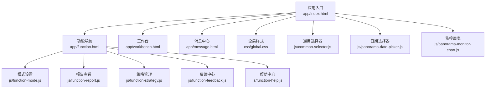
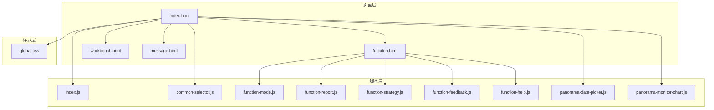
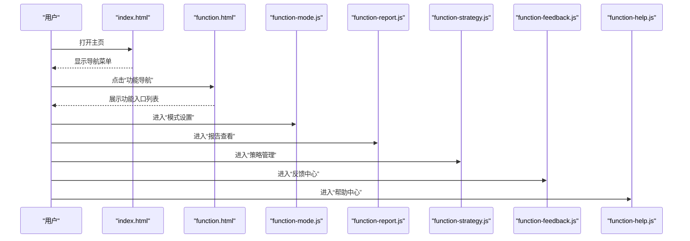
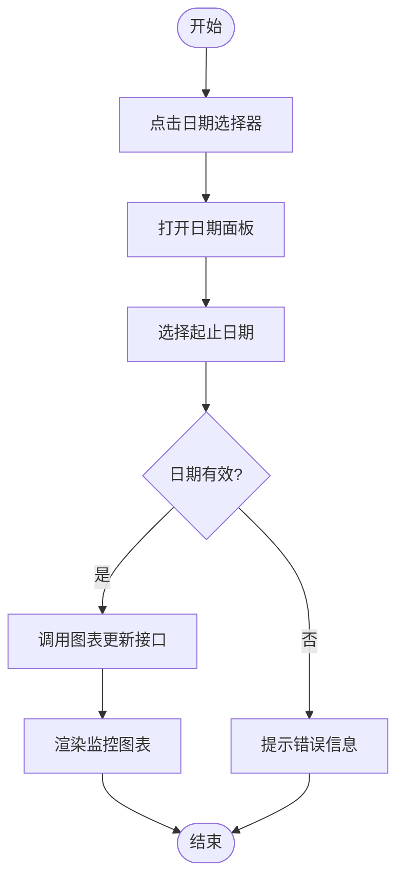
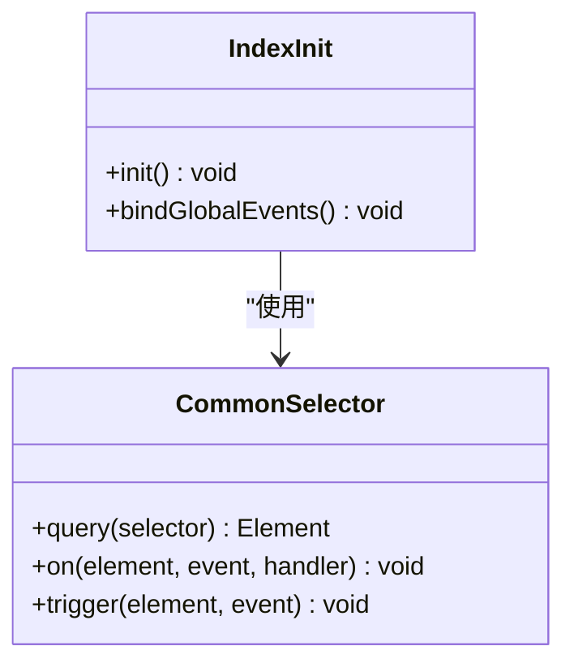
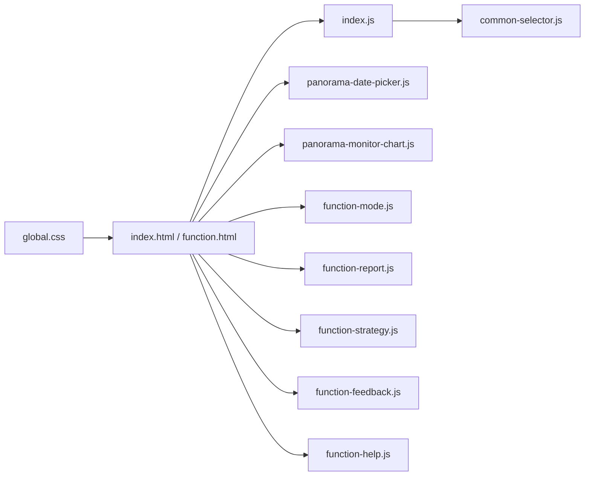

# 快速开始

<cite>
**本文引用的文件**   
- [index.html](file://app/index.html)
- [function.html](file://app/function.html)
- [workbench.html](file://app/workbench.html)
- [message.html](file://app/message.html)
- [global.css](file://app/css/global.css)
- [index.js](file://app/js/index.js)
- [common-selector.js](file://app/js/common-selector.js)
- [function-mode.js](file://app/js/function-mode.js)
- [function-report.js](file://app/js/function-report.js)
- [function-strategy.js](file://app/js/function-strategy.js)
- [function-feedback.js](file://app/js/function-feedback.js)
- [function-help.js](file://app/js/function-help.js)
- [panorama-date-picker.js](file://app/js/panorama-date-picker.js)
- [panorama-monitor-chart.js](file://app/js/panorama-monitor-chart.js)
- [2026-07-03-能量全景看板PRD.md](file://docs/2026-07-03-能量全景看板PRD.md)
</cite>

## 目录
1. [简介](#简介)
2. [项目结构](#项目结构)
3. [核心组件](#核心组件)
4. [架构总览](#架构总览)
5. [详细组件分析](#详细组件分析)
6. [依赖关系分析](#依赖关系分析)
7. [性能注意事项](#性能注意事项)
8. [故障排除指南](#故障排除指南)
9. [结论](#结论)
10. [附录](#附录)

## 简介
本快速开始指南面向首次接触 MG-Mini 的新用户，帮助你在最短时间内完成环境准备、安装与启动，并熟悉主界面与各功能模块的基本使用。MG-Mini 是一个纯前端项目，无需后端服务即可运行；通过浏览器直接打开 HTML 页面或启动本地静态服务器即可体验全部功能。

## 项目结构
项目采用“按功能页面 + 公共样式/脚本”的组织方式：
- app/index.html：应用入口页（主页）
- app/function.html：功能导航页（聚合各子功能入口）
- app/workbench.html：工作台页
- app/message.html：消息页
- app/css/*：全局与页面级样式
- app/js/*：页面逻辑与通用工具脚本
- docs/*：产品需求与设计文档

图示来源 
- [index.html](file://app/index.html)
- [function.html](file://app/function.html)
- [workbench.html](file://app/workbench.html)
- [message.html](file://app/message.html)
- [global.css](file://app/css/global.css)
- [index.js](file://app/js/index.js)
- [common-selector.js](file://app/js/common-selector.js)
- [function-mode.js](file://app/js/function-mode.js)
- [function-report.js](file://app/js/function-report.js)
- [function-strategy.js](file://app/js/function-strategy.js)
- [function-feedback.js](file://app/js/function-feedback.js)
- [function-help.js](file://app/js/function-help.js)
- [panorama-date-picker.js](file://app/js/panorama-date-picker.js)
- [panorama-monitor-chart.js](file://app/js/panorama-monitor-chart.js)

章节来源
- [index.html](file://app/index.html)
- [function.html](file://app/function.html)
- [workbench.html](file://app/workbench.html)
- [message.html](file://app/message.html)
- [global.css](file://app/css/global.css)
- [index.js](file://app/js/index.js)
- [common-selector.js](file://app/js/common-selector.js)
- [function-mode.js](file://app/js/function-mode.js)
- [function-report.js](file://app/js/function-report.js)
- [function-strategy.js](file://app/js/function-strategy.js)
- [function-feedback.js](file://app/js/function-feedback.js)
- [function-help.js](file://app/js/function-help.js)
- [panorama-date-picker.js](file://app/js/panorama-date-picker.js)
- [panorama-monitor-chart.js](file://app/js/panorama-monitor-chart.js)

## 核心组件
- 入口与路由
  - index.html：应用首页，承载全局布局与基础交互
  - function.html：功能导航页，集中跳转至各子功能模块
  - workbench.html：工作台页，提供常用操作与概览信息
  - message.html：消息页，展示系统通知与交互提示
- 样式与主题
  - global.css：全局样式与主题变量，统一视觉风格
- 通用脚本
  - index.js：页面初始化与基础事件绑定
  - common-selector.js：通用 DOM 选择与事件封装
- 功能模块脚本
  - function-mode.js：模式切换与配置
  - function-report.js：报告生成与展示
  - function-strategy.js：策略管理与执行
  - function-feedback.js：反馈收集与提交
  - function-help.js：帮助信息与引导
- 可视化与交互
  - panorama-date-picker.js：日期选择器
  - panorama-monitor-chart.js：监控图表渲染

章节来源
- [index.html](file://app/index.html)
- [function.html](file://app/function.html)
- [workbench.html](file://app/workbench.html)
- [message.html](file://app/message.html)
- [global.css](file://app/css/global.css)
- [index.js](file://app/js/index.js)
- [common-selector.js](file://app/js/common-selector.js)
- [function-mode.js](file://app/js/function-mode.js)
- [function-report.js](file://app/js/function-report.js)
- [function-strategy.js](file://app/js/function-strategy.js)
- [function-feedback.js](file://app/js/function-feedback.js)
- [function-help.js](file://app/js/function-help.js)
- [panorama-date-picker.js](file://app/js/panorama-date-picker.js)
- [panorama-monitor-chart.js](file://app/js/panorama-monitor-chart.js)

## 架构总览
MG-Mini 为纯前端单页/多页混合应用，页面间通过链接与脚本进行导航与状态传递。样式与脚本模块化组织，便于维护与扩展。

图示来源 
- [index.html](file://app/index.html)
- [function.html](file://app/function.html)
- [workbench.html](file://app/workbench.html)
- [message.html](file://app/message.html)
- [global.css](file://app/css/global.css)
- [index.js](file://app/js/index.js)
- [common-selector.js](file://app/js/common-selector.js)
- [function-mode.js](file://app/js/function-mode.js)
- [function-report.js](file://app/js/function-report.js)
- [function-strategy.js](file://app/js/function-strategy.js)
- [function-feedback.js](file://app/js/function-feedback.js)
- [function-help.js](file://app/js/function-help.js)
- [panorama-date-picker.js](file://app/js/panorama-date-picker.js)
- [panorama-monitor-chart.js](file://app/js/panorama-monitor-chart.js)

## 详细组件分析

### 入口与导航流程
- 入口页加载后初始化全局样式与基础脚本，提供功能导航与工作区入口
- 点击导航项跳转到对应功能页，由相应脚本接管交互与数据展示

图示来源 
- [index.html](file://app/index.html)
- [function.html](file://app/function.html)
- [function-mode.js](file://app/js/function-mode.js)
- [function-report.js](file://app/js/function-report.js)
- [function-strategy.js](file://app/js/function-strategy.js)
- [function-feedback.js](file://app/js/function-feedback.js)
- [function-help.js](file://app/js/function-help.js)

章节来源
- [index.html](file://app/index.html)
- [function.html](file://app/function.html)
- [function-mode.js](file://app/js/function-mode.js)
- [function-report.js](file://app/js/function-report.js)
- [function-strategy.js](file://app/js/function-strategy.js)
- [function-feedback.js](file://app/js/function-feedback.js)
- [function-help.js](file://app/js/function-help.js)

### 日期选择与图表渲染流程
- 用户在主页或功能页触发日期选择器，选择时间范围后更新图表数据
- 图表组件根据选定的时间区间重新绘制监控指标

图示来源 
- [panorama-date-picker.js](file://app/js/panorama-date-picker.js)
- [panorama-monitor-chart.js](file://app/js/panorama-monitor-chart.js)

章节来源
- [panorama-date-picker.js](file://app/js/panorama-date-picker.js)
- [panorama-monitor-chart.js](file://app/js/panorama-monitor-chart.js)

### 通用选择器与事件封装
- common-selector.js 提供统一的 DOM 查询与事件绑定方法，降低重复代码
- index.js 在页面加载时注册全局事件与初始化逻辑

图示来源 
- [common-selector.js](file://app/js/common-selector.js)
- [index.js](file://app/js/index.js)

章节来源
- [common-selector.js](file://app/js/common-selector.js)
- [index.js](file://app/js/index.js)

## 依赖关系分析
- 页面依赖样式与脚本资源，确保 CSS 与 JS 加载顺序正确
- 功能模块脚本之间保持低耦合，通过页面事件与共享工具函数协作
- 可视化组件依赖日期选择器输出，形成清晰的数据流

图示来源 
- [global.css](file://app/css/global.css)
- [index.html](file://app/index.html)
- [function.html](file://app/function.html)
- [index.js](file://app/js/index.js)
- [common-selector.js](file://app/js/common-selector.js)
- [panorama-date-picker.js](file://app/js/panorama-date-picker.js)
- [panorama-monitor-chart.js](file://app/js/panorama-monitor-chart.js)
- [function-mode.js](file://app/js/function-mode.js)
- [function-report.js](file://app/js/function-report.js)
- [function-strategy.js](file://app/js/function-strategy.js)
- [function-feedback.js](file://app/js/function-feedback.js)
- [function-help.js](file://app/js/function-help.js)

章节来源
- [global.css](file://app/css/global.css)
- [index.html](file://app/index.html)
- [function.html](file://app/function.html)
- [index.js](file://app/js/index.js)
- [common-selector.js](file://app/js/common-selector.js)
- [panorama-date-picker.js](file://app/js/panorama-date-picker.js)
- [panorama-monitor-chart.js](file://app/js/panorama-monitor-chart.js)
- [function-mode.js](file://app/js/function-mode.js)
- [function-report.js](file://app/js/function-report.js)
- [function-strategy.js](file://app/js/function-strategy.js)
- [function-feedback.js](file://app/js/function-feedback.js)
- [function-help.js](file://app/js/function-help.js)

## 性能注意事项
- 首屏加载：尽量将非关键脚本延迟加载，减少初始请求数量
- 样式复用：统一使用 global.css 中的变量与类名，避免重复定义
- 图表优化：大数据量场景下按需分页与增量更新，避免频繁重绘
- 内存管理：及时解绑不再使用的事件监听，防止内存泄漏

## 故障排除指南
- 页面空白或样式未生效
  - 检查浏览器控制台是否有资源加载错误
  - 确认 CSS 与 JS 路径正确且未被跨域限制
- 图表不显示或数据为空
  - 确认日期选择器已正确返回有效时间范围
  - 检查图表组件是否接收到正确的数据源
- 导航跳转无效
  - 验证链接地址是否正确
  - 检查目标页面是否存在且可访问
- 交互无响应
  - 查看控制台是否有 JavaScript 报错
  - 确认事件绑定是否成功执行

章节来源
- [index.html](file://app/index.html)
- [function.html](file://app/function.html)
- [global.css](file://app/css/global.css)
- [index.js](file://app/js/index.js)
- [panorama-date-picker.js](file://app/js/panorama-date-picker.js)
- [panorama-monitor-chart.js](file://app/js/panorama-monitor-chart.js)

## 结论
通过以上步骤，你已成功在本地运行 MG-Mini 并了解其基本结构与使用方法。建议结合 docs 中的 PRD 文档进一步理解业务背景与功能设计，逐步探索各模块的进阶用法。

## 附录

### 环境准备与浏览器兼容性
- 操作系统：Windows、macOS、Linux 均可
- 浏览器：推荐使用最新版本的 Chrome、Edge、Firefox、Safari
- 本地服务器：建议使用任意静态服务器（如 VS Code Live Server、Python http.server、Node http-server 等）

### 安装与启动步骤
- 克隆仓库
  - 使用 Git 将项目克隆到本地
- 进入项目目录
  - 切换到 app 目录或直接打开 index.html
- 启动本地服务器
  - 使用你熟悉的静态服务器工具启动当前目录
- 访问应用
  - 在浏览器中打开 http://localhost:端口号 或直接在文件管理器中双击 index.html

### 基本使用示例
- 访问主界面
  - 打开 index.html，查看顶部导航与快捷入口
- 导航到功能模块
  - 点击“功能导航”，进入 function.html 后选择具体模块（模式设置、报告查看、策略管理、反馈中心、帮助中心）
- 工作台与消息
  - 从主页进入 workbench.html 与 message.html，查看概览与通知

### 常见问题与解决方案
- 无法打开页面
  - 确认本地服务器已启动且端口未被占用
- 样式错乱
  - 清理浏览器缓存并刷新页面
- 图表异常
  - 检查网络请求与数据格式是否符合预期

章节来源
- [2026-07-03-能量全景看板PRD.md](file://docs/2026-07-03-能量全景看板PRD.md)
- [index.html](file://app/index.html)
- [function.html](file://app/function.html)
- [workbench.html](file://app/workbench.html)
- [message.html](file://app/message.html)