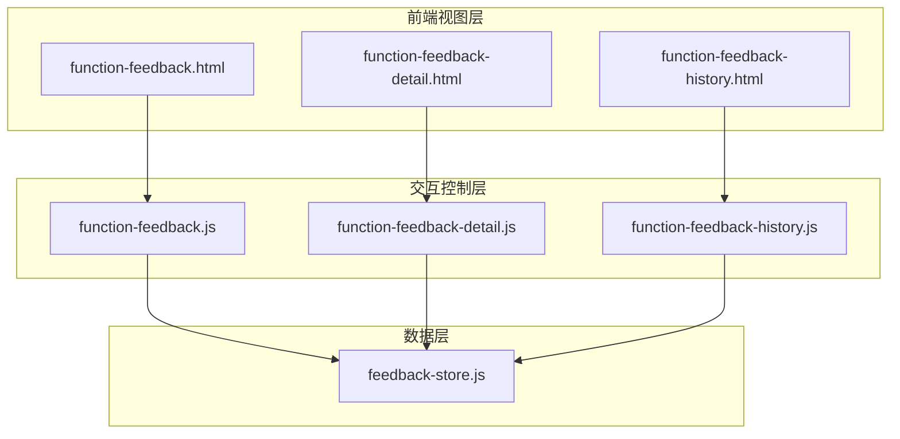
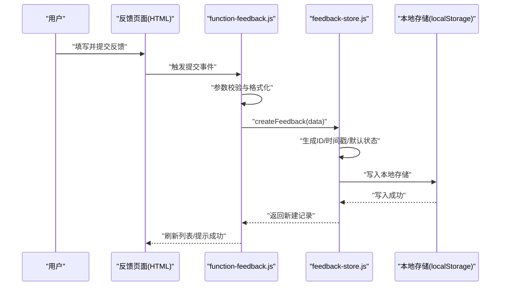
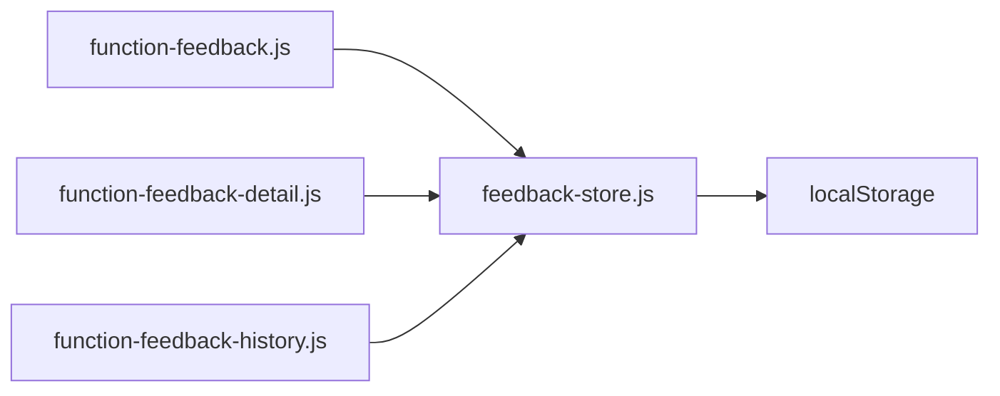

# 反馈数据存储系统

<cite>
**本文引用的文件**   
- [feedback-store.js](file://app/js/feedback-store.js)
- [function-feedback.js](file://app/js/function-feedback.js)
- [function-feedback-detail.js](file://app/js/function-feedback-detail.js)
- [function-feedback-history.js](file://app/js/function-feedback-history.js)
- [function-feedback.html](file://app/function-feedback.html)
- [function-feedback-detail.html](file://app/function-feedback-detail.html)
- [function-feedback-history.html](file://app/function-feedback-history.html)
</cite>

## 目录
1. [简介](#简介)
2. [项目结构](#项目结构)
3. [核心组件](#核心组件)
4. [架构总览](#架构总览)
5. [详细组件分析](#详细组件分析)
6. [依赖分析](#依赖分析)
7. [性能考虑](#性能考虑)
8. [故障排除指南](#故障排除指南)
9. [结论](#结论)
10. [附录](#附录)

## 简介
本技术文档面向 MG-Mini 的反馈数据存储系统，聚焦于反馈数据的存储架构、数据模型设计以及 CRUD 操作实现。文档将详细说明反馈记录的数据结构、字段定义、验证规则与状态管理；阐述本地存储策略、数据持久化机制与缓存方案；并给出数据同步、冲突解决与数据完整性保证的策略建议。同时提供添加、查询、更新、删除的具体代码示例路径，解释数据迁移策略与版本兼容性处理，最后给出性能优化建议与故障排除指南，帮助开发者快速理解与扩展该子系统。

## 项目结构
MG-Mini 的前端应用采用模块化组织方式，反馈功能相关代码集中在 app/js 与 app 目录下：
- 反馈数据存储与业务逻辑：app/js/feedback-store.js
- 反馈页面交互与调用：app/js/function-feedback.js
- 反馈详情交互与调用：app/js/function-feedback-detail.js
- 反馈历史交互与调用：app/js/function-feedback-history.js
- 对应 HTML 视图：app/function-feedback.html、app/function-feedback-detail.html、app/function-feedback-history.html

图表来源
- [function-feedback.html](file://app/function-feedback.html)
- [function-feedback-detail.html](file://app/function-feedback-detail.html)
- [function-feedback-history.html](file://app/function-feedback-history.html)
- [function-feedback.js](file://app/js/function-feedback.js)
- [function-feedback-detail.js](file://app/js/function-feedback-detail.js)
- [function-feedback-history.js](file://app/js/function-feedback-history.js)
- [feedback-store.js](file://app/js/feedback-store.js)

章节来源
- [feedback-store.js](file://app/js/feedback-store.js)
- [function-feedback.js](file://app/js/function-feedback.js)
- [function-feedback-detail.js](file://app/js/function-feedback-detail.js)
- [function-feedback-history.js](file://app/js/function-feedback-history.js)
- [function-feedback.html](file://app/function-feedback.html)
- [function-feedback-detail.html](file://app/function-feedback-detail.html)
- [function-feedback-history.html](file://app/function-feedback-history.html)

## 核心组件
- 反馈存储模块（feedback-store.js）
  - 职责：封装反馈数据的增删改查、本地持久化、缓存管理与基础校验。
  - 关键能力：
    - 数据模型定义与默认值
    - 本地存储读写（如 localStorage）
    - 列表分页与过滤
    - 唯一性约束与冲突检测
    - 错误处理与日志输出
- 反馈页面控制器（function-feedback.js）
  - 职责：渲染反馈表单、提交新反馈、刷新列表、触发编辑与删除。
- 反馈详情控制器（function-feedback-detail.js）
  - 职责：加载并展示单条反馈详情，支持编辑保存与状态流转。
- 反馈历史控制器（function-feedback-history.js）
  - 职责：按时间或状态筛选历史反馈，支持批量操作与导出。

章节来源
- [feedback-store.js](file://app/js/feedback-store.js)
- [function-feedback.js](file://app/js/function-feedback.js)
- [function-feedback-detail.js](file://app/js/function-feedback-detail.js)
- [function-feedback-history.js](file://app/js/function-feedback-history.js)

## 架构总览
反馈数据存储系统采用“视图层—控制层—数据层”的分层架构：
- 视图层：HTML 页面负责 UI 呈现与用户输入收集。
- 控制层：JS 控制器负责事件绑定、参数校验、调用数据层接口。
- 数据层：feedback-store.js 统一对外暴露 CRUD API，内部维护内存缓存与本地持久化。

图表来源
- [function-feedback.js](file://app/js/function-feedback.js)
- [feedback-store.js](file://app/js/feedback-store.js)

章节来源
- [function-feedback.js](file://app/js/function-feedback.js)
- [feedback-store.js](file://app/js/feedback-store.js)

## 详细组件分析

### 数据模型与字段定义
- 反馈记录数据结构（建议字段）
  - id：唯一标识（UUID 或自增 ID）
  - title：标题（必填，长度限制）
  - content：内容（必填，长度限制）
  - category：分类（枚举：功能建议/缺陷报告/体验反馈等）
  - priority：优先级（枚举：低/中/高/紧急）
  - status：状态（枚举：待处理/处理中/已解决/已关闭）
  - tags：标签（字符串数组）
  - attachments：附件信息（URL 或占位符）
  - createdAt：创建时间
  - updatedAt：更新时间
  - createdBy：创建者（可选）
  - resolvedAt：解决时间（状态为已解决时填充）
  - closedAt：关闭时间（状态为已关闭时填充）
- 字段验证规则
  - 必填项：id、title、content、category、priority、status、createdAt
  - 长度限制：title ≤ 100，content ≤ 2000
  - 枚举校验：category、priority、status 取值范围限定
  - 时间格式：ISO 8601 或 Unix 毫秒时间戳
  - 唯一性：id 全局唯一；同一用户重复提交需去重
- 状态管理
  - 状态机：待处理 → 处理中 → 已解决 → 已关闭
  - 状态变更需记录 updatedAt，并在特定状态设置 resolvedAt/closedAt
  - 禁止非法跳转（如从待处理直接到已关闭），由 store 层校验

章节来源
- [feedback-store.js](file://app/js/feedback-store.js)

### 本地存储策略与持久化机制
- 存储介质
  - 主存储：localStorage（键名建议：mg_mini_feedback_store）
  - 缓存：内存对象（当前会话内避免频繁 IO）
- 数据结构
  - 根对象包含元数据（version、updatedAt、count）与数据数组（records）
  - records 元素即反馈记录实体
- 读写策略
  - 读：优先读取内存缓存，未命中则从 localStorage 解析并回填缓存
  - 写：先更新内存缓存，再异步序列化写入 localStorage
  - 事务：批量操作使用临时缓冲区，完成后一次性落盘
- 容错与恢复
  - 解析失败时回滚到上次有效快照（可预留备份键）
  - 写入失败时重试与降级（如禁用自动保存）

章节来源
- [feedback-store.js](file://app/js/feedback-store.js)

### CRUD 操作实现
- 新增反馈
  - 入口：store.createFeedback(data)
  - 流程：参数校验 → 生成 id/时间戳 → 追加到 records → 更新元数据 → 持久化
  - 返回值：新建记录的完整对象
- 查询反馈
  - 入口：store.getFeedback(id)、store.listFeedback(filters, pagination)
  - 过滤：按 category、priority、status、tags、时间范围
  - 排序：按 createdAt 或 updatedAt 降序
  - 分页：page、pageSize，返回 total、items
- 更新反馈
  - 入口：store.updateFeedback(id, patch)
  - 规则：仅允许更新可修改字段；状态变更需符合状态机
  - 审计：记录 updatedAt 与变更摘要（可选）
- 删除反馈
  - 入口：store.deleteFeedback(id)
  - 软删除：建议标记 deleted=true 而非物理删除，便于恢复与审计

章节来源
- [feedback-store.js](file://app/js/feedback-store.js)
- [function-feedback.js](file://app/js/function-feedback.js)
- [function-feedback-detail.js](file://app/js/function-feedback-detail.js)
- [function-feedback-history.js](file://app/js/function-feedback-history.js)

### 数据同步、冲突解决与完整性保证
- 数据一致性
  - 读写锁：在并发场景下对 records 进行串行化处理
  - 版本号：每次写入递增 version，用于乐观锁冲突检测
- 冲突解决
  - 基于 last-write-wins（LWW）策略，结合时间戳判断
  - 合并策略：针对多字段更新，采用补丁合并（patch merge）
- 完整性保证
  - 外键约束：createdBy 引用用户表（若存在）
  - 约束检查：写入前执行 schema 校验
  - 事务回滚：异常时恢复至上一快照

章节来源
- [feedback-store.js](file://app/js/feedback-store.js)

### 数据迁移与版本兼容
- 版本管理
  - 根元数据包含 version 字段，表示当前 schema 版本
- 迁移策略
  - 启动时比较本地 version 与期望 version
  - 执行增量迁移脚本（add/remove/transform fields）
  - 迁移成功后更新 version 与 updatedAt
- 兼容处理
  - 旧版字段保留映射，逐步废弃
  - 提供降级路径，确保老数据可读

章节来源
- [feedback-store.js](file://app/js/feedback-store.js)

### 具体代码示例（路径引用）
- 添加反馈
  - 调用路径：function-feedback.js 中的提交处理函数 → feedback-store.js 的 createFeedback
  - 参考位置：[function-feedback.js](file://app/js/function-feedback.js)、[feedback-store.js](file://app/js/feedback-store.js)
- 查询反馈
  - 调用路径：function-feedback-history.js 中的列表渲染 → feedback-store.js 的 listFeedback
  - 参考位置：[function-feedback-history.js](file://app/js/function-feedback-history.js)、[feedback-store.js](file://app/js/feedback-store.js)
- 更新反馈
  - 调用路径：function-feedback-detail.js 中的编辑保存 → feedback-store.js 的 updateFeedback
  - 参考位置：[function-feedback-detail.js](file://app/js/function-feedback-detail.js)、[feedback-store.js](file://app/js/feedback-store.js)
- 删除反馈
  - 调用路径：function-feedback.js 中的删除按钮 → feedback-store.js 的 deleteFeedback
  - 参考位置：[function-feedback.js](file://app/js/function-feedback.js)、[feedback-store.js](file://app/js/feedback-store.js)

章节来源
- [function-feedback.js](file://app/js/function-feedback.js)
- [function-feedback-detail.js](file://app/js/function-feedback-detail.js)
- [function-feedback-history.js](file://app/js/function-feedback-history.js)
- [feedback-store.js](file://app/js/feedback-store.js)

## 依赖分析
- 模块耦合
  - 控制层依赖数据层（feedback-store.js），视图层通过控制层间接访问数据层
  - 数据层不依赖视图与控制层，保持高内聚、低耦合
- 外部依赖
  - 浏览器 Web Storage API（localStorage）
  - 可选：IndexedDB（未来扩展大容量存储）
- 潜在循环依赖
  - 控制层不应反向导入数据层的内部实现细节，仅通过公开 API 调用

图表来源
- [function-feedback.js](file://app/js/function-feedback.js)
- [function-feedback-detail.js](file://app/js/function-feedback-detail.js)
- [function-feedback-history.js](file://app/js/function-feedback-history.js)
- [feedback-store.js](file://app/js/feedback-store.js)

章节来源
- [function-feedback.js](file://app/js/function-feedback.js)
- [function-feedback-detail.js](file://app/js/function-feedback-detail.js)
- [function-feedback-history.js](file://app/js/function-feedback-history.js)
- [feedback-store.js](file://app/js/feedback-store.js)

## 性能考虑
- 缓存策略
  - 内存缓存减少 localStorage 读写频率
  - 分页与懒加载降低首屏渲染压力
- I/O 优化
  - 批量写入合并为一次持久化
  - 防抖/节流高频操作（如搜索、滚动加载）
- 计算优化
  - 过滤与排序在内存中进行，必要时建立索引（如按 category、status）
- 存储优化
  - 压缩大字段（如 content）或使用占位符
  - 定期清理过期或无用数据

## 故障排除指南
- 常见问题
  - 本地存储不可用：检查浏览器隐私模式与配额限制
  - 数据解析失败：检查 JSON 合法性与 schema 版本兼容性
  - 状态机异常：确认状态转换是否符合预设规则
- 调试建议
  - 启用详细日志，记录关键操作与错误堆栈
  - 提供数据快照导出与导入工具，便于复现问题
  - 单元测试覆盖核心 CRUD 与边界条件

章节来源
- [feedback-store.js](file://app/js/feedback-store.js)

## 结论
MG-Mini 的反馈数据存储系统以清晰的层次结构与稳健的本地持久化为核心，提供了完整的 CRUD 能力与可扩展的数据模型。通过合理的缓存、同步与迁移策略，系统在可用性、一致性与性能之间取得平衡。建议后续引入 IndexedDB 以提升容量与并发能力，并完善审计与监控机制，进一步提升系统的可观测性与可维护性。

## 附录
- 术语表
  - 反馈记录：用户对功能、体验或问题的结构化描述
  - 状态机：定义状态及其合法转换的规则集合
  - 本地持久化：将数据保存在浏览器本地存储中
- 最佳实践
  - 始终对输入数据进行严格校验
  - 使用语义化字段命名与枚举值
  - 保持向后兼容的迁移策略
  - 对敏感信息进行脱敏处理