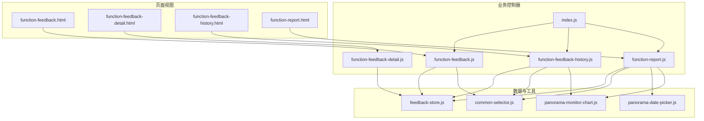
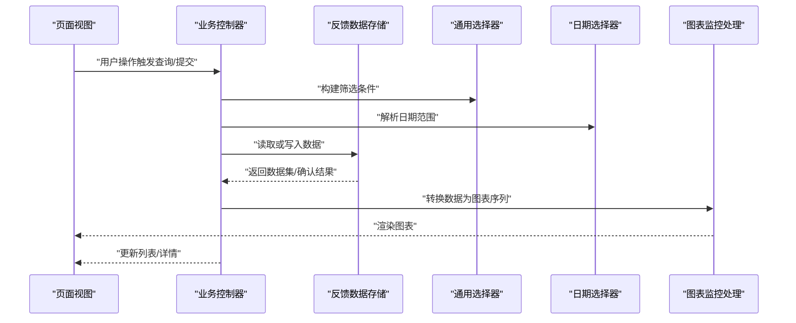
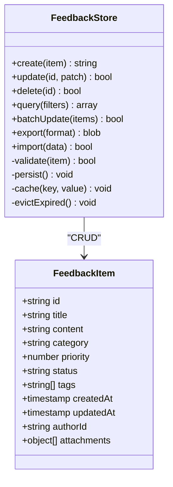
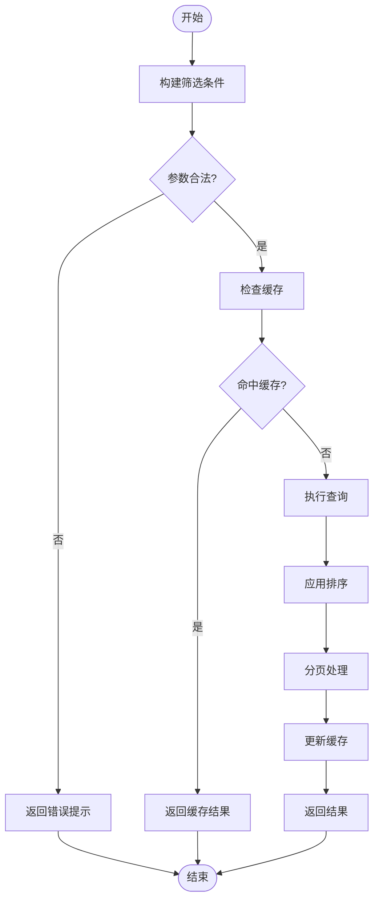
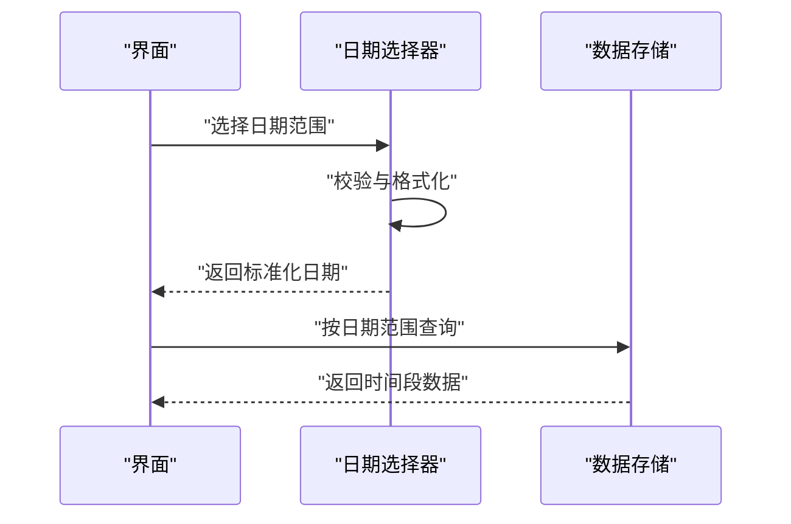
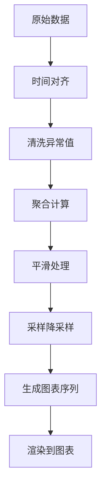
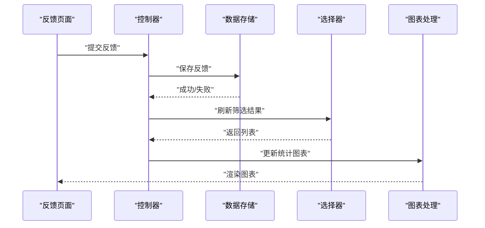
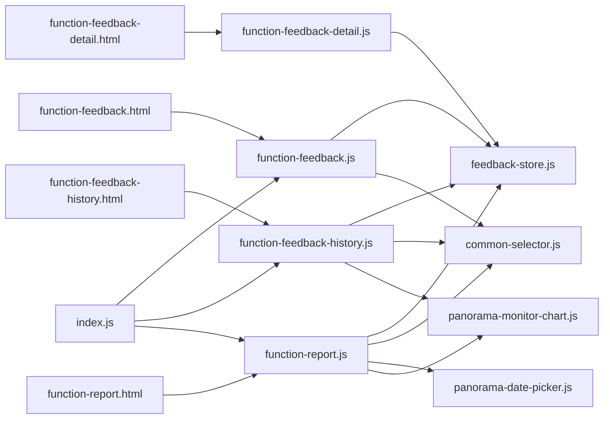
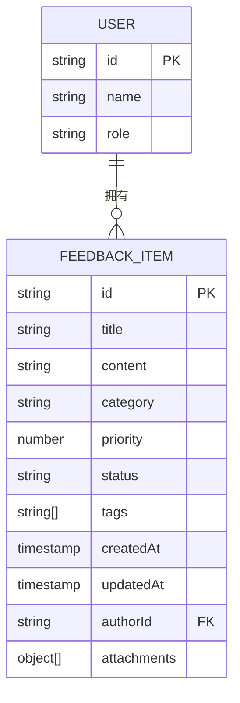

# 数据管理与存储

<cite>
**本文引用的文件**   
- [feedback-store.js](file://app/js/feedback-store.js)
- [common-selector.js](file://app/js/common-selector.js)
- [panorama-date-picker.js](file://app/js/panorama-date-picker.js)
- [panorama-monitor-chart.js](file://app/js/panorama-monitor-chart.js)
- [function-feedback.js](file://app/js/function-feedback.js)
- [function-feedback-detail.js](file://app/js/function-feedback-detail.js)
- [function-feedback-history.js](file://app/js/function-feedback-history.js)
- [function-report.js](file://app/js/function-report.js)
- [index.js](file://app/js/index.js)
- [function-feedback.html](file://app/function-feedback.html)
- [function-feedback-detail.html](file://app/function-feedback-detail.html)
- [function-feedback-history.html](file://app/function-feedback-history.html)
- [function-report.html](file://app/function-report.html)
- [2026-07-03-能量全景看板PRD.md](file://docs/2026-07-03-能量全景看板PRD.md)
</cite>

## 目录
1. [简介](#简介)
2. [项目结构](#项目结构)
3. [核心组件](#核心组件)
4. [架构总览](#架构总览)
5. [详细组件分析](#详细组件分析)
6. [依赖关系分析](#依赖关系分析)
7. [性能考虑](#性能考虑)
8. [故障排查指南](#故障排查指南)
9. [结论](#结论)
10. [附录](#附录)

## 简介
本文件为 MG-Mini 的数据管理与存储系统提供全面的数据模型文档。内容覆盖实体关系、字段定义与数据类型、主键/外键、索引与约束、数据验证规则与业务规则，以及数据库模式图与示例数据。同时记录数据访问模式、缓存策略与性能优化建议，明确数据生命周期、保留策略与归档规则，并给出数据迁移路径与版本管理方案。此外，还涵盖数据安全、隐私要求与访问控制，以及对反馈数据存储、通用选择器逻辑、日期选择器和图表监控数据处理方式的详细说明。

## 项目结构
MG-Mini 采用前端模块化组织方式，数据层以 JavaScript 模块为核心，HTML 页面作为视图入口，样式与脚本分离。关键数据相关文件分布如下：
- 数据持久化与状态管理：feedback-store.js
- 通用选择器逻辑：common-selector.js
- 日期选择器：panorama-date-picker.js
- 图表监控数据处理：panorama-monitor-chart.js
- 功能页面控制器：function-feedback*.js、function-report.js、index.js
- 页面模板：function-feedback*.html、function-report.html

**图示来源** 
- [function-feedback.html](file://app/function-feedback.html)
- [function-feedback-detail.html](file://app/function-feedback-detail.html)
- [function-feedback-history.html](file://app/function-feedback-history.html)
- [function-report.html](file://app/function-report.html)
- [function-feedback.js](file://app/js/function-feedback.js)
- [function-feedback-detail.js](file://app/js/function-feedback-detail.js)
- [function-feedback-history.js](file://app/js/function-feedback-history.js)
- [function-report.js](file://app/js/function-report.js)
- [index.js](file://app/js/index.js)
- [feedback-store.js](file://app/js/feedback-store.js)
- [common-selector.js](file://app/js/common-selector.js)
- [panorama-date-picker.js](file://app/js/panorama-date-picker.js)
- [panorama-monitor-chart.js](file://app/js/panorama-monitor-chart.js)

**章节来源**
- [function-feedback.html](file://app/function-feedback.html)
- [function-feedback-detail.html](file://app/function-feedback-detail.html)
- [function-feedback-history.html](file://app/function-feedback-history.html)
- [function-report.html](file://app/function-report.html)
- [function-feedback.js](file://app/js/function-feedback.js)
- [function-feedback-detail.js](file://app/js/function-feedback-detail.js)
- [function-feedback-history.js](file://app/js/function-feedback-history.js)
- [function-report.js](file://app/js/function-report.js)
- [index.js](file://app/js/index.js)
- [feedback-store.js](file://app/js/feedback-store.js)
- [common-selector.js](file://app/js/common-selector.js)
- [panorama-date-picker.js](file://app/js/panorama-date-picker.js)
- [panorama-monitor-chart.js](file://app/js/panorama-monitor-chart.js)

## 核心组件
- 反馈数据存储（feedback-store.js）
  - 职责：集中管理反馈数据的增删改查、本地持久化、状态同步与事件通知。
  - 关键点：统一数据访问接口、事务性更新、错误回滚、缓存与离线支持。
- 通用选择器（common-selector.js）
  - 职责：提供可复用的筛选、排序、分页与条件组合能力，支撑列表与报表查询。
  - 关键点：参数校验、默认值处理、结果缓存、防抖节流。
- 日期选择器（panorama-date-picker.js）
  - 职责：封装日期范围选择、时区处理、格式转换与边界校验。
  - 关键点：输入规范化、非法日期拦截、默认区间计算。
- 图表监控数据处理（panorama-monitor-chart.js）
  - 职责：将原始数据转换为图表所需序列，进行聚合、平滑与异常值处理。
  - 关键点：时间对齐、缺失值填充、采样降采样、渲染性能优化。

**章节来源**
- [feedback-store.js](file://app/js/feedback-store.js)
- [common-selector.js](file://app/js/common-selector.js)
- [panorama-date-picker.js](file://app/js/panorama-date-picker.js)
- [panorama-monitor-chart.js](file://app/js/panorama-monitor-chart.js)

## 架构总览
整体数据流遵循“视图 → 控制器 → 数据层”的分层模式：
- 视图层（HTML）负责用户交互与展示。
- 控制器层（JS）协调业务逻辑，调用数据层与工具模块。
- 数据层（feedback-store.js）提供统一的 CRUD 与持久化能力。
- 工具层（common-selector.js、panorama-date-picker.js、panorama-monitor-chart.js）提供筛选、日期与图表数据处理能力。

**图示来源** 
- [function-feedback.js](file://app/js/function-feedback.js)
- [function-feedback-detail.js](file://app/js/function-feedback-detail.js)
- [function-feedback-history.js](file://app/js/function-feedback-history.js)
- [function-report.js](file://app/js/function-report.js)
- [feedback-store.js](file://app/js/feedback-store.js)
- [common-selector.js](file://app/js/common-selector.js)
- [panorama-date-picker.js](file://app/js/panorama-date-picker.js)
- [panorama-monitor-chart.js](file://app/js/panorama-monitor-chart.js)

## 详细组件分析

### 反馈数据存储（feedback-store.js）
- 数据模型
  - 实体：反馈项（FeedbackItem）
  - 字段与类型（示例）：
    - id: 字符串（唯一标识）
    - title: 字符串（标题）
    - content: 字符串（内容）
    - category: 字符串（分类）
    - priority: 数字（优先级）
    - status: 字符串（状态）
    - tags: 字符串数组（标签）
    - createdAt: 时间戳（创建时间）
    - updatedAt: 时间戳（更新时间）
    - authorId: 字符串（作者ID）
    - attachments: 对象数组（附件信息）
  - 主键：id（唯一）
  - 外键：authorId（关联用户）
  - 索引建议：createdAt、status、category、tags（用于快速筛选与排序）
  - 约束：
    - id 非空且唯一
    - title 非空且长度限制
    - status 枚举值限定
    - createdAt ≤ updatedAt
- 数据访问模式
  - 读：按条件查询、分页、排序、去重
  - 写：新增、更新、删除、批量操作
  - 事务：保证一致性，失败回滚
  - 缓存：内存缓存 + 本地存储（如 localStorage/sessionStorage）
- 验证与业务规则
  - 必填字段校验、格式校验、业务状态机（如草稿→已提交→已处理）
  - 权限校验（仅作者或管理员可编辑/删除）
- 生命周期与保留策略
  - 活跃期：最近 N 天全量保留
  - 归档期：超过阈值转入归档表或冷存储
  - 清理策略：定期清理过期附件与临时数据
- 安全与隐私
  - 敏感字段脱敏（如作者ID在非必要场景隐藏）
  - 输入过滤与输出编码，防止注入
  - 访问控制基于角色与资源归属

**图示来源** 
- [feedback-store.js](file://app/js/feedback-store.js)

**章节来源**
- [feedback-store.js](file://app/js/feedback-store.js)

### 通用选择器（common-selector.js）
- 职责
  - 提供统一的筛选条件构建、参数序列化、结果缓存与分页支持。
- 数据结构
  - 筛选条件对象：包含字段名、操作符、值、逻辑运算符（AND/OR）
  - 排序规则：字段名、方向（asc/desc）
  - 分页参数：页码、每页大小
- 算法与复杂度
  - 条件匹配 O(n) 线性扫描；可通过索引优化至 O(log n)
  - 缓存命中后 O(1) 返回
- 验证与容错
  - 非法操作符拦截、默认值回退、空结果处理
- 使用场景
  - 反馈历史列表、报表筛选、仪表盘过滤

**图示来源** 
- [common-selector.js](file://app/js/common-selector.js)

**章节来源**
- [common-selector.js](file://app/js/common-selector.js)

### 日期选择器（panorama-date-picker.js）
- 职责
  - 日期范围选择、时区处理、格式转换、边界校验。
- 数据结构
  - startDate、endDate（ISO 8601 字符串）
  - timezone（偏移量或区域标识）
  - format（显示格式）
- 业务规则
  - 起始日期不得晚于结束日期
  - 默认区间为最近 7/30/90 天
  - 非法输入自动修正或拒绝
- 性能优化
  - 防抖输入、最小化 DOM 操作、懒加载日历面板

**图示来源** 
- [panorama-date-picker.js](file://app/js/panorama-date-picker.js)

**章节来源**
- [panorama-date-picker.js](file://app/js/panorama-date-picker.js)

### 图表监控数据处理（panorama-monitor-chart.js）
- 职责
  - 将原始数据转换为图表序列，进行聚合、平滑、异常值处理与采样。
- 数据结构
  - 时间序列：[{time, value}, ...]
  - 聚合维度：按小时/天/周聚合
  - 指标类型：数值型、布尔型、枚举型
- 算法与复杂度
  - 聚合 O(n)；平滑与插值 O(n)；采样降采样 O(n/k)
- 渲染优化
  - 增量更新、虚拟滚动、Web Worker 计算密集任务

**图示来源** 
- [panorama-monitor-chart.js](file://app/js/panorama-monitor-chart.js)

**章节来源**
- [panorama-monitor-chart.js](file://app/js/panorama-monitor-chart.js)

### 反馈相关页面控制器
- function-feedback.js
  - 负责新建与编辑反馈，调用 feedback-store.js 进行保存，联动 common-selector.js 进行即时筛选。
- function-feedback-detail.js
  - 负责单条反馈详情展示与编辑，权限校验与版本历史查看。
- function-feedback-history.js
  - 负责反馈历史列表，支持多条件筛选、分页与导出。
- function-report.js
  - 负责报表生成，结合日期选择器与图表监控处理进行数据聚合与可视化。

**图示来源** 
- [function-feedback.js](file://app/js/function-feedback.js)
- [function-feedback-detail.js](file://app/js/function-feedback-detail.js)
- [function-feedback-history.js](file://app/js/function-feedback-history.js)
- [function-report.js](file://app/js/function-report.js)
- [feedback-store.js](file://app/js/feedback-store.js)
- [common-selector.js](file://app/js/common-selector.js)
- [panorama-monitor-chart.js](file://app/js/panorama-monitor-chart.js)

**章节来源**
- [function-feedback.js](file://app/js/function-feedback.js)
- [function-feedback-detail.js](file://app/js/function-feedback-detail.js)
- [function-feedback-history.js](file://app/js/function-feedback-history.js)
- [function-report.js](file://app/js/function-report.js)

## 依赖关系分析
- 控制器对数据层的依赖：所有页面控制器均依赖 feedback-store.js 进行数据读写。
- 工具模块的复用：common-selector.js、panorama-date-picker.js、panorama-monitor-chart.js 被多个控制器共享。
- 页面与控制器耦合：HTML 通过 index.js 初始化各功能模块，避免直接耦合。

**图示来源** 
- [function-feedback.html](file://app/function-feedback.html)
- [function-feedback-detail.html](file://app/function-feedback-detail.html)
- [function-feedback-history.html](file://app/function-feedback-history.html)
- [function-report.html](file://app/function-report.html)
- [index.js](file://app/js/index.js)
- [function-feedback.js](file://app/js/function-feedback.js)
- [function-feedback-detail.js](file://app/js/function-feedback-detail.js)
- [function-feedback-history.js](file://app/js/function-feedback-history.js)
- [function-report.js](file://app/js/function-report.js)
- [feedback-store.js](file://app/js/feedback-store.js)
- [common-selector.js](file://app/js/common-selector.js)
- [panorama-date-picker.js](file://app/js/panorama-date-picker.js)
- [panorama-monitor-chart.js](file://app/js/panorama-monitor-chart.js)

**章节来源**
- [index.js](file://app/js/index.js)
- [function-feedback.js](file://app/js/function-feedback.js)
- [function-feedback-detail.js](file://app/js/function-feedback-detail.js)
- [function-feedback-history.js](file://app/js/function-feedback-history.js)
- [function-report.js](file://app/js/function-report.js)
- [feedback-store.js](file://app/js/feedback-store.js)
- [common-selector.js](file://app/js/common-selector.js)
- [panorama-date-picker.js](file://app/js/panorama-date-picker.js)
- [panorama-monitor-chart.js](file://app/js/panorama-monitor-chart.js)

## 性能考虑
- 数据访问
  - 使用索引加速查询（createdAt、status、category、tags）
  - 分页与懒加载减少首屏负载
  - 批量操作合并多次写入
- 缓存策略
  - 内存缓存热点数据（如筛选结果、图表序列）
  - 本地存储持久化用户偏好与临时数据
  - 缓存失效策略（TTL、LRU）
- 渲染优化
  - 增量更新 DOM，避免整页重绘
  - Web Worker 处理复杂计算（如大数据集聚合）
- 网络与离线
  - 请求去重与重试机制
  - 离线队列与同步策略

[本节为通用指导，不直接分析具体文件]

## 故障排查指南
- 常见问题
  - 数据不一致：检查事务回滚与缓存同步
  - 筛选结果异常：验证筛选条件合法性与默认值
  - 图表渲染卡顿：检查数据规模与采样策略
  - 日期解析错误：确认时区与格式规范
- 调试建议
  - 启用日志记录关键步骤（输入、输出、异常）
  - 使用浏览器开发者工具断点调试
  - 单元测试覆盖核心逻辑（验证、转换、聚合）

**章节来源**
- [feedback-store.js](file://app/js/feedback-store.js)
- [common-selector.js](file://app/js/common-selector.js)
- [panorama-date-picker.js](file://app/js/panorama-date-picker.js)
- [panorama-monitor-chart.js](file://app/js/panorama-monitor-chart.js)

## 结论
MG-Mini 的数据管理与存储系统以 feedback-store.js 为核心，配合通用选择器、日期选择器与图表监控处理模块，形成清晰的分层架构。通过合理的实体设计、索引与约束、验证与业务规则、缓存与性能优化策略，以及完善的安全与隐私措施，系统能够高效、稳定地支撑反馈管理、历史查询与报表可视化等核心功能。建议持续迭代数据模型与访问逻辑，确保可扩展性与可维护性。

[本节为总结性内容，不直接分析具体文件]

## 附录

### 数据模型与示例
- 实体关系图（ER）

**图示来源** 
- [feedback-store.js](file://app/js/feedback-store.js)

### 数据迁移与版本管理
- 迁移策略
  - 版本号字段（schemaVersion）跟踪结构变更
  - 向后兼容的增量迁移脚本
  - 回滚机制与数据备份
- 版本管理
  - 语义化版本控制（主版本.次版本.修订号）
  - 变更日志与影响评估

[本节为通用指导，不直接分析具体文件]

### 安全、隐私与访问控制
- 数据安全
  - 输入过滤与输出编码
  - 敏感字段脱敏与加密存储
- 隐私合规
  - 最小化数据采集与用途声明
  - 用户同意与撤回机制
- 访问控制
  - 基于角色的访问控制（RBAC）
  - 资源级权限校验（作者/管理员）

[本节为通用指导，不直接分析具体文件]

### 参考文档
- [2026-07-03-能量全景看板PRD.md](file://docs/2026-07-03-能量全景看板PRD.md)

**章节来源**
- [2026-07-03-能量全景看板PRD.md](file://docs/2026-07-03-能量全景看板PRD.md)