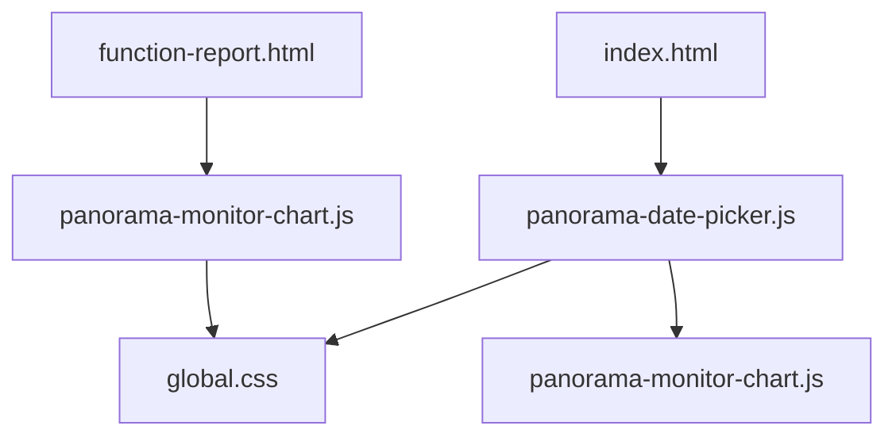
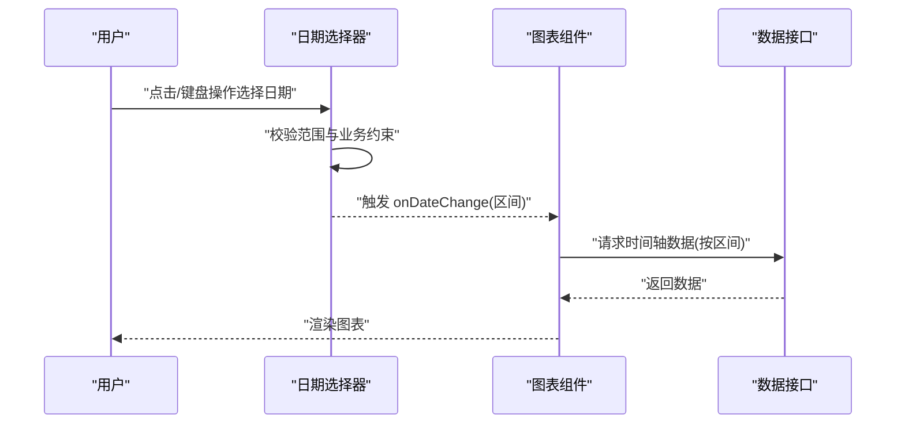
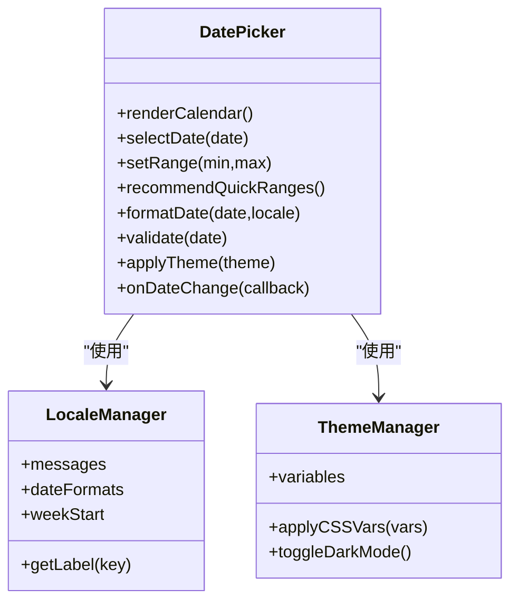
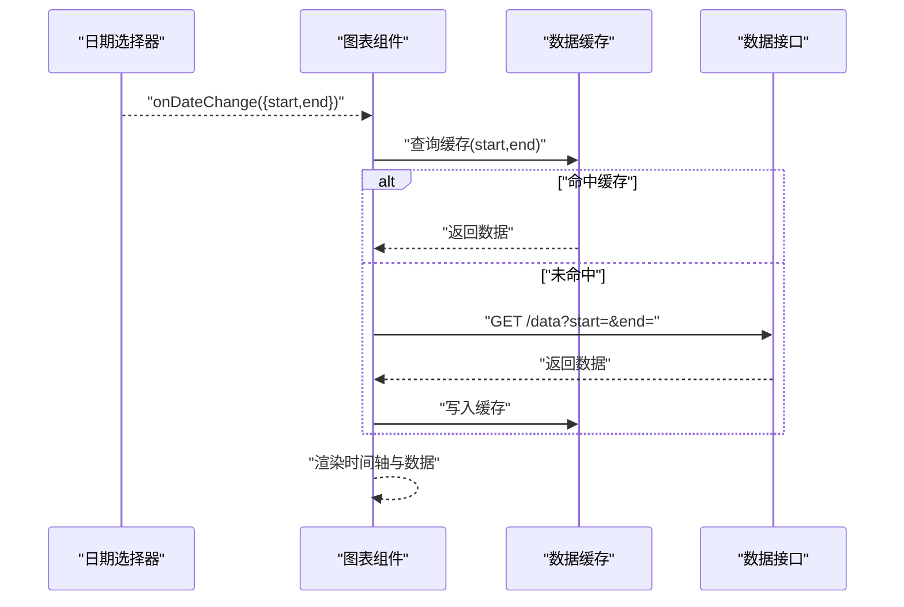
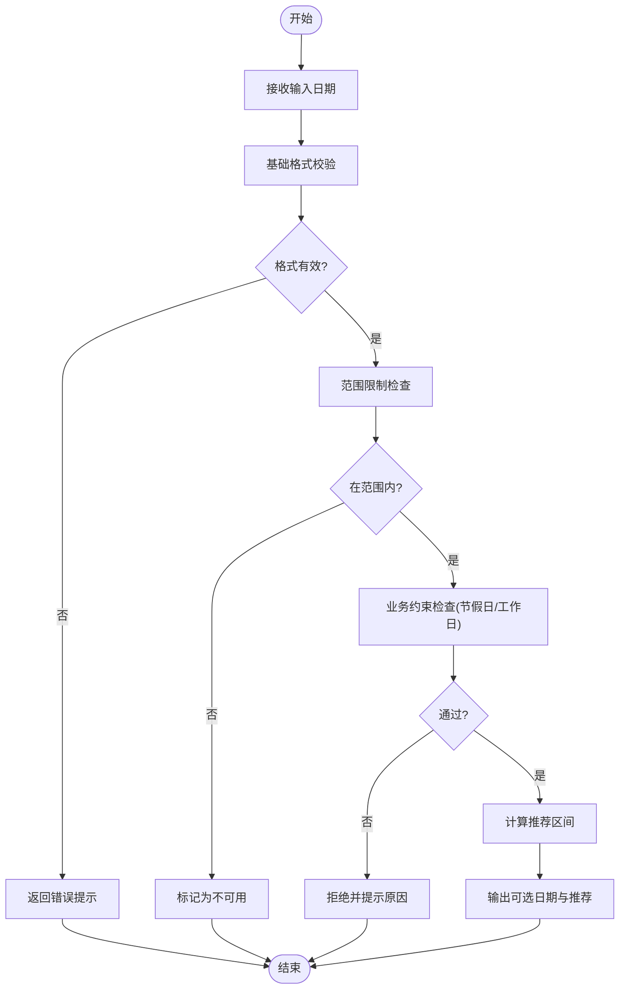
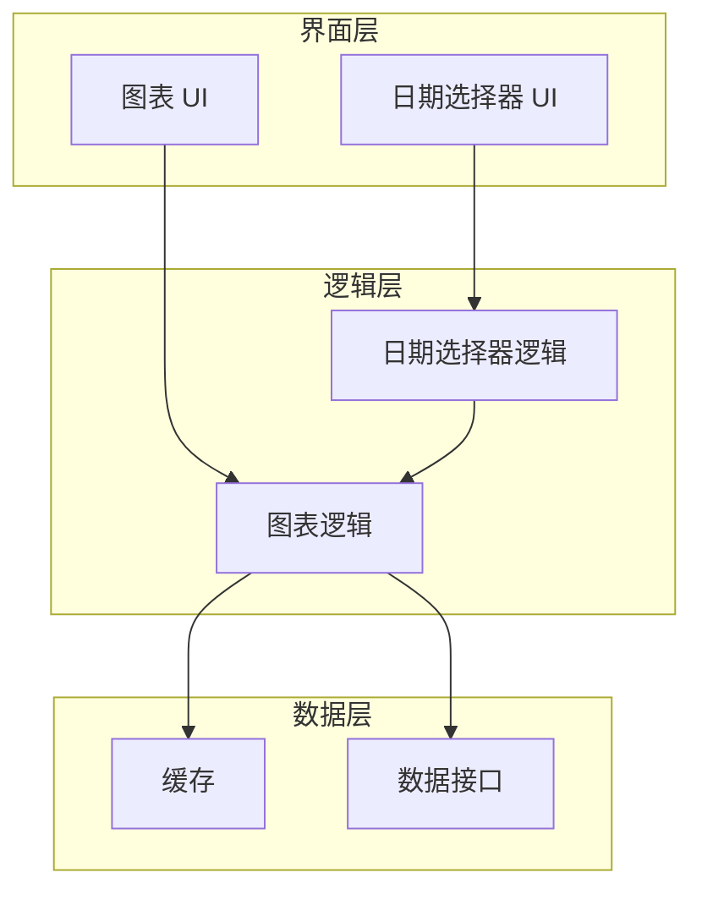
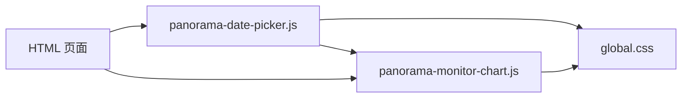

# 日期选择器模块

<cite>
**本文引用的文件**   
- [panorama-date-picker.js](file://app/js/panorama-date-picker.js)
- [panorama-monitor-chart.js](file://app/js/panorama-monitor-chart.js)
- [index.html](file://app/index.html)
- [function-report.html](file://app/function-report.html)
- [global.css](file://app/css/global.css)
- [2026-07-03-能量全景看板PRD.md](file://docs/2026-07-03-能量全景看板PRD.md)
</cite>

## 目录
1. [简介](#简介)
2. [项目结构](#项目结构)
3. [核心组件](#核心组件)
4. [架构总览](#架构总览)
5. [详细组件分析](#详细组件分析)
6. [依赖关系分析](#依赖关系分析)
7. [性能考虑](#性能考虑)
8. [故障排查指南](#故障排查指南)
9. [结论](#结论)
10. [附录](#附录)

## 简介
本技术文档聚焦 MG-Mini 的全景日期选择器模块，围绕日期格式化、时区处理与国际化支持展开，系统阐述日历渲染算法、日期范围限制与智能推荐逻辑。文档同时覆盖用户交互流程、键盘导航与屏幕阅读器支持，并给出日期验证规则、业务时间约束与节假日识别策略。此外，提供配置选项说明、自定义主题样式方法、多语言与本地化配置、日期格式定制，以及与图表数据的时间轴集成和实时数据更新机制。最后包含性能优化策略与移动端适配方案，帮助开发者快速理解与高效扩展该模块。

## 项目结构
MG-Mini 的前端资源按功能页面与脚本分离组织：
- 页面入口与功能页：app/index.html、app/function-report.html 等
- 脚本模块：app/js/panorama-date-picker.js（日期选择器）、app/js/panorama-monitor-chart.js（图表集成）
- 全局样式：app/css/global.css
- 需求文档：docs/2026-07-03-能量全景看板PRD.md

图示来源 
- [index.html](file://app/index.html)
- [function-report.html](file://app/function-report.html)
- [panorama-date-picker.js](file://app/js/panorama-date-picker.js)
- [panorama-monitor-chart.js](file://app/js/panorama-monitor-chart.js)
- [global.css](file://app/css/global.css)

章节来源
- [index.html](file://app/index.html)
- [function-report.html](file://app/function-report.html)
- [panorama-date-picker.js](file://app/js/panorama-date-picker.js)
- [panorama-monitor-chart.js](file://app/js/panorama-monitor-chart.js)
- [global.css](file://app/css/global.css)

## 核心组件
- 日期选择器组件：负责日历渲染、日期选择、范围校验、智能推荐、键盘与无障碍访问、国际化与本地化、主题样式注入。
- 图表集成组件：负责将选中的日期区间映射到时间轴，驱动图表数据加载与刷新，支持实时更新。
- 全局样式：提供主题变量与通用 UI 样式，便于日期选择器与图表统一外观。

章节来源
- [panorama-date-picker.js](file://app/js/panorama-date-picker.js)
- [panorama-monitor-chart.js](file://app/js/panorama-monitor-chart.js)
- [global.css](file://app/css/global.css)

## 架构总览
日期选择器与图表通过事件总线或回调进行解耦通信：选择器输出标准化日期对象与区间，图表消费这些数据进行时间轴对齐与数据拉取。

图示来源 
- [panorama-date-picker.js](file://app/js/panorama-date-picker.js)
- [panorama-monitor-chart.js](file://app/js/panorama-monitor-chart.js)

章节来源
- [panorama-date-picker.js](file://app/js/panorama-date-picker.js)
- [panorama-monitor-chart.js](file://app/js/panorama-monitor-chart.js)

## 详细组件分析

### 日期选择器组件
- 日历渲染算法
  - 基于目标月份生成网格，计算首尾偏移，渲染周标题与日期单元格。
  - 支持多视图切换（月视图为主，可扩展周视图）。
  - 高亮当前日、选中日、范围起止与不可用状态。
- 日期范围限制
  - 最小/最大日期边界控制，超出范围的单元格禁用。
  - 业务时间约束（如仅允许工作日、排除节假日），通过过滤函数实现。
- 智能推荐逻辑
  - 根据当前时间与业务场景推荐“最近7天”“本月”“最近30天”等快捷区间。
  - 结合历史选择与常用区间进行个性化推荐。
- 用户交互与键盘导航
  - Tab/Shift+Tab 在单元格间移动，Enter/Space 确认选择，方向键移动焦点。
  - Esc 关闭面板，F1/F2 打开帮助提示。
- 屏幕阅读器支持
  - aria-label、aria-live、role="grid"、aria-selected 等语义标注。
  - 读屏播报当前选中日期与可用状态。
- 日期格式化与时区处理
  - 输入/输出采用 ISO 8601 字符串，内部使用 UTC 存储避免夏令时问题。
  - 展示层按区域设置格式化（YYYY-MM-DD、DD/MM/YYYY 等）。
- 国际化与本地化
  - 多语言文案（月份名、星期名、提示信息）通过 locale 配置注入。
  - 数字与日期格式遵循 Intl.DateTimeFormat 规范。
- 日期验证规则
  - 必填校验、范围校验、重复选择校验、业务约束校验（节假日/非工作时间）。
- 主题与样式
  - CSS 变量定义颜色、字号、圆角、阴影；支持明暗主题切换。
  - 提供类名约定用于覆盖默认样式。

图示来源 
- [panorama-date-picker.js](file://app/js/panorama-date-picker.js)
- [global.css](file://app/css/global.css)

章节来源
- [panorama-date-picker.js](file://app/js/panorama-date-picker.js)
- [global.css](file://app/css/global.css)

### 图表集成组件
- 时间轴映射
  - 将选择的日期区间转换为时间轴刻度与数据点索引。
  - 支持分钟/小时/日/周/月粒度自动切换。
- 数据加载与刷新
  - 监听 onDateChange 事件，发起数据请求，缓存结果减少重复请求。
  - 支持增量更新与轮询机制，保证实时性。
- 错误与空态处理
  - 网络异常重试、超时降级、空数据占位图。
- 与日期选择器的协作
  - 接收标准化日期对象，确保跨时区一致性。
  - 向选择器反馈不可用区间（如数据缺失时段）。

图示来源 
- [panorama-monitor-chart.js](file://app/js/panorama-monitor-chart.js)

章节来源
- [panorama-monitor-chart.js](file://app/js/panorama-monitor-chart.js)

### 复杂逻辑流程图（示例：日期验证与推荐）

图示来源 
- [panorama-date-picker.js](file://app/js/panorama-date-picker.js)

章节来源
- [panorama-date-picker.js](file://app/js/panorama-date-picker.js)

### 概念总览
- 日期选择器作为独立 UI 组件，关注用户体验与可访问性。
- 图表组件作为数据可视化层，关注时间轴对齐与性能。
- 两者通过标准化接口协作，确保数据一致性与实时性。

[此图为概念示意，不直接映射具体源码文件]

## 依赖关系分析
- 日期选择器依赖全局样式与本地化管理器。
- 图表组件依赖日期选择器的事件输出与数据接口。
- 页面 HTML 引入脚本与样式，完成初始化与挂载。

图示来源 
- [index.html](file://app/index.html)
- [function-report.html](file://app/function-report.html)
- [panorama-date-picker.js](file://app/js/panorama-date-picker.js)
- [panorama-monitor-chart.js](file://app/js/panorama-monitor-chart.js)
- [global.css](file://app/css/global.css)

章节来源
- [index.html](file://app/index.html)
- [function-report.html](file://app/function-report.html)
- [panorama-date-picker.js](file://app/js/panorama-date-picker.js)
- [panorama-monitor-chart.js](file://app/js/panorama-monitor-chart.js)
- [global.css](file://app/css/global.css)

## 性能考虑
- 渲染优化
  - 虚拟滚动或分页渲染大日历（如多年跨度）。
  - 防抖/节流用户输入与窗口 resize。
- 数据缓存
  - 按日期区间缓存图表数据，避免重复请求。
  - 合理设置过期策略与内存上限。
- 网络优化
  - 合并请求、压缩响应、断线重连。
- 移动端适配
  - 触摸手势支持（滑动切换月份、长按多选）。
  - 视口自适应与字体缩放。
- 可访问性
  - 键盘可达性与读屏兼容，降低认知负担。

[本节为通用指导，不直接分析具体文件]

## 故障排查指南
- 常见问题
  - 日期显示错位：检查时区与区域设置是否正确。
  - 选择无效：查看范围限制与业务约束是否过于严格。
  - 图表无数据：确认 onDateChange 事件是否触发，接口是否正常返回。
- 调试建议
  - 打印选择器输出的标准化日期对象与区间。
  - 检查缓存键是否与区间一致。
  - 使用浏览器无障碍工具验证 aria 属性。
- 日志与监控
  - 记录关键步骤的耗时与错误码。
  - 上报用户操作路径以便复现问题。

章节来源
- [panorama-date-picker.js](file://app/js/panorama-date-picker.js)
- [panorama-monitor-chart.js](file://app/js/panorama-monitor-chart.js)

## 结论
MG-Mini 的全景日期选择器模块以清晰的职责划分与稳定的接口设计，实现了强大的日期选择、范围限制、智能推荐与国际化能力。通过与图表组件的解耦协作，确保了时间轴对齐与实时数据更新的可靠性。遵循本文档的配置与优化建议，可在多平台与多语言环境下获得一致且高效的体验。

[本节为总结性内容，不直接分析具体文件]

## 附录

### 配置选项说明
- 基本配置
  - 最小/最大日期：限制可选范围。
  - 初始区间：默认展示的日期范围。
  - 快捷推荐：内置推荐项（最近7天、本月等）。
- 国际化与本地化
  - 语言代码：如 zh-CN、en-US。
  - 日期格式：如 YYYY-MM-DD、DD/MM/YYYY。
  - 周起始日：周一或周日。
- 主题与样式
  - 主题模式：明/暗。
  - 自定义变量：颜色、字号、间距等。
- 图表集成
  - 时间粒度：分钟/小时/日/周/月。
  - 数据源：接口地址与参数映射。
  - 缓存策略：有效期与最大条目数。

章节来源
- [panorama-date-picker.js](file://app/js/panorama-date-picker.js)
- [panorama-monitor-chart.js](file://app/js/panorama-monitor-chart.js)
- [global.css](file://app/css/global.css)

### 自定义主题样式方法
- 使用 CSS 变量覆盖默认值（颜色、边框、阴影）。
- 通过类名选择器覆盖特定元素样式。
- 动态切换主题（明/暗）并持久化用户偏好。

章节来源
- [global.css](file://app/css/global.css)

### 多语言支持与本地化配置
- 文案管理：月份、星期、提示信息等集中维护。
- 日期格式：依据区域设置自动格式化。
- 文本方向：支持从左到右与从右到左布局。

章节来源
- [panorama-date-picker.js](file://app/js/panorama-date-picker.js)

### 日期格式定制
- 输入解析：支持多种常见格式并容错处理。
- 输出格式化：统一为 ISO 8601，展示层按需转换。
- 区域设置：遵循 Intl 标准，确保一致性。

章节来源
- [panorama-date-picker.js](file://app/js/panorama-date-picker.js)

### 与图表数据的时间轴集成与实时更新
- 事件驱动：选择器触发 onDateChange，图表消费事件。
- 数据同步：按区间拉取数据，缓存与增量更新。
- 实时机制：轮询或 WebSocket 推送，保持图表最新。

章节来源
- [panorama-monitor-chart.js](file://app/js/panorama-monitor-chart.js)

### 业务时间约束与节假日识别
- 工作日/周末过滤：根据区域设置与节假日表。
- 节假日识别：外部节假日接口或本地表。
- 业务窗口：限定可选时间段（如营业时间）。

章节来源
- [panorama-date-picker.js](file://app/js/panorama-date-picker.js)
- [2026-07-03-能量全景看板PRD.md](file://docs/2026-07-03-能量全景看板PRD.md)

### 用户交互流程与键盘导航
- 鼠标交互：点击选择、拖拽范围、双击确认。
- 键盘导航：方向键移动、Enter/Space 确认、Esc 关闭。
- 无障碍：ARIA 标注与读屏播报。

章节来源
- [panorama-date-picker.js](file://app/js/panorama-date-picker.js)

### 移动端适配方案
- 触控手势：滑动切换月份、长按多选。
- 视口适配：弹性布局与字体缩放。
- 性能优化：减少重绘与回流，懒加载日历。

章节来源
- [panorama-date-picker.js](file://app/js/panorama-date-picker.js)
- [global.css](file://app/css/global.css)