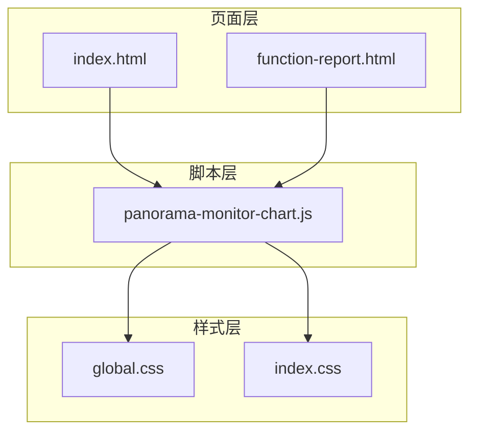
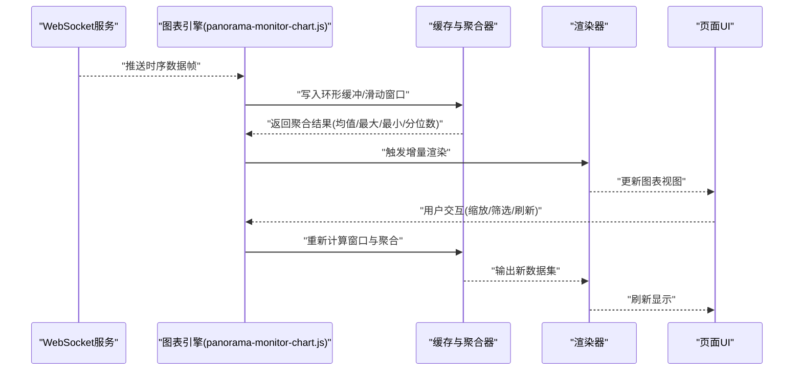
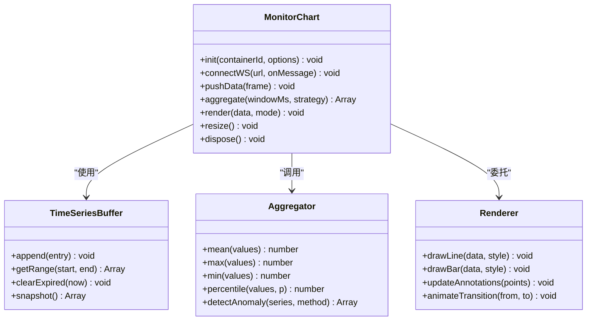
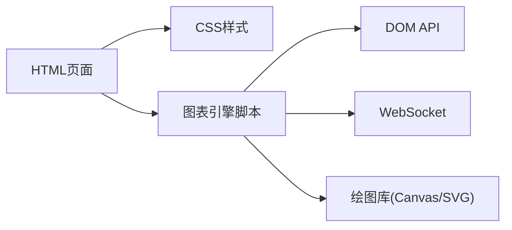

# 监控图表数据管理

<cite>
**本文引用的文件**   
- [panorama-monitor-chart.js](file://app/js/panorama-monitor-chart.js)
- [index.html](file://app/index.html)
- [function-report.html](file://app/function-report.html)
- [global.css](file://app/css/global.css)
- [index.css](file://app/css/index.css)
- [2026-07-03-能量全景看板PRD.md](file://docs/2026-07-03-能量全景看板PRD.md)
</cite>

## 目录
1. [简介](#简介)
2. [项目结构](#项目结构)
3. [核心组件](#核心组件)
4. [架构总览](#架构总览)
5. [详细组件分析](#详细组件分析)
6. [依赖关系分析](#依赖关系分析)
7. [性能考量](#性能考量)
8. [故障排查指南](#故障排查指南)
9. [结论](#结论)
10. [附录](#附录)

## 简介
本技术文档面向MG-Mini的监控图表数据管理系统，聚焦实时数据流处理、数据聚合算法与可视化渲染机制。文档涵盖图表数据类型、时间序列处理、异常检测逻辑、数据缓存策略、增量更新与内存优化、多类型图表配置与样式定制、交互功能、WebSocket接入与同步、性能监控、采样与降采样、错误处理与断线重连、调试工具与性能分析方法等。目标是帮助开发者快速理解系统设计与实现要点，并高效进行扩展与维护。

## 项目结构
本项目采用前端模块化组织方式，关键目录与职责如下：
- app/js：前端业务脚本，包含监控图表核心模块与页面交互逻辑
- app/css：全局样式与页面样式，支撑主题与图表视觉呈现
- app/*.html：页面入口与功能页，承载图表容器与交互控件
- docs：产品需求与设计说明，指导功能边界与指标定义

图示来源
- [index.html](file://app/index.html)
- [function-report.html](file://app/function-report.html)
- [panorama-monitor-chart.js](file://app/js/panorama-monitor-chart.js)
- [global.css](file://app/css/global.css)
- [index.css](file://app/css/index.css)

章节来源
- [panorama-monitor-chart.js](file://app/js/panorama-monitor-chart.js)
- [index.html](file://app/index.html)
- [function-report.html](file://app/function-report.html)
- [global.css](file://app/css/global.css)
- [index.css](file://app/css/index.css)

## 核心组件
- 监控图表引擎（panorama-monitor-chart.js）
  - 负责时间序列数据的接收、缓存、聚合、渲染与交互
  - 提供多种图表类型的配置接口与样式定制能力
  - 管理WebSocket连接、断线重连与数据同步
- 页面容器（index.html、function-report.html）
  - 提供图表挂载点与用户交互控件（如时间范围选择、刷新按钮）
- 样式体系（global.css、index.css）
  - 定义主题色、布局与图表元素样式，支持亮/暗主题切换

章节来源
- [panorama-monitor-chart.js](file://app/js/panorama-monitor-chart.js)
- [index.html](file://app/index.html)
- [function-report.html](file://app/function-report.html)
- [global.css](file://app/css/global.css)
- [index.css](file://app/css/index.css)

## 架构总览
系统采用“数据接入—缓存聚合—渲染展示”的分层架构：
- 数据接入层：通过WebSocket或HTTP轮询获取实时数据，统一封装为时间序列事件
- 缓存聚合层：维护环形缓冲区与滑动窗口，执行增量聚合与降采样
- 渲染展示层：基于Canvas/SVG绘制折线、柱状、面积等图表，支持缩放、平移、高亮与联动

图示来源
- [panorama-monitor-chart.js](file://app/js/panorama-monitor-chart.js)
- [index.html](file://app/index.html)
- [function-report.html](file://app/function-report.html)

## 详细组件分析

### 监控图表引擎（panorama-monitor-chart.js）
- 职责
  - 初始化图表实例、绑定DOM容器与事件
  - 管理WebSocket连接生命周期（建立、心跳、断线重连）
  - 接收数据帧，校验字段与时间戳，写入缓存
  - 按时间窗口执行聚合（如每N秒取均值、最大值、最小值、P95/P99）
  - 增量渲染，避免全量重绘
  - 提供配置项：图表类型、颜色、坐标轴、提示框、动画、采样率等
- 数据结构
  - 时间序列条目：{timestamp, value, metric, tags}
  - 滑动窗口：固定长度数组或环形缓冲，支持过期清理
  - 聚合状态：窗口起始/结束时间、统计计数器、临时累加器
- 算法要点
  - 降采样：在放大视图时合并相邻样本，保持曲线平滑
  - 异常检测：基于阈值、移动平均偏差、Z-Score或IQR方法标记异常点
  - 增量更新：仅对变化区间重绘，减少CPU/GPU压力
- 错误处理
  - WebSocket断线：指数退避重连，队列暂存离线数据，恢复后补发
  - 数据异常：丢弃非法时间戳或空值，记录日志并告警
  - 渲染失败：降级到基础折线图，保证可用性

章节来源
- [panorama-monitor-chart.js](file://app/js/panorama-monitor-chart.js)

#### 类与方法关系图

图示来源
- [panorama-monitor-chart.js](file://app/js/panorama-monitor-chart.js)

### 页面容器与交互
- index.html与function-report.html提供图表容器与控件
- 交互包括：时间范围选择、指标切换、刷新、导出截图、联动过滤
- 事件驱动：监听用户操作，触发引擎的查询与渲染流程

章节来源
- [index.html](file://app/index.html)
- [function-report.html](file://app/function-report.html)

### 样式与主题
- global.css定义全局变量与基础布局
- index.css定义页面级样式与图表容器尺寸
- 支持主题切换：通过CSS变量动态替换颜色、背景与边框

章节来源
- [global.css](file://app/css/global.css)
- [index.css](file://app/css/index.css)

## 依赖关系分析
- 页面HTML依赖样式与脚本
- 图表引擎依赖样式变量与DOM API
- 外部依赖可能包括WebSocket库、绘图库（Canvas/SVG）、时间处理库
- 模块间低耦合：通过配置对象与事件总线通信

图示来源
- [index.html](file://app/index.html)
- [function-report.html](file://app/function-report.html)
- [panorama-monitor-chart.js](file://app/js/panorama-monitor-chart.js)
- [global.css](file://app/css/global.css)
- [index.css](file://app/css/index.css)

章节来源
- [panorama-monitor-chart.js](file://app/js/panorama-monitor-chart.js)
- [index.html](file://app/index.html)
- [function-report.html](file://app/function-report.html)
- [global.css](file://app/css/global.css)
- [index.css](file://app/css/index.css)

## 性能考量
- 数据采样与降采样
  - 高频数据按时间窗口聚合，降低渲染压力
  - 放大视图时自动合并相邻点，保持曲线可读性
- 内存管理
  - 使用环形缓冲与滑动窗口，限制最大长度
  - 及时释放旧数据与中间计算结果
- 渲染优化
  - 增量更新，避免全量重绘
  - 使用requestAnimationFrame与离屏Canvas
- 网络优化
  - WebSocket批量消息压缩与去抖
  - 断线重连指数退避，避免雪崩

[本节为通用指导，不直接分析具体文件]

## 故障排查指南
- 常见问题
  - 图表不更新：检查WebSocket连接状态与消息格式
  - 数据跳变：确认时间戳顺序与去重逻辑
  - 内存泄漏：检查未释放的事件监听与定时器
- 调试工具
  - 浏览器控制台：打印数据帧与聚合结果
  - 性能面板：观察FPS、主线程阻塞与内存峰值
  - 网络面板：查看WebSocket帧大小与频率
- 恢复策略
  - 断线重连成功后拉取缺失时间段数据
  - 本地缓存持久化，防止刷新丢失

章节来源
- [panorama-monitor-chart.js](file://app/js/panorama-monitor-chart.js)

## 结论
MG-Mini监控图表数据管理系统以清晰的层次架构与高效的实时数据处理为核心，结合灵活的图表配置与样式定制，满足多场景监控需求。通过合理的采样、聚合与渲染优化，系统在大数据量下仍保持稳定流畅。建议持续完善异常检测与性能监控能力，提升可观测性与可维护性。

[本节为总结，不直接分析具体文件]

## 附录
- 产品需求参考
  - 能量全景看板PRD定义了指标范围、展示维度与交互要求，指导图表功能设计

章节来源
- [2026-07-03-能量全景看板PRD.md](file://docs/2026-07-03-能量全景看板PRD.md)