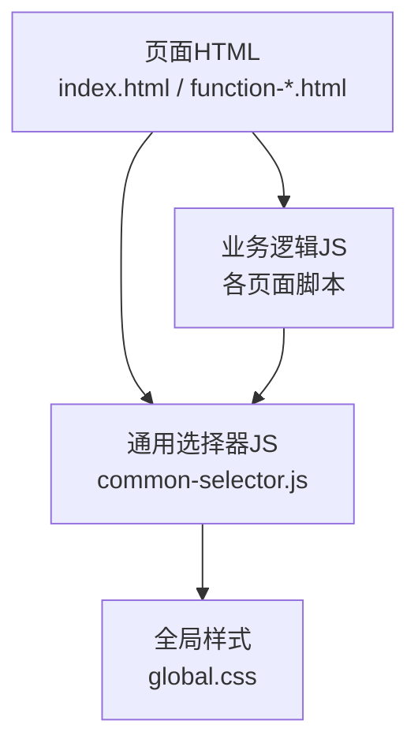
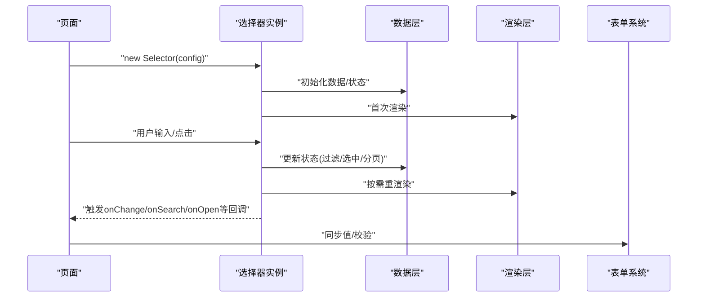
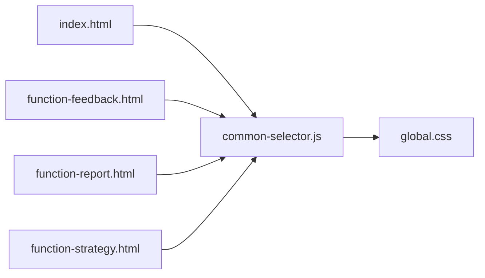

# 通用选择器组件

<cite>
**本文引用的文件**   
- [common-selector.js](file://app/js/common-selector.js)
- [index.html](file://app/index.html)
- [function-feedback.html](file://app/function-feedback.html)
- [function-report.html](file://app/function-report.html)
- [function-strategy.html](file://app/function-strategy.html)
- [global.css](file://app/css/global.css)
</cite>

## 目录
1. [简介](#简介)
2. [项目结构](#项目结构)
3. [核心组件](#核心组件)
4. [架构总览](#架构总览)
5. [详细组件分析](#详细组件分析)
6. [依赖分析](#依赖分析)
7. [性能考虑](#性能考虑)
8. [故障排查指南](#故障排查指南)
9. [结论](#结论)
10. [附录](#附录)

## 简介
本技术文档面向 MG-Mini 的通用选择器组件，围绕数据绑定、事件处理与用户交互逻辑展开，系统说明其支持的数据格式、过滤与搜索算法、配置项与 API 接口、扩展点，以及响应式数据处理、虚拟滚动与大列表渲染策略。同时提供多种使用场景（单选、多选、级联选择、动态加载）的实践指引，并给出与表单系统集成和数据验证的建议，最后包含性能调优与内存管理最佳实践。

## 项目结构
- 选择器核心实现位于 app/js/common-selector.js，负责渲染、事件、数据绑定、过滤与搜索等能力。
- 页面集成示例分布在多个 HTML 文件中，展示不同使用场景：
  - 基础用法与单选/多选在 index.html 中演示。
  - 业务场景中的选择器集成在 function-feedback.html、function-report.html、function-strategy.html 中体现。
- 样式由全局样式 global.css 统一管理，保证主题一致性与可定制性。

图表来源
- [common-selector.js](file://app/js/common-selector.js)
- [index.html](file://app/index.html)
- [function-feedback.html](file://app/function-feedback.html)
- [function-report.html](file://app/function-report.html)
- [function-strategy.html](file://app/function-strategy.html)
- [global.css](file://app/css/global.css)

章节来源
- [common-selector.js](file://app/js/common-selector.js)
- [index.html](file://app/index.html)
- [function-feedback.html](file://app/function-feedback.html)
- [function-report.html](file://app/function-report.html)
- [function-strategy.html](file://app/function-strategy.html)
- [global.css](file://app/css/global.css)

## 核心组件
- 选择器实例化与初始化：通过统一的入口创建选择器实例，传入配置对象（如数据源、模式、是否可搜索、分页或虚拟滚动开关等）。
- 数据绑定机制：支持单向绑定与双向绑定两种模式；当外部数据变化时，内部视图自动更新；用户操作后触发回调以同步到上层状态。
- 事件处理：封装了点击、键盘导航、输入过滤、选项选中/取消选中、下拉面板打开/关闭等事件，并提供统一的事件回调接口。
- 用户交互逻辑：包括焦点管理、Tab/Shift+Tab 导航、Enter/Space 确认、Esc 关闭、方向键移动、输入联想与高亮匹配等。

章节来源
- [common-selector.js](file://app/js/common-selector.js)

## 架构总览
选择器采用“配置驱动 + 事件驱动”的轻量架构：
- 配置层：声明式配置决定行为（模式、数据源、过滤、搜索、分页/虚拟滚动、渲染钩子等）。
- 数据层：维护原始数据、过滤后的数据、选中状态、分页游标、搜索关键词等。
- 渲染层：根据当前状态生成 DOM 片段，支持懒加载与虚拟滚动优化。
- 事件层：捕获用户输入与交互，转化为状态变更并触发回调。
- 集成层：与表单系统对接，提供校验规则与值同步方法。

图表来源
- [common-selector.js](file://app/js/common-selector.js)
- [index.html](file://app/index.html)
- [function-feedback.html](file://app/function-feedback.html)

## 详细组件分析

### 数据模型与数据结构
- 数据源格式：支持数组对象、树形结构、懒加载节点等；每个节点至少包含标识字段、显示文本字段，可选层级、禁用、分组等元信息。
- 选中状态：单选为单值，多选为集合；支持按 ID 或自定义键进行去重与匹配。
- 过滤与搜索：支持前缀匹配、模糊匹配、大小写不敏感；可配置多字段检索与权重。
- 分页与虚拟滚动：分页模式下维护页码与每页数量；虚拟滚动仅渲染可视区域节点，提升大列表性能。

章节来源
- [common-selector.js](file://app/js/common-selector.js)

### 配置项与API接口
- 配置项（部分示例）：
  - data：数据源
  - mode：单选/多选/级联
  - searchable：是否启用搜索
  - filter：过滤函数或内置策略
  - pageSize：分页大小
  - virtualScroll：是否启用虚拟滚动
  - renderItem：自定义渲染函数
  - onChange：值变化回调
  - onSearch：搜索回调
  - onOpen/onClose：面板生命周期回调
- API 方法（部分示例）：
  - setValue(value)：设置选中值
  - getValue()：获取选中值
  - setSearch(keyword)：设置搜索词
  - reset()：重置状态
  - destroy()：销毁实例并释放资源

章节来源
- [common-selector.js](file://app/js/common-selector.js)

### 事件处理与用户交互
- 输入事件：实时搜索、防抖处理、结果高亮。
- 键盘事件：方向键导航、回车确认、Esc 关闭、Tab 切换焦点。
- 鼠标事件：点击选项、勾选框、下拉面板开关。
- 自定义事件：开放 onOptionClick、onFilterChange、onVirtualScrollUpdate 等扩展点。

章节来源
- [common-selector.js](file://app/js/common-selector.js)

### 过滤与搜索算法
- 前缀匹配：快速定位以输入开头的选项，适合拼音首字母或短词搜索。
- 模糊匹配：基于字符串包含判断，支持多字段合并检索。
- 权重排序：对命中字段赋予权重，优先展示更相关结果。
- 缓存策略：对相同搜索词的结果进行短期缓存，减少重复计算。

章节来源
- [common-selector.js](file://app/js/common-selector.js)

### 响应式数据处理
- 数据变化监听：当外部数据源更新时，自动重新计算过滤结果与选中状态。
- 状态同步：支持单向绑定（只读展示）与双向绑定（实时更新父级状态）。
- 异步数据：支持懒加载与分页请求，结合搜索词与筛选条件发起请求。

章节来源
- [common-selector.js](file://app/js/common-selector.js)

### 虚拟滚动与大列表渲染策略
- 可视区域计算：根据容器高度与行高估算可见范围。
- 占位与偏移：使用占位元素维持滚动条长度，避免抖动。
- 增量渲染：仅渲染进入可视区域的节点，离开时回收 DOM。
- 性能优化：节流滚动事件、复用节点模板、避免频繁重排。

章节来源
- [common-selector.js](file://app/js/common-selector.js)

### 使用场景与集成示例

#### 单选场景
- 适用：单一目标选择，如性别、状态等。
- 关键点：mode=单选，onChange 返回单值，支持默认值与禁用项。

章节来源
- [index.html](file://app/index.html)
- [common-selector.js](file://app/js/common-selector.js)

#### 多选场景
- 适用：标签选择、权限分配等。
- 关键点：mode=多选，onChange 返回集合，支持全选/反选、批量操作。

章节来源
- [index.html](file://app/index.html)
- [common-selector.js](file://app/js/common-selector.js)

#### 级联选择
- 适用：省市区、分类树等层级数据。
- 关键点：支持树形数据、路径回显、联动刷新、懒加载子节点。

章节来源
- [function-report.html](file://app/function-report.html)
- [common-selector.js](file://app/js/common-selector.js)

#### 动态数据加载
- 适用：远程搜索、分页加载、大数据集。
- 关键点：onSearch 触发请求，pageSize 控制分页，虚拟滚动提升体验。

章节来源
- [function-strategy.html](file://app/function-strategy.html)
- [common-selector.js](file://app/js/common-selector.js)

### 与表单系统的集成与数据验证
- 值同步：通过 setValue/getValue 与表单控件保持同步。
- 校验规则：支持必填、唯一性、范围限制等；可在提交前统一校验。
- 错误提示：与表单错误消息联动，聚焦到选择器并高亮异常项。

章节来源
- [function-feedback.html](file://app/function-feedback.html)
- [common-selector.js](file://app/js/common-selector.js)

## 依赖分析
- 内部依赖：选择器模块依赖全局样式与页面脚本；页面脚本通过实例化选择器完成功能集成。
- 外部依赖：无重型框架依赖，保持轻量与可移植性。
- 耦合度：低耦合，通过配置与回调解耦渲染与业务逻辑。

图表来源
- [index.html](file://app/index.html)
- [function-feedback.html](file://app/function-feedback.html)
- [function-report.html](file://app/function-report.html)
- [function-strategy.html](file://app/function-strategy.html)
- [common-selector.js](file://app/js/common-selector.js)
- [global.css](file://app/css/global.css)

章节来源
- [common-selector.js](file://app/js/common-selector.js)
- [global.css](file://app/css/global.css)

## 性能考虑
- 搜索防抖：对输入事件进行节流/防抖，降低高频计算开销。
- 虚拟滚动：开启虚拟滚动以减少 DOM 节点数量，提升滚动流畅度。
- 分页加载：合理设置 pageSize，避免一次性加载过多数据。
- 内存管理：及时销毁实例、移除事件监听、释放缓存与定时器。
- 渲染优化：复用模板、避免不必要的重绘与回流。

[本节为通用性能建议，不直接分析具体文件]

## 故障排查指南
- 常见问题：
  - 搜索无结果：检查数据字段映射与搜索策略配置。
  - 选中值不同步：确认双向绑定是否正确设置，回调是否被调用。
  - 滚动卡顿：检查虚拟滚动配置与行高一致性。
  - 内存泄漏：确保在页面卸载时调用 destroy 清理资源。
- 调试建议：
  - 打印关键状态（过滤结果、选中集合、分页游标）。
  - 使用浏览器开发者工具观察 DOM 节点数量与事件触发频率。

章节来源
- [common-selector.js](file://app/js/common-selector.js)

## 结论
MG-Mini 的通用选择器组件以轻量、可扩展为核心设计目标，提供完善的数据绑定、事件处理与用户交互能力，支持丰富的使用场景与性能优化策略。通过合理的配置与 API 使用，可以在复杂业务中高效集成并保持良好的用户体验。

[本节为总结性内容，不直接分析具体文件]

## 附录
- 最佳实践清单：
  - 为大列表启用虚拟滚动与分页。
  - 对搜索输入进行防抖处理。
  - 在页面卸载时销毁选择器实例。
  - 使用统一的样式变量以保持主题一致。
- 参考文件：
  - 选择器核心实现：[common-selector.js](file://app/js/common-selector.js)
  - 页面集成示例：[index.html](file://app/index.html)、[function-feedback.html](file://app/function-feedback.html)、[function-report.html](file://app/function-report.html)、[function-strategy.html](file://app/function-strategy.html)
  - 全局样式：[global.css](file://app/css/global.css)

[本节为补充信息，不直接分析具体文件]