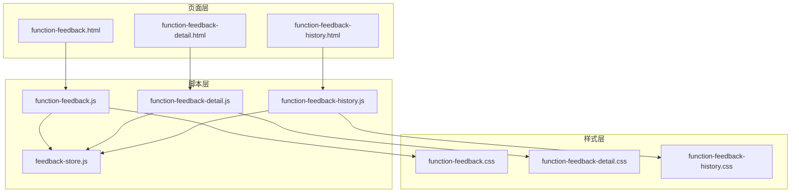
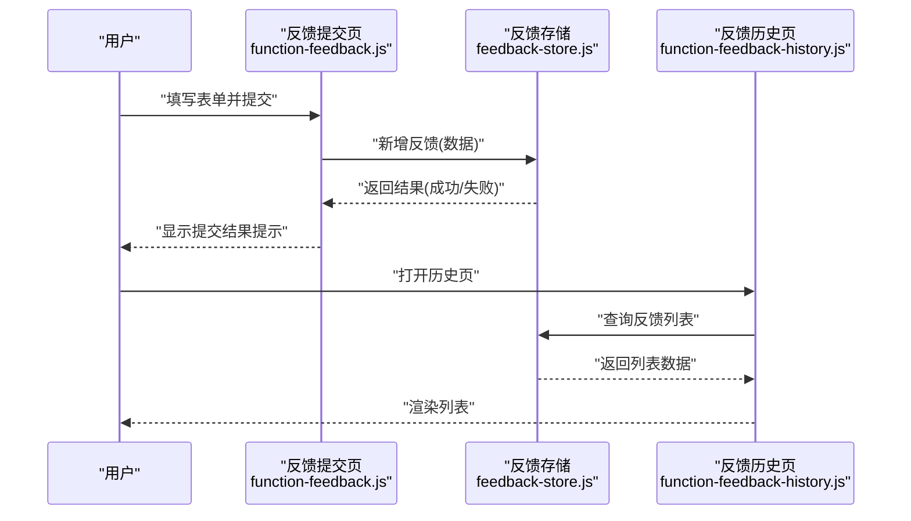
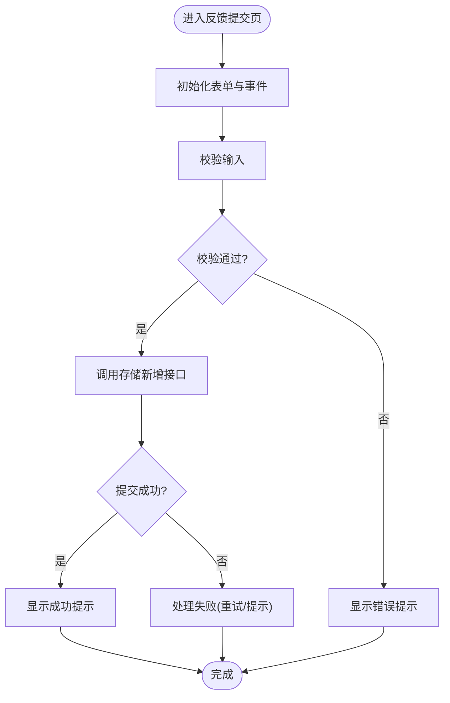
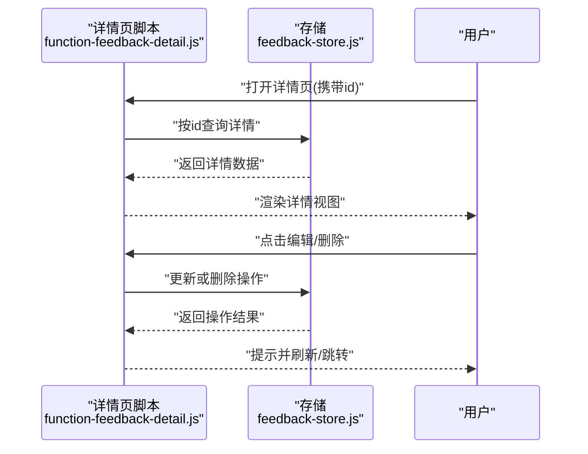
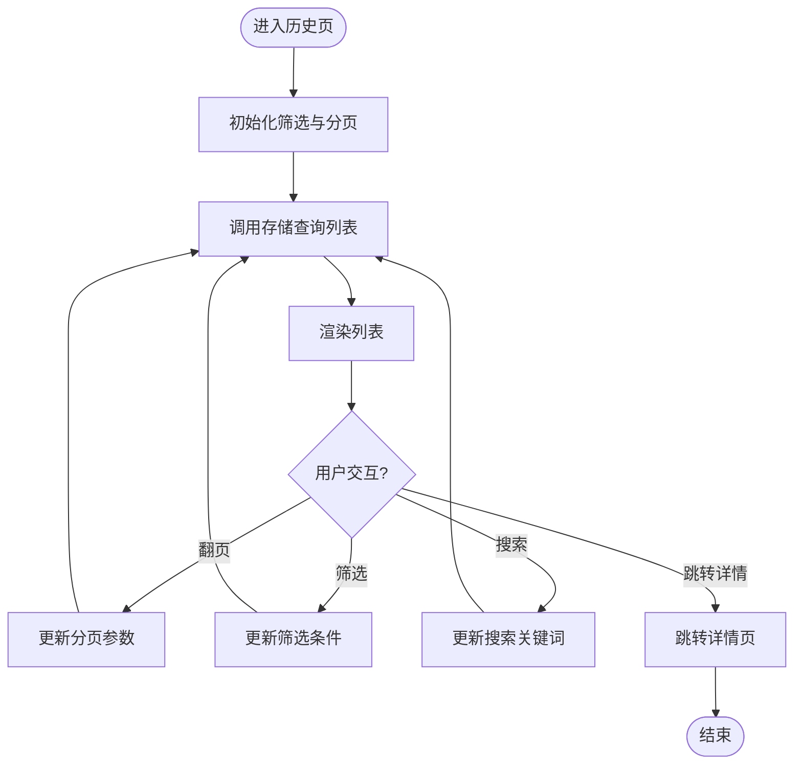
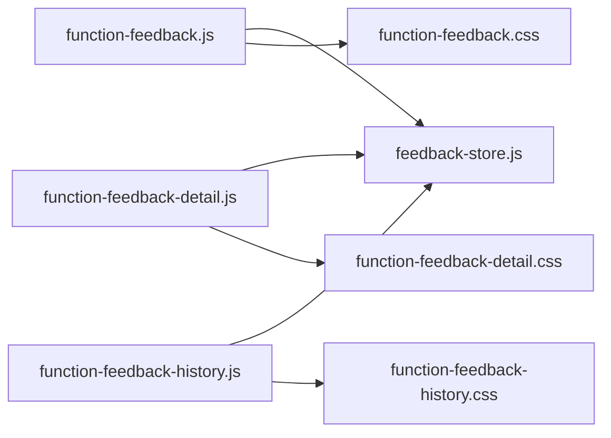

# 功能反馈系统

<cite>
**本文引用的文件**   
- [function-feedback.html](file://app/function-feedback.html)
- [function-feedback-detail.html](file://app/function-feedback-detail.html)
- [function-feedback-history.html](file://app/function-feedback-history.html)
- [function-feedback.js](file://app/js/function-feedback.js)
- [function-feedback-detail.js](file://app/js/function-feedback-detail.js)
- [function-feedback-history.js](file://app/js/function-feedback-history.js)
- [feedback-store.js](file://app/js/feedback-store.js)
- [function-feedback.css](file://app/css/function-feedback.css)
- [function-feedback-detail.css](file://app/css/function-feedback-detail.css)
- [function-feedback-history.css](file://app/css/function-feedback-history.css)
</cite>

## 目录
1. [简介](#简介)
2. [项目结构](#项目结构)
3. [核心组件](#核心组件)
4. [架构总览](#架构总览)
5. [详细组件分析](#详细组件分析)
6. [依赖关系分析](#依赖关系分析)
7. [性能考量](#性能考量)
8. [故障排查指南](#故障排查指南)
9. [结论](#结论)
10. [附录](#附录)

## 简介
本文件面向 MG-Mini 的功能反馈系统，系统性阐述其实现细节、调用关系、接口定义与业务模型。内容覆盖反馈提交、详情查看、历史记录管理等核心能力，并结合仓库中的实际页面与脚本文件，给出可操作的调用方式、数据交互流程与状态管理策略。文档同时提供配置项说明、参数与返回值格式约定、与数据存储的关系说明以及常见问题解决方案，既适合初学者快速上手，也为有经验的开发者提供足够的技术深度。

## 项目结构
功能反馈系统由三个页面与对应的脚本、样式组成：
- 反馈提交页：用于用户填写并提交反馈
- 反馈详情页：用于查看单条反馈的详细信息
- 反馈历史页：用于浏览与管理历史反馈记录

图表来源
- [function-feedback.html](file://app/function-feedback.html)
- [function-feedback-detail.html](file://app/function-feedback-detail.html)
- [function-feedback-history.html](file://app/function-feedback-history.html)
- [function-feedback.js](file://app/js/function-feedback.js)
- [function-feedback-detail.js](file://app/js/function-feedback-detail.js)
- [function-feedback-history.js](file://app/js/function-feedback-history.js)
- [feedback-store.js](file://app/js/feedback-store.js)
- [function-feedback.css](file://app/css/function-feedback.css)
- [function-feedback-detail.css](file://app/css/function-feedback-detail.css)
- [function-feedback-history.css](file://app/css/function-feedback-history.css)

章节来源
- [function-feedback.html](file://app/function-feedback.html)
- [function-feedback-detail.html](file://app/function-feedback-detail.html)
- [function-feedback-history.html](file://app/function-feedback-history.html)
- [function-feedback.js](file://app/js/function-feedback.js)
- [function-feedback-detail.js](file://app/js/function-feedback-detail.js)
- [function-feedback-history.js](file://app/js/function-feedback-history.js)
- [feedback-store.js](file://app/js/feedback-store.js)
- [function-feedback.css](file://app/css/function-feedback.css)
- [function-feedback-detail.css](file://app/css/function-feedback-detail.css)
- [function-feedback-history.css](file://app/css/function-feedback-history.css)

## 核心组件
- 反馈提交（function-feedback）
  - 负责表单渲染、输入校验、提交动作触发、成功/失败提示
  - 通过 feedback-store 持久化新提交的反馈条目
- 反馈详情（function-feedback-detail）
  - 根据路由或参数加载指定反馈的详情数据并展示
  - 支持编辑、更新与删除操作（如业务需要）
- 反馈历史（function-feedback-history）
  - 拉取并分页展示反馈列表，支持筛选、排序与搜索
  - 支持跳转到详情页进行查看或编辑
- 数据与状态（feedback-store）
  - 集中管理反馈数据的增删改查、缓存与本地持久化
  - 对外暴露统一的 API 供各页面脚本调用

章节来源
- [function-feedback.js](file://app/js/function-feedback.js)
- [function-feedback-detail.js](file://app/js/function-feedback-detail.js)
- [function-feedback-history.js](file://app/js/function-feedback-history.js)
- [feedback-store.js](file://app/js/feedback-store.js)

## 架构总览
整体采用“页面脚本 + 统一存储”的分层架构：
- 页面脚本负责 UI 交互与事件处理
- 存储模块负责数据访问与状态管理
- 样式模块负责界面呈现

图表来源
- [function-feedback.js](file://app/js/function-feedback.js)
- [function-feedback-history.js](file://app/js/function-feedback-history.js)
- [feedback-store.js](file://app/js/feedback-store.js)

## 详细组件分析

### 反馈提交（function-feedback）
- 职责
  - 渲染表单字段（如标题、分类、描述、附件等）
  - 执行前端校验（必填、长度、格式等）
  - 调用反馈存储新增接口，处理响应并反馈给用户
- 关键流程
  - 初始化：绑定表单元素与事件监听器
  - 校验：逐项验证输入合法性
  - 提交：组装数据对象，调用存储新增方法
  - 反馈：根据返回结果展示成功或错误信息
- 数据模型（建议）
  - id：唯一标识（服务端生成或客户端生成）
  - title：反馈标题
  - category：分类标签
  - description：详细描述
  - attachments：附件列表（可选）
  - status：状态（草稿/已提交/处理中/已解决）
  - createdAt：创建时间
  - updatedAt：更新时间
- 调用示例路径
  - 表单初始化与事件绑定：[function-feedback.js](file://app/js/function-feedback.js)
  - 提交逻辑与存储调用：[function-feedback.js](file://app/js/function-feedback.js)
  - 存储新增接口：[feedback-store.js](file://app/js/feedback-store.js)

图表来源
- [function-feedback.js](file://app/js/function-feedback.js)
- [feedback-store.js](file://app/js/feedback-store.js)

章节来源
- [function-feedback.js](file://app/js/function-feedback.js)
- [feedback-store.js](file://app/js/feedback-store.js)

### 反馈详情（function-feedback-detail）
- 职责
  - 根据传入参数（如 id）加载对应反馈详情
  - 展示字段信息与操作按钮（编辑、删除等）
  - 处理更新或删除请求，刷新状态
- 关键流程
  - 解析参数：从 URL 或上下文获取目标反馈 id
  - 加载数据：调用存储查询接口获取详情
  - 渲染视图：填充表单或只读视图
  - 操作处理：保存更新或删除后刷新列表或跳转
- 调用示例路径
  - 参数解析与数据加载：[function-feedback-detail.js](file://app/js/function-feedback-detail.js)
  - 存储查询接口：[feedback-store.js](file://app/js/feedback-store.js)

图表来源
- [function-feedback-detail.js](file://app/js/function-feedback-detail.js)
- [feedback-store.js](file://app/js/feedback-store.js)

章节来源
- [function-feedback-detail.js](file://app/js/function-feedback-detail.js)
- [feedback-store.js](file://app/js/feedback-store.js)

### 反馈历史（function-feedback-history）
- 职责
  - 拉取反馈列表，支持分页、筛选、排序与搜索
  - 提供跳转到详情页的操作入口
- 关键流程
  - 初始化：设置默认筛选条件与分页参数
  - 拉取数据：调用存储列表接口，处理返回数据
  - 渲染列表：展示条目并提供操作按钮
  - 交互：翻页、筛选、搜索、跳转详情
- 调用示例路径
  - 列表拉取与渲染：[function-feedback-history.js](file://app/js/function-feedback-history.js)
  - 存储列表接口：[feedback-store.js](file://app/js/feedback-store.js)

图表来源
- [function-feedback-history.js](file://app/js/function-feedback-history.js)
- [feedback-store.js](file://app/js/feedback-store.js)

章节来源
- [function-feedback-history.js](file://app/js/function-feedback-history.js)
- [feedback-store.js](file://app/js/feedback-store.js)

### 数据与状态（feedback-store）
- 职责
  - 统一管理反馈数据的增删改查
  - 维护内存状态与本地持久化（如 localStorage）
  - 对外暴露一致的 API 供页面脚本调用
- 典型接口（概念性）
  - 新增反馈：接收数据对象，返回成功/失败
  - 查询详情：按 id 返回单条反馈
  - 查询列表：支持分页、筛选、排序参数，返回列表与总数
  - 更新反馈：按 id 更新字段
  - 删除反馈：按 id 删除条目
- 状态管理要点
  - 避免重复请求：对相同参数的查询进行缓存
  - 错误处理：网络异常或数据不一致时的降级策略
  - 数据一致性：确保多页面共享状态的同步

章节来源
- [feedback-store.js](file://app/js/feedback-store.js)

## 依赖关系分析
- 页面脚本依赖存储模块，不直接访问底层存储或后端
- 样式模块仅被对应页面脚本引入，保证样式隔离
- 页面之间通过存储模块间接共享数据，降低耦合度

图表来源
- [function-feedback.js](file://app/js/function-feedback.js)
- [function-feedback-detail.js](file://app/js/function-feedback-detail.js)
- [function-feedback-history.js](file://app/js/function-feedback-history.js)
- [feedback-store.js](file://app/js/feedback-store.js)
- [function-feedback.css](file://app/css/function-feedback.css)
- [function-feedback-detail.css](file://app/css/function-feedback-detail.css)
- [function-feedback-history.css](file://app/css/function-feedback-history.css)

章节来源
- [function-feedback.js](file://app/js/function-feedback.js)
- [function-feedback-detail.js](file://app/js/function-feedback-detail.js)
- [function-feedback-history.js](file://app/js/function-feedback-history.js)
- [feedback-store.js](file://app/js/feedback-store.js)
- [function-feedback.css](file://app/css/function-feedback.css)
- [function-feedback-detail.css](file://app/css/function-feedback-detail.css)
- [function-feedback-history.css](file://app/css/function-feedback-history.css)

## 性能考量
- 列表分页与懒加载：避免一次性加载大量数据
- 查询缓存：对相同参数的查询结果进行短期缓存，减少重复请求
- 防抖与节流：搜索与滚动场景使用防抖/节流优化
- 资源按需加载：仅在需要的页面引入对应样式与脚本
- 错误重试与降级：在网络不稳定时提供重试机制与友好提示

## 故障排查指南
- 提交失败
  - 检查表单校验是否通过
  - 确认存储新增接口是否正常返回
  - 查看控制台错误日志与网络请求
- 详情无法加载
  - 确认传入的 id 是否正确
  - 检查存储查询接口是否返回有效数据
  - 核对页面参数解析逻辑
- 历史列表为空
  - 检查筛选与分页参数是否合理
  - 确认存储列表接口是否返回数据
  - 查看是否有未处理的异常导致渲染失败
- 常见错误定位
  - 在存储模块中添加日志输出，追踪数据流向
  - 使用浏览器开发者工具检查网络请求与响应
  - 逐步注释页面逻辑以缩小问题范围

章节来源
- [function-feedback.js](file://app/js/function-feedback.js)
- [function-feedback-detail.js](file://app/js/function-feedback-detail.js)
- [function-feedback-history.js](file://app/js/function-feedback-history.js)
- [feedback-store.js](file://app/js/feedback-store.js)

## 结论
MG-Mini 的功能反馈系统通过清晰的页面脚本与统一存储模块实现了高内聚、低耦合的数据管理与交互流程。反馈提交、详情查看与历史记录管理三大核心能力相互独立又协同工作，具备良好的可扩展性与可维护性。遵循本文档的接口约定与最佳实践，开发者可以快速集成与扩展功能，保障用户体验与系统稳定性。

## 附录
- 配置选项（建议）
  - 分页大小：每页条目数
  - 默认筛选：分类、状态等
  - 缓存时长：查询结果的缓存时间
  - 重试次数：失败后的自动重试上限
- 参数说明（建议）
  - 新增反馈：包含标题、分类、描述、附件等字段
  - 查询列表：页码、每页大小、筛选条件、排序字段
  - 查询详情：反馈 id
  - 更新反馈：反馈 id 与待更新字段
  - 删除反馈：反馈 id
- 返回值格式（建议）
  - 成功：包含数据对象或列表及元信息（如总数）
  - 失败：包含错误码与错误消息
- 与数据存储的关系
  - 存储模块作为中间层，屏蔽底层存储实现细节
  - 支持本地持久化与未来后端接口的平滑替换