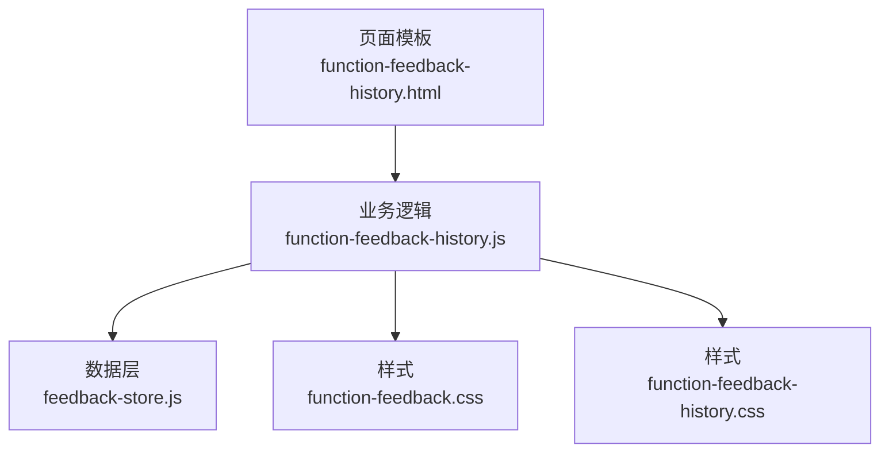
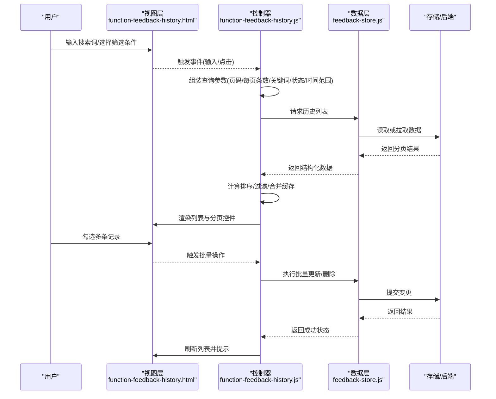
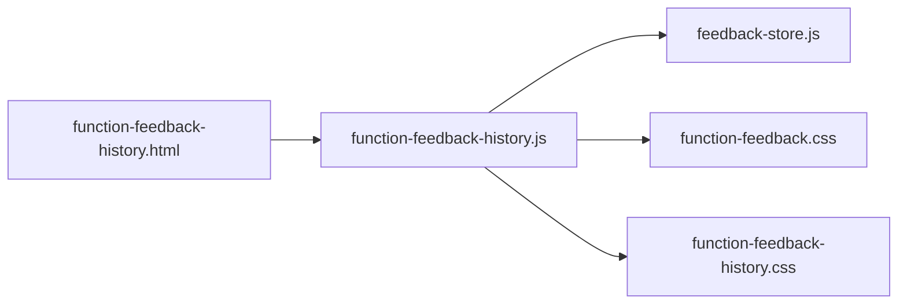

# 反馈历史记录

<cite>
**本文引用的文件**   
- [function-feedback-history.html](file://app/function-feedback-history.html)
- [function-feedback-history.js](file://app/js/function-feedback-history.js)
- [feedback-store.js](file://app/js/feedback-store.js)
- [function-feedback.css](file://app/css/function-feedback.css)
- [function-feedback-history.css](file://app/css/function-feedback-history.css)
</cite>

## 目录
1. [简介](#简介)
2. [项目结构](#项目结构)
3. [核心组件](#核心组件)
4. [架构总览](#架构总览)
5. [详细组件分析](#详细组件分析)
6. [依赖关系分析](#依赖关系分析)
7. [性能考量](#性能考量)
8. [故障排查指南](#故障排查指南)
9. [结论](#结论)
10. [附录](#附录)

## 简介
本章节面向MG-Mini的“反馈历史记录”功能，系统性说明历史列表的数据获取、分页机制、搜索过滤与批量操作逻辑。文档同时覆盖前端渲染流程、筛选条件与排序参数、与反馈存储模块的数据同步策略，以及大数据量场景下的加载与搜索优化方案。内容兼顾初学者友好与资深开发者的技术深度。

## 项目结构
与“反馈历史记录”直接相关的代码位于 app 目录下：
- 页面模板：function-feedback-history.html
- 业务逻辑：js/function-feedback-history.js
- 数据层：js/feedback-store.js
- 样式：css/function-feedback.css、css/function-feedback-history.css

图表来源
- [function-feedback-history.html](file://app/function-feedback-history.html)
- [function-feedback-history.js](file://app/js/function-feedback-history.js)
- [feedback-store.js](file://app/js/feedback-store.js)
- [function-feedback.css](file://app/css/function-feedback.css)
- [function-feedback-history.css](file://app/css/function-feedback-history.css)

章节来源
- [function-feedback-history.html](file://app/function-feedback-history.html)
- [function-feedback-history.js](file://app/js/function-feedback-history.js)
- [feedback-store.js](file://app/js/feedback-store.js)
- [function-feedback.css](file://app/css/function-feedback.css)
- [function-feedback-history.css](file://app/css/function-feedback-history.css)

## 核心组件
- 页面视图（HTML）：承载搜索框、筛选区、分页控件、列表容器等UI元素。
- 业务控制器（JS）：负责事件绑定、查询参数组装、调用数据层、渲染列表、处理分页与批量操作。
- 数据层（Store）：封装历史数据的增删改查、缓存与持久化、分页与过滤接口。
- 样式（CSS）：定义列表布局、交互态、响应式适配。

章节来源
- [function-feedback-history.js](file://app/js/function-feedback-history.js)
- [feedback-store.js](file://app/js/feedback-store.js)
- [function-feedback-history.css](file://app/css/function-feedback-history.css)
- [function-feedback.css](file://app/css/function-feedback.css)

## 架构总览
下图展示了从用户交互到数据渲染的完整链路，包括搜索、筛选、分页与批量操作的调用序列。

图表来源
- [function-feedback-history.js](file://app/js/function-feedback-history.js)
- [feedback-store.js](file://app/js/feedback-store.js)
- [function-feedback-history.html](file://app/function-feedback-history.html)

## 详细组件分析

### 数据模型与字段约定
- 单条历史记录建议包含以下字段（示例字段名，具体以实现为准）：
  - id: 唯一标识
  - title: 标题/摘要
  - content: 内容详情
  - status: 状态（如待处理/处理中/已解决/已关闭）
  - category: 分类（如功能缺陷/体验建议/性能问题）
  - priority: 优先级（低/中/高）
  - tags: 标签数组
  - created_at: 创建时间
  - updated_at: 更新时间
  - author: 提交人
  - source: 来源（如Web/App/内部系统）
- 列表分页数据结构：
  - items: 当前页数据数组
  - total: 总条数
  - page: 当前页码
  - pageSize: 每页条数
  - totalPages: 总页数

章节来源
- [feedback-store.js](file://app/js/feedback-store.js)
- [function-feedback-history.js](file://app/js/function-feedback-history.js)

### 查询接口与参数规范
- 基础查询参数：
  - page: 页码（默认1）
  - pageSize: 每页条数（默认20，支持10/20/50/100）
  - keyword: 关键词（模糊匹配标题/内容/标签）
  - status: 状态筛选（空表示全部）
  - category: 分类筛选（空表示全部）
  - priority: 优先级筛选（空表示全部）
  - dateFrom/dateTo: 时间范围（ISO字符串或时间戳）
  - sortBy/sortOrder: 排序字段与方向（如 created_at/desc）
- 高级筛选扩展：
  - tag: 按标签精确匹配
  - source: 来源筛选
  - author: 作者筛选
- 参数校验与默认值：
  - 非法页码回退到1
  - pageSize限制在允许范围内
  - 时间范围校验与边界修正

章节来源
- [function-feedback-history.js](file://app/js/function-feedback-history.js)
- [feedback-store.js](file://app/js/feedback-store.js)

### 列表渲染与交互
- 渲染要点：
  - 使用虚拟滚动或按需渲染提升大数据量性能
  - 骨架屏占位提升首屏感知
  - 行内操作按钮（查看/编辑/删除）与复选框
- 交互行为：
  - 搜索防抖（如300ms）
  - 筛选变化自动触发查询
  - 分页控件联动（上一页/下一页/跳转页码）
  - 批量选择与全选/反选
  - 操作确认与撤销（可选）

章节来源
- [function-feedback-history.js](file://app/js/function-feedback-history.js)
- [function-feedback-history.css](file://app/css/function-feedback-history.css)

### 搜索与过滤实现
- 客户端过滤：
  - 对本地缓存数据进行关键词与多条件组合过滤
  - 支持大小写不敏感与分词匹配
- 服务端过滤：
  - 将筛选参数透传到后端，减少传输体积
- 性能优化：
  - 搜索防抖与节流
  - 增量更新而非全量重绘
  - 索引加速（如倒排索引或Elasticsearch）

章节来源
- [function-feedback-history.js](file://app/js/function-feedback-history.js)
- [feedback-store.js](file://app/js/feedback-store.js)

### 分页机制
- 分页策略：
  - 服务端分页优先，避免一次性加载大量数据
  - 客户端缓存当前页与历史页，支持快速翻页
- 配置项：
  - pageSize可动态调整
  - 支持“加载更多”模式（追加式）
- 边界处理：
  - 越界页码保护
  - 空数据态展示

章节来源
- [function-feedback-history.js](file://app/js/function-feedback-history.js)
- [feedback-store.js](file://app/js/feedback-store.js)

### 排序功能
- 支持字段：
  - 创建时间、更新时间、优先级、状态、标题等
- 排序规则：
  - 升序/降序切换
  - 多字段复合排序（主键+次级键）
- 用户体验：
  - 列头指示器显示当前排序状态
  - 排序后保持选中状态与页码稳定

章节来源
- [function-feedback-history.js](file://app/js/function-feedback-history.js)

### 批量操作逻辑
- 支持操作：
  - 批量删除、批量修改状态、批量打标签
- 操作流程：
  - 选择条目 -> 弹出确认 -> 发起批量请求 -> 成功后刷新列表
- 错误处理：
  - 部分失败时给出明细提示
  - 支持重试与回滚

章节来源
- [function-feedback-history.js](file://app/js/function-feedback-history.js)
- [feedback-store.js](file://app/js/feedback-store.js)

### 与反馈存储模块的数据同步策略
- 读写分离：
  - 读路径：优先缓存命中，未命中则拉取并回填缓存
  - 写路径：乐观更新UI，失败时回滚
- 缓存策略：
  - 基于查询参数的键生成缓存
  - 设置过期时间与失效策略（写入后失效）
- 一致性保障：
  - 版本号或时间戳冲突检测
  - 增量同步与冲突合并

章节来源
- [feedback-store.js](file://app/js/feedback-store.js)

### 性能优化方案
- 首屏优化：
  - 骨架屏与懒加载
  - 关键资源预加载
- 渲染优化：
  - 虚拟列表与差量更新
  - 文本截断与图片懒加载
- 网络优化：
  - 请求去重与合并
  - 压缩与CDN加速
- 搜索优化：
  - 防抖与节流
  - 服务端全文检索

章节来源
- [function-feedback-history.js](file://app/js/function-feedback-history.js)
- [feedback-store.js](file://app/js/feedback-store.js)

## 依赖关系分析
- 页面模板依赖控制器进行事件绑定与渲染
- 控制器依赖数据层进行数据访问与缓存管理
- 样式文件为视图提供布局与交互态

图表来源
- [function-feedback-history.html](file://app/function-feedback-history.html)
- [function-feedback-history.js](file://app/js/function-feedback-history.js)
- [feedback-store.js](file://app/js/feedback-store.js)
- [function-feedback.css](file://app/css/function-feedback.css)
- [function-feedback-history.css](file://app/css/function-feedback-history.css)

章节来源
- [function-feedback-history.js](file://app/js/function-feedback-history.js)
- [feedback-store.js](file://app/js/feedback-store.js)

## 性能考量
- 大数据量加载：
  - 采用服务端分页与虚拟滚动
  - 控制每页条数与并发请求数量
- 搜索性能：
  - 前端防抖与索引加速
  - 后端全文检索与缓存热点查询
- 内存占用：
  - 及时释放无用DOM节点
  - 避免大对象常驻内存
- 网络开销：
  - 合理缓存与ETag/Last-Modified
  - 压缩与HTTP/2多路复用

[本节为通用指导，不直接分析具体文件]

## 故障排查指南
- 常见问题定位：
  - 列表为空：检查分页参数与接口返回结构
  - 搜索无结果：核对关键词匹配规则与大小写
  - 批量操作失败：查看错误码与重试策略
- 调试技巧：
  - 打印查询参数与响应体
  - 使用浏览器开发者工具监控网络与缓存
  - 逐步缩小筛选条件定位问题
- 日志与埋点：
  - 记录关键操作与异常堆栈
  - 统计搜索耗时与失败率

章节来源
- [function-feedback-history.js](file://app/js/function-feedback-history.js)
- [feedback-store.js](file://app/js/feedback-store.js)

## 结论
“反馈历史记录”通过清晰的职责划分与模块化设计，实现了高效的数据获取、灵活的筛选与排序、稳定的分页与批量操作。结合缓存与虚拟化等技术手段，能够在大数据量场景下保持良好的用户体验。建议在后续迭代中持续完善错误恢复、可观测性与性能监控能力。

[本节为总结性内容，不直接分析具体文件]

## 附录
- 术语表：
  - 分页：将大量数据拆分为多页展示
  - 防抖：延迟执行函数以减少频繁触发
  - 虚拟滚动：仅渲染可视区域以提升性能
- 最佳实践：
  - 统一查询参数命名与校验
  - 明确错误码与用户提示
  - 保持前后端数据结构一致

[本节为补充信息，不直接分析具体文件]