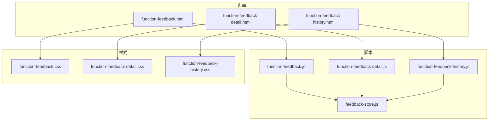
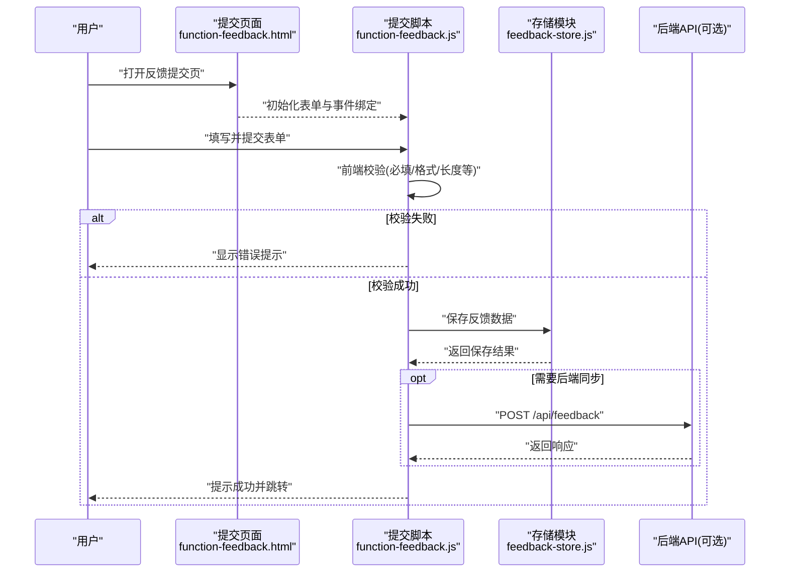
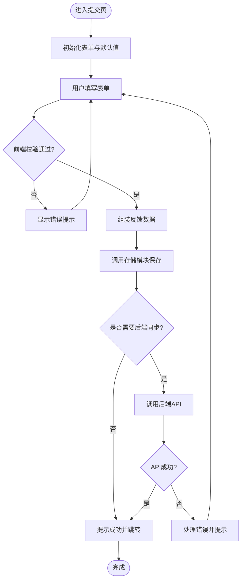
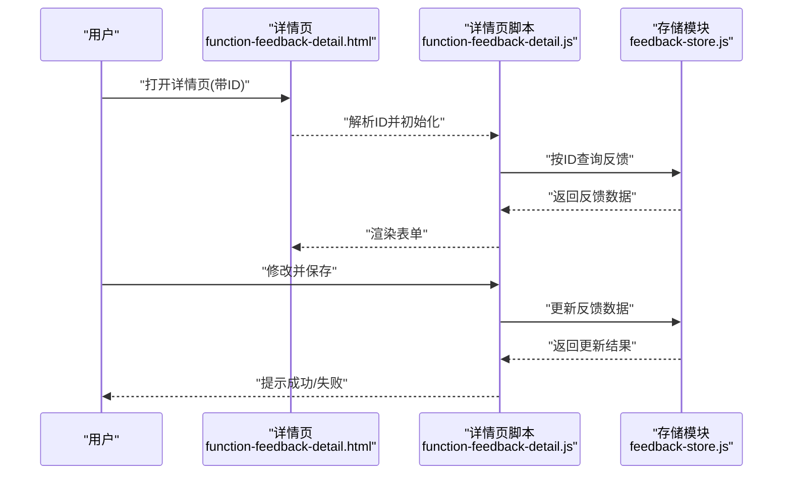
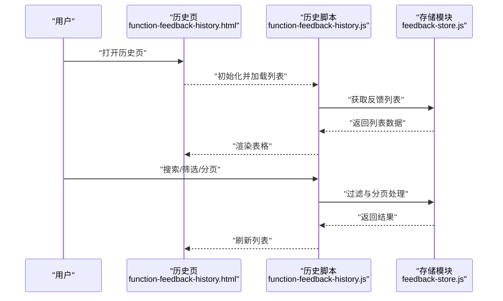
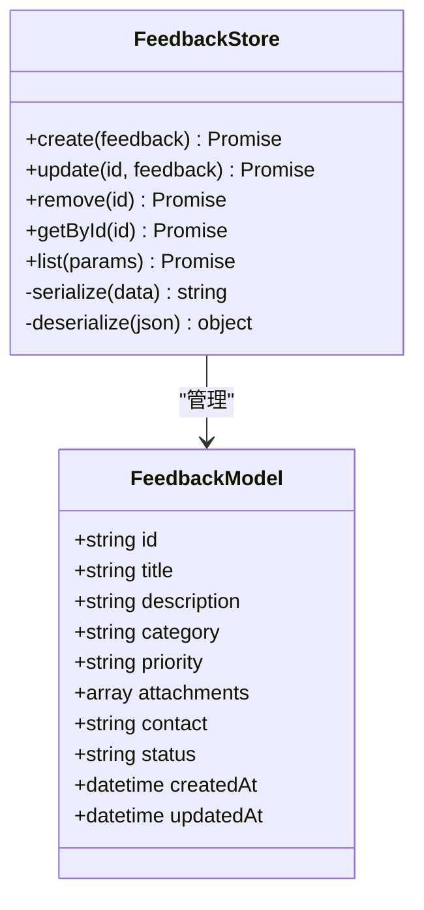
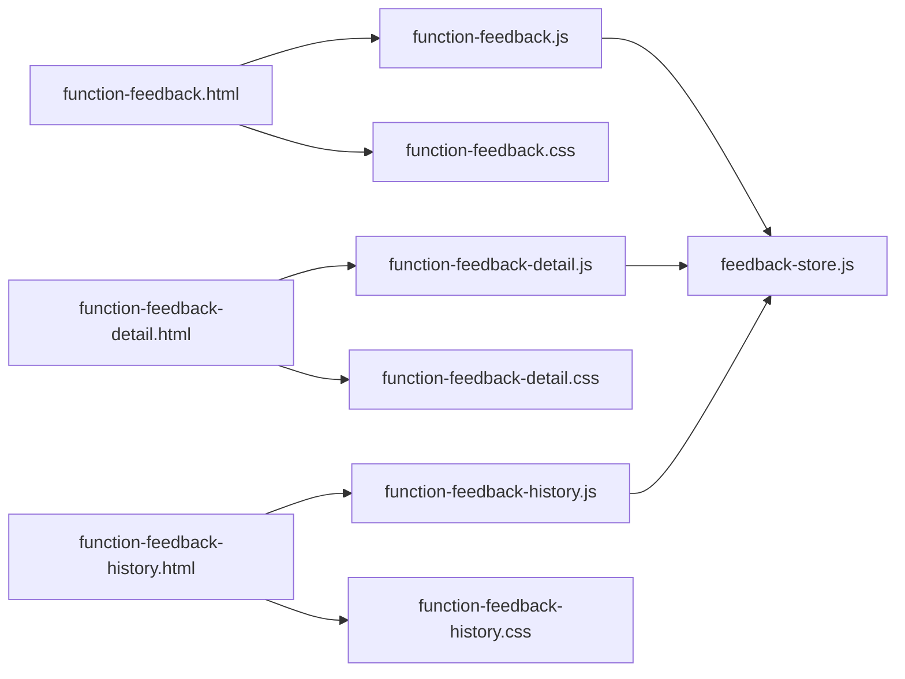

# 反馈提交功能

<cite>
**本文引用的文件**   
- [function-feedback.html](file://app/function-feedback.html)
- [function-feedback.js](file://app/js/function-feedback.js)
- [feedback-store.js](file://app/js/feedback-store.js)
- [function-feedback-detail.html](file://app/function-feedback-detail.html)
- [function-feedback-detail.js](file://app/js/function-feedback-detail.js)
- [function-feedback-history.html](file://app/function-feedback-history.html)
- [function-feedback-history.js](file://app/js/function-feedback-history.js)
- [function-feedback.css](file://app/css/function-feedback.css)
- [function-feedback-detail.css](file://app/css/function-feedback-detail.css)
- [function-feedback-history.css](file://app/css/function-feedback-history.css)
</cite>

## 目录
1. [简介](#简介)
2. [项目结构](#项目结构)
3. [核心组件](#核心组件)
4. [架构总览](#架构总览)
5. [详细组件分析](#详细组件分析)
6. [依赖关系分析](#依赖关系分析)
7. [性能考虑](#性能考虑)
8. [故障排查指南](#故障排查指南)
9. [结论](#结论)
10. [附录](#附录)

## 简介
本章节面向MG-Mini的“反馈提交”功能，提供从用户界面到数据验证、提交流程与错误处理的完整说明。文档将帮助初学者快速上手，同时为有经验的开发者提供足够的技术深度，包括表单数据结构、校验规则、API调用方式以及与反馈存储模块的交互关系。

## 项目结构
反馈相关的前端实现集中在 app 目录下，包含HTML页面、JavaScript逻辑与CSS样式：
- 页面层：function-feedback.html（提交页）、function-feedback-detail.html（详情/编辑页）、function-feedback-history.html（历史列表页）
- 脚本层：function-feedback.js（提交逻辑）、feedback-store.js（本地存储封装）、function-feedback-detail.js（详情逻辑）、function-feedback-history.js（历史逻辑）
- 样式层：function-feedback.css、function-feedback-detail.css、function-feedback-history.css

图表来源
- [function-feedback.html](file://app/function-feedback.html)
- [function-feedback.js](file://app/js/function-feedback.js)
- [feedback-store.js](file://app/js/feedback-store.js)
- [function-feedback-detail.html](file://app/function-feedback-detail.html)
- [function-feedback-detail.js](file://app/js/function-feedback-detail.js)
- [function-feedback-history.html](file://app/function-feedback-history.html)
- [function-feedback-history.js](file://app/js/function-feedback-history.js)
- [function-feedback.css](file://app/css/function-feedback.css)
- [function-feedback-detail.css](file://app/css/function-feedback-detail.css)
- [function-feedback-history.css](file://app/css/function-feedback-history.css)

章节来源
- [function-feedback.html](file://app/function-feedback.html)
- [function-feedback.js](file://app/js/function-feedback.js)
- [feedback-store.js](file://app/js/feedback-store.js)
- [function-feedback-detail.html](file://app/function-feedback-detail.html)
- [function-feedback-detail.js](file://app/js/function-feedback-detail.js)
- [function-feedback-history.html](file://app/function-feedback-history.html)
- [function-feedback-history.js](file://app/js/function-feedback-history.js)
- [function-feedback.css](file://app/css/function-feedback.css)
- [function-feedback-detail.css](file://app/css/function-feedback-detail.css)
- [function-feedback-history.css](file://app/css/function-feedback-history.css)

## 核心组件
- 反馈提交页面（function-feedback.html + function-feedback.js）
  - 负责渲染反馈表单、收集用户输入、执行前端校验、触发提交流程并展示结果
- 反馈详情页面（function-feedback-detail.html + function-feedback-detail.js）
  - 负责查看或编辑已有反馈条目，支持更新与删除操作
- 反馈历史页面（function-feedback-history.html + function-feedback-history.js）
  - 负责列出所有反馈条目，支持分页、搜索与筛选
- 反馈存储模块（feedback-store.js）
  - 封装本地存储（如localStorage）的CRUD操作，提供统一的读写接口，保证数据一致性

章节来源
- [function-feedback.js](file://app/js/function-feedback.js)
- [function-feedback-detail.js](file://app/js/function-feedback-detail.js)
- [function-feedback-history.js](file://app/js/function-feedback-history.js)
- [feedback-store.js](file://app/js/feedback-store.js)

## 架构总览
反馈提交的整体流程如下：用户在提交页面填写表单，系统在前端进行数据校验；校验通过后，通过存储模块持久化数据，并在必要时调用后端API（若存在）。提交成功后，用户可跳转到详情页或返回列表。

图表来源
- [function-feedback.html](file://app/function-feedback.html)
- [function-feedback.js](file://app/js/function-feedback.js)
- [feedback-store.js](file://app/js/feedback-store.js)

## 详细组件分析

### 反馈提交组件（function-feedback.html + function-feedback.js）
- 表单字段建议
  - 标题：必填，最大长度限制
  - 描述：必填，最小/最大长度限制，支持富文本或纯文本
  - 分类：下拉选择（如“功能建议”“Bug反馈”“体验优化”）
  - 优先级：单选（低/中/高）
  - 附件：图片/文件上传（可选，大小与类型限制）
  - 联系方式：邮箱或手机号（可选，格式校验）
- 数据验证规则
  - 必填项校验：空值拦截并提示
  - 格式校验：邮箱正则、手机号正则、URL格式等
  - 长度校验：标题与描述的最小/最大长度
  - 附件校验：类型白名单、大小上限
- 提交流程
  - 前端校验通过后，组装反馈对象
  - 调用存储模块保存（本地优先），如需后端则发起HTTP请求
  - 根据返回结果展示成功或失败提示
- 错误处理机制
  - 网络异常：重试或降级为仅本地保存
  - 服务端错误：解析错误码并提示用户
  - 本地存储失败：提示用户清理缓存或切换设备

图表来源
- [function-feedback.js](file://app/js/function-feedback.js)
- [feedback-store.js](file://app/js/feedback-store.js)

章节来源
- [function-feedback.html](file://app/function-feedback.html)
- [function-feedback.js](file://app/js/function-feedback.js)

### 反馈详情组件（function-feedback-detail.html + function-feedback-detail.js）
- 功能要点
  - 根据ID加载反馈详情，支持编辑与删除
  - 编辑时复用提交页的校验逻辑，确保数据一致性
  - 删除前二次确认，防止误操作
- 数据流
  - 读取ID -> 查询存储模块 -> 渲染表单 -> 用户修改 -> 保存更新

图表来源
- [function-feedback-detail.html](file://app/function-feedback-detail.html)
- [function-feedback-detail.js](file://app/js/function-feedback-detail.js)
- [feedback-store.js](file://app/js/feedback-store.js)

章节来源
- [function-feedback-detail.html](file://app/function-feedback-detail.html)
- [function-feedback-detail.js](file://app/js/function-feedback-detail.js)

### 反馈历史组件（function-feedback-history.html + function-feedback-history.js）
- 功能要点
  - 列表展示所有反馈条目，支持分页、搜索与筛选
  - 点击条目跳转详情页
  - 支持批量删除或导出
- 数据流
  - 加载列表 -> 查询存储模块 -> 渲染表格 -> 用户操作（搜索/筛选/分页）

图表来源
- [function-feedback-history.html](file://app/function-feedback-history.html)
- [function-feedback-history.js](file://app/js/function-feedback-history.js)
- [feedback-store.js](file://app/js/feedback-store.js)

章节来源
- [function-feedback-history.html](file://app/function-feedback-history.html)
- [function-feedback-history.js](file://app/js/function-feedback-history.js)

### 反馈存储模块（feedback-store.js）
- 职责
  - 统一封装本地存储的增删改查操作
  - 提供数据模型定义与序列化/反序列化
  - 处理并发写入冲突与数据迁移
- 关键方法
  - create(feedback): 新增反馈
  - update(id, feedback): 更新反馈
  - remove(id): 删除反馈
  - getById(id): 按ID查询
  - list(params): 列表查询（支持分页、筛选）
- 数据模型
  - id: 唯一标识（建议UUID）
  - title: 标题
  - description: 描述
  - category: 分类
  - priority: 优先级
  - attachments: 附件列表
  - contact: 联系方式
  - status: 状态（草稿/已提交/已处理）
  - createdAt: 创建时间
  - updatedAt: 更新时间

图表来源
- [feedback-store.js](file://app/js/feedback-store.js)

章节来源
- [feedback-store.js](file://app/js/feedback-store.js)

## 依赖关系分析
- 页面与脚本的耦合
  - 每个HTML页面对应一个JS脚本，职责清晰，便于维护
- 脚本与存储模块的解耦
  - 所有业务脚本通过feedback-store.js访问数据，避免直接操作存储介质
- 样式文件的模块化
  - 每个页面独立样式文件，减少样式冲突

图表来源
- [function-feedback.html](file://app/function-feedback.html)
- [function-feedback.js](file://app/js/function-feedback.js)
- [function-feedback-detail.html](file://app/function-feedback-detail.html)
- [function-feedback-detail.js](file://app/js/function-feedback-detail.js)
- [function-feedback-history.html](file://app/function-feedback-history.html)
- [function-feedback-history.js](file://app/js/function-feedback-history.js)
- [feedback-store.js](file://app/js/feedback-store.js)
- [function-feedback.css](file://app/css/function-feedback.css)
- [function-feedback-detail.css](file://app/css/function-feedback-detail.css)
- [function-feedback-history.css](file://app/css/function-feedback-history.css)

章节来源
- [function-feedback.js](file://app/js/function-feedback.js)
- [function-feedback-detail.js](file://app/js/function-feedback-detail.js)
- [function-feedback-history.js](file://app/js/function-feedback-history.js)
- [feedback-store.js](file://app/js/feedback-store.js)

## 性能考虑
- 表单校验优化
  - 使用防抖与节流减少频繁校验
  - 增量校验：仅在字段失焦或输入变化时校验
- 存储模块优化
  - 批量操作时使用事务或合并写入
  - 大列表分页加载，避免一次性渲染过多DOM
- 网络请求优化
  - 失败重试与超时控制
  - 缓存热点数据，减少重复请求

## 故障排查指南
- 常见表单验证问题
  - 必填项未填写：检查校验规则是否生效，确认字段绑定是否正确
  - 格式不合法：检查正则表达式与输入值，必要时放宽限制或提供更明确提示
  - 附件过大或类型不支持：检查文件大小与类型白名单配置
- 提交失败处理方案
  - 网络错误：检查网络连接与API地址，启用离线模式仅本地保存
  - 服务端错误：记录错误码与消息，提示用户稍后重试
  - 本地存储失败：提示用户清理缓存或更换浏览器

章节来源
- [function-feedback.js](file://app/js/function-feedback.js)
- [feedback-store.js](file://app/js/feedback-store.js)

## 结论
MG-Mini的反馈提交功能通过清晰的页面分层、独立的脚本逻辑与统一的存储模块，实现了良好的可维护性与扩展性。前端校验保障了数据质量，存储模块提供了可靠的数据持久化能力。未来可进一步引入后端API集成、更丰富的校验规则与更好的用户体验设计。

## 附录
- 配置选项建议
  - 表单字段配置：标题、描述、分类、优先级、附件、联系方式
  - 校验规则配置：必填、长度、格式、大小限制
  - 存储策略：本地优先、云端同步开关
- 参数说明与返回值格式
  - 提交参数：feedback对象（见数据模型）
  - 返回格式：{ success: boolean, message: string, data?: any }
- 最佳实践
  - 保持前后端数据模型一致
  - 错误信息对用户友好且可操作
  - 日志记录关键步骤以便排查问题