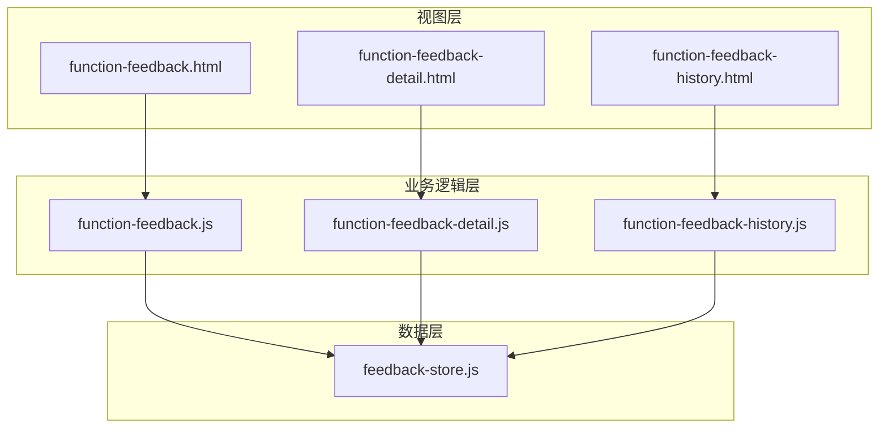
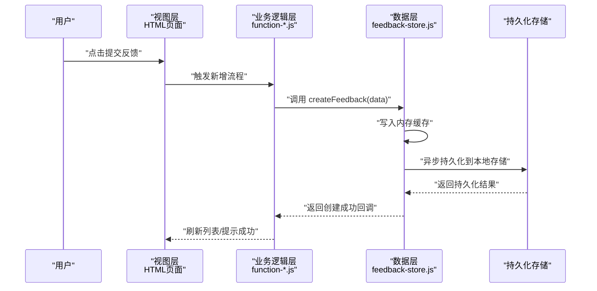
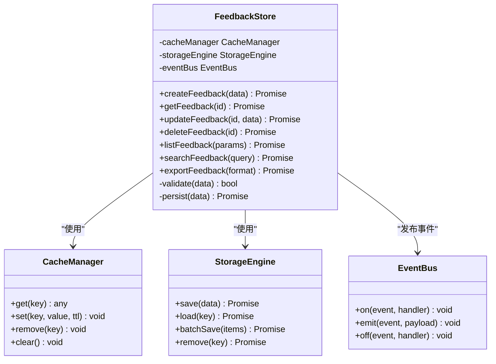
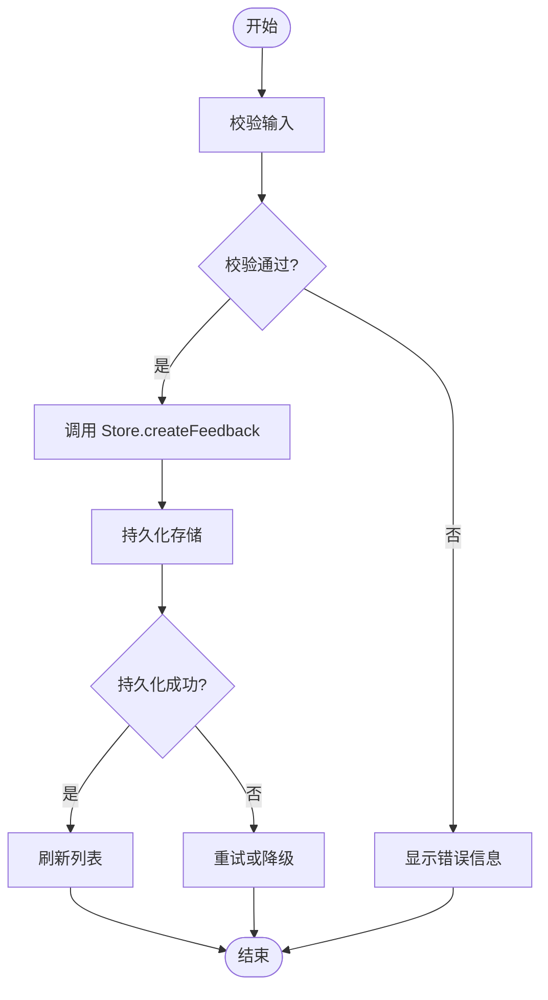
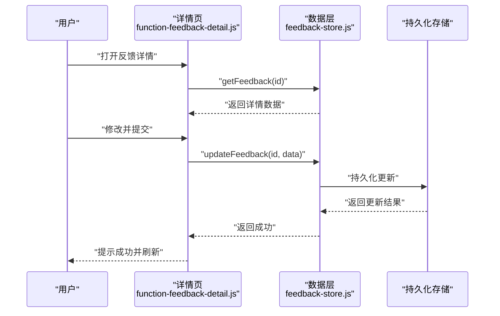
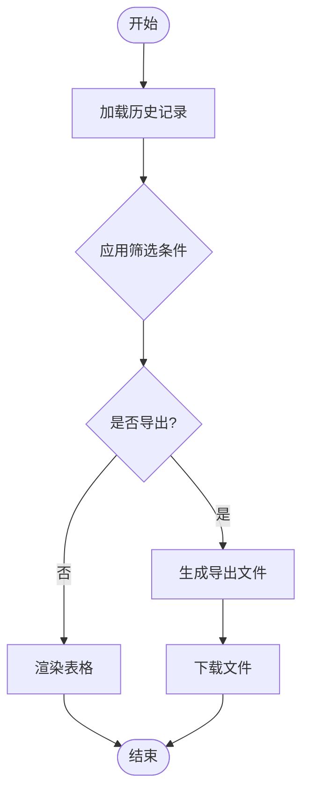
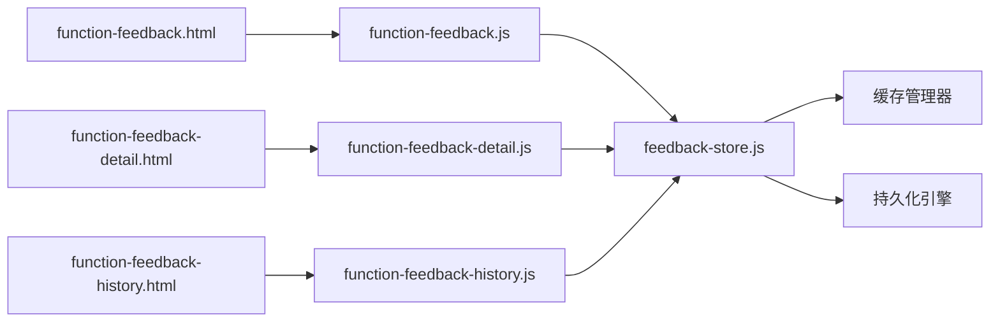

# 反馈数据存储

<cite>
**本文引用的文件**   
- [feedback-store.js](file://app/js/feedback-store.js)
- [function-feedback.js](file://app/js/function-feedback.js)
- [function-feedback-detail.js](file://app/js/function-feedback-detail.js)
- [function-feedback-history.js](file://app/js/function-feedback-history.js)
- [function-feedback.html](file://app/function-feedback.html)
- [function-feedback-detail.html](file://app/function-feedback-detail.html)
- [function-feedback-history.html](file://app/function-feedback-history.html)
</cite>

## 目录
1. [简介](#简介)
2. [项目结构](#项目结构)
3. [核心组件](#核心组件)
4. [架构总览](#架构总览)
5. [详细组件分析](#详细组件分析)
6. [依赖关系分析](#依赖关系分析)
7. [性能考虑](#性能考虑)
8. [故障排查指南](#故障排查指南)
9. [结论](#结论)
10. [附录](#附录)

## 简介
本文件面向 MG-Mini 的“反馈数据存储”模块，系统性阐述其数据模型、存储引擎选择、CRUD 接口、数据同步与缓存策略、并发访问控制、事务机制以及与 UI 层的交互方式。文档既适合初学者快速上手，也为有经验的开发者提供足够的技术深度与可操作建议。

## 项目结构
与反馈数据存储相关的代码主要位于 app/js 与 app 下的 HTML 页面中：
- 数据层与持久化：feedback-store.js
- 业务逻辑与交互编排：function-feedback.js、function-feedback-detail.js、function-feedback-history.js
- 视图层：function-feedback.html、function-feedback-detail.html、function-feedback-history.html

图表来源
- [function-feedback.html](file://app/function-feedback.html)
- [function-feedback-detail.html](file://app/function-feedback-detail.html)
- [function-feedback-history.html](file://app/function-feedback-history.html)
- [function-feedback.js](file://app/js/function-feedback.js)
- [function-feedback-detail.js](file://app/js/function-feedback-detail.js)
- [function-feedback-history.js](file://app/js/function-feedback-history.js)
- [feedback-store.js](file://app/js/feedback-store.js)

章节来源
- [feedback-store.js](file://app/js/feedback-store.js)
- [function-feedback.js](file://app/js/function-feedback.js)
- [function-feedback-detail.js](file://app/js/function-feedback-detail.js)
- [function-feedback-history.js](file://app/js/function-feedback-history.js)
- [function-feedback.html](file://app/function-feedback.html)
- [function-feedback-detail.html](file://app/function-feedback-detail.html)
- [function-feedback-history.html](file://app/function-feedback-history.html)

## 核心组件
- 数据仓库（Store）：集中管理反馈数据的增删改查、本地持久化、内存缓存与事件通知。
- 反馈列表页（function-feedback.js）：负责新增反馈、列表展示、分页与筛选、批量操作等。
- 反馈详情页（function-feedback-detail.js）：负责单条反馈的查看、编辑与状态流转。
- 反馈历史页（function-feedback-history.js）：负责历史记录的查询、导出与归档。

章节来源
- [feedback-store.js](file://app/js/feedback-store.js)
- [function-feedback.js](file://app/js/function-feedback.js)
- [function-feedback-detail.js](file://app/js/function-feedback-detail.js)
- [function-feedback-history.js](file://app/js/function-feedback-history.js)

## 架构总览
整体采用“视图层 → 业务逻辑层 → 数据层”的分层架构。数据层通过 Store 统一暴露 CRUD 方法，内部维护内存缓存与本地持久化；业务逻辑层协调用户交互与数据流；视图层仅负责渲染与事件派发。

图表来源
- [function-feedback.js](file://app/js/function-feedback.js)
- [function-feedback-detail.js](file://app/js/function-feedback-detail.js)
- [function-feedback-history.js](file://app/js/function-feedback-history.js)
- [feedback-store.js](file://app/js/feedback-store.js)

## 详细组件分析

### 数据仓库（feedback-store.js）
职责
- 定义反馈数据模型字段与校验规则
- 提供统一的 CRUD 接口：create、read、update、delete、list、search、export
- 维护内存缓存，提升读取性能
- 实现本地持久化（如 localStorage/IndexedDB），支持离线可用
- 提供事件总线或回调机制，供 UI 层订阅数据变更
- 处理并发访问与冲突合并（幂等写入、版本号/时间戳）

关键设计要点
- 数据模型：包含唯一标识、标题、内容、分类、优先级、状态、附件、时间戳、版本等字段
- 缓存策略：LRU 或 TTL 过期，读多写少场景下显著降低 I/O
- 持久化：批量落盘与增量更新结合，避免频繁 IO
- 并发控制：读写锁或队列化写入，保证一致性
- 错误处理：网络/IO 异常重试、降级策略、失败回滚

图表来源
- [feedback-store.js](file://app/js/feedback-store.js)

章节来源
- [feedback-store.js](file://app/js/feedback-store.js)

### 反馈列表页（function-feedback.js）
职责
- 收集表单输入并调用 Store 的 create 接口
- 拉取列表数据，支持分页、排序、筛选
- 处理批量删除、导出等操作
- 监听 Store 的事件以刷新界面

典型流程
- 用户提交 → 参数校验 → 调用 create → 成功后刷新列表 → 提示用户

图表来源
- [function-feedback.js](file://app/js/function-feedback.js)
- [feedback-store.js](file://app/js/feedback-store.js)

章节来源
- [function-feedback.js](file://app/js/function-feedback.js)

### 反馈详情页（function-feedback-detail.js）
职责
- 根据 ID 获取单条反馈详情
- 支持编辑保存、状态流转（如草稿→已提交→已处理）
- 处理附件上传与预览

典型流程
- 打开详情 → 加载数据 → 编辑保存 → 调用 update → 成功后跳转/提示

图表来源
- [function-feedback-detail.js](file://app/js/function-feedback-detail.js)
- [feedback-store.js](file://app/js/feedback-store.js)

章节来源
- [function-feedback-detail.js](file://app/js/function-feedback-detail.js)

### 反馈历史页（function-feedback-history.js）
职责
- 查询历史反馈记录，支持按时间范围、状态、分类筛选
- 导出为 CSV/JSON 等格式
- 归档与清理策略

图表来源
- [function-feedback-history.js](file://app/js/function-feedback-history.js)
- [feedback-store.js](file://app/js/feedback-store.js)

章节来源
- [function-feedback-history.js](file://app/js/function-feedback-history.js)

## 依赖关系分析
- 视图层依赖业务逻辑层进行交互编排
- 业务逻辑层依赖数据仓库进行数据存取
- 数据仓库依赖缓存与持久化引擎，并通过事件总线通知 UI

图表来源
- [function-feedback.html](file://app/function-feedback.html)
- [function-feedback-detail.html](file://app/function-feedback-detail.html)
- [function-feedback-history.html](file://app/function-feedback-history.html)
- [function-feedback.js](file://app/js/function-feedback.js)
- [function-feedback-detail.js](file://app/js/function-feedback-detail.js)
- [function-feedback-history.js](file://app/js/function-feedback-history.js)
- [feedback-store.js](file://app/js/feedback-store.js)

章节来源
- [feedback-store.js](file://app/js/feedback-store.js)
- [function-feedback.js](file://app/js/function-feedback.js)
- [function-feedback-detail.js](file://app/js/function-feedback-detail.js)
- [function-feedback-history.js](file://app/js/function-feedback-history.js)

## 性能考虑
- 缓存命中优先：读路径先查缓存，未命中再落盘读取
- 批量写入：合并多次更新为一次持久化，减少 IO
- 懒加载与分页：列表按需加载，避免一次性渲染大量 DOM
- 去抖与节流：搜索与高频操作进行节流，降低重复计算
- 索引优化：对常用查询字段建立索引（如时间、状态、分类）
- 资源压缩：静态资源与导出文件压缩传输

[本节为通用性能建议，不直接分析具体文件]

## 故障排查指南
常见问题与定位步骤
- 新增失败：检查输入校验、网络/IO 异常、重试次数与降级策略
- 列表不更新：确认事件总线是否正确触发、UI 订阅是否生效
- 数据不一致：检查并发写入顺序、版本号/时间戳冲突解决
- 导出失败：确认文件格式、权限与浏览器限制

建议日志与监控
- 记录关键操作的入参、出参与耗时
- 捕获并上报异常堆栈与上下文信息
- 统计缓存命中率、持久化成功率与失败率

章节来源
- [feedback-store.js](file://app/js/feedback-store.js)
- [function-feedback.js](file://app/js/function-feedback.js)
- [function-feedback-detail.js](file://app/js/function-feedback-detail.js)
- [function-feedback-history.js](file://app/js/function-feedback-history.js)

## 结论
MG-Mini 的反馈数据存储模块通过分层架构与统一的数据仓库，实现了清晰的职责划分与良好的扩展性。借助缓存与持久化协同、事件驱动与并发控制，能够在复杂交互场景下保持数据一致性与高性能。建议在后续迭代中持续完善错误恢复、监控告警与性能指标采集。

[本节为总结性内容，不直接分析具体文件]

## 附录

### API 接口参考（基于实际模块）
- createFeedback(data)
  - 参数：data（对象，包含标题、内容、分类、优先级、状态、附件等）
  - 返回：Promise，成功时返回新建对象的标识与时间戳
  - 错误：参数校验失败、持久化失败、并发冲突
- getFeedback(id)
  - 参数：id（字符串或数字）
  - 返回：Promise，成功时返回反馈详情对象
  - 错误：ID 不存在、读取失败
- updateFeedback(id, data)
  - 参数：id、data（部分更新或全量更新）
  - 返回：Promise，成功时返回更新后的对象
  - 错误：ID 不存在、版本冲突、持久化失败
- deleteFeedback(id)
  - 参数：id
  - 返回：Promise，成功时返回删除结果
  - 错误：ID 不存在、权限不足
- listFeedback(params)
  - 参数：params（分页、排序、筛选）
  - 返回：Promise，成功时返回列表与总数
  - 错误：查询失败、参数非法
- searchFeedback(query)
  - 参数：query（关键词、范围）
  - 返回：Promise，成功时返回匹配结果
  - 错误：查询失败
- exportFeedback(format)
  - 参数：format（csv/json）
  - 返回：Promise，成功时返回二进制或 Blob
  - 错误：导出失败、权限不足

章节来源
- [feedback-store.js](file://app/js/feedback-store.js)
- [function-feedback.js](file://app/js/function-feedback.js)
- [function-feedback-detail.js](file://app/js/function-feedback-detail.js)
- [function-feedback-history.js](file://app/js/function-feedback-history.js)