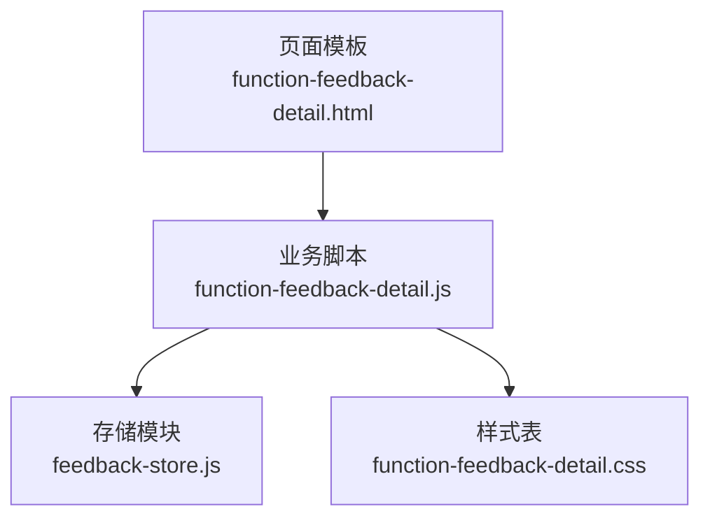
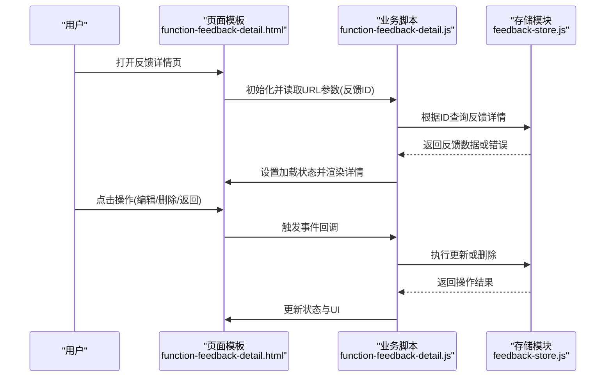
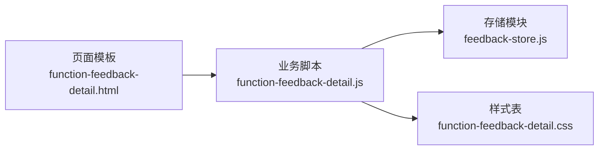
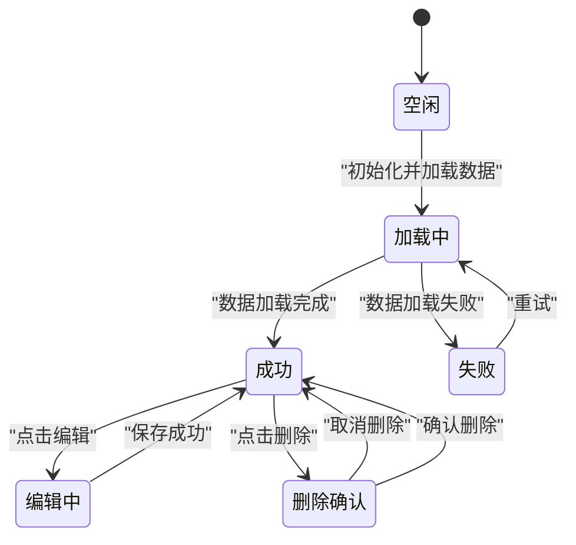
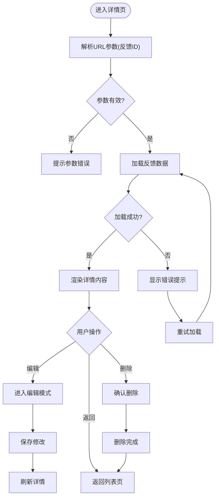

# 反馈详情查看

<cite>
**本文引用的文件**   
- [function-feedback-detail.html](file://app/function-feedback-detail.html)
- [function-feedback-detail.js](file://app/js/function-feedback-detail.js)
- [feedback-store.js](file://app/js/feedback-store.js)
- [function-feedback-detail.css](file://app/css/function-feedback-detail.css)
</cite>

## 目录
1. [简介](#简介)
2. [项目结构](#项目结构)
3. [核心组件](#核心组件)
4. [架构总览](#架构总览)
5. [详细组件分析](#详细组件分析)
6. [依赖关系分析](#依赖关系分析)
7. [性能考量](#性能考量)
8. [故障排查指南](#故障排查指南)
9. [结论](#结论)
10. [附录](#附录)

## 简介
本章节面向MG-Mini的“反馈详情查看”功能，系统性说明该功能的页面实现、数据加载机制、状态管理、用户交互与事件处理。文档将解释如何获取并展示单个反馈的完整信息，支持的操作类型（如编辑、删除等）及对应的事件处理流程；同时给出接口参数、数据结构与返回格式的约定，以及与反馈存储模块的数据同步机制。内容兼顾初学者友好性与资深开发者的技术深度需求。

## 项目结构
“反馈详情查看”功能由以下关键文件组成：
- 页面模板：用于渲染反馈详情UI骨架
- 业务脚本：负责路由参数解析、数据加载、状态管理与交互逻辑
- 存储模块：提供本地数据的读写与同步能力
- 样式文件：定义详情页面的视觉表现

图表来源
- [function-feedback-detail.html](file://app/function-feedback-detail.html)
- [function-feedback-detail.js](file://app/js/function-feedback-detail.js)
- [feedback-store.js](file://app/js/feedback-store.js)
- [function-feedback-detail.css](file://app/css/function-feedback-detail.css)

章节来源
- [function-feedback-detail.html](file://app/function-feedback-detail.html)
- [function-feedback-detail.js](file://app/js/function-feedback-detail.js)
- [feedback-store.js](file://app/js/feedback-store.js)
- [function-feedback-detail.css](file://app/css/function-feedback-detail.css)

## 核心组件
- 页面模板（HTML）
  - 承载详情视图的DOM结构，包含标题、正文、时间戳、操作按钮等区域占位元素
  - 通过ID或类名与JS进行绑定，便于动态填充数据与响应事件
- 业务脚本（JS）
  - 解析页面参数（如反馈ID），调用存储模块获取数据
  - 维护页面状态（加载中、成功、失败、编辑模式等）
  - 处理用户交互（查看详情、编辑、删除、返回列表等）
- 存储模块（Store）
  - 提供按ID查询反馈详情的方法
  - 提供更新与删除反馈的方法
  - 封装本地持久化策略（如localStorage或内存缓存）
- 样式表（CSS）
  - 定义详情布局、排版、交互态（禁用、高亮）、错误提示样式

章节来源
- [function-feedback-detail.html](file://app/function-feedback-detail.html)
- [function-feedback-detail.js](file://app/js/function-feedback-detail.js)
- [feedback-store.js](file://app/js/feedback-store.js)
- [function-feedback-detail.css](file://app/css/function-feedback-detail.css)

## 架构总览
下图展示了从页面初始化到数据加载、渲染与用户操作的完整流程，以及各组件之间的职责边界与数据流向。

图表来源
- [function-feedback-detail.html](file://app/function-feedback-detail.html)
- [function-feedback-detail.js](file://app/js/function-feedback-detail.js)
- [feedback-store.js](file://app/js/feedback-store.js)

## 详细组件分析

### 页面模板（HTML）
- 角色与职责
  - 提供反馈详情的静态结构与占位符
  - 定义操作按钮与交互入口（编辑、删除、返回）
  - 预留错误提示与加载指示区域
- 关键占位元素
  - 标题区：显示反馈主题
  - 内容区：显示反馈正文、附件描述、时间戳等
  - 操作区：编辑、删除、返回列表等按钮
  - 状态区：加载中、错误提示、空数据提示
- 与JS的绑定方式
  - 通过ID或类名选择器在JS中定位节点
  - 事件委托绑定在容器上，统一处理按钮点击

章节来源
- [function-feedback-detail.html](file://app/function-feedback-detail.html)

### 业务脚本（JS）
- 初始化与参数解析
  - 从URL参数中解析反馈ID
  - 校验参数有效性，无效时跳转或提示
- 数据加载机制
  - 调用存储模块的“按ID查询”接口
  - 设置加载状态为“加载中”，请求完成后切换为“成功”或“失败”
  - 失败时展示错误提示，并提供重试入口
- 渲染逻辑
  - 将反馈数据映射到页面占位元素
  - 格式化时间戳、富文本内容、附件列表等
  - 根据权限或配置控制操作按钮可见性
- 状态管理
  - 维护页面状态：idle、loading、success、error、editing
  - 状态变更时同步更新UI与按钮可用性
- 用户交互与事件处理
  - 编辑：进入编辑模式，预填表单，保存后刷新详情
  - 删除：二次确认后调用删除接口，成功后返回列表
  - 返回：导航回上一级或列表页
- 错误处理
  - 网络异常、数据缺失、权限不足等场景的统一处理
  - 提供友好的错误提示与恢复路径

章节来源
- [function-feedback-detail.js](file://app/js/function-feedback-detail.js)

### 存储模块（Store）
- 数据模型
  - 反馈条目包含：id、标题、正文、创建时间、更新时间、状态、附件信息等字段
- 接口契约
  - 查询详情：传入反馈ID，返回反馈对象或错误
  - 更新反馈：传入反馈对象或部分字段，返回更新结果
  - 删除反馈：传入反馈ID，返回删除结果
- 持久化策略
  - 本地缓存优先，必要时回退到默认值或空数据
  - 提供一致性保障（如版本号或时间戳）以避免冲突
- 错误与边界
  - ID不存在、格式非法、并发更新等场景的错误码与消息

章节来源
- [feedback-store.js](file://app/js/feedback-store.js)

### 样式表（CSS）
- 布局与排版
  - 详情卡片式布局，标题与内容分区清晰
  - 响应式适配不同屏幕尺寸
- 交互态
  - 按钮禁用态、悬停态、激活态
  - 编辑模式下表单控件的高亮与校验提示
- 错误与空态
  - 统一的错误提示样式与空数据占位图

章节来源
- [function-feedback-detail.css](file://app/css/function-feedback-detail.css)

## 依赖关系分析
- 页面模板依赖业务脚本进行数据绑定与事件处理
- 业务脚本依赖存储模块完成数据读写
- 业务脚本依赖样式表提供视觉呈现
- 存储模块可被其他模块复用，保持高内聚低耦合

图表来源
- [function-feedback-detail.html](file://app/function-feedback-detail.html)
- [function-feedback-detail.js](file://app/js/function-feedback-detail.js)
- [feedback-store.js](file://app/js/feedback-store.js)
- [function-feedback-detail.css](file://app/css/function-feedback-detail.css)

章节来源
- [function-feedback-detail.html](file://app/function-feedback-detail.html)
- [function-feedback-detail.js](file://app/js/function-feedback-detail.js)
- [feedback-store.js](file://app/js/feedback-store.js)
- [function-feedback-detail.css](file://app/css/function-feedback-detail.css)

## 性能考量
- 数据加载优化
  - 使用防抖/节流避免重复请求
  - 对大文本或富文本内容进行懒加载
- 渲染优化
  - 最小化DOM操作，批量更新节点
  - 使用虚拟滚动或分页加载长列表附件
- 状态管理优化
  - 减少不必要的状态重绘
  - 使用局部更新而非整页刷新

[本节为通用指导，不直接分析具体文件]

## 故障排查指南
- 数据加载失败
  - 检查URL参数是否包含有效的反馈ID
  - 确认存储模块查询接口返回状态与错误码
  - 查看控制台日志与网络请求记录
- 状态异常
  - 核对状态机转换是否正确（如loading未切换到success/error）
  - 检查事件绑定是否生效，是否存在事件冒泡问题
- 渲染异常
  - 验证数据字段是否与模板占位符匹配
  - 检查样式冲突或CSS类名拼写错误
- 操作失败
  - 编辑/删除前进行二次确认与权限校验
  - 捕获并展示后端或存储层返回的错误信息

章节来源
- [function-feedback-detail.js](file://app/js/function-feedback-detail.js)
- [feedback-store.js](file://app/js/feedback-store.js)

## 结论
“反馈详情查看”功能通过清晰的页面模板、稳健的业务脚本与可靠的存储模块协作，实现了完整的单条反馈信息查询、展示与操作闭环。合理的状态管理与错误处理保障了用户体验与系统稳定性。建议在实际集成中严格遵循接口契约与数据模型约定，确保与其他模块的一致性。

[本节为总结性内容，不直接分析具体文件]

## 附录

### 接口与数据模型约定
- 查询详情
  - 输入：反馈ID（字符串或数字）
  - 输出：反馈对象（包含标题、正文、时间戳、状态、附件等字段）或错误对象
- 更新反馈
  - 输入：反馈对象或部分字段（需包含ID）
  - 输出：更新结果（成功标志与消息）
- 删除反馈
  - 输入：反馈ID
  - 输出：删除结果（成功标志与消息）

章节来源
- [feedback-store.js](file://app/js/feedback-store.js)

### 页面状态机

图表来源
- [function-feedback-detail.js](file://app/js/function-feedback-detail.js)

### 用户操作流程

图表来源
- [function-feedback-detail.js](file://app/js/function-feedback-detail.js)