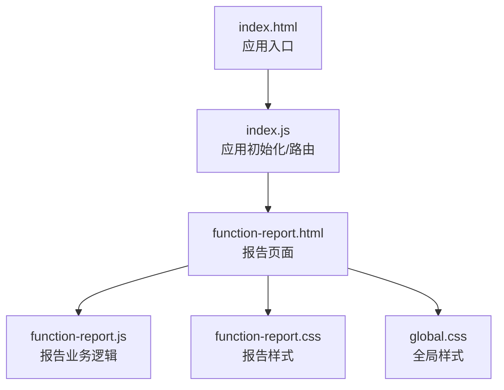
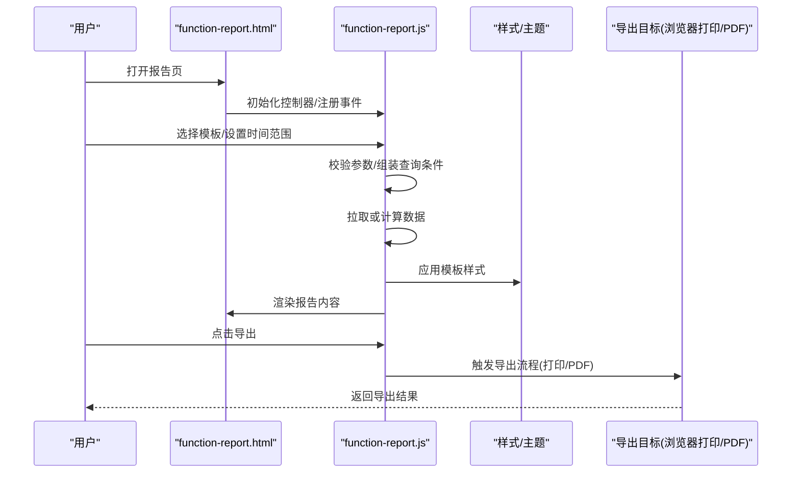
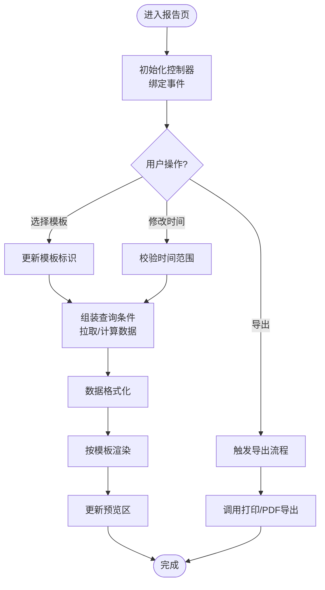
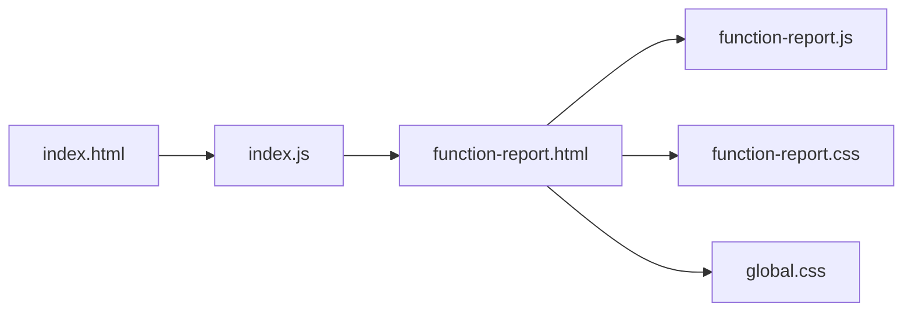

# 报告生成系统

<cite>
**本文引用的文件**   
- [function-report.html](file://app/function-report.html)
- [function-report.js](file://app/js/function-report.js)
- [function-report.css](file://app/css/function-report.css)
- [index.html](file://app/index.html)
- [index.js](file://app/js/index.js)
- [global.css](file://app/css/global.css)
</cite>

## 目录
1. [简介](#简介)
2. [项目结构](#项目结构)
3. [核心组件](#核心组件)
4. [架构总览](#架构总览)
5. [详细组件分析](#详细组件分析)
6. [依赖关系分析](#依赖关系分析)
7. [性能考量](#性能考量)
8. [故障排查指南](#故障排查指南)
9. [结论](#结论)
10. [附录](#附录)

## 简介
本文件面向 MG-Mini 的报告生成系统，围绕“模板配置、数据收集、格式化与导出”四大能力进行系统化说明。文档从整体架构入手，逐步深入到具体模块的实现要点、调用关系与接口约定，并提供常见问题排查建议。内容兼顾初学者友好性与资深开发者的技术深度，帮助读者快速理解并正确使用报告功能。

## 项目结构
报告相关的前端资源集中在 app 目录下：
- 页面入口：function-report.html
- 业务逻辑：js/function-report.js
- 样式定义：css/function-report.css
- 全局样式：css/global.css
- 应用主入口：index.html（用于导航到报告页）
- 应用初始化脚本：js/index.js（负责路由/页面加载等）

图表来源
- [index.html:1-200](file://app/index.html#L1-L200)
- [index.js:1-200](file://app/js/index.js#L1-L200)
- [function-report.html:1-200](file://app/function-report.html#L1-L200)
- [function-report.js:1-200](file://app/js/function-report.js#L1-L200)
- [function-report.css:1-200](file://app/css/function-report.css#L1-L200)
- [global.css:1-200](file://app/css/global.css#L1-L200)

章节来源
- [index.html:1-200](file://app/index.html#L1-L200)
- [index.js:1-200](file://app/js/index.js#L1-L200)
- [function-report.html:1-200](file://app/function-report.html#1-L200)
- [function-report.js:1-200](file://app/js/function-report.js#L1-L200)
- [function-report.css:1-200](file://app/css/function-report.css#L1-L200)
- [global.css:1-200](file://app/css/global.css#L1-L200)

## 核心组件
- 报告页面容器（HTML）：承载报告模板选择器、时间范围筛选、数据预览区、导出按钮等 UI 元素。
- 报告控制器（JS）：负责事件绑定、参数校验、数据获取与组装、渲染策略切换、导出流程编排。
- 报告样式（CSS）：定义报告布局、主题、打印适配等视觉表现。
- 全局样式（CSS）：提供基础排版、颜色、字体等通用样式。

章节来源
- [function-report.html:1-200](file://app/function-report.html#L1-L200)
- [function-report.js:1-200](file://app/js/function-report.js#L1-L200)
- [function-report.css:1-200](file://app/css/function-report.css#L1-L200)
- [global.css:1-200](file://app/css/global.css#L1-L200)

## 架构总览
报告系统采用“页面-控制器-样式”的轻量前端架构，遵循职责分离原则：
- 页面层仅负责结构与展示
- 控制器层处理交互、数据流与渲染决策
- 样式层专注视觉呈现与打印适配

图表来源
- [function-report.html:1-200](file://app/function-report.html#L1-L200)
- [function-report.js:1-200](file://app/js/function-report.js#L1-L200)
- [function-report.css:1-200](file://app/css/function-report.css#L1-L200)
- [global.css:1-200](file://app/css/global.css#L1-L200)

## 详细组件分析

### 报告页面（function-report.html）
- 作用：定义报告页面的 DOM 结构，包括模板选择控件、时间范围输入、数据预览容器、导出操作按钮等。
- 关键点：
  - 为交互元素提供稳定的 id/class，便于控制器绑定事件。
  - 预留占位区域用于动态渲染报告内容。
  - 引入必要的 CSS 与 JS 资源。

章节来源
- [function-report.html:1-200](file://app/function-report.html#L1-L200)

### 报告控制器（function-report.js）
- 作用：实现报告系统的核心逻辑，包括：
  - 生命周期管理：页面加载后初始化、销毁时清理监听。
  - 事件处理：模板切换、时间范围变更、导出触发等。
  - 数据流：参数校验、数据源聚合、格式化处理。
  - 渲染策略：根据模板类型选择渲染路径。
  - 导出编排：调用浏览器打印或生成 PDF。
- 关键流程（示例）：
  - 模板切换：监听模板选择事件，更新当前模板标识，重新渲染。
  - 数据收集：读取时间范围与筛选条件，构造查询参数，拉取数据或本地计算。
  - 格式化：对数值、日期、文本进行统一格式化。
  - 渲染：将数据注入模板，更新预览区。
  - 导出：封装导出参数，调用导出 API 或触发打印对话框。

图表来源
- [function-report.js:1-200](file://app/js/function-report.js#L1-L200)

章节来源
- [function-report.js:1-200](file://app/js/function-report.js#L1-L200)

### 报告样式（function-report.css 与 global.css）
- function-report.css：定义报告专属布局、卡片样式、表格样式、打印媒体查询等。
- global.css：提供全局字体、颜色、间距、响应式基础规则。
- 关键点：
  - 使用 CSS 变量统一管理主题色与字号。
  - 针对打印场景优化布局与分页。
  - 避免在 HTML 中内联样式，保持样式集中管理。

章节来源
- [function-report.css:1-200](file://app/css/function-report.css#L1-L200)
- [global.css:1-200](file://app/css/global.css#L1-L200)

### 应用入口与路由（index.html 与 index.js）
- index.html：应用主页面，包含导航与页面容器。
- index.js：负责页面路由、模块懒加载、错误边界等。
- 与报告的关系：通过路由跳转到 function-report.html，并在加载完成后初始化报告控制器。

章节来源
- [index.html:1-200](file://app/index.html#L1-L200)
- [index.js:1-200](file://app/js/index.js#L1-L200)

## 依赖关系分析
- 页面与控制器：function-report.html 依赖 function-report.js 提供的交互与渲染能力。
- 控制器与样式：function-report.js 通过类名/ID 控制样式生效，function-report.css 与 global.css 提供视觉支持。
- 应用入口：index.js 负责加载报告页面与控制器，确保 DOM 就绪后再执行初始化。

图表来源
- [index.html:1-200](file://app/index.html#L1-L200)
- [index.js:1-200](file://app/js/index.js#L1-L200)
- [function-report.html:1-200](file://app/function-report.html#L1-L200)
- [function-report.js:1-200](file://app/js/function-report.js#L1-L200)
- [function-report.css:1-200](file://app/css/function-report.css#L1-L200)
- [global.css:1-200](file://app/css/global.css#L1-L200)

章节来源
- [index.html:1-200](file://app/index.html#L1-L200)
- [index.js:1-200](file://app/js/index.js#L1-L200)
- [function-report.html:1-200](file://app/function-report.html#L1-L200)
- [function-report.js:1-200](file://app/js/function-report.js#L1-L200)
- [function-report.css:1-200](file://app/css/function-report.css#L1-L200)
- [global.css:1-200](file://app/css/global.css#L1-L200)

## 性能考量
- 渲染优化：
  - 按需渲染：仅在模板或时间范围变化时重新渲染。
  - 虚拟列表：大数据集建议使用虚拟滚动减少重排。
- 内存管理：
  - 及时解绑事件监听，避免内存泄漏。
  - 大对象复用与缓存，减少重复计算。
- 网络请求：
  - 合并请求与去抖节流，降低频繁请求开销。
  - 合理设置超时与重试策略。
- 打印导出：
  - 使用 CSS @media print 优化打印布局。
  - 避免在打印时执行重型计算。

[本节为通用指导，不直接分析具体文件]

## 故障排查指南
- 页面空白或无内容：
  - 检查 function-report.html 是否正确引入 function-report.js 与样式文件。
  - 确认 index.js 路由跳转是否成功，DOM 是否已就绪。
- 模板不生效：
  - 核对模板标识与渲染分支匹配。
  - 检查 CSS 类名是否与模板要求一致。
- 数据为空或异常：
  - 验证时间范围与筛选参数的合法性。
  - 检查数据源接口可用性、跨域与权限。
- 导出失败：
  - 确认浏览器打印权限与弹窗拦截设置。
  - 检查打印样式是否完整，是否存在遮挡或溢出。

章节来源
- [function-report.html:1-200](file://app/function-report.html#L1-L200)
- [function-report.js:1-200](file://app/js/function-report.js#L1-L200)
- [function-report.css:1-200](file://app/css/function-report.css#L1-L200)
- [global.css:1-200](file://app/css/global.css#L1-L200)
- [index.html:1-200](file://app/index.html#L1-L200)
- [index.js:1-200](file://app/js/index.js#L1-L200)

## 结论
MG-Mini 的报告生成系统以简洁的前端架构实现了模板化报告的核心能力。通过清晰的职责划分与模块化设计，系统在可维护性、扩展性与用户体验方面具备良好基础。后续可在数据源集成、模板引擎增强与导出能力扩展等方面持续优化。

[本节为总结性内容，不直接分析具体文件]

## 附录
- 术语表：
  - 模板：报告的可视化结构与样式集合。
  - 数据源：提供报告所需数据的后端接口或本地计算模块。
  - 导出：将报告内容输出为 PDF、图片或通过浏览器打印。
- 最佳实践：
  - 使用统一的参数校验与错误提示机制。
  - 将模板与样式解耦，便于主题切换与多语言支持。
  - 对敏感数据进行脱敏与权限控制。

[本节为补充信息，不直接分析具体文件]