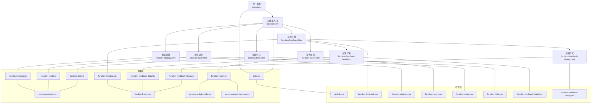
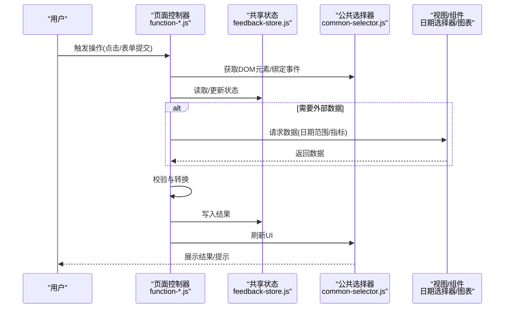
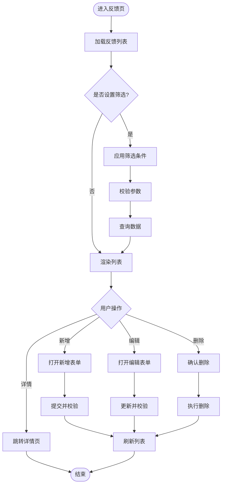
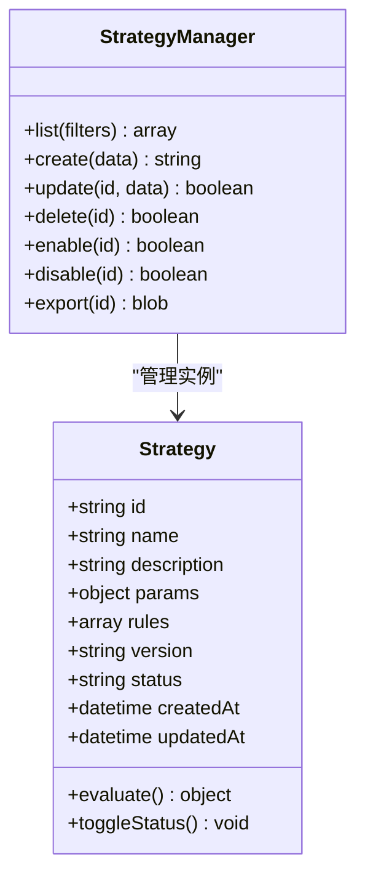
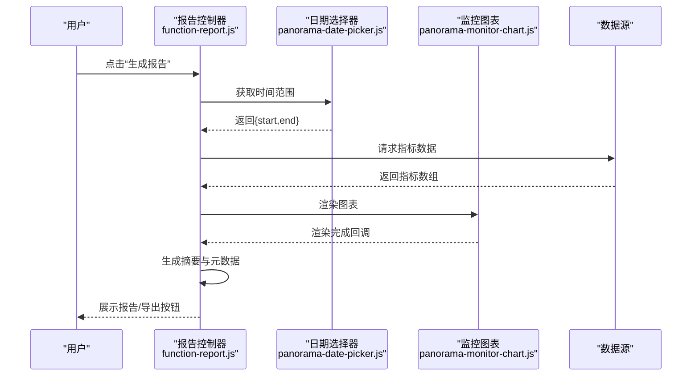
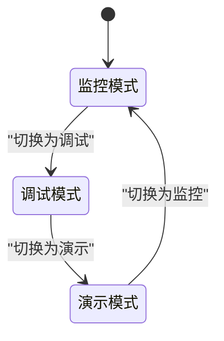
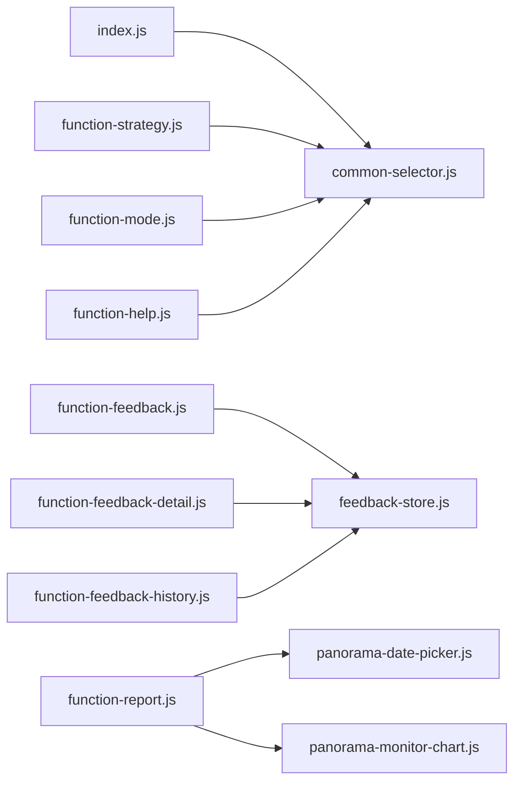

# 核心功能模块

<cite>
**本文引用的文件**   
- [index.html](file://app/index.html)
- [function.html](file://app/function.html)
- [function-feedback.html](file://app/function-feedback.html)
- [function-feedback-detail.html](file://app/function-feedback-detail.html)
- [function-feedback-history.html](file://app/function-feedback-history.html)
- [function-strategy.html](file://app/function-strategy.html)
- [function-report.html](file://app/function-report.html)
- [function-mode.html](file://app/function-mode.html)
- [function-help.html](file://app/function-help.html)
- [index.js](file://app/js/index.js)
- [feedback-store.js](file://app/js/feedback-store.js)
- [function-feedback.js](file://app/js/function-feedback.js)
- [function-feedback-detail.js](file://app/js/function-feedback-detail.js)
- [function-feedback-history.js](file://app/js/function-feedback-history.js)
- [function-strategy.js](file://app/js/function-strategy.js)
- [function-report.js](file://app/js/function-report.js)
- [function-mode.js](file://app/js/function-mode.js)
- [function-help.js](file://app/js/function-help.js)
- [common-selector.js](file://app/js/common-selector.js)
- [panorama-date-picker.js](file://app/js/panorama-date-picker.js)
- [panorama-monitor-chart.js](file://app/js/panorama-monitor-chart.js)
- [global.css](file://app/css/global.css)
- [function-feedback.css](file://app/css/function-feedback.css)
- [function-feedback-detail.css](file://app/css/function-feedback-detail.css)
- [function-feedback-history.css](file://app/css/function-feedback-history.css)
- [function-strategy.css](file://app/css/function-strategy.css)
- [function-report.css](file://app/css/function-report.css)
- [function-mode.css](file://app/css/function-mode.css)
- [function-help.css](file://app/css/function-help.css)
- [2026-07-03-能量全景看板PRD.md](file://docs/2026-07-03-能量全景看板PRD.md)
</cite>

## 目录
1. [简介](#简介)
2. [项目结构](#项目结构)
3. [核心组件](#核心组件)
4. [架构总览](#架构总览)
5. [详细组件分析](#详细组件分析)
6. [依赖关系分析](#依赖关系分析)
7. [性能考虑](#性能考虑)
8. [故障排查指南](#故障排查指南)
9. [结论](#结论)
10. [附录](#附录)

## 简介
本文件面向MG-Mini的核心功能模块，聚焦以下能力：功能反馈系统、策略管理、报告生成、模式切换。文档从系统架构、数据流、接口契约、状态管理与错误处理等维度进行系统化说明，并提供调用示例与常见问题解决方案，兼顾初学者友好与资深开发者的技术深度。

## 项目结构
项目采用“页面 + 脚本 + 样式”的模块化组织方式，每个功能对应一个HTML页面与其JS/CSS实现，公共逻辑通过独立脚本复用。

图表来源
- [index.html](file://app/index.html)
- [function.html](file://app/function.html)
- [function-feedback.html](file://app/function-feedback.html)
- [function-feedback-detail.html](file://app/function-feedback-detail.html)
- [function-feedback-history.html](file://app/function-feedback-history.html)
- [function-strategy.html](file://app/function-strategy.html)
- [function-report.html](file://app/function-report.html)
- [function-mode.html](file://app/function-mode.html)
- [function-help.html](file://app/function-help.html)
- [index.js](file://app/js/index.js)
- [common-selector.js](file://app/js/common-selector.js)
- [feedback-store.js](file://app/js/feedback-store.js)
- [panorama-date-picker.js](file://app/js/panorama-date-picker.js)
- [panorama-monitor-chart.js](file://app/js/panorama-monitor-chart.js)
- [global.css](file://app/css/global.css)
- [function-feedback.css](file://app/css/function-feedback.css)
- [function-strategy.css](file://app/css/function-strategy.css)
- [function-report.css](file://app/css/function-report.css)
- [function-mode.css](file://app/css/function-mode.css)
- [function-help.css](file://app/css/function-help.css)
- [function-feedback-detail.css](file://app/css/function-feedback-detail.css)
- [function-feedback-history.css](file://app/css/function-feedback-history.css)

章节来源
- [index.html](file://app/index.html)
- [function.html](file://app/function.html)
- [index.js](file://app/js/index.js)

## 核心组件
- 功能反馈系统：负责用户反馈的创建、查看、编辑、删除与历史归档，支持按时间、类型、状态筛选与分页展示。
- 策略管理：提供策略的增删改查、启用/禁用、版本控制与执行效果评估。
- 报告生成：基于日期选择器与监控图表组件，聚合指标并导出可视化报告。
- 模式切换：在应用内切换不同工作模式（如监控/调试/演示），影响UI行为与数据源。
- 公共选择器与工具：统一DOM选择、事件绑定与通用交互封装。
- 全局样式：统一的视觉规范与主题变量。

章节来源
- [function-feedback.js](file://app/js/function-feedback.js)
- [function-strategy.js](file://app/js/function-strategy.js)
- [function-report.js](file://app/js/function-report.js)
- [function-mode.js](file://app/js/function-mode.js)
- [common-selector.js](file://app/js/common-selector.js)
- [global.css](file://app/css/global.css)

## 架构总览
整体采用“页面级控制器 + 共享状态 + 组件化”的前端架构。页面JS作为控制器，协调视图渲染、用户交互与数据持久化；反馈数据通过集中式store管理；报告页组合日期选择器与图表组件完成数据聚合与可视化。

图表来源
- [function-feedback.js](file://app/js/function-feedback.js)
- [function-strategy.js](file://app/js/function-strategy.js)
- [function-report.js](file://app/js/function-report.js)
- [function-mode.js](file://app/js/function-mode.js)
- [feedback-store.js](file://app/js/feedback-store.js)
- [common-selector.js](file://app/js/common-selector.js)
- [panorama-date-picker.js](file://app/js/panorama-date-picker.js)
- [panorama-monitor-chart.js](file://app/js/panorama-monitor-chart.js)

## 详细组件分析

### 功能反馈系统
- 职责：维护反馈列表、单条反馈详情、历史记录与筛选条件；提供新增、编辑、删除、批量操作与导出能力。
- 数据模型：反馈条目包含标识、标题、分类、优先级、状态、内容、创建/更新时间、关联策略或报告等。
- 关键流程：
  - 新增反馈：表单校验 -> 写入store -> 刷新列表 -> 提示成功。
  - 查看详情：根据ID加载详情 -> 渲染富文本/附件 -> 支持评论与状态流转。
  - 历史归档：按时间范围与状态过滤 -> 分页加载 -> 导出CSV/PDF。
- 状态管理：集中式store提供订阅与派发机制，确保多页面一致性。

图表来源
- [function-feedback.js](file://app/js/function-feedback.js)
- [function-feedback-detail.js](file://app/js/function-feedback-detail.js)
- [function-feedback-history.js](file://app/js/function-feedback-history.js)
- [feedback-store.js](file://app/js/feedback-store.js)

章节来源
- [function-feedback.js](file://app/js/function-feedback.js)
- [function-feedback-detail.js](file://app/js/function-feedback-detail.js)
- [function-feedback-history.js](file://app/js/function-feedback-history.js)
- [feedback-store.js](file://app/js/feedback-store.js)
- [function-feedback.css](file://app/css/function-feedback.css)
- [function-feedback-detail.css](file://app/css/function-feedback-detail.css)
- [function-feedback-history.css](file://app/css/function-feedback-history.css)

### 策略管理
- 职责：策略CRUD、启用/禁用、版本对比、执行效果评估与回滚。
- 关键流程：
  - 新建策略：模板选择 -> 参数配置 -> 规则校验 -> 保存草稿/发布。
  - 启停控制：切换开关 -> 同步状态到store -> 通知相关模块生效。
  - 效果评估：拉取指标 -> 计算命中率/误报率 -> 生成评估卡片。
- 数据模型：策略包含标识、名称、描述、规则集、参数、版本、状态、创建/更新时间、评估指标等。

图表来源
- [function-strategy.js](file://app/js/function-strategy.js)

章节来源
- [function-strategy.js](file://app/js/function-strategy.js)
- [function-strategy.css](file://app/css/function-strategy.css)

### 报告生成
- 职责：基于日期选择器与监控图表组件，聚合指标并生成可视化报告，支持导出。
- 关键流程：
  - 选择时间范围 -> 拉取指标数据 -> 渲染图表 -> 生成报告摘要 -> 导出PDF/CSV。
- 组件协作：日期选择器提供时间边界，图表组件渲染趋势/分布，报告控制器编排数据与视图。

图表来源
- [function-report.js](file://app/js/function-report.js)
- [panorama-date-picker.js](file://app/js/panorama-date-picker.js)
- [panorama-monitor-chart.js](file://app/js/panorama-monitor-chart.js)

章节来源
- [function-report.js](file://app/js/function-report.js)
- [panorama-date-picker.js](file://app/js/panorama-date-picker.js)
- [panorama-monitor-chart.js](file://app/js/panorama-monitor-chart.js)
- [function-report.css](file://app/css/function-report.css)

### 模式切换
- 职责：在应用内切换工作模式（如监控/调试/演示），影响UI行为、数据源与权限。
- 关键流程：
  - 用户选择模式 -> 更新全局状态 -> 重新渲染受影响组件 -> 记录偏好。
- 状态管理：通过全局状态存储当前模式，并在各模块监听变化以调整行为。

图表来源
- [function-mode.js](file://app/js/function-mode.js)

章节来源
- [function-mode.js](file://app/js/function-mode.js)
- [function-mode.css](file://app/css/function-mode.css)

### 帮助中心
- 职责：提供使用指南、常见问题与快捷入口，提升用户体验。
- 关键流程：
  - 加载帮助内容 -> 搜索关键词 -> 高亮匹配项 -> 跳转到相关页面。

章节来源
- [function-help.js](file://app/js/function-help.js)
- [function-help.css](file://app/css/function-help.css)

## 依赖关系分析
- 页面控制器依赖公共选择器与状态管理，避免直接操作DOM与分散状态。
- 报告页依赖日期选择器与图表组件，形成松耦合的数据装配。
- 反馈系统通过集中式store保证跨页面一致性。
- 样式层通过全局CSS统一主题，功能CSS隔离样式冲突。

图表来源
- [index.js](file://app/js/index.js)
- [common-selector.js](file://app/js/common-selector.js)
- [feedback-store.js](file://app/js/feedback-store.js)
- [function-feedback.js](file://app/js/function-feedback.js)
- [function-feedback-detail.js](file://app/js/function-feedback-detail.js)
- [function-feedback-history.js](file://app/js/function-feedback-history.js)
- [function-strategy.js](file://app/js/function-strategy.js)
- [function-report.js](file://app/js/function-report.js)
- [panorama-date-picker.js](file://app/js/panorama-date-picker.js)
- [panorama-monitor-chart.js](file://app/js/panorama-monitor-chart.js)
- [function-mode.js](file://app/js/function-mode.js)
- [function-help.js](file://app/js/function-help.js)

章节来源
- [index.js](file://app/js/index.js)
- [common-selector.js](file://app/js/common-selector.js)
- [feedback-store.js](file://app/js/feedback-store.js)
- [function-feedback.js](file://app/js/function-feedback.js)
- [function-strategy.js](file://app/js/function-strategy.js)
- [function-report.js](file://app/js/function-report.js)
- [function-mode.js](file://app/js/function-mode.js)
- [function-help.js](file://app/js/function-help.js)

## 性能考虑
- 列表分页与虚拟滚动：反馈与历史列表按需加载，减少首屏压力。
- 组件懒加载：图表与日期选择器按需初始化，避免阻塞渲染。
- 状态最小化更新：store仅推送变更字段，降低重绘成本。
- 缓存策略：对热点数据（如策略模板、常用筛选）进行短期缓存。
- 资源优化：CSS按需注入，图片与字体延迟加载。

[本节为通用指导，不直接分析具体文件]

## 故障排查指南
- 反馈列表不更新
  - 检查store是否正确派发更新事件
  - 确认页面控制器订阅了状态变更
  - 验证筛选参数合法性
- 报告图表空白
  - 确认日期选择器返回值格式正确
  - 检查数据源接口返回结构与字段映射
  - 查看图表组件初始化是否成功
- 模式切换无效
  - 检查全局状态是否被其他模块覆盖
  - 确认受影响的组件已监听模式变化
- 常见错误定位
  - 使用浏览器控制台查看网络请求与异常堆栈
  - 通过日志输出关键步骤的状态快照
  - 逐步缩小问题范围至具体组件

章节来源
- [feedback-store.js](file://app/js/feedback-store.js)
- [function-report.js](file://app/js/function-report.js)
- [function-mode.js](file://app/js/function-mode.js)

## 结论
MG-Mini的核心功能模块以清晰的页面控制器与共享状态为核心，结合组件化与样式隔离，实现了可维护、可扩展的前端架构。功能反馈、策略管理、报告生成与模式切换各司其职并通过明确的数据流协同工作。遵循本文档的接口约定与最佳实践，可有效提升开发与排错效率。

[本节为总结性内容，不直接分析具体文件]

## 附录
- 术语表
  - 反馈：用户对系统问题的记录与跟踪
  - 策略：用于自动化决策的规则集合
  - 报告：基于指标的可视化汇总与导出
  - 模式：应用的工作上下文，影响UI与行为
- 参考文档
  - 产品需求文档：能量全景看板PRD

章节来源
- [2026-07-03-能量全景看板PRD.md](file://docs/2026-07-03-能量全景看板PRD.md)