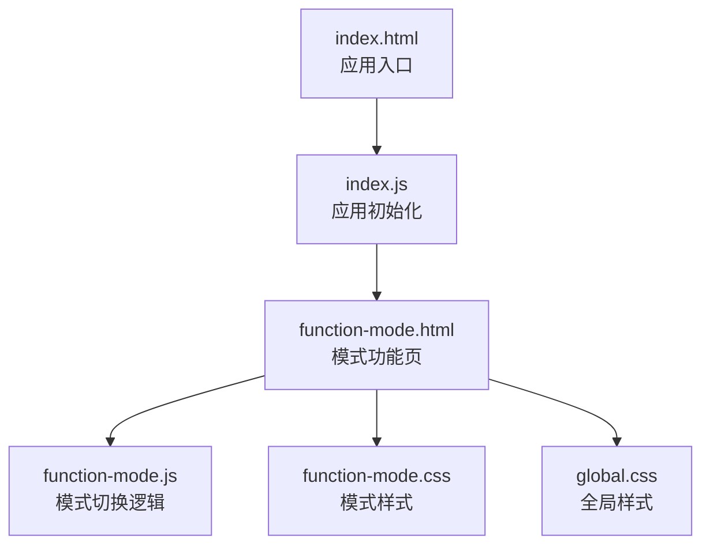
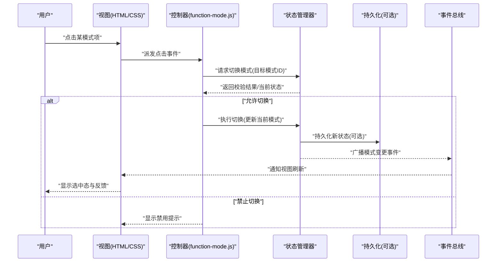
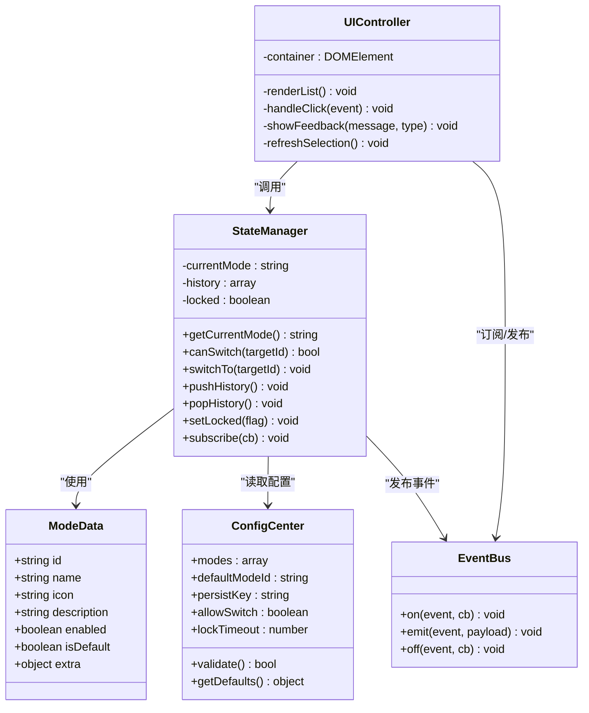
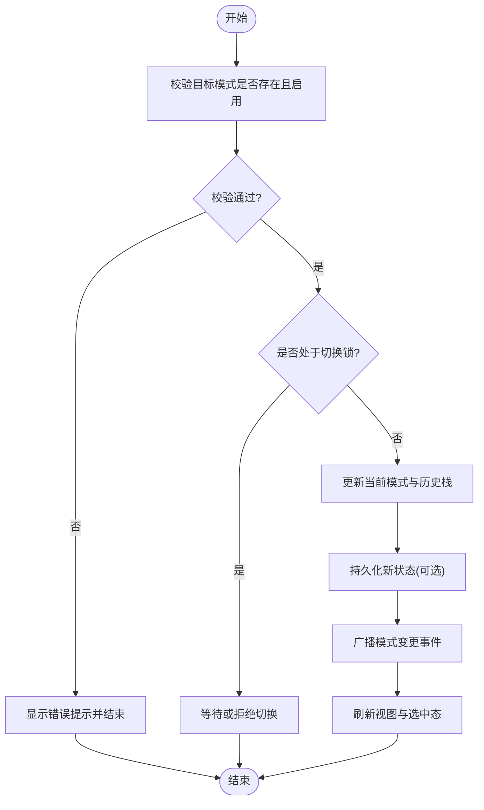
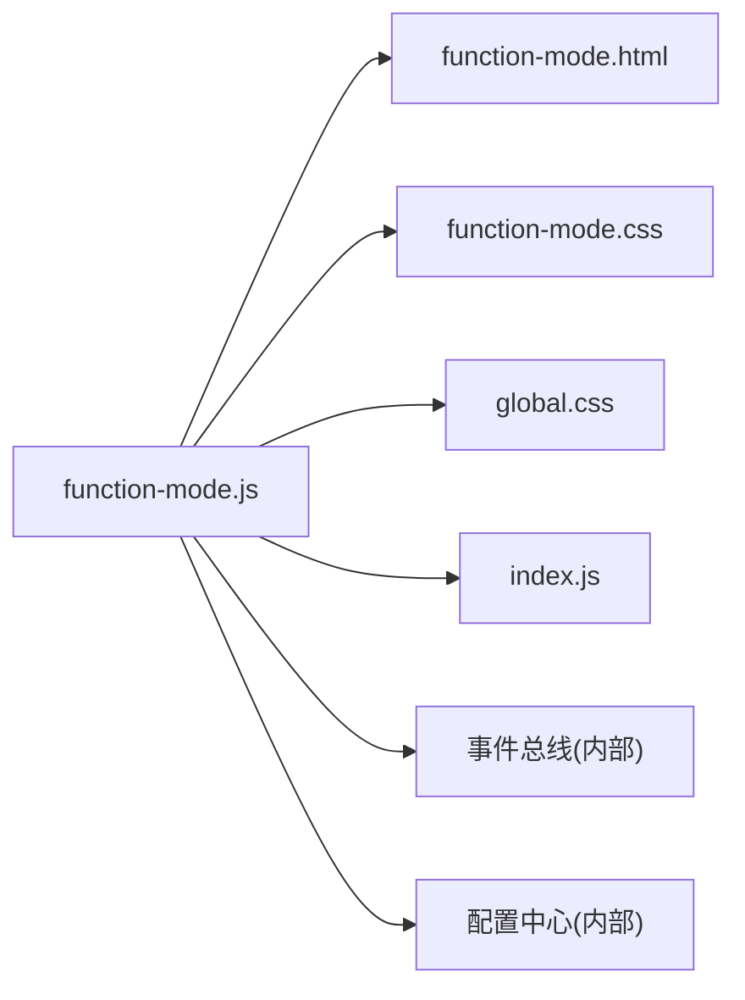

# 模式切换系统

<cite>
**本文引用的文件**   
- [function-mode.html](file://app/function-mode.html)
- [function-mode.js](file://app/js/function-mode.js)
- [function-mode.css](file://app/css/function-mode.css)
- [index.html](file://app/index.html)
- [index.js](file://app/js/index.js)
- [global.css](file://app/css/global.css)
</cite>

## 目录
1. [简介](#简介)
2. [项目结构](#项目结构)
3. [核心组件](#核心组件)
4. [架构总览](#架构总览)
5. [详细组件分析](#详细组件分析)
6. [依赖关系分析](#依赖关系分析)
7. [性能考虑](#性能考虑)
8. [故障排查指南](#故障排查指南)
9. [结论](#结论)
10. [附录](#附录)

## 简介
本文件面向 MG-Mini 的“模式切换系统”，聚焦工作模式的配置、切换逻辑与状态管理，以及模式与用户界面的集成方式。文档从整体架构到具体实现细节逐层展开，既适合初学者快速上手，也为有经验的开发者提供足够的技术深度。内容涵盖：
- 模式定义与数据模型
- 切换流程与状态机
- 界面渲染与事件处理
- 配置项与参数说明
- 常见问题与解决方案

## 项目结构
与模式切换相关的核心文件位于 app 目录下，包含页面、脚本与样式：
- 页面入口：function-mode.html（模式功能页）
- 业务逻辑：js/function-mode.js（模式切换逻辑、状态管理、UI交互）
- 样式资源：css/function-mode.css（模式相关样式）
- 全局样式：css/global.css（全局主题与布局）
- 应用入口：index.html、js/index.js（页面加载与模块初始化）

图表来源
- [index.html](file://app/index.html)
- [index.js](file://app/js/index.js)
- [function-mode.html](file://app/function-mode.html)
- [function-mode.js](file://app/js/function-mode.js)
- [function-mode.css](file://app/css/function-mode.css)
- [global.css](file://app/css/global.css)

章节来源
- [function-mode.html](file://app/function-mode.html)
- [function-mode.js](file://app/js/function-mode.js)
- [function-mode.css](file://app/css/function-mode.css)
- [index.html](file://app/index.html)
- [index.js](file://app/js/index.js)
- [global.css](file://app/css/global.css)

## 核心组件
- 模式数据模型：定义可用模式集合、默认模式、模式属性（如名称、图标、描述、是否可切换等）。
- 状态管理器：维护当前模式、历史模式栈、切换锁与异步任务状态，保证切换过程的一致性。
- UI 控制器：负责渲染模式列表、选中态、禁用态、加载提示与错误提示；响应点击事件触发切换。
- 配置中心：集中管理模式开关、默认值、持久化策略与回退策略。
- 事件总线：在页面内或跨模块广播模式变更事件，驱动其他组件同步更新。

章节来源
- [function-mode.js](file://app/js/function-mode.js)
- [function-mode.css](file://app/css/function-mode.css)
- [global.css](file://app/css/global.css)

## 架构总览
模式切换系统采用“数据驱动 + 事件驱动”的轻量架构：
- 数据层：模式定义与当前状态
- 控制层：切换逻辑与校验
- 视图层：DOM 渲染与交互反馈
- 存储层：本地持久化（可选）
- 事件层：模式变更广播与订阅

图表来源
- [function-mode.js](file://app/js/function-mode.js)
- [function-mode.html](file://app/function-mode.html)
- [function-mode.css](file://app/css/function-mode.css)

## 详细组件分析

### 模式数据模型
- 模式标识：唯一 ID，用于定位与持久化
- 模式元信息：名称、图标、描述、排序权重
- 行为标志：是否可切换、是否默认、是否受权限限制
- 扩展字段：不同模式可能携带额外配置（如颜色主题、布局开关）

建议的数据流：
- 初始化时加载模式清单
- 根据当前状态选择高亮项
- 切换时校验行为标志并更新视图

章节来源
- [function-mode.js](file://app/js/function-mode.js)

### 状态管理器
职责：
- 维护当前模式、历史栈、切换锁
- 提供 get/set 接口与校验逻辑
- 支持撤销/重做（可选）
- 触发持久化与事件广播

关键方法（概念性）：
- getCurrentMode()
- canSwitch(targetId)
- switchTo(targetId)
- pushHistory()/popHistory()
- setLocked(flag)
- subscribe(callback)

章节来源
- [function-mode.js](file://app/js/function-mode.js)

### UI 控制器
职责：
- 渲染模式列表与选中态
- 处理点击、键盘导航与无障碍标签
- 展示加载、禁用与错误提示
- 监听事件总线并刷新视图

交互要点：
- 点击后立即锁定，防止重复切换
- 切换失败时恢复解锁并给出明确提示
- 成功切换后更新 aria-selected 与焦点位置

章节来源
- [function-mode.js](file://app/js/function-mode.js)
- [function-mode.css](file://app/css/function-mode.css)

### 配置中心
职责：
- 集中管理模式开关、默认模式、持久化策略
- 提供运行时覆盖能力（如调试模式）
- 暴露配置校验与回退机制

常用配置项（概念性）：
- modes: 模式清单
- defaultModeId: 默认模式
- persistKey: 本地存储键名
- allowSwitch: 是否允许切换
- lockTimeout: 切换锁超时时间

章节来源
- [function-mode.js](file://app/js/function-mode.js)

### 事件总线
职责：
- 发布/订阅模式变更事件
- 解耦视图与其他模块
- 支持批量订阅与一次性订阅

事件类型（概念性）：
- mode:switched
- mode:locked
- mode:error

章节来源
- [function-mode.js](file://app/js/function-mode.js)

### 类图（代码级关系）

图表来源
- [function-mode.js](file://app/js/function-mode.js)

章节来源
- [function-mode.js](file://app/js/function-mode.js)

### 切换流程图（算法视角）

图表来源
- [function-mode.js](file://app/js/function-mode.js)

章节来源
- [function-mode.js](file://app/js/function-mode.js)

### API 参考（概念性）
- 获取当前模式
  - 输入：无
  - 输出：当前模式 ID
  - 异常：未初始化时抛出错误
- 检查是否可切换
  - 输入：目标模式 ID
  - 输出：布尔值
  - 异常：非法 ID 时抛出错误
- 执行切换
  - 输入：目标模式 ID
  - 输出：Promise（成功/失败）
  - 异常：切换失败时返回错误原因
- 订阅模式变更
  - 输入：回调函数
  - 输出：取消订阅函数
  - 异常：无效回调时忽略

章节来源
- [function-mode.js](file://app/js/function-mode.js)

### 界面集成示例（步骤）
- 在 function-mode.html 中引入 function-mode.js 与 function-mode.css
- 在 index.js 中初始化应用并挂载模式模块
- 为模式容器绑定点击事件，委托给 UI 控制器
- 监听事件总线以同步其他模块的状态

章节来源
- [function-mode.html](file://app/function-mode.html)
- [function-mode.js](file://app/js/function-mode.js)
- [index.js](file://app/js/index.js)

## 依赖关系分析
- function-mode.js 依赖：
  - function-mode.html（DOM 结构与模板）
  - function-mode.css（样式与主题）
  - global.css（全局样式）
  - index.js（应用初始化与生命周期）
- 内部耦合：
  - 状态管理与 UI 控制器强耦合（通过事件与回调）
  - 配置中心与状态管理器弱耦合（通过只读接口）
  - 事件总线作为松耦合通信通道

图表来源
- [function-mode.js](file://app/js/function-mode.js)
- [function-mode.html](file://app/function-mode.html)
- [function-mode.css](file://app/css/function-mode.css)
- [global.css](file://app/css/global.css)
- [index.js](file://app/js/index.js)

章节来源
- [function-mode.js](file://app/js/function-mode.js)
- [function-mode.html](file://app/function-mode.html)
- [function-mode.css](file://app/css/function-mode.css)
- [global.css](file://app/css/global.css)
- [index.js](file://app/js/index.js)

## 性能考虑
- 避免频繁 DOM 操作：批量更新节点，减少重排与重绘
- 切换锁与节流：防止高频点击导致多次切换
- 懒加载与按需渲染：仅渲染可见模式项
- 事件去抖：对搜索或过滤场景进行防抖处理
- 持久化优化：合并写入与异步落盘

[本节为通用指导，不直接分析具体文件]

## 故障排查指南
- 现象：点击模式无响应
  - 排查：确认 DOM 已就绪、事件绑定是否生效、是否有切换锁
  - 解决：延迟绑定或在 ready 钩子中初始化
- 现象：切换后视图未更新
  - 排查：事件总线是否正确广播、订阅是否注册
  - 解决：确保 emit/on 成对出现，检查事件名一致性
- 现象：切换失败但无提示
  - 排查：错误分支是否调用 showFeedback
  - 解决：统一错误处理与用户提示
- 现象：状态不一致
  - 排查：持久化是否成功、历史栈是否越界
  - 解决：增加重试与边界检查

章节来源
- [function-mode.js](file://app/js/function-mode.js)

## 结论
MG-Mini 的模式切换系统以清晰的分层与事件驱动为核心，实现了可配置、可扩展且易维护的切换能力。通过状态管理器与 UI 控制器的协作，结合事件总线与配置中心，系统在复杂交互下仍能保持稳定的状态与一致的体验。建议在后续迭代中完善错误监控、性能指标与单元测试，进一步提升健壮性与可观测性。

[本节为总结，不直接分析具体文件]

## 附录
- 术语表
  - 模式：一种工作状态的抽象，包含元信息与行为标志
  - 切换锁：防止并发切换的临时状态
  - 事件总线：模块间通信的发布/订阅机制
- 最佳实践
  - 始终校验输入与上下文状态
  - 对用户反馈保持一致性与及时性
  - 将配置与逻辑分离，便于测试与维护

[本节为补充信息，不直接分析具体文件]