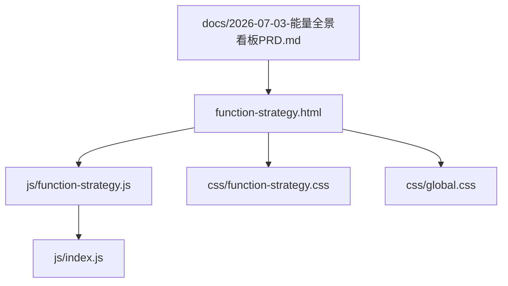
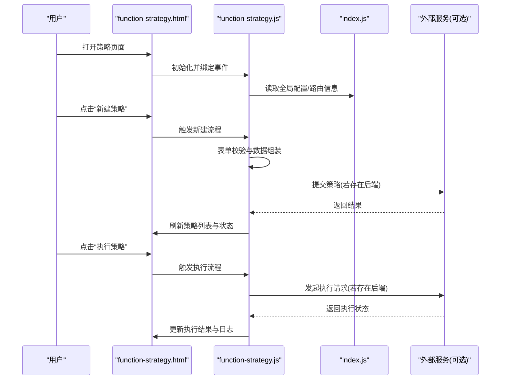
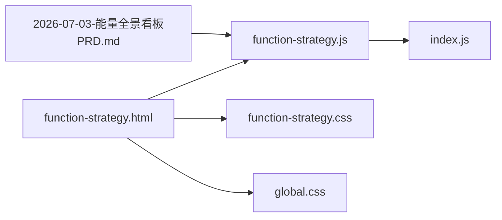

# 策略管理系统

<cite>
**本文引用的文件**
- [function-strategy.html](file://app/function-strategy.html)
- [function-strategy.js](file://app/js/function-strategy.js)
- [index.js](file://app/js/index.js)
- [global.css](file://app/css/global.css)
- [function-strategy.css](file://app/css/function-strategy.css)
- [2026-07-03-能量全景看板PRD.md](file://docs/2026-07-03-能量全景看板PRD.md)
</cite>

## 目录
1. [简介](#简介)
2. [项目结构](#项目结构)
3. [核心组件](#核心组件)
4. [架构总览](#架构总览)
5. [详细组件分析](#详细组件分析)
6. [依赖关系分析](#依赖关系分析)
7. [性能考虑](#性能考虑)
8. [故障排查指南](#故障排查指南)
9. [结论](#结论)
10. [附录](#附录)

## 简介
本文件为 MG-Mini 的策略管理系统提供系统化文档，聚焦策略管理模块的实现细节、调用关系、接口定义与业务模型。内容覆盖策略的创建、配置、执行与管理等关键能力，结合仓库中的实际前端页面与脚本文件，给出可操作的调用方式、数据流转说明与状态管理要点。同时总结常见问题与解决方案，帮助初学者快速上手，也为有经验的开发者提供足够的技术深度。

## 项目结构
策略管理相关的前端资源集中在 app 目录下：
- 页面入口：function-strategy.html
- 交互逻辑：js/function-strategy.js
- 全局初始化与路由：js/index.js
- 样式：css/function-strategy.css、css/global.css
- 需求参考：docs/2026-07-03-能量全景看板PRD.md（用于理解业务背景）

图表来源
- [function-strategy.html](file://app/function-strategy.html)
- [function-strategy.js](file://app/js/function-strategy.js)
- [index.js](file://app/js/index.js)
- [function-strategy.css](file://app/css/function-strategy.css)
- [global.css](file://app/css/global.css)
- [2026-07-03-能量全景看板PRD.md](file://docs/2026-07-03-能量全景看板PRD.md)

章节来源
- [function-strategy.html](file://app/function-strategy.html)
- [function-strategy.js](file://app/js/function-strategy.js)
- [index.js](file://app/js/index.js)
- [function-strategy.css](file://app/css/function-strategy.css)
- [global.css](file://app/css/global.css)
- [2026-07-03-能量全景看板PRD.md](file://docs/2026-07-03-能量全景看板PRD.md)

## 核心组件
- 页面层（function-strategy.html）
  - 承载策略管理的用户界面，包括策略列表展示、新增/编辑表单、执行控制按钮、状态提示区域等。
- 交互层（function-strategy.js）
  - 负责页面事件绑定、表单校验、策略数据的本地存储与渲染、与后端或上层服务的通信封装（如存在）。
- 全局初始化（index.js）
  - 负责应用启动、路由切换、公共模块加载与全局状态初始化，策略页面作为功能模块之一被集成。
- 样式层（function-strategy.css、global.css）
  - 提供策略页面的布局与主题样式，保证一致的视觉体验。
- 业务背景（PRD）
  - 明确策略在“能量全景看板”场景中的定位与目标，指导策略字段设计与交互流程。

章节来源
- [function-strategy.html](file://app/function-strategy.html)
- [function-strategy.js](file://app/js/function-strategy.js)
- [index.js](file://app/js/index.js)
- [function-strategy.css](file://app/css/function-strategy.css)
- [global.css](file://app/css/global.css)
- [2026-07-03-能量全景看板PRD.md](file://docs/2026-07-03-能量全景看板PRD.md)

## 架构总览
策略管理采用典型的前端分层架构：页面层通过交互层组织数据与事件，必要时与外部服务进行通信；样式层统一外观；业务需求由 PRD 驱动。整体数据流遵循“用户操作 → 交互层处理 → 数据更新 → 视图刷新”的闭环。

图表来源
- [function-strategy.html](file://app/function-strategy.html)
- [function-strategy.js](file://app/js/function-strategy.js)
- [index.js](file://app/js/index.js)

## 详细组件分析

### 页面层（function-strategy.html）
- 职责
  - 定义策略管理界面的骨架：标题区、工具栏、策略列表容器、新增/编辑弹窗、执行结果面板等。
  - 提供表单控件（输入框、下拉选择、开关等）与操作按钮（保存、删除、执行、刷新）。
- 关键点
  - 使用语义化标签提升可访问性。
  - 预留占位容器供交互层动态渲染策略条目与状态。
  - 与样式文件解耦，便于主题切换。

章节来源
- [function-strategy.html](file://app/function-strategy.html)

### 交互层（function-strategy.js）
- 职责
  - 生命周期管理：页面加载后初始化 UI、注册事件监听、加载初始数据。
  - 数据管理：维护策略集合、当前选中项、执行状态、错误信息等。
  - 业务逻辑：策略的新增、编辑、删除、启用/停用、执行与结果展示。
  - 通信封装：对可能的异步请求进行统一处理（成功/失败回调、重试机制、超时处理）。
- 关键流程
  - 新建策略：表单校验 → 数据组装 → 持久化（本地或远程）→ 刷新列表。
  - 执行策略：参数校验 → 状态检查（是否可用）→ 发起执行 → 轮询或回调获取结果 → 更新 UI。
  - 错误处理：捕获异常、记录日志、友好提示、回滚状态。
- 数据结构建议
  - 策略对象：包含标识、名称、类型、条件表达式、动作、优先级、状态、时间戳等。
  - 执行上下文：包含触发源、时间窗口、环境参数、执行结果与日志。

章节来源
- [function-strategy.js](file://app/js/function-strategy.js)

### 全局初始化（index.js）
- 职责
  - 应用启动：加载公共模块、设置全局配置、初始化路由。
  - 模块集成：将策略页面作为功能模块挂载到主框架中。
  - 状态共享：提供跨模块的全局状态（如用户信息、权限、主题）。
- 与策略系统的关系
  - 为策略页面提供运行环境与必要依赖。
  - 在路由切换时确保策略页面正确初始化与销毁。

章节来源
- [index.js](file://app/js/index.js)

### 样式层（function-strategy.css、global.css）
- 职责
  - 定义策略页面的布局、间距、颜色、字体与响应式适配。
  - 提供统一的按钮、表单、表格、弹窗等组件样式。
- 最佳实践
  - 使用 CSS 变量管理主题色，便于亮/暗主题切换。
  - 避免内联样式，保持结构与表现分离。

章节来源
- [function-strategy.css](file://app/css/function-strategy.css)
- [global.css](file://app/css/global.css)

### 业务背景（PRD）
- 作用
  - 明确策略在“能量全景看板”中的业务目标与使用场景。
  - 指导策略字段设计（如阈值、周期、动作类型）与交互流程（如审批、灰度发布）。
- 关键要点
  - 策略需支持可视化配置与实时生效。
  - 执行结果需可观测、可追溯。

章节来源
- [2026-07-03-能量全景看板PRD.md](file://docs/2026-07-03-能量全景看板PRD.md)

## 依赖关系分析
策略系统内部依赖清晰，外部依赖可选（如后端服务）。下图展示了主要模块间的依赖关系。

图表来源
- [function-strategy.html](file://app/function-strategy.html)
- [function-strategy.js](file://app/js/function-strategy.js)
- [index.js](file://app/js/index.js)
- [function-strategy.css](file://app/css/function-strategy.css)
- [global.css](file://app/css/global.css)
- [2026-07-03-能量全景看板PRD.md](file://docs/2026-07-03-能量全景看板PRD.md)

章节来源
- [function-strategy.html](file://app/function-strategy.html)
- [function-strategy.js](file://app/js/function-strategy.js)
- [index.js](file://app/js/index.js)
- [function-strategy.css](file://app/css/function-strategy.css)
- [global.css](file://app/css/global.css)
- [2026-07-03-能量全景看板PRD.md](file://docs/2026-07-03-能量全景看板PRD.md)

## 性能考虑
- 渲染优化
  - 策略列表采用虚拟滚动或分页加载，避免一次性渲染大量 DOM。
  - 使用防抖/节流减少高频事件（如搜索、滚动）带来的重绘压力。
- 数据管理
  - 优先使用内存缓存热点数据，降低重复请求。
  - 对大对象进行深拷贝与不可变更新，避免不必要的重新计算。
- 网络优化
  - 合并请求、使用缓存策略（ETag/Last-Modified）。
  - 失败重试与超时控制，提升用户体验。
- 样式优化
  - 按需加载样式，避免阻塞首屏渲染。
  - 使用 CSS 动画替代 JavaScript 动画，提升流畅度。

[本节为通用性能建议，不直接分析具体文件]

## 故障排查指南
- 页面无法加载
  - 检查 function-strategy.html 是否正确引入 js/function-strategy.js 与样式文件。
  - 确认 index.js 的路由配置是否包含策略页面路径。
- 表单校验失败
  - 核对必填字段与格式规则，查看控制台错误信息。
  - 确认交互层的事件绑定是否生效。
- 策略执行无响应
  - 检查策略状态是否为“可用”。
  - 若存在后端服务，确认接口连通性与返回码。
  - 查看执行日志与错误堆栈，定位问题环节。
- 样式错乱
  - 确认 CSS 文件路径与加载顺序。
  - 检查浏览器开发者工具的样式面板，查找冲突样式。

章节来源
- [function-strategy.js](file://app/js/function-strategy.js)
- [index.js](file://app/js/index.js)
- [function-strategy.css](file://app/css/function-strategy.css)
- [global.css](file://app/css/global.css)

## 结论
MG-Mini 的策略管理系统以清晰的前端分层架构实现策略的创建、配置、执行与管理。页面层提供直观交互，交互层封装业务逻辑与数据流，全局初始化保障运行环境，样式层统一视觉体验，PRD 驱动业务设计。通过合理的性能优化与完善的故障排查手段，系统具备良好的可维护性与扩展性。

[本节为总结性内容，不直接分析具体文件]

## 附录
- 术语表
  - 策略：一组可配置的条件与动作，用于自动化决策与执行。
  - 执行上下文：策略执行时的运行时环境，包含参数、时间与状态。
  - 状态机：描述策略在不同状态间转换的规则与约束。
- 参考链接
  - 能量全景看板 PRD：用于理解策略的业务背景与设计目标。

[本节为补充信息，不直接分析具体文件]