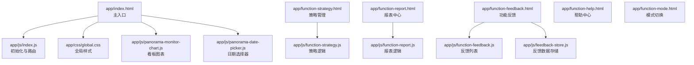
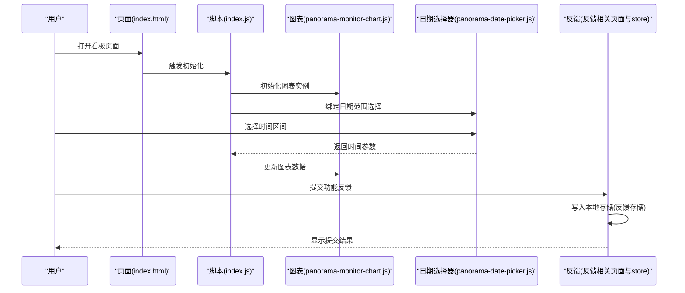
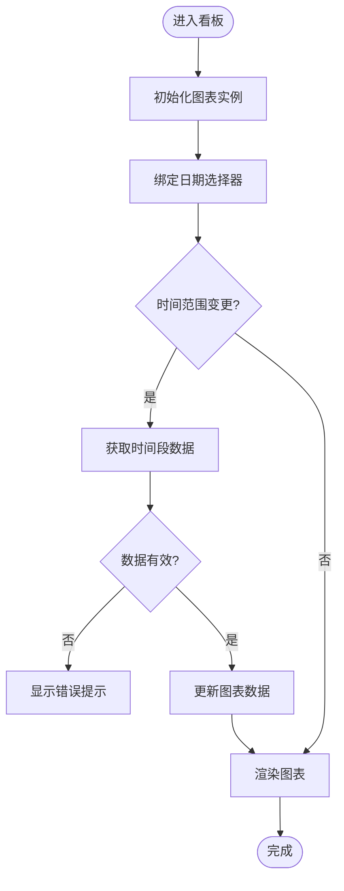
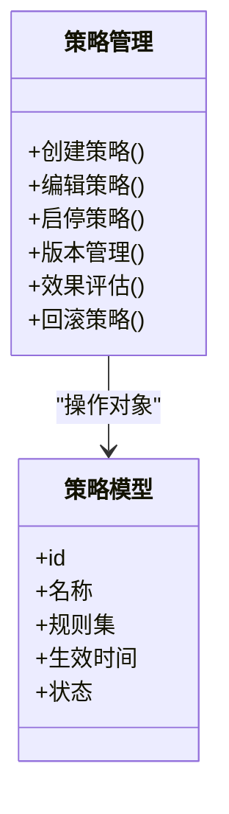
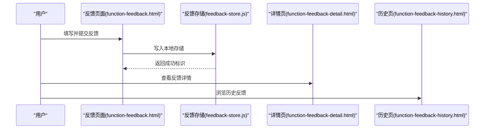
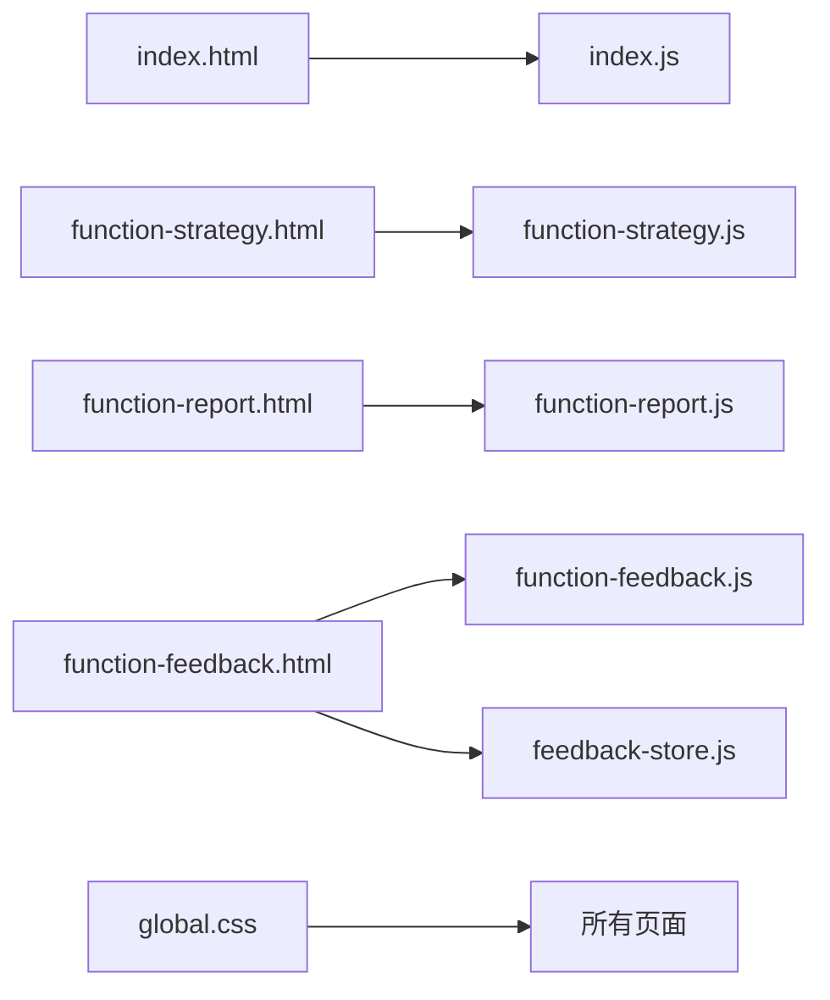

# 产品简介

<cite>
**本文档引用的文件**   
- [2026-07-03-能量全景看板PRD.md](file://docs/2026-07-03-能量全景看板PRD.md)
- [index.html](file://app/index.html)
- [function-strategy.html](file://app/function-strategy.html)
- [function-report.html](file://app/function-report.html)
- [function-feedback.html](file://app/function-feedback.html)
- [function-help.html](file://app/function-help.html)
- [function-mode.html](file://app/function-mode.html)
- [function-feedback-detail.html](file://app/function-feedback-detail.html)
- [function-feedback-history.html](file://app/function-feedback-history.html)
- [index.js](file://app/js/index.js)
- [panorama-monitor-chart.js](file://app/js/panorama-monitor-chart.js)
- [panorama-date-picker.js](file://app/js/panorama-date-picker.js)
- [feedback-store.js](file://app/js/feedback-store.js)
- [global.css](file://app/css/global.css)
</cite>

## 目录
1. [引言](#引言)
2. [项目结构](#项目结构)
3. [核心组件](#核心组件)
4. [架构总览](#架构总览)
5. [详细组件分析](#详细组件分析)
6. [依赖关系分析](#依赖关系分析)
7. [性能考量](#性能考量)
8. [故障排查指南](#故障排查指南)
9. [结论](#结论)
10. [附录](#附录)

## 引言
MG-Mini能量全景看板是一款面向能源监控与管理的Web应用，聚焦“能量数据可视化、策略管理、功能反馈”三大核心模块。产品旨在为运营人员、设备工程师与管理者提供统一的数据入口与决策支持，帮助快速掌握系统运行态势、优化用能策略并高效处理问题反馈。通过直观的图表与交互设计，用户可完成从数据采集展示到策略制定与执行跟踪的闭环工作流，提升能效管理水平与运维效率。

## 项目结构
本项目采用前端静态页面与脚本分离的组织方式，按功能页面划分HTML，JS/CSS模块化组织，便于维护与扩展。关键目录说明：
- app：前端资源根目录
  - css：样式文件，包含全局样式与各功能页样式
  - js：业务逻辑与交互脚本，含看板图表、日期选择器、反馈存储等
  - vendor：第三方库（按需引入）
  - *.html：各功能页面入口
- docs：产品文档与需求说明

**图示来源** 
- [index.html](file://app/index.html)
- [index.js](file://app/js/index.js)
- [panorama-monitor-chart.js](file://app/js/panorama-monitor-chart.js)
- [panorama-date-picker.js](file://app/js/panorama-date-picker.js)
- [function-strategy.html](file://app/function-strategy.html)
- [function-report.html](file://app/function-report.html)
- [function-feedback.html](file://app/function-feedback.html)
- [function-help.html](file://app/function-help.html)
- [function-mode.html](file://app/function-mode.html)
- [global.css](file://app/css/global.css)

**章节来源**
- [2026-07-03-能量全景看板PRD.md](file://docs/2026-07-03-能量全景看板PRD.md)

## 核心组件
- 能量数据可视化
  - 基于时间维度的能耗趋势、功率曲线、负荷分布等图表展示
  - 支持多指标对比、区间筛选与动态刷新
- 策略管理
  - 策略创建、编辑、启停与版本管理
  - 策略效果评估与回滚机制
- 功能反馈
  - 问题上报、分类、状态跟踪与历史查询
  - 本地缓存与离线暂存能力
- 辅助功能
  - 帮助中心、模式切换（如明暗主题）、报表导出

**章节来源**
- [2026-07-03-能量全景看板PRD.md](file://docs/2026-07-03-能量全景看板PRD.md)

## 架构总览
产品采用“页面-脚本-样式”三层解耦的前端架构，以HTML作为视图层，JS实现交互与数据处理，CSS负责视觉呈现。核心流程包括：
- 页面加载与初始化：入口脚本统一初始化图表、日期选择器与导航
- 数据展示：图表组件订阅数据源并按时间轴渲染
- 策略操作：策略页面调用对应逻辑进行增删改查与状态同步
- 反馈流转：反馈数据经本地存储持久化，支持历史检索与详情查看

**图示来源** 
- [index.html](file://app/index.html)
- [index.js](file://app/js/index.js)
- [panorama-monitor-chart.js](file://app/js/panorama-monitor-chart.js)
- [panorama-date-picker.js](file://app/js/panorama-date-picker.js)
- [function-feedback.html](file://app/function-feedback.html)
- [feedback-store.js](file://app/js/feedback-store.js)

## 详细组件分析

### 能量数据可视化组件
- 职责
  - 渲染能耗趋势、功率曲线、负荷分布等图表
  - 响应时间区间变化与数据刷新
- 关键特性
  - 多系列数据叠加对比
  - 自适应布局与缩放
  - 交互提示与数据点定位
- 使用建议
  - 合理设置刷新频率，避免频繁重绘
  - 大数据量时启用分页或采样

**图示来源** 
- [panorama-monitor-chart.js](file://app/js/panorama-monitor-chart.js)
- [panorama-date-picker.js](file://app/js/panorama-date-picker.js)

**章节来源**
- [panorama-monitor-chart.js](file://app/js/panorama-monitor-chart.js)
- [panorama-date-picker.js](file://app/js/panorama-date-picker.js)

### 策略管理组件
- 职责
  - 提供策略的创建、编辑、启停与版本管理
  - 支持策略效果评估与回滚
- 关键特性
  - 表单校验与状态同步
  - 操作日志与变更记录
- 使用建议
  - 变更前备份当前策略配置
  - 灰度发布与A/B测试结合验证

**图示来源** 
- [function-strategy.html](file://app/function-strategy.html)

**章节来源**
- [function-strategy.html](file://app/function-strategy.html)

### 功能反馈组件
- 职责
  - 收集用户问题与改进建议
  - 本地持久化与历史查询
- 关键特性
  - 分类标签与优先级
  - 状态跟踪（待处理/处理中/已解决）
  - 详情查看与附件上传（可选）
- 使用建议
  - 明确问题描述与复现步骤
  - 定期清理过期反馈记录

**图示来源** 
- [function-feedback.html](file://app/function-feedback.html)
- [feedback-store.js](file://app/js/feedback-store.js)
- [function-feedback-detail.html](file://app/function-feedback-detail.html)
- [function-feedback-history.html](file://app/function-feedback-history.html)

**章节来源**
- [function-feedback.html](file://app/function-feedback.html)
- [feedback-store.js](file://app/js/feedback-store.js)
- [function-feedback-detail.html](file://app/function-feedback-detail.html)
- [function-feedback-history.html](file://app/function-feedback-history.html)

### 辅助功能组件
- 帮助中心
  - 常见问题、操作指南与使用说明
- 模式切换
  - 明暗主题切换与界面适配
- 报表中心
  - 数据导出与统计汇总

**章节来源**
- [function-help.html](file://app/function-help.html)
- [function-mode.html](file://app/function-mode.html)
- [function-report.html](file://app/function-report.html)

## 依赖关系分析
- 页面与脚本
  - index.html 依赖 index.js 进行初始化与路由控制
  - 各功能页依赖对应JS模块实现业务逻辑
- 样式依赖
  - global.css 提供全局样式基础，各功能页样式独立维护
- 数据与存储
  - 反馈模块依赖本地存储进行数据持久化

**图示来源** 
- [index.html](file://app/index.html)
- [index.js](file://app/js/index.js)
- [function-strategy.html](file://app/function-strategy.html)
- [function-report.html](file://app/function-report.html)
- [function-feedback.html](file://app/function-feedback.html)
- [feedback-store.js](file://app/js/feedback-store.js)
- [global.css](file://app/css/global.css)

**章节来源**
- [index.html](file://app/index.html)
- [index.js](file://app/js/index.js)
- [global.css](file://app/css/global.css)

## 性能考量
- 图表渲染优化
  - 合理使用动画与过渡，避免频繁重绘
  - 大数据集启用采样或分页加载
- 内存管理
  - 及时销毁不使用的图表实例与事件监听
- 网络与存储
  - 减少不必要的请求，合并接口调用
  - 本地存储容量限制与清理策略

[本节为通用指导，不涉及具体文件分析]

## 故障排查指南
- 图表不显示或数据为空
  - 检查日期选择器参数是否正确传递
  - 确认数据源可用性与格式
- 反馈无法保存
  - 验证本地存储权限与容量
  - 检查反馈数据结构是否符合要求
- 样式异常
  - 确认全局样式是否被覆盖
  - 浏览器兼容性检查

**章节来源**
- [panorama-date-picker.js](file://app/js/panorama-date-picker.js)
- [feedback-store.js](file://app/js/feedback-store.js)
- [global.css](file://app/css/global.css)

## 结论
MG-Mini能量全景看板以直观的数据可视化、灵活的策略管理与高效的反馈机制为核心，为能源监控与管理提供了完整的解决方案。通过清晰的功能边界与良好的用户体验，帮助用户快速掌握系统运行态势、优化用能策略并提升运维效率。未来可进一步扩展数据分析深度与自动化能力，持续赋能智慧能源管理。

[本节为总结性内容，不涉及具体文件分析]

## 附录
- 用户群体
  - 运营人员：日常监控与报表查看
  - 设备工程师：策略配置与问题排查
  - 管理者：决策支持与绩效评估
- 使用场景
  - 工厂能耗监控与优化
  - 建筑能源管理系统
  - 分布式能源平台
- 价值主张
  - 数据驱动决策
  - 降低运维成本
  - 提升能效水平

[本节为概念性内容，不涉及具体文件分析]