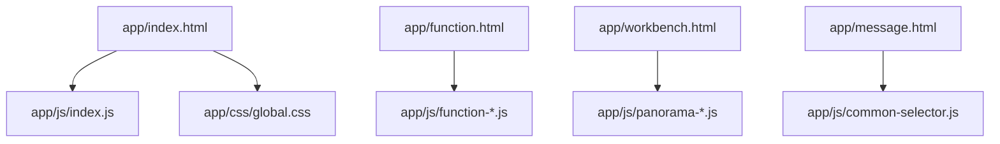
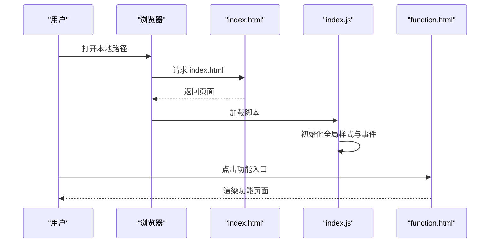
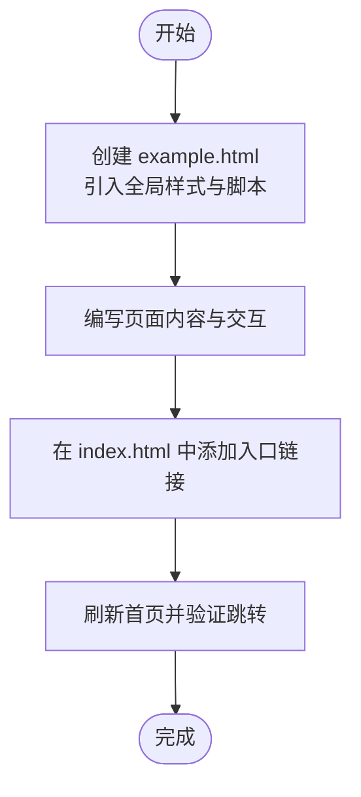
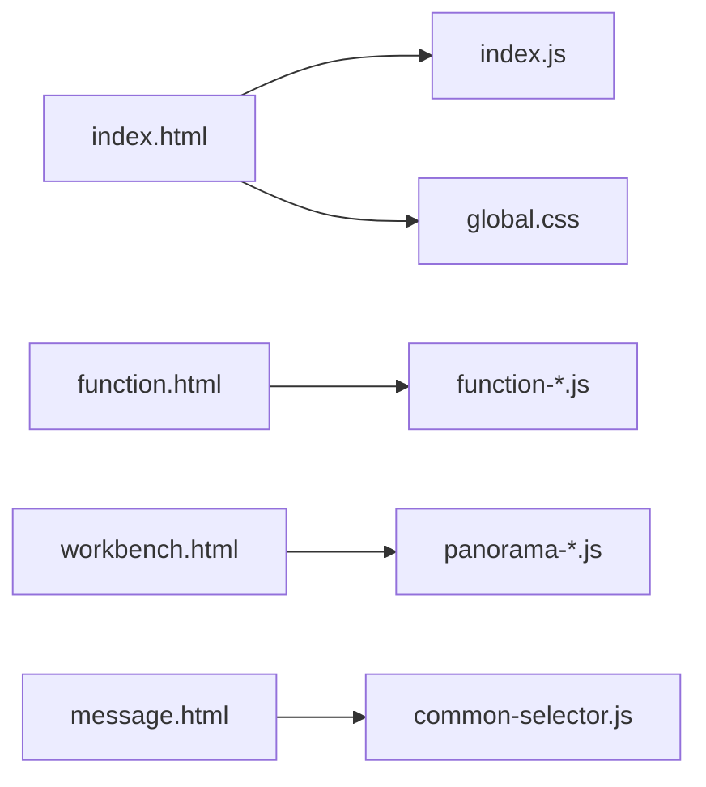

# 快速开始

<cite>
**本文引用的文件**   
- [index.html](file://app/index.html)
- [index.js](file://app/js/index.js)
- [global.css](file://app/css/global.css)
- [function.html](file://app/function.html)
- [workbench.html](file://app/workbench.html)
- [message.html](file://app/message.html)
</cite>

## 目录
1. [简介](#简介)
2. [项目结构](#项目结构)
3. [核心组件](#核心组件)
4. [架构总览](#架构总览)
5. [详细组件分析](#详细组件分析)
6. [依赖分析](#依赖分析)
7. [性能注意事项](#性能注意事项)
8. [故障排查指南](#故障排查指南)
9. [结论](#结论)
10. [附录](#附录)

## 简介
本快速开始指南帮助你在最短时间内运行 MG-Mini，并理解其基本运作方式。项目为纯前端静态站点，无需后端服务即可在本地浏览器中运行。你将了解：
- 环境准备与浏览器兼容性
- 本地开发环境搭建与启动
- 访问首页与基础功能
- 如何新增一个页面或功能模块（第一个示例）
- 常见配置选项与使用方法

## 项目结构
MG-Mini 采用“按功能页面组织”的目录结构，HTML、CSS、JS 分别位于 app 目录下，便于独立维护与扩展。

**图示来源** 
- [index.html](file://app/index.html)
- [index.js](file://app/js/index.js)
- [global.css](file://app/css/global.css)
- [function.html](file://app/function.html)
- [workbench.html](file://app/workbench.html)
- [message.html](file://app/message.html)

**章节来源**
- [index.html](file://app/index.html)
- [index.js](file://app/js/index.js)
- [global.css](file://app/css/global.css)
- [function.html](file://app/function.html)
- [workbench.html](file://app/workbench.html)
- [message.html](file://app/message.html)

## 核心组件
- 入口页面 index.html：应用主入口，加载全局样式与脚本，提供导航与基础交互。
- 全局样式 global.css：定义主题色、排版、布局等通用样式。
- 业务页面 function.html：功能页集合，承载具体业务模块。
- 工作台 workbench.html：数据看板与工作区入口。
- 消息中心 message.html：消息展示与交互。
- 脚本入口 index.js：初始化应用逻辑、路由跳转与公共行为。

**章节来源**
- [index.html](file://app/index.html)
- [global.css](file://app/css/global.css)
- [function.html](file://app/function.html)
- [workbench.html](file://app/workbench.html)
- [message.html](file://app/message.html)
- [index.js](file://app/js/index.js)

## 架构总览
MG-Mini 为单页多页面的混合形态：以 HTML 页面为单元，通过 JS 进行页面内交互与跳转。整体流程如下：

**图示来源** 
- [index.html](file://app/index.html)
- [index.js](file://app/js/index.js)
- [function.html](file://app/function.html)

## 详细组件分析

### 环境准备与浏览器兼容性
- 操作系统：Windows / macOS / Linux
- 浏览器：现代浏览器（Chrome、Edge、Firefox、Safari），建议使用最新版本以获得最佳体验
- 无需 Node.js 或构建工具；直接以静态文件方式运行

**章节来源**
- [index.html](file://app/index.html)
- [global.css](file://app/css/global.css)

### 本地开发环境搭建与启动
- 使用任意静态服务器（如 VS Code Live Server、Python http.server、Node http-server）
- 将 app 目录作为根目录启动
- 在浏览器访问 http://localhost:端口号
- 若无法访问，检查端口占用与防火墙设置

**章节来源**
- [index.html](file://app/index.html)

### 访问基本功能
- 打开首页后，可在导航栏或卡片区域点击“功能”进入功能页
- 功能页包含多个子模块，点击相应按钮可切换视图
- 工作台与消息中心可通过主页快捷入口进入

**章节来源**
- [index.html](file://app/index.html)
- [function.html](file://app/function.html)
- [workbench.html](file://app/workbench.html)
- [message.html](file://app/message.html)

### 第一个功能实现示例：新增一个页面或模块
目标：新增一个名为“示例页”的新页面，并在首页添加入口。

步骤概览：
1. 新建页面
   - 在 app 目录下创建 example.html
   - 引入全局样式与必要脚本
2. 编写页面内容
   - 在 body 中添加标题与占位内容
3. 添加首页入口
   - 在 index.html 的导航或卡片区域增加链接指向 example.html
4. 验证效果
   - 刷新首页，点击新入口确认跳转成功

**图示来源** 
- [index.html](file://app/index.html)
- [example.html](file://app/example.html)

**章节来源**
- [index.html](file://app/index.html)
- [function.html](file://app/function.html)

### 常见配置选项与使用方法
- 主题与样式
  - 修改 global.css 中的颜色变量与排版规则，统一全站风格
- 页面路由
  - 通过 HTML a 标签或 JS 跳转至不同页面
- 脚本初始化
  - 在对应页面的 JS 文件中初始化交互逻辑
- 资源管理
  - 图片与字体放置在 app/images 与 app/fonts 下，按需引用

**章节来源**
- [global.css](file://app/css/global.css)
- [index.js](file://app/js/index.js)

## 依赖分析
- 页面与脚本关系
  - index.html 依赖 index.js 与 global.css
  - function.html 依赖对应的 function-*.js
  - workbench.html 依赖 panorama-*.js
  - message.html 依赖 common-selector.js
- 无外部框架依赖，所有逻辑由原生 JavaScript 实现

**图示来源** 
- [index.html](file://app/index.html)
- [index.js](file://app/js/index.js)
- [global.css](file://app/css/global.css)
- [function.html](file://app/function.html)
- [workbench.html](file://app/workbench.html)
- [message.html](file://app/message.html)

**章节来源**
- [index.html](file://app/index.html)
- [index.js](file://app/js/index.js)
- [global.css](file://app/css/global.css)
- [function.html](file://app/function.html)
- [workbench.html](file://app/workbench.html)
- [message.html](file://app/message.html)

## 性能注意事项
- 首屏加载：确保只引入必要的 CSS 与 JS，避免冗余
- 资源体积：压缩图片与字体，减少网络请求
- 脚本执行：将初始化逻辑放在 DOMContentLoaded 之后执行
- 缓存策略：对静态资源启用浏览器缓存

[本节为通用指导，不直接分析具体文件]

## 故障排查指南
- 页面空白或样式未生效
  - 检查 CSS 路径是否正确
  - 确认浏览器控制台是否有 404 错误
- 脚本未执行
  - 检查 JS 文件是否被正确引入
  - 查看控制台报错信息并修复语法错误
- 跨域问题
  - 本地开发建议使用静态服务器，避免 file:// 协议带来的限制

**章节来源**
- [index.html](file://app/index.html)
- [index.js](file://app/js/index.js)

## 结论
通过以上步骤，你可以在几分钟内启动 MG-Mini 并理解其基本结构与扩展方式。后续可按需新增页面与模块，保持代码简洁与职责清晰。

[本节为总结性内容，不直接分析具体文件]

## 附录
- 常用命令（示例）
  - Python 静态服务器：python -m http.server 8080
  - Node http-server：npx http-server ./app -p 8080
- 建议编辑器插件
  - Live Server、HTML/CSS/JS 高亮与格式化

[本节为补充信息，不直接分析具体文件]