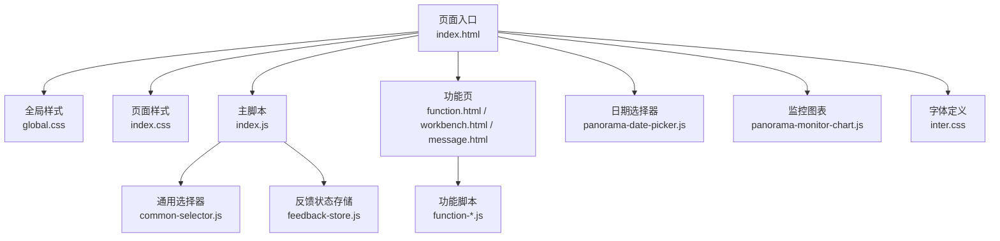
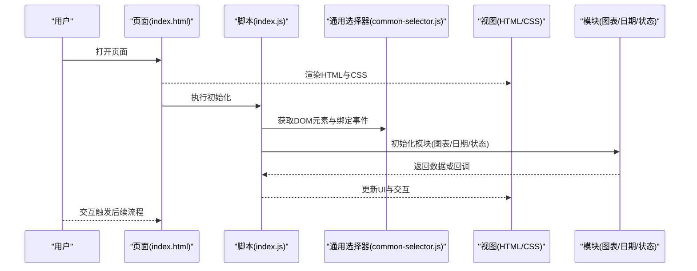
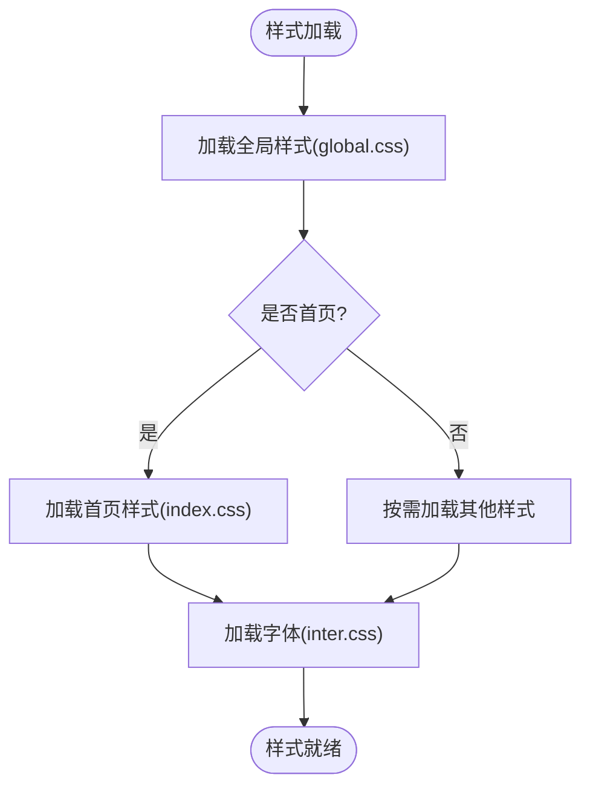
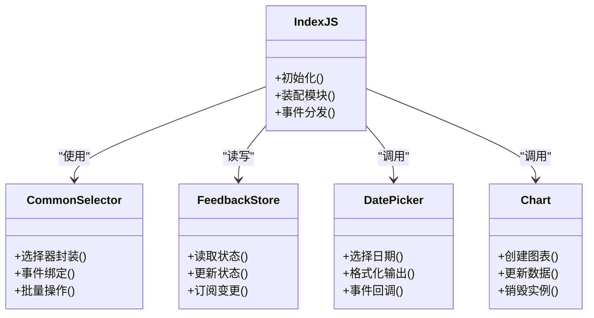
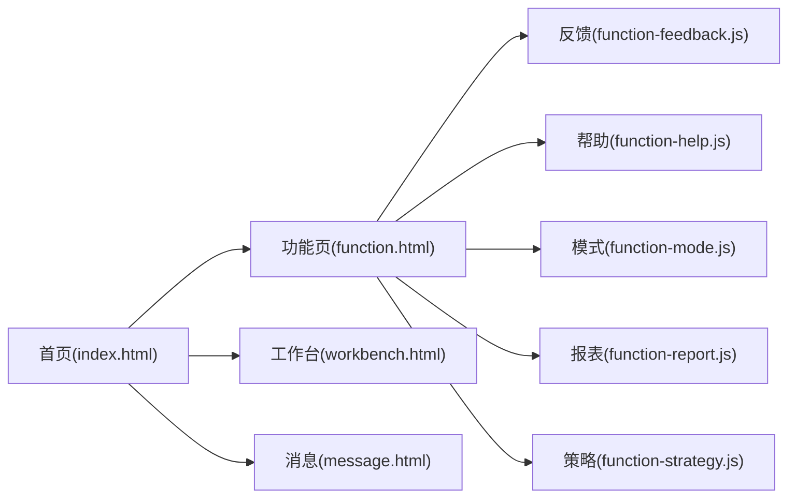
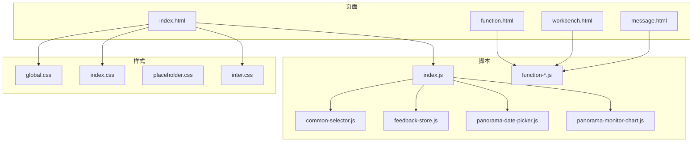

# 技术栈

<cite>
**本文引用的文件**   
- [index.html](file://app/index.html)
- [function.html](file://app/function.html)
- [workbench.html](file://app/workbench.html)
- [message.html](file://app/message.html)
- [global.css](file://app/css/global.css)
- [index.css](file://app/css/index.css)
- [placeholder.css](file://app/css/placeholder.css)
- [inter.css](file://app/fonts/inter.css)
- [index.js](file://app/js/index.js)
- [common-selector.js](file://app/js/common-selector.js)
- [feedback-store.js](file://app/js/feedback-store.js)
- [panorama-date-picker.js](file://app/js/panorama-date-picker.js)
- [panorama-monitor-chart.js](file://app/js/panorama-monitor-chart.js)
- [function-feedback.js](file://app/js/function-feedback.js)
- [function-help.js](file://app/js/function-help.js)
- [function-mode.js](file://app/js/function-mode.js)
- [function-report.js](file://app/js/function-report.js)
- [function-strategy.js](file://app/js/function-strategy.js)
</cite>

## 目录
1. [简介](#简介)
2. [项目结构](#项目结构)
3. [核心组件](#核心组件)
4. [架构总览](#架构总览)
5. [详细组件分析](#详细组件分析)
6. [依赖分析](#依赖分析)
7. [性能考量](#性能考量)
8. [故障排查指南](#故障排查指南)
9. [结论](#结论)
10. [附录](#附录)

## 简介
本技术栈文档面向 MG-Mini 前端工程，系统梳理并解释其技术选型与协作方式。项目采用原生 HTML5、CSS3 与 JavaScript ES6+ 构建，样式体系遵循模块化 CSS 架构，字体统一使用 Inter 字体库。整体方案强调轻量、可维护与高兼容性，避免重型框架带来的体积与复杂度，同时通过合理的模块划分与资源组织保障开发效率与运行性能。

## 项目结构
MG-Mini 的前端资源按功能域与职责清晰分层：
- app/html：页面入口与视图模板（HTML）
- app/css：样式文件，按全局、页面与占位等维度拆分
- app/js：脚本逻辑，包含通用选择器、状态存储、日期选择器、图表渲染与各功能页脚本
- app/fonts：Inter 字体定义与加载配置
- app/images：静态图片资源
- app/vendor：第三方库（当前为空，预留扩展）

**图示来源** 
- [index.html](file://app/index.html)
- [global.css](file://app/css/global.css)
- [index.css](file://app/css/index.css)
- [index.js](file://app/js/index.js)
- [common-selector.js](file://app/js/common-selector.js)
- [feedback-store.js](file://app/js/feedback-store.js)
- [panorama-date-picker.js](file://app/js/panorama-date-picker.js)
- [panorama-monitor-chart.js](file://app/js/panorama-monitor-chart.js)
- [inter.css](file://app/fonts/inter.css)

**章节来源**
- [index.html](file://app/index.html)
- [function.html](file://app/function.html)
- [workbench.html](file://app/workbench.html)
- [message.html](file://app/message.html)
- [global.css](file://app/css/global.css)
- [index.css](file://app/css/index.css)
- [placeholder.css](file://app/css/placeholder.css)
- [inter.css](file://app/fonts/inter.css)
- [index.js](file://app/js/index.js)
- [common-selector.js](file://app/js/common-selector.js)
- [feedback-store.js](file://app/js/feedback-store.js)
- [panorama-date-picker.js](file://app/js/panorama-date-picker.js)
- [panorama-monitor-chart.js](file://app/js/panorama-monitor-chart.js)
- [function-feedback.js](file://app/js/function-feedback.js)
- [function-help.js](file://app/js/function-help.js)
- [function-mode.js](file://app/js/function-mode.js)
- [function-report.js](file://app/js/function-report.js)
- [function-strategy.js](file://app/js/function-strategy.js)

## 核心组件
- 页面层（HTML5）
  - 语义化标签与结构化布局，确保可访问性与SEO友好
  - 多页面路由由浏览器原生导航驱动，减少路由库依赖
- 样式层（CSS3 + 模块化）
  - global.css 提供基础变量、重置与通用布局
  - index.css 承载首页样式；placeholder.css 提供占位样式
  - 各功能页样式按需引入，保持样式边界清晰
- 脚本层（JavaScript ES6+）
  - index.js 作为应用初始化与页面编排入口
  - common-selector.js 封装常用 DOM 选择与事件绑定
  - feedback-store.js 管理反馈相关状态与数据流
  - panorama-date-picker.js 提供日期选择交互能力
  - panorama-monitor-chart.js 负责图表渲染与更新
  - function-*.js 对应各功能页的业务逻辑与交互

**章节来源**
- [index.js](file://app/js/index.js)
- [common-selector.js](file://app/js/common-selector.js)
- [feedback-store.js](file://app/js/feedback-store.js)
- [panorama-date-picker.js](file://app/js/panorama-date-picker.js)
- [panorama-monitor-chart.js](file://app/js/panorama-monitor-chart.js)
- [function-feedback.js](file://app/js/function-feedback.js)
- [function-help.js](file://app/js/function-help.js)
- [function-mode.js](file://app/js/function-mode.js)
- [function-report.js](file://app/js/function-report.js)
- [function-strategy.js](file://app/js/function-strategy.js)
- [global.css](file://app/css/global.css)
- [index.css](file://app/css/index.css)
- [placeholder.css](file://app/css/placeholder.css)

## 架构总览
MG-Mini 采用“页面即模块”的轻量架构：每个 HTML 页面独立承载视图，JS 脚本按功能域拆分，CSS 以模块化方式组织。页面加载时，HTML 引入必要的 CSS 与 JS，JS 完成 DOM 操作、事件绑定与数据渲染。图表与日期选择器等能力以独立脚本形式复用，避免重复实现。

**图示来源** 
- [index.html](file://app/index.html)
- [index.js](file://app/js/index.js)
- [common-selector.js](file://app/js/common-selector.js)
- [panorama-monitor-chart.js](file://app/js/panorama-monitor-chart.js)
- [panorama-date-picker.js](file://app/js/panorama-date-picker.js)
- [feedback-store.js](file://app/js/feedback-store.js)

## 详细组件分析

### 样式系统与字体
- 模块化 CSS
  - global.css：定义全局变量、基础排版与布局规则
  - index.css：首页专属样式，与全局解耦
  - placeholder.css：占位样式，便于开发与调试
- 字体 Inter
  - inter.css 集中管理 Inter 字体的加载与声明，保证跨页面一致体验
- 设计原则
  - 样式按页面与功能域拆分，避免全局污染
  - 使用现代 CSS 特性（如变量、Flex/Grid）提升可维护性

**图示来源** 
- [global.css](file://app/css/global.css)
- [index.css](file://app/css/index.css)
- [placeholder.css](file://app/css/placeholder.css)
- [inter.css](file://app/fonts/inter.css)

**章节来源**
- [global.css](file://app/css/global.css)
- [index.css](file://app/css/index.css)
- [placeholder.css](file://app/css/placeholder.css)
- [inter.css](file://app/fonts/inter.css)

### 脚本与模块组织
- 入口脚本 index.js
  - 负责页面初始化、模块装配与事件总线协调
- 通用选择器 common-selector.js
  - 封装 querySelectorAll、事件监听与批量操作，降低重复代码
- 状态存储 feedback-store.js
  - 管理反馈相关的数据与状态变更，为 UI 提供稳定数据源
- 日期选择器 panorama-date-picker.js
  - 提供日期范围选择与格式化能力，供看板与报表使用
- 图表渲染 panorama-monitor-chart.js
  - 封装图表创建、更新与销毁逻辑，支持动态数据刷新
- 功能页脚本 function-*.js
  - 各自处理业务交互与数据请求，与公共模块解耦

**图示来源** 
- [index.js](file://app/js/index.js)
- [common-selector.js](file://app/js/common-selector.js)
- [feedback-store.js](file://app/js/feedback-store.js)
- [panorama-date-picker.js](file://app/js/panorama-date-picker.js)
- [panorama-monitor-chart.js](file://app/js/panorama-monitor-chart.js)

**章节来源**
- [index.js](file://app/js/index.js)
- [common-selector.js](file://app/js/common-selector.js)
- [feedback-store.js](file://app/js/feedback-store.js)
- [panorama-date-picker.js](file://app/js/panorama-date-picker.js)
- [panorama-monitor-chart.js](file://app/js/panorama-monitor-chart.js)
- [function-feedback.js](file://app/js/function-feedback.js)
- [function-help.js](file://app/js/function-help.js)
- [function-mode.js](file://app/js/function-mode.js)
- [function-report.js](file://app/js/function-report.js)
- [function-strategy.js](file://app/js/function-strategy.js)

### 页面与功能模块
- 页面
  - index.html：首页入口，聚合必要样式与脚本
  - function.html / workbench.html / message.html：功能页与工作台、消息页
- 功能模块
  - function-feedback.js：反馈列表与提交逻辑
  - function-help.js：帮助与说明页交互
  - function-mode.js：模式切换与配置
  - function-report.js：报表生成与导出
  - function-strategy.js：策略管理与展示

**图示来源** 
- [index.html](file://app/index.html)
- [function.html](file://app/function.html)
- [workbench.html](file://app/workbench.html)
- [message.html](file://app/message.html)
- [function-feedback.js](file://app/js/function-feedback.js)
- [function-help.js](file://app/js/function-help.js)
- [function-mode.js](file://app/js/function-mode.js)
- [function-report.js](file://app/js/function-report.js)
- [function-strategy.js](file://app/js/function-strategy.js)

**章节来源**
- [index.html](file://app/index.html)
- [function.html](file://app/function.html)
- [workbench.html](file://app/workbench.html)
- [message.html](file://app/message.html)
- [function-feedback.js](file://app/js/function-feedback.js)
- [function-help.js](file://app/js/function-help.js)
- [function-mode.js](file://app/js/function-mode.js)
- [function-report.js](file://app/js/function-report.js)
- [function-strategy.js](file://app/js/function-strategy.js)

## 依赖分析
- 内部依赖
  - 页面脚本依赖通用选择器与状态存储，形成稳定的内聚关系
  - 图表与日期选择器作为独立模块被多处复用，避免耦合
- 外部依赖
  - 当前 vendor 目录为空，未引入第三方库，保持最小依赖
  - 字体通过 inter.css 统一管理，不依赖网络字体服务（建议本地部署）

**图示来源** 
- [index.html](file://app/index.html)
- [function.html](file://app/function.html)
- [workbench.html](file://app/workbench.html)
- [message.html](file://app/message.html)
- [index.js](file://app/js/index.js)
- [common-selector.js](file://app/js/common-selector.js)
- [feedback-store.js](file://app/js/feedback-store.js)
- [panorama-date-picker.js](file://app/js/panorama-date-picker.js)
- [panorama-monitor-chart.js](file://app/js/panorama-monitor-chart.js)
- [function-feedback.js](file://app/js/function-feedback.js)
- [function-help.js](file://app/js/function-help.js)
- [function-mode.js](file://app/js/function-mode.js)
- [function-report.js](file://app/js/function-report.js)
- [function-strategy.js](file://app/js/function-strategy.js)
- [global.css](file://app/css/global.css)
- [index.css](file://app/css/index.css)
- [placeholder.css](file://app/css/placeholder.css)
- [inter.css](file://app/fonts/inter.css)

**章节来源**
- [index.html](file://app/index.html)
- [function.html](file://app/function.html)
- [workbench.html](file://app/workbench.html)
- [message.html](file://app/message.html)
- [index.js](file://app/js/index.js)
- [common-selector.js](file://app/js/common-selector.js)
- [feedback-store.js](file://app/js/feedback-store.js)
- [panorama-date-picker.js](file://app/js/panorama-date-picker.js)
- [panorama-monitor-chart.js](file://app/js/panorama-monitor-chart.js)
- [function-feedback.js](file://app/js/function-feedback.js)
- [function-help.js](file://app/js/function-help.js)
- [function-mode.js](file://app/js/function-mode.js)
- [function-report.js](file://app/js/function-report.js)
- [function-strategy.js](file://app/js/function-strategy.js)
- [global.css](file://app/css/global.css)
- [index.css](file://app/css/index.css)
- [placeholder.css](file://app/css/placeholder.css)
- [inter.css](file://app/fonts/inter.css)

## 性能考量
- 构建与打包
  - 当前无构建工具，适合快速迭代与小规模项目；如需优化，可引入轻量打包器进行资源压缩与合并
- 资源加载
  - 样式与脚本按需引入，减少首屏负担
  - 字体文件建议本地缓存与预加载，避免阻塞渲染
- 运行时优化
  - 使用事件委托与批量 DOM 操作降低重排重绘
  - 图表与日期选择器按需初始化，避免不必要的计算
- 兼容性
  - 基于现代浏览器标准（ES6+、CSS3），目标环境需支持主流现代浏览器
  - 若需兼容旧版浏览器，可通过转译与 Polyfill 补充

[本节为通用指导，无需特定文件引用]

## 故障排查指南
- 样式问题
  - 检查 global.css 与页面样式是否冲突，确认样式加载顺序
  - 使用占位样式 placeholder.css 辅助定位布局问题
- 脚本错误
  - 优先检查 common-selector.js 的选择器是否正确
  - 查看 feedback-store.js 的状态更新是否触发 UI 同步
  - 图表与日期选择器初始化失败时，确认容器存在且尺寸有效
- 字体显示异常
  - 确认 inter.css 路径正确，字体文件可访问
  - 检查浏览器缓存与跨域设置

**章节来源**
- [global.css](file://app/css/global.css)
- [index.css](file://app/css/index.css)
- [placeholder.css](file://app/css/placeholder.css)
- [common-selector.js](file://app/js/common-selector.js)
- [feedback-store.js](file://app/js/feedback-store.js)
- [panorama-monitor-chart.js](file://app/js/panorama-monitor-chart.js)
- [panorama-date-picker.js](file://app/js/panorama-date-picker.js)
- [inter.css](file://app/fonts/inter.css)

## 结论
MG-Mini 采用原生 HTML5、CSS3 与 JavaScript ES6+ 的轻量技术栈，结合模块化 CSS 与 Inter 字体，实现了清晰的职责分离与良好的可维护性。通过页面级模块化与脚本解耦，项目在保持低依赖的同时具备足够的扩展能力。未来可在不改变核心架构的前提下引入构建工具与性能优化手段，进一步提升交付质量与用户体验。

[本节为总结性内容，无需特定文件引用]

## 附录
- 技术版本要求
  - HTML5：语义化标签与标准 API
  - CSS3：变量、Flexbox、Grid 等现代特性
  - JavaScript ES6+：模块、箭头函数、Promise、异步等
- 兼容性建议
  - 目标浏览器：现代桌面与移动端浏览器
  - 如需兼容旧版，建议使用转译与 Polyfill 方案

[本节为通用信息，无需特定文件引用]