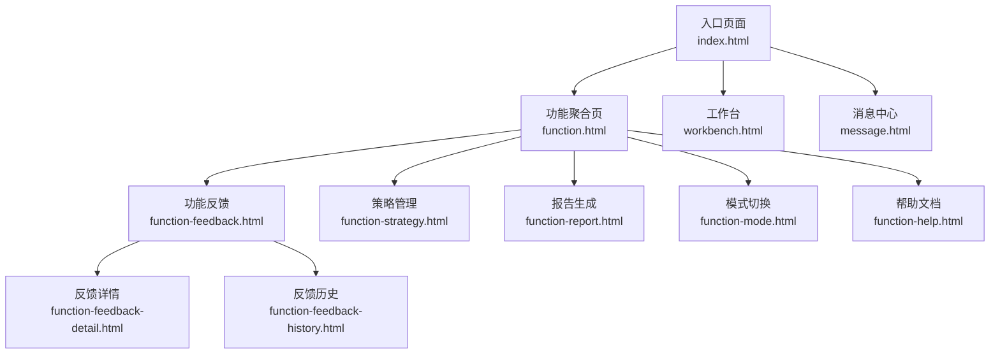
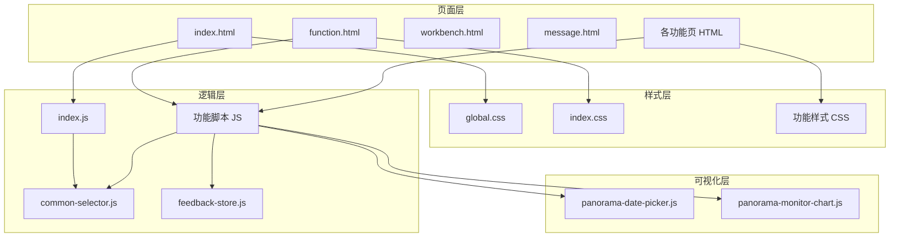
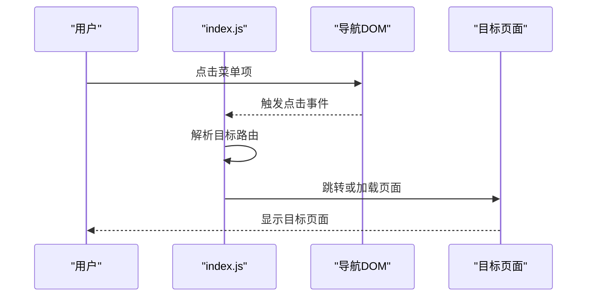
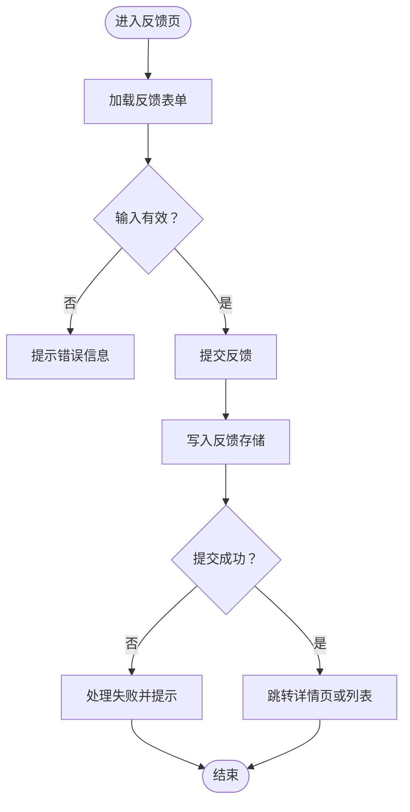
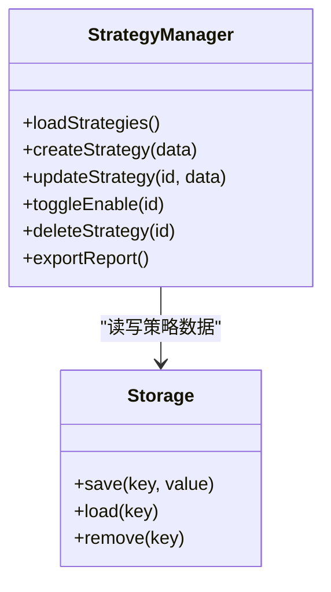
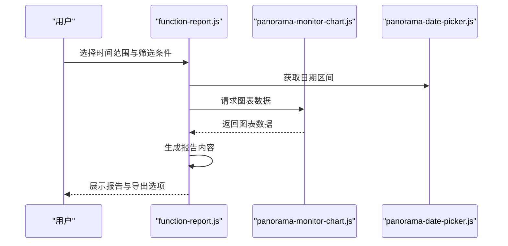
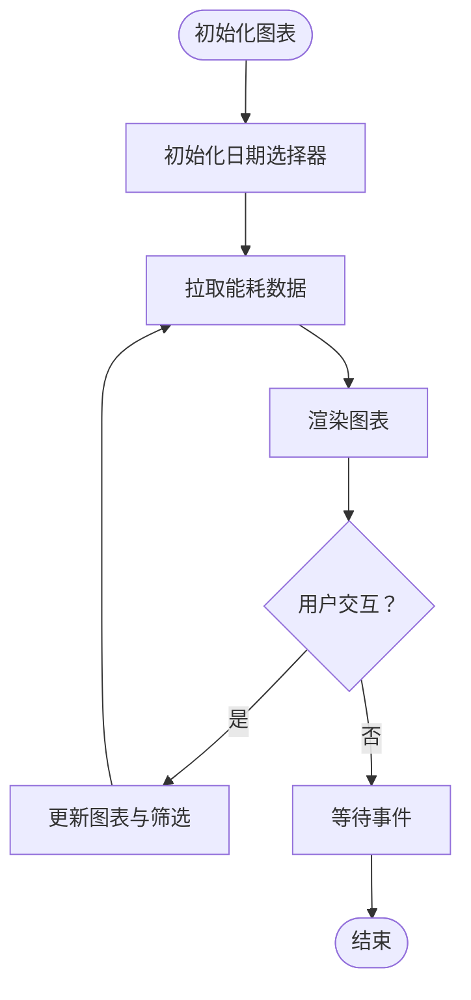
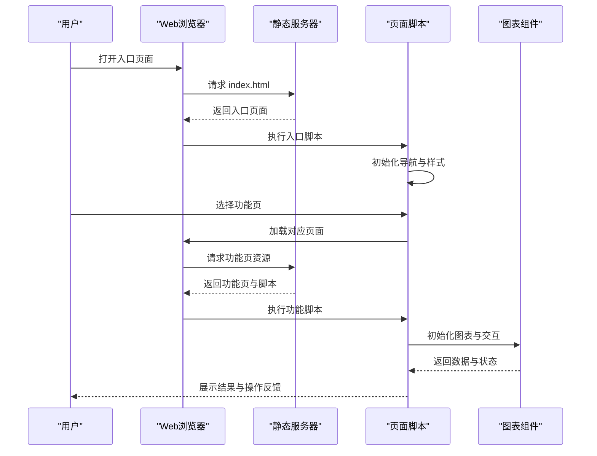
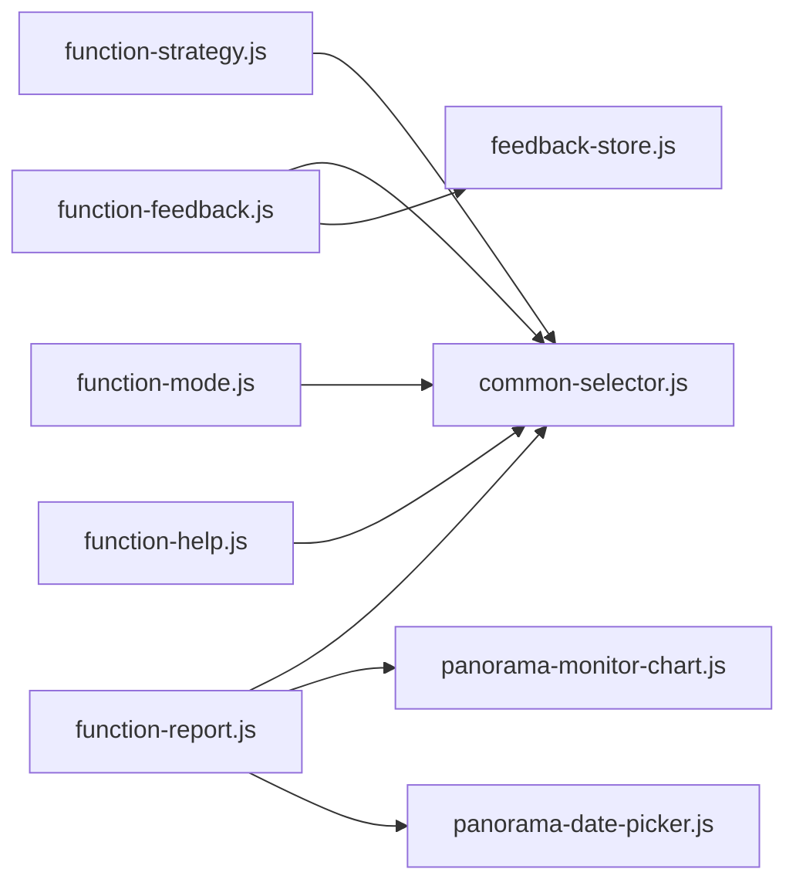

# 项目概览

<cite>
**本文引用的文件**   
- [index.html](file://app/index.html)
- [function.html](file://app/function.html)
- [workbench.html](file://app/workbench.html)
- [message.html](file://app/message.html)
- [function-feedback.html](file://app/function-feedback.html)
- [function-feedback-detail.html](file://app/function-feedback-detail.html)
- [function-feedback-history.html](file://app/function-feedback-history.html)
- [function-strategy.html](file://app/function-strategy.html)
- [function-report.html](file://app/function-report.html)
- [function-mode.html](file://app/function-mode.html)
- [function-help.html](file://app/function-help.html)
- [global.css](file://app/css/global.css)
- [index.css](file://app/css/index.css)
- [function-feedback.css](file://app/css/function-feedback.css)
- [function-feedback-detail.css](file://app/css/function-feedback-detail.css)
- [function-feedback-history.css](file://app/css/function-feedback-history.css)
- [function-strategy.css](file://app/css/function-strategy.css)
- [function-report.css](file://app/css/function-report.css)
- [function-mode.css](file://app/css/function-mode.css)
- [function-help.css](file://app/css/function-help.css)
- [inter.css](file://app/fonts/inter.css)
- [index.js](file://app/js/index.js)
- [common-selector.js](file://app/js/common-selector.js)
- [feedback-store.js](file://app/js/feedback-store.js)
- [function-feedback.js](file://app/js/function-feedback.js)
- [function-feedback-detail.js](file://app/js/function-feedback-detail.js)
- [function-feedback-history.js](file://app/js/function-feedback-history.js)
- [function-strategy.js](file://app/js/function-strategy.js)
- [function-report.js](file://app/js/function-report.js)
- [function-mode.js](file://app/js/function-mode.js)
- [function-help.js](file://app/js/function-help.js)
- [panorama-date-picker.js](file://app/js/panorama-date-picker.js)
- [panorama-monitor-chart.js](file://app/js/panorama-monitor-chart.js)
- [2026-07-03-能量全景看板PRD.md](file://docs/2026-07-03-能量全景看板PRD.md)
</cite>

## 目录
1. [简介](#简介)
2. [项目结构](#项目结构)
3. [核心组件](#核心组件)
4. [架构总览](#架构总览)
5. [详细组件分析](#详细组件分析)
6. [依赖关系分析](#依赖关系分析)
7. [性能考量](#性能考量)
8. [故障排查指南](#故障排查指南)
9. [结论](#结论)
10. [附录](#附录)

## 简介
MG-Mini 能量全景看板是一个面向能源监控与管理的 Web 应用，聚焦于“能量数据可视化、策略管理、功能反馈与报告生成”的一体化体验。项目通过多页面组织（首页、工作台、消息、功能页）与模块化前端脚本，提供：
- 能量全景监控与图表展示
- 功能反馈收集与历史追踪
- 策略配置与管理
- 报告生成与导出
- 模式切换与帮助文档

技术栈采用纯前端 HTML/CSS/JS 方案，强调轻量、易部署、可快速迭代。样式体系支持多种主题风格，便于在不同场景下呈现一致的视觉体验。

核心价值主张：
- 以“全景视角”统一呈现能耗与运行状态，提升决策效率
- 将“策略—执行—反馈—报告”闭环打通，形成持续优化机制
- 低门槛部署与使用，适合中小规模能源管理系统快速落地

[本节为概念性概述，不直接分析具体文件]

## 项目结构
项目采用“按功能模块划分”的前端工程化组织方式：
- app/index.html 作为入口页面，承载导航与全局布局
- app/function.html 作为功能聚合页，集中跳转至各子功能
- app/workbench.html 与 app/message.html 分别承担工作台与消息中心
- 各功能页独立 HTML + CSS + JS 三件套，职责清晰、耦合度低
- docs/ 存放产品需求与设计说明，指导开发方向

**图示来源**
- [index.html](file://app/index.html)
- [function.html](file://app/function.html)
- [workbench.html](file://app/workbench.html)
- [message.html](file://app/message.html)
- [function-feedback.html](file://app/function-feedback.html)
- [function-feedback-detail.html](file://app/function-feedback-detail.html)
- [function-feedback-history.html](file://app/function-feedback-history.html)
- [function-strategy.html](file://app/function-strategy.html)
- [function-report.html](file://app/function-report.html)
- [function-mode.html](file://app/function-mode.html)
- [function-help.html](file://app/function-help.html)

**章节来源**
- [index.html](file://app/index.html)
- [function.html](file://app/function.html)
- [workbench.html](file://app/workbench.html)
- [message.html](file://app/message.html)

## 核心组件
- 全局样式与字体
  - global.css 定义全局变量、基础排版与主题适配
  - index.css 定义首页布局与通用组件样式
  - inter.css 引入 Inter 字体，保证跨平台一致性
- 功能样式
  - function-feedback.css / detail / history 对应反馈模块的界面样式
  - function-strategy.css 策略管理界面样式
  - function-report.css 报告生成界面样式
  - function-mode.css 模式切换界面样式
  - function-help.css 帮助文档界面样式
- 公共脚本
  - common-selector.js 提供 DOM 选择与事件绑定工具
  - feedback-store.js 封装反馈数据的本地存储与查询
- 功能脚本
  - index.js 负责入口初始化与路由跳转
  - function-feedback.js / detail / history 实现反馈采集、详情查看与历史列表
  - function-strategy.js 实现策略配置与保存
  - function-report.js 实现报告生成与导出
  - function-mode.js 实现系统模式切换
  - function-help.js 加载并渲染帮助内容
- 全景监控组件
  - panorama-date-picker.js 日期选择器，用于筛选时间范围
  - panorama-monitor-chart.js 图表渲染，用于展示能耗曲线与关键指标

**章节来源**
- [global.css](file://app/css/global.css)
- [index.css](file://app/css/index.css)
- [inter.css](file://app/fonts/inter.css)
- [function-feedback.css](file://app/css/function-feedback.css)
- [function-feedback-detail.css](file://app/css/function-feedback-detail.css)
- [function-feedback-history.css](file://app/css/function-feedback-history.css)
- [function-strategy.css](file://app/css/function-strategy.css)
- [function-report.css](file://app/css/function-report.css)
- [function-mode.css](file://app/css/function-mode.css)
- [function-help.css](file://app/css/function-help.css)
- [common-selector.js](file://app/js/common-selector.js)
- [feedback-store.js](file://app/js/feedback-store.js)
- [index.js](file://app/js/index.js)
- [function-feedback.js](file://app/js/function-feedback.js)
- [function-feedback-detail.js](file://app/js/function-feedback-detail.js)
- [function-feedback-history.js](file://app/js/function-feedback-history.js)
- [function-strategy.js](file://app/js/function-strategy.js)
- [function-report.js](file://app/js/function-report.js)
- [function-mode.js](file://app/js/function-mode.js)
- [function-help.js](file://app/js/function-help.js)
- [panorama-date-picker.js](file://app/js/panorama-date-picker.js)
- [panorama-monitor-chart.js](file://app/js/panorama-monitor-chart.js)

## 架构总览
整体采用“页面级模块 + 公共脚本库”的前端架构：
- 页面层：HTML 负责结构与导航，CSS 负责样式与主题
- 逻辑层：JS 模块按功能拆分，通过 common-selector.js 进行 DOM 操作，通过 feedback-store.js 进行数据持久化
- 可视化层：panorama-monitor-chart.js 提供图表能力，panorama-date-picker.js 提供时间筛选
- 数据流：用户交互触发事件 → 业务逻辑处理 → 数据更新或存储 → UI 刷新

**图示来源**
- [index.html](file://app/index.html)
- [function.html](file://app/function.html)
- [workbench.html](file://app/workbench.html)
- [message.html](file://app/message.html)
- [global.css](file://app/css/global.css)
- [index.css](file://app/css/index.css)
- [function-feedback.css](file://app/css/function-feedback.css)
- [function-strategy.css](file://app/css/function-strategy.css)
- [function-report.css](file://app/css/function-report.css)
- [function-mode.css](file://app/css/function-mode.css)
- [function-help.css](file://app/css/function-help.css)
- [index.js](file://app/js/index.js)
- [common-selector.js](file://app/js/common-selector.js)
- [feedback-store.js](file://app/js/feedback-store.js)
- [function-feedback.js](file://app/js/function-feedback.js)
- [function-strategy.js](file://app/js/function-strategy.js)
- [function-report.js](file://app/js/function-report.js)
- [function-mode.js](file://app/js/function-mode.js)
- [function-help.js](file://app/js/function-help.js)
- [panorama-date-picker.js](file://app/js/panorama-date-picker.js)
- [panorama-monitor-chart.js](file://app/js/panorama-monitor-chart.js)

## 详细组件分析

### 入口与导航（index.js）
- 负责页面初始化、菜单高亮与路由跳转
- 监听导航点击事件，动态加载目标页面或跳转到对应功能页
- 与全局样式和字体资源协同，确保首屏渲染一致

**图示来源**
- [index.js](file://app/js/index.js)
- [index.html](file://app/index.html)

**章节来源**
- [index.js](file://app/js/index.js)
- [index.html](file://app/index.html)

### 功能反馈模块（function-feedback.js / detail / history）
- function-feedback.js：表单校验、提交反馈、调用反馈存储
- function-feedback-detail.js：根据 ID 加载反馈详情，支持编辑与状态更新
- function-feedback-history.js：分页展示历史反馈，支持搜索与筛选

**图示来源**
- [function-feedback.js](file://app/js/function-feedback.js)
- [function-feedback-detail.js](file://app/js/function-feedback-detail.js)
- [function-feedback-history.js](file://app/js/function-feedback-history.js)
- [feedback-store.js](file://app/js/feedback-store.js)

**章节来源**
- [function-feedback.html](file://app/function-feedback.html)
- [function-feedback-detail.html](file://app/function-feedback-detail.html)
- [function-feedback-history.html](file://app/function-feedback-history.html)
- [function-feedback.js](file://app/js/function-feedback.js)
- [function-feedback-detail.js](file://app/js/function-feedback-detail.js)
- [function-feedback-history.js](file://app/js/function-feedback-history.js)
- [feedback-store.js](file://app/js/feedback-store.js)

### 策略管理（function-strategy.js）
- 提供策略创建、编辑、启用/禁用与批量操作
- 与全局样式保持一致，确保策略列表与表单的可用性
- 支持策略版本管理与变更日志记录（由 PRD 指导）

**图示来源**
- [function-strategy.js](file://app/js/function-strategy.js)
- [function-strategy.html](file://app/function-strategy.html)

**章节来源**
- [function-strategy.html](file://app/function-strategy.html)
- [function-strategy.js](file://app/js/function-strategy.js)

### 报告生成（function-report.js）
- 基于时间范围与筛选条件生成能耗报告
- 支持预览、导出与打印
- 与图表组件联动，展示趋势与对比

**图示来源**
- [function-report.js](file://app/js/function-report.js)
- [panorama-monitor-chart.js](file://app/js/panorama-monitor-chart.js)
- [panorama-date-picker.js](file://app/js/panorama-date-picker.js)

**章节来源**
- [function-report.html](file://app/function-report.html)
- [function-report.js](file://app/js/function-report.js)

### 模式切换（function-mode.js）
- 提供系统模式切换（如节能模式、高性能模式等）
- 切换后影响图表展示与策略生效范围
- 与全局样式联动，确保不同模式的视觉一致性

**章节来源**
- [function-mode.html](file://app/function-mode.html)
- [function-mode.js](file://app/js/function-mode.js)

### 帮助文档（function-help.js）
- 加载帮助内容与常见问题解答
- 支持关键词搜索与分类浏览
- 与全局字体与样式保持一致

**章节来源**
- [function-help.html](file://app/function-help.html)
- [function-help.js](file://app/js/function-help.js)

### 全景监控组件（panorama-monitor-chart.js / panorama-date-picker.js）
- 日期选择器：支持快捷时间段与自定义范围
- 图表组件：折线图、柱状图、仪表盘等，支持响应式缩放与交互

**图示来源**
- [panorama-monitor-chart.js](file://app/js/panorama-monitor-chart.js)
- [panorama-date-picker.js](file://app/js/panorama-date-picker.js)

**章节来源**
- [panorama-monitor-chart.js](file://app/js/panorama-monitor-chart.js)
- [panorama-date-picker.js](file://app/js/panorama-date-picker.js)

### 概念性总览
下图展示了从用户访问到功能使用的端到端流程，适用于初学者理解系统行为：

[本图为概念性流程图，不直接映射具体代码文件]

## 依赖关系分析
- 页面与脚本：每个功能页依赖对应的 JS 模块，避免全局污染
- 公共库：common-selector.js 被多个功能脚本复用，降低重复代码
- 数据存储：feedback-store.js 提供统一的本地存储接口
- 可视化：panorama-monitor-chart.js 与 panorama-date-picker.js 被报告与监控相关页面共用

**图示来源**
- [function-feedback.js](file://app/js/function-feedback.js)
- [function-report.js](file://app/js/function-report.js)
- [function-strategy.js](file://app/js/function-strategy.js)
- [function-mode.js](file://app/js/function-mode.js)
- [function-help.js](file://app/js/function-help.js)
- [common-selector.js](file://app/js/common-selector.js)
- [feedback-store.js](file://app/js/feedback-store.js)
- [panorama-monitor-chart.js](file://app/js/panorama-monitor-chart.js)
- [panorama-date-picker.js](file://app/js/panorama-date-picker.js)

**章节来源**
- [function-feedback.js](file://app/js/function-feedback.js)
- [function-report.js](file://app/js/function-report.js)
- [function-strategy.js](file://app/js/function-strategy.js)
- [function-mode.js](file://app/js/function-mode.js)
- [function-help.js](file://app/js/function-help.js)
- [common-selector.js](file://app/js/common-selector.js)
- [feedback-store.js](file://app/js/feedback-store.js)
- [panorama-monitor-chart.js](file://app/js/panorama-monitor-chart.js)
- [panorama-date-picker.js](file://app/js/panorama-date-picker.js)

## 性能考量
- 首屏加载：入口页面仅加载必要资源，按需加载功能页与脚本
- 样式分离：全局样式与功能样式解耦，减少重绘与回流
- 数据缓存：反馈存储与图表数据建议增加本地缓存与去抖
- 图表优化：大数据量时采用虚拟滚动与增量渲染
- 字体与图片：使用 CDN 或内联字体，减少网络请求

[本节为通用性能建议，不直接分析具体文件]

## 故障排查指南
- 页面无法加载：检查入口与功能页路径是否正确，确认静态资源是否可用
- 图表不显示：确认日期选择器与图表组件初始化顺序，检查数据格式
- 反馈提交失败：验证表单字段与存储接口，查看控制台错误信息
- 样式错乱：检查 CSS 加载顺序与主题变量覆盖情况
- 帮助内容空白：确认帮助文档路径与内容加载逻辑

**章节来源**
- [index.js](file://app/js/index.js)
- [function-feedback.js](file://app/js/function-feedback.js)
- [function-report.js](file://app/js/function-report.js)
- [panorama-monitor-chart.js](file://app/js/panorama-monitor-chart.js)
- [panorama-date-picker.js](file://app/js/panorama-date-picker.js)

## 结论
MG-Mini 能量全景看板以轻量前端架构实现了能源监控与管理的核心闭环。通过清晰的模块划分、统一的样式与脚本规范，以及可视化的数据呈现，项目既满足初学者的易用性，也为有经验的开发者提供了可扩展的技术基础。结合 PRD 的指导，后续可在数据源接入、权限控制与移动端适配方面持续演进。

[本节为总结性内容，不直接分析具体文件]

## 附录
- 快速开始
  - 环境要求：现代浏览器（Chrome/Firefox/Safari），无需后端服务即可运行
  - 安装步骤：克隆仓库后，使用任意静态服务器（如 VS Code Live Server）启动
  - 基本使用：打开入口页面，通过导航进入各功能模块，完成反馈、策略、报告等操作
- 术语说明
  - 能量全景：对能耗、设备状态与运行指标的综合性可视化
  - 策略管理：对节能、调度与运行模式的配置与维护
  - 功能反馈：用户对系统功能的使用反馈与建议收集
  - 报告生成：基于时间与筛选条件的能耗分析与导出

**章节来源**
- [2026-07-03-能量全景看板PRD.md](file://docs/2026-07-03-能量全景看板PRD.md)
- [index.html](file://app/index.html)
- [function.html](file://app/function.html)