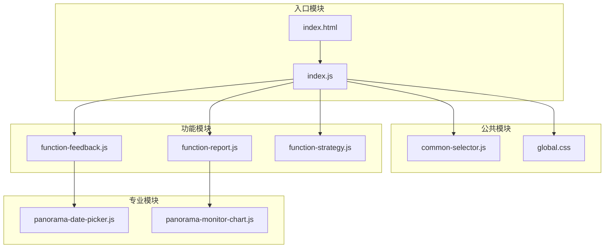
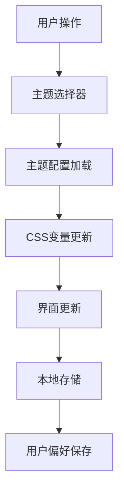

# 项目结构

<cite>
**本文档引用的文件**   
- [index.html](file://app/index.html)
- [function.html](file://app/function.html)
- [workbench.html](file://app/workbench.html)
- [message.html](file://app/message.html)
- [global.css](file://app/css/global.css)
- [index.css](file://app/css/index.css)
- [placeholder.css](file://app/css/placeholder.css)
- [common-selector.js](file://app/js/common-selector.js)
- [index.js](file://app/js/index.js)
- [feedback-store.js](file://app/js/feedback-store.js)
- [panorama-date-picker.js](file://app/js/panorama-date-picker.js)
- [panorama-monitor-chart.js](file://app/js/panorama-monitor-chart.js)
- [2026-07-03-能量全景看板PRD.md](file://docs/2026-07-03-能量全景看板PRD.md)
- [亮色现代极简-style.md](file://style/亮色现代极简-style.md)
- [暗色低饱和黑灰-style.md](file://style/暗色低饱和黑灰-style.md)
</cite>

## 目录
1. [简介](#简介)
2. [项目结构概览](#项目结构概览)
3. [核心目录详解](#核心目录详解)
4. [文件组织规范](#文件组织规范)
5. [模块引用关系](#模块引用关系)
6. [主题样式系统](#主题样式系统)
7. [开发指南](#开发指南)
8. [常见问题](#常见问题)

## 简介

MG-Mini是一个现代化的前端项目，采用清晰的分层架构和模块化设计。项目遵循Web标准的前端开发规范，将HTML页面、CSS样式、JavaScript模块进行合理分离和组织，便于团队协作和后期维护。

## 项目结构概览

```mermaid
graph TB
root["MG-Mini项目根目录"] --> app["app/ - 应用主目录"]
root --> docs["docs/ - 文档目录"]
root --> style[".style/ - 主题样式目录"]
app --> html["HTML页面文件"]
app --> css["css/ - 样式文件"]
app --> js["js/ - JavaScript模块"]
app --> fonts["fonts/ - 字体文件"]
app --> images["images/ - 图片资源"]
app --> vendor["vendor/ - 第三方库"]
html --> index["index.html - 主页"]
html --> function["function.html - 功能页"]
html --> workbench["workbench.html - 工作台"]
html --> message["message.html - 消息页"]
css --> global["global.css - 全局样式"]
css --> function_css["function-*.css - 功能样式"]
js --> common["common-*.js - 公共模块"]
js --> function_js["function-*.js - 功能模块"]
js --> panorama["panorama-*.js - 全景模块"]
```

**图表来源**
- [index.html](file://app/index.html)
- [global.css](file://app/css/global.css)
- [index.js](file://app/js/index.js)

## 核心目录详解

### app/ 目录 - 应用主目录

app目录是项目的核心目录，包含所有前端资源文件。该目录采用按功能模块组织的策略，每个功能模块都有对应的HTML、CSS和JS文件。

#### HTML页面文件组织

HTML文件按照功能模块进行划分，主要包含以下页面：

- **index.html**: 应用入口页面，包含基础布局和导航
- **function.html**: 功能集合页面，作为功能模块的容器
- **workbench.html**: 工作台页面，提供主要业务功能
- **message.html**: 消息中心页面

每个功能页面都遵循统一的命名规范：`function-[功能名].html`，便于识别和管理。

#### CSS样式文件组织

CSS文件采用分层组织策略：

- **global.css**: 全局样式定义，包含基础样式、变量定义、通用组件样式
- **index.css**: 首页专用样式
- **placeholder.css**: 占位符样式，用于开发过程中的临时样式
- **function-*.css**: 各功能模块的专用样式文件

#### JavaScript模块组织

JavaScript文件采用模块化设计：

- **common-*.js**: 公共工具函数和通用逻辑
- **function-*.js**: 各功能模块的业务逻辑
- **panorama-*.js**: 全景监控相关的专业模块
- **index.js**: 应用入口脚本

### docs/ 目录 - 文档目录

docs目录专门用于存放项目相关的需求文档和设计文档。当前包含：

- **2026-07-03-能量全景看板PRD.md**: 能量全景看板的产品需求文档

这种组织方式便于团队成员快速查找和理解项目需求和设计思路。

### .style/ 目录 - 主题样式系统

.style目录实现了完整的主题样式系统，支持多种视觉风格切换：

#### 主题分类

**亮色主题系列：**
- 亮色现代极简：简洁现代的浅色主题
- 亮色电光蓝：科技感蓝色主题
- 亮色科技蓝：商务蓝色主题

**暗色主题系列：**
- 暗色低饱和黑灰：低调专业的深色主题
- 暗色紫色科技感：未来感紫色主题
- 暗黑亮青发光：赛博朋克风格主题
- 暗黑荧光绿：黑客风格绿色主题

#### 主题文件结构

每个主题包含两个核心文件：
- **[主题名]-style.md**: 主题配置说明文件
- **[主题名]-preview.html**: 主题预览页面

## 文件组织规范

### 命名规范

#### HTML文件命名
- 主页面：使用有意义的名称，如 `index.html`, `workbench.html`
- 功能页面：采用 `function-[功能名].html` 格式
- 示例：`function-feedback.html`, `function-report.html`

#### CSS文件命名
- 全局样式：`global.css`
- 页面样式：`[页面名].css`
- 功能样式：`function-[功能名].css`
- 组件样式：`component-[组件名].css`

#### JavaScript文件命名
- 公共模块：`common-[模块名].js`
- 功能模块：`function-[功能名].js`
- 工具模块：`tool-[工具名].js`
- 入口文件：`index.js`

### 目录组织原则

1. **按功能分组**：相关文件按功能模块组织在一起
2. **按类型分层**：HTML、CSS、JS分别存放在对应目录
3. **公共资源集中**：字体、图片等公共资源统一管理
4. **第三方库隔离**：vendor目录专门存放外部依赖

## 模块引用关系



**图表来源**
- [index.js](file://app/js/index.js)
- [common-selector.js](file://app/js/common-selector.js)
- [function-feedback.js](file://app/js/function-feedback.js)

## 主题样式系统

### 主题切换机制

项目实现了灵活的主题切换系统，支持运行时动态切换不同视觉风格：



### 主题配置文件结构

每个主题的style.md文件包含：
- 主题基本信息（名称、描述、作者）
- 颜色变量定义
- 字体配置
- 组件样式覆盖规则
- 适用场景说明

## 开发指南

### 快速开始

1. **环境准备**
   - 现代浏览器（Chrome/Firefox/Safari最新版）
   - 本地HTTP服务器（推荐使用VS Code Live Server）

2. **项目启动**
   ```bash
   # 在项目根目录启动本地服务器
   python -m http.server 8080
   # 或使用Node.js
   npx serve .
   ```

3. **开发流程**
   - 修改HTML文件后刷新浏览器查看效果
   - CSS修改实时生效（建议使用热重载）
   - JavaScript修改需要刷新或热重载

### 新增功能模块

1. **创建HTML页面**
   ```
   app/function-[module-name].html
   ```

2. **创建CSS样式**
   ```
   app/css/function-[module-name].css
   ```

3. **创建JavaScript模块**
   ```
   app/js/function-[module-name].js
   ```

4. **在入口文件中注册模块**
   ```javascript
   // 在index.js中添加模块引用
   import './function-[module-name].js';
   ```

### 代码规范

#### JavaScript编码规范
- 使用ES6+语法特性
- 模块化开发，避免全局污染
- 添加必要的注释和文档
- 错误处理和异常捕获

#### CSS编码规范
- 使用BEM命名方法
- 合理使用CSS变量
- 响应式设计考虑
- 性能优化（减少重绘重排）

#### HTML编码规范
- 语义化标签使用
- 无障碍访问支持
- SEO优化考虑
- 跨浏览器兼容性

## 常见问题

### 路径引用问题

**问题**：页面间跳转时路径不正确
**解决方案**：使用相对路径或绝对路径，确保路径正确性

### 样式冲突问题

**问题**：多个CSS文件导致样式冲突
**解决方案**：检查CSS优先级，使用更具体的选择器

### 模块加载问题

**问题**：JavaScript模块无法正确加载
**解决方案**：检查模块依赖关系，确保加载顺序正确

### 主题切换失效

**问题**：主题切换后样式不生效
**解决方案**：检查CSS变量是否正确更新，确认主题配置文件格式

## 总结

MG-Mini项目采用了清晰、规范的目录结构和文件组织方式，为团队协作和后期维护提供了良好的基础。通过合理的模块化设计和主题系统，项目具有良好的可扩展性和可维护性。新开发者可以快速理解项目结构并开始贡献代码。

建议在实际开发中严格遵守命名规范和目录组织原则，保持代码的一致性和可读性。同时，充分利用主题系统和模块化特性，提高开发效率和代码复用率。