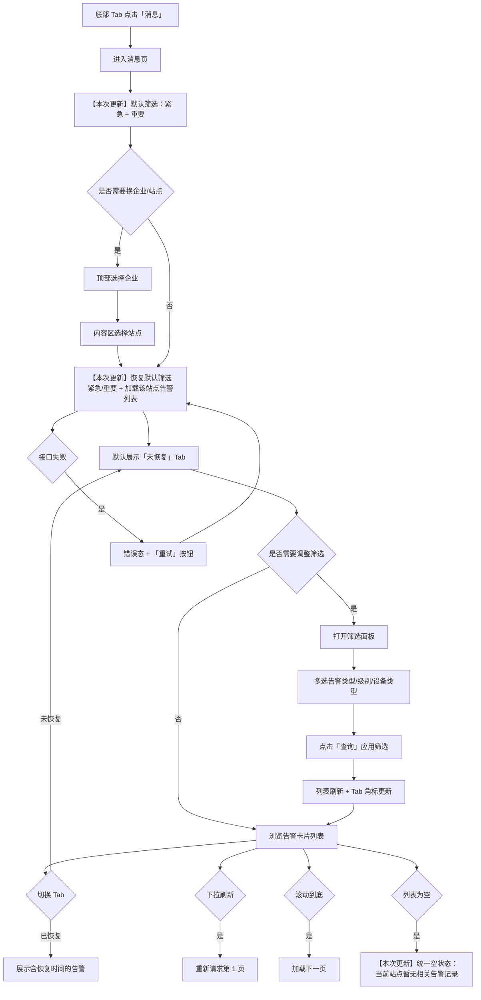

# 天工数智 · 消息页面 PRD

> **文档版本**：v2.1（需求评审版）  
> **创建日期**：2026-07-03  
> **更新日期**：2026-07-14  
> **来源**：基于 `app/message.html` 原型反推并补齐评审规格  
> **所属产品**：天工数智（智能微网 / 零碳能源管理平台）  
> **关联文档**：[2026-07-03-能量全景看板PRD](./2026-07-03-能量全景看板PRD.md)

---

## 评审说明

| 项 | 内容 |
| --- | --- |
| **评审范围** | 消息页 V1 全量功能：告警列表、筛选、企业/站点切换、下拉刷新与分页 |
| **不在本次评审** | 告警详情跳转、已读/未读、小程序订阅推送（V2 规划） |
| **评审关注点** | ① 筛选逻辑与后端参数对齐 ② 分页与 30 天数据范围 ③ 权限过滤规则 ④ API 草案字段 |
| **原型对齐提醒** | 筛选面板「取消」按钮：PRD 规定**放弃 pending 修改**；须与原型 `filterClose` 行为一致 |

### 【本次更新】v2.1 变更摘要（2026-07-14）

| 变更项 | 说明 |
| --- | --- |
| 默认筛选 | 进入消息页默认选中告警级别「紧急」「重要」；换站后同样恢复为该默认条件 |
| 筛选入口反馈 | 有生效筛选时仅展示激活态（`is-active`），**不展示**筛选数量角标 |
| 空状态统一 | 有/无筛选条件下无匹配告警时，说明文案统一为「当前站点暂无相关告警记录」；**不再展示**「重置筛选」按钮 |
| 文案去句号 | 空状态说明句末不加句号 |

### v2.0 变更摘要（2026-07-06）

| 变更项 | 说明 |
| --- | --- |
| 补齐 §5.5 | 新增「下拉刷新与分页」完整规格 |
| 补齐 §9 | 新增 API 接口契约（草案，供研发评审） |
| 补齐 §10 | 新增验收标准清单 |
| 消除 `[待补充]` | 加载/失败文案、权限规则、分页阈值、错误重试 UI 均已明确 |
| 空状态优化 | （已被 v2.1 覆盖）原区分「无数据」与「筛选无结果」两种文案与操作 |
| 角标规则 | 明确两个 Tab 角标均为 0 时隐藏 |

---

## 1. 产品概述

### 一句话定位

> 这是一个给**能源运维人员与企业管理者**用的**微信小程序内嵌 H5 页面**，帮他们**集中查看当前站点下的设备告警消息，并按状态与维度快速筛选**。
> 与现有方案（分散在各功能模块内查看、依赖人工巡检发现异常）相比，核心差异是**统一告警收件箱 + 多维度筛选 + 未恢复/已恢复状态分流**。

### 产品形态

- **当前选型**：微信小程序内嵌 H5（App 壳原型，底部四 Tab 导航）
- **选择理由**：目标用户主要在中国，使用频次中等；告警查看属于「随时打开、快速扫一眼」的场景，无需独立原生 App；与「概览 / 功能 / 工作台」等模块共用同一小程序入口，切换成本低
- **阶段策略**：当前为静态原型阶段；V1 对接后端告警 API；V1 不做小程序订阅消息推送

### 产品价值

| 维度 | 价值 |
| --- | --- |
| 用户价值 | 运维人员可在单一页面掌握站点告警全貌，按紧急程度与设备类型快速定位问题，减少漏检与响应延迟 |
| 商业价值 | 提升平台粘性与运维效率，为后续工单闭环、SLA 统计等增值功能打基础 |

### 不做什么（边界）

- **V1 点击告警卡片不跳转**——仅展示摘要信息，详情/处置页后续版本再定
- 不在本页面处理告警（确认、派单、关闭）
- 不支持跨站点批量聚合查看——始终以「当前选中站点」为数据范围
- **V1 不做小程序订阅消息推送**
- **V1 不做已读/未读状态**

---

## 2. 目标用户与使用场景

### 用户画像

**画像 A：站点运维工程师**
- 负责 1～3 个微网站点的日常巡检与故障响应
- 每天多次打开 App，优先关注「未恢复」告警
- 需要快速知道：什么设备、什么类型、多严重、何时发生

**画像 B：企业能源管理员**
- 管理多企业、多站点，需在不同企业/站点间切换查看
- 更关注「紧急 / 重要」级别告警的数量与趋势
- 已恢复告警用于复盘与统计

### 典型使用场景

| 场景 | 用户动作 | 期望结果 |
| --- | --- | --- |
| 早班巡检 | 打开消息 Tab，默认查看「未恢复」列表 | 【本次更新】3 秒内看到当前站点下**紧急/重要**未恢复告警及 Tab 数量角标；筛选按钮为激活态（无数量角标） |
| 故障定位 | 点击「筛选」，勾选「故障告警 + 储能设备」 | 列表仅展示匹配的未恢复告警 |
| 换站查看 | 切换企业 → 切换站点 | 【本次更新】列表刷新为该站点告警；筛选条件恢复为默认「紧急」「重要」 |
| 复盘确认 | 切换到「已恢复」Tab | 看到含恢复时间的已关闭告警记录 |
| 历史翻查 | 上拉加载更多 | 按发生时间倒序加载更早告警（近 30 天内） |

---

## 3. 核心用户动线



---

## 4. 功能清单

```
天工数智 · 消息页
├── 🔴 页面框架与导航（MVP 必须有）
│   ├── 顶部标题栏（企业选择器 + 页面标题「消息」+ 小程序胶囊占位）
│   ├── 站点控制条（站点切换 + 筛选入口）
│   ├── 分段 Tab（未恢复 / 已恢复）
│   ├── 告警卡片列表
│   └── 底部四 Tab 导航（概览 / 功能 / 消息 / 工作台）
├── 🔴 告警列表展示（MVP 必须有）
│   ├── 未恢复告警卡片
│   ├── 已恢复告警卡片（含恢复时间）
│   ├── Tab 角标数量（随筛选联动，为 0 时隐藏）
│   └── 空状态引导（【本次更新】统一文案，无「重置筛选」按钮）
├── 🔴 多维度筛选（MVP 必须有）
│   ├── 告警类型筛选
│   ├── 告警级别筛选（【本次更新】进入页默认「紧急」「重要」）
│   ├── 设备类型筛选
│   ├── 重置 / 查询 / 取消操作
│   └── 筛选生效态视觉反馈（【本次更新】仅高亮激活，无数量角标）
├── 🔴 企业与站点切换（MVP 必须有）
│   ├── 顶部企业 Bottom Sheet 选择器
│   └── 内容区站点 Bottom Sheet 选择器（联动企业站点列表）
├── 🔴 下拉刷新与分页（MVP 必须有）
│   ├── 下拉刷新当前 Tab 列表
│   └── 上拉加载更多（20 条/页，默认近 30 天）
├── 🟡 告警详情（重要，后续迭代）
│   └── 点击卡片进入告警详情 / 关联设备页
└── ⚪ 推送与已读（V1 不做，未来规划）
    ├── 小程序订阅消息推送
    └── 已读/未读状态
```

---

## 4.1 关键页面布局线框图

```
┌─────────────────────────────┐
│ [状态栏 / 灵动岛]            │
├─────────────────────────────┤
│ [天合富家 ▼]    消息    [胶囊]│  ← 顶部标题栏：企业选择 + 固定标题
├─────────────────────────────┤
│ [天合富家1#站点 ▼]  [筛选*] │  ← 站点控制条；* 有生效筛选时仅高亮，无数量角标
├─────────────────────────────┤
│ [ 未恢复 (3) ] [ 已恢复 ]    │  ← 分段 Tab，角标为 0 时隐藏
├─────────────────────────────┤
│ ┌─────────────────────────┐ │
│ │ 逆变器通信中断    [紧急] │ │
│ │ 告警类型 │ 设备名称      │ │  ← 告警卡片（2 列信息网格）
│ │ 离线告警 │ 1#逆变器-08   │ │
│ │ 设备类型 │ 设备 SN       │ │
│ │ 光伏设备 │ PV-INV-00128  │ │
│ │ 发生时间 │               │ │
│ │ 2026-06-30 08:14         │ │
│ └─────────────────────────┘ │
│         （可滚动列表）        │  ← 视觉重心：告警卡片列表；默认仅紧急/重要
│         上拉加载更多…         │
├─────────────────────────────┤
│ [概览][功能][消息][工作台]   │  ← 底部 Tab，消息高亮
└─────────────────────────────┘

【筛选 Bottom Sheet 覆盖层】
┌─────────────────────────────┐
│ 筛选                    取消 │  ← 取消：放弃 pending，恢复已生效筛选
├─────────────────────────────┤
│ 告警类型                     │
│ [故障告警] [离线告警]        │
│ 告警级别                     │
│ [紧急*][重要*][普通][提示]   │  ← * 进入页默认选中
│ 设备类型                     │
│ [光伏][储能][充电][配电][配套]│
├─────────────────────────────┤
│ [  重置  ]    [  查询  ]     │
└─────────────────────────────┘

【空状态（列表区域）——有/无筛选统一】
┌─────────────────────────────┐
│      🔔̸ 暂无未恢复消息       │
│   当前站点暂无相关告警记录    │  ← 无「重置筛选」按钮；句末无句号
└─────────────────────────────┘

【加载失败态（列表区域）】
┌─────────────────────────────┐
│        ⚠ 告警加载失败        │
│   请检查网络后重试            │
│        [ 重试 ]              │
└─────────────────────────────┘
```

---

## 5. 功能详细描述

### 5.1 页面框架与导航

**功能描述**：消息页作为天工数智 App 四 Tab 之一，提供统一的告警查看入口，并与全局企业/站点上下文保持一致。

**触发条件**：用户点击底部 Tab 栏「消息」，或从其他页面跳转至 `message.html`。

**页面结构**：

| 区域 | 元素 | 说明 |
| --- | --- | --- |
| 顶部标题栏 | 企业选择按钮 | 显示当前企业名（超长截断为 4 字 + `...`），点击弹出 Bottom Sheet |
| 顶部标题栏 | 页面标题 | 固定文案「消息」，居中 |
| 顶部标题栏 | 小程序胶囊 | 视觉占位，非交互 |
| 站点控制条 | 站点切换按钮 | 显示当前站点名（超长截断为 8 字 + `...`） |
| 站点控制条 | 筛选按钮 | 【本次更新】图标 + 「筛选」文字；有生效筛选时仅高亮（`is-active`），**不展示**筛选数量角标 |
| 内容区 | 分段 Tab + 列表面板 | 见 5.2、5.3 |
| 底部 | Tab 导航 | 消息 Tab 为 `active` 态 |

**交互细节**：

| 场景 | 交互处理方式 |
| --- | --- |
| 操作反馈 | 首屏展示 3 条骨架卡片；数据返回后替换为真实列表 |
| 危险操作确认 | 本页无删除等危险操作 |
| 空状态引导 | 见 5.2 |
| 操作失败引导 | 列表区域居中展示错误文案 + 「重试」按钮；点击重试重新请求当前 Tab 第 1 页 |

**状态清单**：

| 状态 | 触发条件 | UI 表现 | 用户可执行操作 |
| --- | --- | --- | --- |
| 默认 | 页面加载完成 | 【本次更新】展示未恢复 Tab + 默认筛选（紧急/重要）下的告警列表；筛选按钮激活 | 切换 Tab、筛选、换站 |
| 加载中 | 切换站点/应用筛选/首屏 | 骨架屏（3 条卡片占位） | 不可重复触发 |
| 成功 | 数据返回 | 渲染卡片列表 + 更新角标 | 全部交互 |
| 失败 | 接口报错 | 错误文案 + 「重试」按钮 | 重试 |
| 空状态 | 无匹配告警 | 【本次更新】空状态插图 + 统一说明文案；无列表内「重置筛选」 | 可打开筛选面板调整条件，或浏览其他 Tab |
| 加载更多 | 上拉触底 | 列表底部 loading 指示器 | 等待，不可重复触发 |

---

### 5.2 告警列表与分段 Tab

**功能描述**：按告警恢复状态分为「未恢复」「已恢复」两个 Tab，以卡片形式展示告警摘要信息；两个 Tab 均显示符合当前筛选条件的数量角标，**数量为 0 时隐藏角标**。

**触发条件**：进入消息页、切换 Tab、切换站点、应用/重置筛选、刷新/分页后自动更新。

**Tab 规则**：

| Tab | `data-message-status` | 默认 | 角标 |
| --- | --- | --- | --- |
| 未恢复 | `unrecovered` | 默认选中 | 显示数量；为 0 时隐藏 |
| 已恢复 | `recovered` | — | 显示数量；为 0 时隐藏 |

**告警卡片字段**：

| 展示项 | 未恢复 | 已恢复 | 说明 |
| --- | --- | --- | --- |
| 告警标题 | ✅ | ✅ | 主标题，如「逆变器通信中断」 |
| 级别徽章 | ✅ | ✅ | 紧急 / 重要 / 普通 / 提示 |
| 告警类型 | ✅ | ✅ | 故障告警 / 离线告警 |
| 设备名称 | ✅ | ✅ | |
| 设备类型 | ✅ | ✅ | 光伏 / 储能 / 充电 / 配电 / 配套系统 |
| 设备 SN | ✅ | ✅ | |
| 发生时间 | ✅ | ✅ | 格式 `YYYY-MM-DD HH:mm` |
| 恢复时间 | — | ✅ | 格式同上 |

**卡片视觉 tone（级别映射）**：

| tone | 适用级别（未恢复） | 边框/徽章色系 |
| --- | --- | --- |
| `urgent` | 紧急 | 红色系 |
| `important` | 重要 | 橙色系 |
| `normal` | 普通 / 提示 | 蓝色系 |
| `resolved` | 已恢复（任意原级别） | 绿色系 |

**排序规则**：按**发生时间倒序**（最新在前）；不按告警级别置顶。

**交互细节**：

| 场景 | 交互处理方式 |
| --- | --- |
| 操作反馈 | 切换 Tab 即时切换面板，保留各 Tab 已加载列表缓存 |
| 空状态（【本次更新】统一） | 图标 + 标题「暂无未恢复消息」/「暂无已恢复消息」+ 说明「当前站点暂无相关告警记录」（句末无句号）；**无论是否存在生效筛选，均不展示**「重置筛选」按钮 |
| 卡片点击 | **V1 不跳转**，无点击态跳转 |

**边界条件**：

- 【本次更新】内容为空时：有筛选 / 无筛选空状态**文案与操作一致**（见上表）
- 内容超长时：标题与 SN 允许换行（`word-break: break-word`）
- 角标为 0 时：**隐藏角标**，不显示「0」
- 网络异常：展示错误态 + 重试
- 单 Tab 告警量 > 500 条：仍按分页加载，不做虚拟列表（V1）；若单页响应 > 2s 则研发评估虚拟列表

**数据规范**：

| 字段名 | 数据类型 | 长度/限制 | 必填 | 说明 |
| --- | --- | --- | --- | --- |
| id | string | UUID 或雪花 ID | 是 | 告警唯一 ID |
| status | enum | `unrecovered` / `recovered` | 是 | 恢复状态 |
| title | string | ≤50 字 | 是 | 告警标题 |
| badge | string | — | 是 | 徽章展示文案（与 alarmLevel 一致） |
| tone | enum | urgent/important/normal/resolved | 是 | 卡片样式 |
| alarmType | enum | 故障告警 / 离线告警 | 是 | 告警类型 |
| alarmLevel | enum | 紧急 / 重要 / 普通 / 提示 | 是 | 告警级别 |
| deviceName | string | ≤30 字 | 是 | 设备名称 |
| deviceType | enum | 见筛选选项 | 是 | 设备类型 |
| deviceSn | string | ≤32 字 | 是 | 设备序列号 |
| occurredAt | datetime | `YYYY-MM-DD HH:mm` | 是 | 发生时间，站点时区 |
| recoveredAt | datetime | 同上 | 已恢复必填 | 恢复时间，站点时区 |

---

### 5.3 多维度筛选

**功能描述**：通过 Bottom Sheet 面板，支持按告警类型、告警级别、设备类型三个维度进行**多选 OR 组内、AND 组间**的组合筛选；筛选结果同步更新列表与 Tab 角标。

**触发条件**：点击站点控制条右侧「筛选」按钮。

**【本次更新】默认筛选条件**：
- 进入消息页（无 URL 覆盖参数时）：告警级别预选 **「紧急」「重要」**；告警类型、设备类型不预选
- 若 URL 携带 `alarmType` / `alarmLevel` 等参数：以 URL 预设为准，覆盖默认条件

**筛选维度配置**：

| 分组 | 字段 key | 可选项 |
| --- | --- | --- |
| 告警类型 | `alarmType` | 故障告警、离线告警 |
| 告警级别 | `alarmLevel` | 紧急、重要、普通、提示（【本次更新】进入页默认勾选「紧急」「重要」） |
| 设备类型 | `deviceType` | 光伏设备、储能设备、充电设备、配电设备、配套系统 |

**筛选逻辑**：
- 组内：多选为 **OR**（选中「紧急」或「重要」则展示任一级别的告警）
- 组间：多组之间为 **AND**（同时选「故障告警」+「光伏设备」须同时满足）
- 某组未选任何项：该组不参与过滤（等价于全选）

**面板操作**：

| 按钮 | 行为 |
| --- | --- |
| 取消 | 关闭面板，**放弃**本次 pending 修改，恢复为打开前的已生效筛选 |
| 重置 | 清空面板内 pending 选择，不关闭面板，不立即生效（点「查询」后生效为无筛选） |
| 查询 | 应用 pending 选择、关闭面板、重新请求第 1 页 |
| 点击遮罩 | 同「取消」 |
| Escape 键 | 同「取消」 |
| 选项按钮 | 点击切换选中/取消（`aria-pressed`） |

**筛选生效反馈**（【本次更新】）：
- 「筛选」按钮添加 `is-active` 高亮样式，表示当前存在已生效筛选
- **不展示**筛选数量角标（不显示已选条件条数）
- `aria-label` 变为「打开筛选面板，筛选已激活」

**交互细节**：

| 场景 | 交互处理方式 |
| --- | --- |
| 操作反馈 | 应用筛选后展示骨架屏，数据返回后刷新列表与角标 |
| 空状态 | 【本次更新】筛选后无结果 → 统一空状态文案「当前站点暂无相关告警记录」，**无**「重置筛选」按钮 |
| 操作失败 | 接口失败时 Toast「筛选失败，请重试」并保留原列表 |

**边界条件**：
- 三组全部为空：等价于无筛选，展示全部
- 筛选后切换 Tab：筛选条件**跨 Tab 保持**（角标按 Tab 分别计数；列表按 Tab 分别请求）
- 【本次更新】切换站点/企业：筛选条件**恢复为默认「紧急」「重要」**，并刷新列表与角标（非清空为无筛选）

---

### 5.4 企业与站点切换

**功能描述**：消息页支持在顶部切换企业、在内容区切换站点；站点列表随企业联动更新。

**触发条件**：点击企业名或站点名按钮。

**企业选择器**：
- 位置：顶部标题栏左侧
- 形式：Bottom Sheet 单选列表
- 数据源：按账号权限过滤后的企业列表
- 名称展示：超过 4 字截断为「前 4 字 + ...」

**站点选择器**：
- 位置：站点控制条左侧
- 形式：Bottom Sheet 单选列表
- 数据源：当前企业下、按账号权限过滤后的站点列表
- 名称展示：超过 8 字截断
- 联动：切换企业后，若当前站点不在新企业列表中，自动选中该企业第一个可访问站点

**权限规则**（V1）：
- 无权限的企业/站点：**不在选择器中展示**（非置灰不可选）
- 若用户仅有一个企业/站点，选择器仍可打开但仅一项

**与消息列表关系**：
- 【本次更新】切换企业或站点后：筛选条件恢复为默认「紧急」「重要」→ 请求新站点第 1 页告警数据
- 请求参数：`enterpriseId` + `siteId`（见 §9）；默认筛选时携带 `alarmLevels=紧急,重要`

**交互细节**：

| 场景 | 交互处理方式 |
| --- | --- |
| 选择企业/站点 | 选中项高亮 + 勾选图标，关闭 Sheet，触发加载 |
| 点击取消/遮罩 | 关闭 Sheet，不改变选择 |
| 加载中换站 | 以最后一次选择为准，丢弃过期请求响应 |

---

### 5.5 下拉刷新与分页

**功能描述**：支持手动下拉刷新当前 Tab 列表，以及滚动到底部自动加载下一页；默认查询近 30 天内的告警记录。

**触发条件**：
- 下拉刷新：用户在列表区域下拉手势（阈值 ≥ 60px）
- 加载更多：列表滚动至距底部 ≤ 80px 且仍有下一页

**分页规则**：

| 项 | 规格 |
| --- | --- |
| 每页条数 | **20 条** |
| 默认时间范围 | 近 **30 个自然日**（含当日，以站点时区计） |
| 排序 | 发生时间倒序 |
| 筛选 | 与 §5.3 一致，筛选参数随请求传递 |
| Tab 独立 | 未恢复 / 已恢复分别维护 `page` 游标与已加载数据 |

**交互细节**：

| 场景 | 交互处理方式 |
| --- | --- |
| 下拉刷新 | 顶部 loading 指示器；重置为第 1 页并替换列表；完成后轻 Toast「已更新」 |
| 加载更多 | 列表底部 spinner；追加渲染，不替换已有卡片 |
| 无更多数据 | 底部文案「已加载全部消息」；不再触发请求 |
| 刷新/加载失败 | 保留已加载数据；Toast 提示 + 底部「加载失败，点击重试」 |
| 并发 | 刷新进行中禁止重复下拉；加载更多进行中禁止重复触发 |

**边界条件**：
- 第 1 页即不足 20 条：不展示「加载更多」指示，直接显示「已加载全部消息」
- 切换 Tab：若该 Tab 未加载过则请求第 1 页；已加载则展示缓存，支持下拉刷新
- 切换站点/企业：清空两个 Tab 的缓存与页码，重新请求

---

## 6. 文案规范

### 6.1 产品整体文案风格

**专业严谨** — 面向 B 端能源运维场景，用语准确、克制，避免口语化与娱乐化表达。

### 6.2 面向终端用户的产品文案

| 场景 | 文案内容 | 风格备注 |
| --- | --- | --- |
| 页面标题 | 消息 | 简短明确 |
| Tab - 未恢复 | 未恢复 | — |
| Tab - 已恢复 | 已恢复 | — |
| 筛选按钮 | 筛选 | — |
| 筛选面板标题 | 筛选 | — |
| 筛选 - 重置 | 重置 | 动词 |
| 筛选 - 提交 | 查询 | 动词 |
| 筛选 - 取消 | 取消 | — |
| 企业选择标题 | 选择企业 | — |
| 站点选择标题 | 选择站点 | — |
| 空状态标题（未恢复） | 暂无未恢复消息 | 陈述事实 |
| 空状态标题（已恢复） | 暂无已恢复消息 | 陈述事实 |
| 空状态说明（【本次更新】统一） | 当前站点暂无相关告警记录 | 有/无筛选均使用此文案；句末无句号；无操作按钮 |
| 加载中 | 正在加载告警… | 骨架屏阶段可不展示 |
| 加载失败（区块） | 告警加载失败，请检查网络后重试 | 原因 + 下一步 |
| 重试按钮 | 重试 | 动词 |
| 筛选失败 Toast | 筛选失败，请重试 | 简短 |
| 刷新成功 Toast | 已更新 | 轻量正向反馈 |
| 加载更多失败 | 加载失败，点击重试 | 可点击重试 |
| 无更多数据 | 已加载全部消息 | 陈述 |
| 底部 Tab | 概览 / 功能 / 消息 / 工作台 | 与全 App 一致 |

---

## 7. 非功能性需求

| 类别 | 要求 |
| --- | --- |
| **性能** | 首屏列表渲染 < 2s（P95）；筛选操作响应 < 200ms（前端）；列表接口 P95 < 500ms |
| **权限控制** | 需登录；企业/站点列表与告警数据均按账号数据权限过滤；无权限资源不可见 |
| **兼容性** | 微信小程序 WebView；iOS / Android 主流机型；最小宽度适配 375px |
| **数据安全** | 告警数据 HTTPS 传输；客户端不持久化缓存告警列表（会话内内存缓存可接受） |
| **数据存储** | 列表默认展示近 **30 天**告警；单页 **20 条**；支持下拉刷新与上拉加载更多 |
| **无障碍** | 关键控件具备 `aria-label`、`aria-expanded`、`aria-pressed`；Tab 使用 `aria-selected` |

---

## 8. 已确认决策

| # | 问题 | 确认结论 |
| --- | --- | --- |
| 1 | 点击告警卡片是否跳转？ | **V1 不跳转**，仅展示 |
| 2 | 切换站点/企业后筛选条件 | 【本次更新】**恢复默认「紧急」「重要」**（非清空全部） |
| 3 | Tab 角标为 0 | **隐藏角标**（两个 Tab 均适用） |
| 4 | 列表默认排序 | **发生时间倒序**（不按级别置顶） |
| 5 | 告警级别「提示」 | **独立**展示与筛选，不与「普通」合并 |
| 6 | 刷新与历史范围 | **下拉刷新 + 上拉分页**（20 条/页，默认近 30 天） |
| 7 | 小程序订阅消息推送 | **V1 不做** |
| 8 | 已读/未读状态 | **V1 不做** |
| 9 | 筛选面板「取消」行为 | **放弃 pending 修改**，恢复打开前已生效筛选 |
| 10 | 空状态 | 【本次更新】**统一**文案「当前站点暂无相关告警记录」；无「重置筛选」按钮 |
| 11 | 无权限站点 | **隐藏**，不在选择器展示 |
| 12 | 时间时区 | 以**站点配置时区**展示发生/恢复时间 |
| 13 | 【本次更新】进入页默认筛选 | 告警级别默认 **「紧急」「重要」** |
| 14 | 【本次更新】筛选入口角标 | 有生效筛选时**仅激活高亮**，不展示已选数量角标 |

---

## 9. API 接口契约（草案）

> 供研发评审；路径与字段名可在联调前微调，语义须保持一致。

### 9.1 告警列表

```
GET /api/v1/sites/{siteId}/alarms

Query:
  status        enum    必填  unrecovered | recovered
  page          int     可选  默认 1
  pageSize      int     可选  默认 20，最大 50
  days          int     可选  默认 30，查询近 N 天
  alarmTypes    string  可选  逗号分隔，如「故障告警,离线告警」
  alarmLevels   string  可选  逗号分隔；【本次更新】页面默认进入时传「紧急,重要」
  deviceTypes   string  可选  逗号分隔

Response 200:
{
  "total": 128,
  "page": 1,
  "pageSize": 20,
  "hasMore": true,
  "counts": {                    // 当前筛选条件下各状态总数（用于 Tab 角标）
    "unrecovered": 3,
    "recovered": 125
  },
  "items": [
    {
      "id": "alm_xxx",
      "status": "unrecovered",
      "title": "逆变器通信中断",
      "alarmType": "离线告警",
      "alarmLevel": "紧急",
      "deviceName": "1#逆变器-08",
      "deviceType": "光伏设备",
      "deviceSn": "PV-INV-00128",
      "occurredAt": "2026-06-30 08:14",
      "recoveredAt": null
    }
  ]
}

Response 403: 无站点访问权限
Response 500: 服务端错误
```

### 9.2 企业与站点（复用全局接口）

消息页复用 App 全局企业与站点列表接口；切换站点时携带 `siteId` 请求 §9.1。

---

## 10. 验收标准

| # | 验收项 | 通过条件 |
| --- | --- | --- |
| AC-01 | 默认进入 | 【本次更新】打开消息 Tab，默认「未恢复」+ 筛选「紧急」「重要」；筛选按钮为激活态且无数量角标；3s 内展示列表或空状态 |
| AC-02 | Tab 切换 | 切换已恢复 Tab，展示恢复时间字段；角标随筛选联动 |
| AC-03 | 角标隐藏 | 某 Tab 数量为 0 时，不显示角标数字 |
| AC-04 | 筛选 OR/AND | 组内 OR、组间 AND；空组等价全选 |
| AC-05 | 筛选取消 | 修改筛选后点「取消」，列表与角标不变 |
| AC-06 | 筛选查询 | 点「查询」后列表、角标、页码均重置为第 1 页 |
| AC-07 | 换站重置 | 【本次更新】切换企业/站点后筛选恢复为「紧急」「重要」，列表刷新 |
| AC-08 | 分页 | 上拉加载下一页 20 条；无更多时展示「已加载全部消息」 |
| AC-09 | 下拉刷新 | 下拉后重新加载第 1 页，Toast「已更新」 |
| AC-10 | 空状态 | 【本次更新】有/无筛选无结果时文案均为「当前站点暂无相关告警记录」，且均无「重置筛选」按钮 |
| AC-11 | 失败重试 | 接口失败展示错误态 + 重试，重试成功后恢复正常 |
| AC-12 | 权限 | 无权限企业/站点不出现在选择器 |
| AC-13 | 卡片不可点 | V1 点击卡片无跳转 |
| AC-14 | 时间范围 | 仅展示近 30 天内告警（除非后端另有配置） |
| AC-15 | 【本次更新】筛选数量角标 | 任意生效筛选条件下，筛选入口均不展示数量数字 |

---

## 11. 待研发确认（评审开放问题）

| # | 问题 | 影响范围 | 建议 |
| --- | --- | --- | --- |
| 1 | 告警列表接口最终路径与鉴权方式 | §9 API | 与平台 API 规范统一后回填 |
| 2 | `counts` 由列表接口返回还是独立统计接口 | Tab 角标 | 建议同请求返回，减少往返 |
| 3 | 单站点 30 天内告警超 5000 条时的性能策略 | 分页 | 评估是否需要缩短默认 days 或强制筛选 |
| 4 | V2 告警详情页跳转目标 | 卡片点击 | 详情页 / 设备监控 / 工单，另行 PRD |

---

## 附录：原型文件索引

| 文件 | 说明 |
| --- | --- |
| `app/message.html` | 消息页 HTML 结构 |
| `app/js/index.js` | 列表渲染、筛选、Tab 切换逻辑 |
| `app/js/common-selector.js` | 企业/站点 Bottom Sheet 选择器 |
| `app/css/placeholder.css` | 告警卡片、筛选面板、空状态样式 |
| `app/css/global.css` | 全局 Tab 栏、标题栏样式 |
