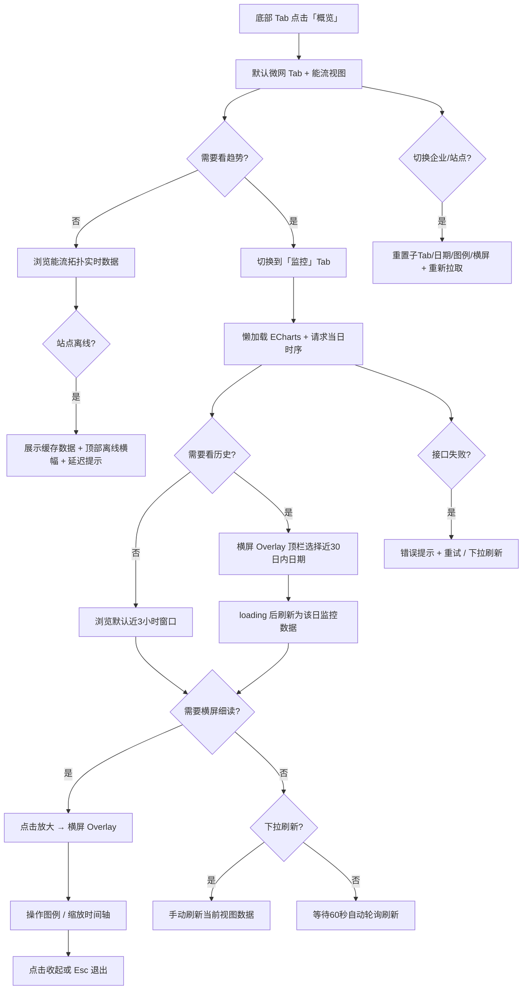

# 天工数智 · 能量全景看板 PRD

> **文档版本**：v2.0（需求评审版）  
> **创建日期**：2026-07-03  
> **更新日期**：2026-07-06  
> **来源**：基于 `app/index.html` 概览页 · 微网 Tab「能量全景」原型反推并补齐评审规格  
> **所属产品**：天工数智（智能微网 / 零碳能源管理平台）  
> **关联文档**：[2026-07-03-消息页面PRD](./2026-07-03-消息页面PRD.md)

---

## 评审说明

| 项 | 内容 |
| --- | --- |
| **评审范围** | 能量全景 V1：监控视图、日期查询、横屏放大、刷新轮询；能流视图仅引用已上线能力 |
| **不在本次评审** | 能流节点下钻、其他业务 Tab 能量全景、图表导出/分享、动态电价、策略调度 |
| **评审关注点** | ① 监控 API 与缺省数据策略 ② 横屏日期选择器交互 ③ 换站状态重置 ④ 离线缓存策略 |
| **与消息页一致性** | 目标用户、产品形态、文案风格、企业/站点权限规则与消息页 PRD 保持一致 |

### v2.0 变更摘要（2026-07-06）

| 变更项 | 说明 |
| --- | --- |
| 消除 `[待补充]` | 空状态、加载/失败/刷新文案、权限规则、缺省数据策略均已明确 |
| 补齐 §9 | 完善监控 API 契约（草案）与能流实时接口引用 |
| 补齐 §10 | 新增验收标准清单 |
| 明确 §11 | 评审开放问题与 V2 规划分离 |
| 图表实例策略 | 明确监控 Tab 切换时的 ECharts 懒加载/销毁规则 |
| 时区与缺值 | 明确站点时区、单点缺失采用「断点不连线」 |

---

## 1. 产品概述

### 一句话定位

> 这是一个给**能源运维人员与企业管理者**用的**微信小程序内嵌 H5 看板**，帮他们**在概览页一眼掌握当前站点的微网实时能流与近期运行趋势**。
> 与分散在各子系统查看功率、SOC 的方式相比，核心差异是**能流拓扑 + 监控时序同屏切换、支持横屏放大细读**。

### 产品形态

- **当前选型**：微信小程序内嵌 H5（App 壳原型，底部四 Tab 导航）
- **选择理由**：目标用户主要在中国；能量查看属于「打开 App 先看概览」的高频场景；与消息、工作台等模块共用同一小程序入口
- **阶段策略**：能流视图相关能力已上线，本文不重复描述；本 PRD 聚焦监控视图、日期查询、刷新与横屏等待实现/迭代规格

### 产品价值

| 维度 | 价值 |
| --- | --- |
| 用户价值 | 运维人员无需切换多个功能页，即可判断光伏/电网/储能/负载当前状态及近 3 小时趋势，缩短异常发现时间 |
| 商业价值 | 强化平台「一眼看懂站点」的核心体验，为后续策略分析、告警联动打基础 |

### 不做什么（边界）

- **V1 能流节点不可点击下钻**——纯展示，详情页后续版本再定
- **V1 仅微网 Tab 提供能量全景**——电网 / 光伏 / 储能 / 充电桩 Tab 本期不做
- **V1 不支持导出 / 分享图表**
- **V1 不展示动态电价曲线**（原原型参考项，本期移除）
- **V1 不展示策略调度底栏**（原原型参考项，本期移除）
- 不在本看板内修改运行策略或下发控制指令

### 已上线能力（本文不展开）

以下能力已在生产环境实现，本 PRD **不重复编写交互与数据规格**，仅在与新需求有耦合处引用：

- 能流视图：拓扑节点、流向动画、功率/SOC 标签展示规则
- 监控视图标定数据：超限阈值线、逆流阈值线

---

## 2. 目标用户与使用场景

### 用户画像

**画像 A：站点运维工程师**

- 负责 1～3 个微网站点的日常巡检与故障响应
- 每天多次打开概览，优先看能流判断当前发电、用电、上下网是否正常
- 发现异常后切换到监控视图查看近 3 小时趋势

**画像 B：企业能源管理员**

- 管理多企业、多站点，需在不同企业/站点间切换查看
- 关注站点整体能量平衡与近期波动，用于日报与复盘
- 需要查看近 30 日内某天的历史监控数据

### 典型使用场景

| 场景 | 用户动作 | 期望结果 |
| --- | --- | --- |
| 到站巡检 | 打开概览 → 微网 Tab，默认「能流」视图 | 3 秒内看到四节点实时功率与 SOC |
| 趋势研判 | 切换到「监控」视图 | 看到近 3 小时、1 分钟粒度的核心指标曲线 |
| 历史复盘 | 横屏放大 → 监控 Tab → 顶栏日期选择器选近 30 日内某一天 | 图表 loading 后切换为该日数据 |
| 细读图表 | 点击放大按钮进入横屏 | 图例可操作、时间轴可缩放，阅读更清晰 |
| 换站查看 | 切换企业 / 站点 | 能流与监控数据刷新；子 Tab 重置为能流；横屏自动收起 |

---

## 3. 核心用户动线



---

## 4. 功能清单

```
天工数智 · 概览页 · 能量全景
├── 🔴 模块入口与上下文（MVP 必须有）
│   ├── 所属：概览页 → 业务 Tab「微网」→ 能量全景卡片
│   ├── 全局企业 / 站点选择器联动
│   ├── 站点离线横幅联动
│   └── 与上方「并网模式」卡片同屏展示（模式卡片只读，不在本 PRD 展开）
├── 🔴 视图切换（MVP 必须有）
│   ├── 能流 / 监控 分段切换（默认能流）
│   └── 横屏放大（能流、监控均适用）
├── 🟢 能流视图（已上线，本文不展开）
│   ├── 四节点拓扑 + 中心微网
│   ├── 实时功率 / SOC 标签
│   └── 流向动画
├── 🔴 监控视图（MVP 必须有）
│   ├── 当日全日时序（1 分钟/点）；默认展示近 3 小时
│   ├── 日期周期选择器（近 30 日，横屏 Overlay 顶栏）
│   ├── 图例显隐（会话级记忆）
│   ├── 时间轴缩放（紧凑 / 横屏均默认近 3 小时窗口）
│   └── 标定阈值线（已上线，本文不展开）
├── 🔴 数据刷新（MVP 必须有）
│   ├── 60 秒自动轮询（当日实时数据）
│   └── 下拉手动刷新
├── 🔴 横屏放大（MVP 必须有）
│   ├── 放大 / 收起按钮
│   ├── Esc 退出
│   └── 横屏下展示完整图例
└── ⚪ 未来规划
    ├── 能流节点点击下钻设备详情
    ├── 其他业务 Tab 能量全景
    └── 图表导出 / 分享
```

---

## 4.1 关键页面布局线框图

### 4.1.1 概览页 · 微网 Tab（能量全景 · 能流，默认）

```
┌─────────────────────────────┐
│ [状态栏 / 灵动岛]            │
├─────────────────────────────┤
│ [天合富家 ▼]   概览    [胶囊] │
├─────────────────────────────┤
│ [天合富家1#站点 ▼]  [在线]   │  ← 站点控制条
├─────────────────────────────┤
│ [离线横幅 - 站点离线时显示]   │
├─────────────────────────────┤
│ [微网][电网][光伏][储能][充电]│  ← 业务分段 Tab，微网高亮
├─────────────────────────────┤
│ ┌ 并网模式卡片 ────────────┐ │
│ │ 峰谷套利需求控制    27°C  │ │
│ └──────────────────────────┘ │
│ ┌ 能量全景 ──────────── [⛶] │ │  ← 放大按钮
│ │ 能量全景    [能流][监控]   │ │  ← 子视图切换，能流默认
│ │ ┌──────────────────────┐ │ │
│ │ │  [光伏]      [电网]   │ │ │
│ │ │      ╲    ⚡微网    ╱  │ │ │  ← 能流拓扑（视觉重心）
│ │ │  [储能]      [负载]   │ │ │
│ │ │  发电… 上网… SOC… 用电│ │ │
│ │ └──────────────────────┘ │ │
│ └──────────────────────────┘ │
├─────────────────────────────┤
│ [概览][功能][消息][工作台]   │
└─────────────────────────────┘
```

### 4.1.2 能量全景 · 监控视图（紧凑竖屏）

```
┌─────────────────────────────┐
│ 能量全景    [能流][监控] [⛶] │
├─────────────────────────────┤
│ ┌─────────────────────────┐ │
│ │     时序折线图区域       │ │  ← 默认展示近3小时（180点）
│ │  （图例紧凑态隐藏）      │ │
│ │  ──── dataZoom 滑块 ─── │ │
│ └─────────────────────────┘ │
│ 建议点击放大按钮后横屏查看   │
└─────────────────────────────┘
```

> **紧凑竖屏说明**：日期选择器本期仅在**横屏放大 Overlay** 顶栏提供（见 4.1.3、5.4.2）；紧凑态引导用户放大后换日查询。

### 4.1.3 横屏放大 Overlay

```
┌──────────────────────────────────────────────────────────┐
│ 能量全景 [⛶]      [能流][监控]        [< 2026-07-03 >] │  ← 左：标题+收起；中：子Tab；右：日期（仅监控）
├──────────────────────────────────────────────────────────┤
│ 核心数据: [储能SOC] [电网功率]                            │
│ 参考数据: [储能功率] [光伏发电功率] [总负荷功率]          │  ← 图例可点击显隐
│ 标定数据: [超限阈值] [逆流阈值]（只读，虚线样式）         │
├──────────────────────────────────────────────────────────┤
│              时序折线图（加高，可交互缩放）               │
│              含超限/逆流阈值虚线及末端标注                │
├──────────────────────────────────────────────────────────┤
│ ─────────────── dataZoom 滑块 ────────────────────────  │
└──────────────────────────────────────────────────────────┘
```

**顶栏布局（三列）**：

| 区域 | 内容 | 说明 |
| --- | --- | --- |
| 左侧 | 「能量全景」+ 收起按钮 | 收起按钮紧邻标题右侧 |
| 中间 | `[能流][监控]` 分段切换 | 与卡片内子 Tab 状态同步 |
| 右侧 | 日期周期选择器 | **仅「监控」子视图下展示**；「能流」下隐藏，保留占位避免布局跳动 |

---

## 5. 功能详细描述

### 5.1 模块入口与全局上下文

**功能描述**：能量全景作为概览页「微网」业务 Tab 内的核心卡片模块，依赖全局企业与站点上下文；站点离线时与页面级离线横幅联动。

**触发条件**：用户进入概览页（`index.html`），且业务分段 Tab 选中「微网」。

**模块位置**：

| 层级 | 说明 |
| --- | --- |
| 页面 | 概览（底部 Tab 第一项） |
| 业务 Tab | 微网（`data-tab-panel="microgrid"`） |
| 卡片 | `能量全景`（`microgrid-flow-card`），位于并网模式卡片下方 |

**与全局组件关系**：

| 全局组件 | 联动规则 |
| --- | --- |
| 企业选择器 | 切换后刷新站点列表；能量全景随新站点数据刷新 |
| 站点选择器 | 切换后立即重新拉取能流 + 监控数据 |
| 离线横幅 | 站点 `offline` 时展示；能量全景区域标注数据可能延迟 |
| 业务 Tab | 仅微网 Tab 展示能量全景；切到其他 Tab 模块不可见 |

**切换企业 / 站点后的状态重置**（已确认）：

| 状态项 | 行为 |
| --- | --- |
| 数据 | 立即请求新站点数据 |
| 子视图 Tab | 重置为「能流」 |
| 横屏放大 | 若处于放大态，**自动收起** |
| 监控日期选择 | 重置为「当日」（站点时区自然日） |
| 图例显隐 | 重置为全部显示（会话级状态清空） |
| 监控图表 | 销毁实例，下次进入监控 Tab 重新懒加载 |

**权限规则**（V1，与消息页一致）：
- 无权限的企业/站点：**不在选择器中展示**

**交互细节**：

| 场景 | 交互处理方式 |
| --- | --- |
| 操作反馈 | 换站后卡片区域展示骨架屏，完成后渲染新数据 |
| 空状态引导 | 新站点无设备/无采样数据时，图表区展示插图 +「暂无监控数据」+ 说明「该站点尚未产生监控数据，请稍后再试或切换其他日期。」 |
| 操作失败引导 | 图表区错误文案「监控数据加载失败，请下拉重试」+ 保留上次成功数据（若有） |
| 站点离线 | 展示最后一次成功缓存 + 顶部离线横幅；能流/监控区域附加「数据可能延迟更新」提示 |

**边界条件**：

- 无权限站点：不在选择器展示
- 网络异常：保留缓存 + 错误提示；支持下拉重试
- 并发换站：以最后一次选择为准，丢弃过期请求响应

---

### 5.2 能流 / 监控视图切换

**功能描述**：能量全景卡片内提供「能流」「监控」两个子视图，通过分段按钮切换；默认进入「能流」。

**触发条件**：点击卡片头部 `chart-switch` 内对应 Tab。

**子视图定义**：

| 子视图 | `data-panorama-tab` | 默认 | 说明 |
| --- | --- | --- | --- |
| 能流 | `flow` | ✅ 默认 | 已上线，本文不展开 |
| 监控 | `strategy` | — | 本 PRD 主要描述对象 |

**切换规则**：

- 切换至「监控」时：**懒加载** ECharts 实例并请求当前日期时序数据
- 切换回「能流」时：**销毁** ECharts 实例并释放 canvas 内存（`dispose()`）
- 横屏放大态下，Overlay 顶栏内提供相同切换控件，状态与卡片内保持一致
- **日期选择器仅监控 Tab 可见**

**状态清单**：

| 状态 | 触发条件 | UI 表现 | 用户可执行操作 |
| --- | --- | --- | --- |
| 能流 | 默认 / 用户选择 | 展示拓扑视图 | 切换监控、放大 |
| 监控加载中 | 首次进入监控 | 图表区域骨架屏 | 等待 |
| 监控就绪 | 数据返回 | 展示时序图 | 缩放、换日期（横屏）、放大、下拉刷新 |
| 监控失败 | 接口报错 | 错误提示 + 保留旧数据 | 重试 / 下拉刷新 |

---

### 5.3 能流视图

**功能描述**：以拓扑形式展示光伏、电网、储能、负载与中心微网的实时能量流向与关键数值。

**状态**：**已上线**。交互规格、数值展示规则、动画逻辑等见生产实现，**本 PRD 不重复描述**。

**V1 边界（已确认）**：

- 节点**不可点击**，无下钻跳转

---

### 5.4 监控视图

**功能描述**：以时序折线图展示站点核心运行指标，支持近 30 日日期选择与 1 分钟粒度数据查看；紧凑竖屏与横屏放大均默认展示近 3 小时窗口，用户可通过 dataZoom 查看当日其他时段；横屏下展示完整图例与更大图表区域。

**触发条件**：用户切换至「监控」子视图，或横屏放大后保持/切换至监控。

#### 5.4.1 时间范围与粒度

| 项 | 规格 |
| --- | --- |
| 数据粒度 | **1 分钟 / 点** |
| 当日数据范围 | 返回当日 `00:00` 至当前时刻（或全日）的时序点，供缩放平移 |
| 默认展示窗口 | **近 3 小时**（180 个数据点）；紧凑竖屏与横屏放大**一致** |
| 默认锚定日 | **当日**（站点时区自然日） |
| 当日行为 | 默认窗口随当前时刻**滚动**；随 60 秒轮询向右推移 |
| 历史日行为 | 选择历史日期后，返回该日全日时序；默认展示该日 **最后 3 小时**（21:00–24:00），静态不轮询 |
| 横坐标标签 | 仅展示时刻（`HH:mm`），**不展示天气图标** |
| 时区 | 以**站点配置时区**为准；`date` 参数与横轴均按站点时区 |

**当日不足 3 小时**（如 00:00–02:59）：从 `00:00` 起展示已有数据点，右侧随时间补齐至近 3 小时窗口。

#### 5.4.2 日期周期选择器

**功能描述**：以**日**为周期查询监控时序，支持查询**近 30 个自然日**内数据；交互参照电网 Tab 的 `period-selector` 风格，横屏放大态在 Overlay 顶栏提供。

**展示范围**：

| 场景 | 是否展示 | 位置 |
| --- | --- | --- |
| 紧凑竖屏（未放大） | ❌ 不展示 | —（提示用户放大后操作） |
| 横屏放大 · 能流子视图 | ❌ 隐藏 | 顶栏右侧占位保留 |
| 横屏放大 · 监控子视图 | ✅ 展示 | Overlay 顶栏**右侧** |

**控件结构**（单行圆角边框，左 ◀ · 中日期 · 右 ▶）：

| 元素 | 行为 |
| --- | --- |
| 上一日 `◀` | 切换到前一自然日；已在最早日（当日 − 29 天）时置灰，**点击仍 Toast 弱提示** |
| 日期文字 | 展示 `YYYY-MM-DD`；**点击弹出 Bottom Sheet 日历** |
| 下一日 `▶` | 切换到后一自然日；已在当日时置灰，**点击仍 Toast 弱提示** |

**可选范围**：

- 最早：`当日 − 29 天`（含当日共 30 天）
- 最晚：当日（**不可查未来**）

**日历弹窗（Bottom Sheet）**：

- 形式：与站点/企业选择器一致的 `picker-overlay` + `picker-sheet`
- 月历网格：可选日在范围内高亮；超出近 30 日或未来日期置灰
- 点击不可选日期：Toast 弱提示（见 6.2）
- 选中有效日期后关闭弹窗并触发数据加载

**边界交互（Toast 弱提示，约 1.8s 自动消失）**：

| 触发 | 文案 |
| --- | --- |
| 点击下一日但已是当日 / 日历选未来日 | 不可选择未来日期 |
| 点击上一日但已是最早日 / 日历选超 30 日 | 仅支持查询近30日数据 |

**切换日期后**：

- 图表区域展示 **loading 遮罩**（旋转指示 +「加载中」）
- 请求该日监控时序完成后渲染新曲线
- 若为当日：恢复 60 秒轮询；若为历史日：停止轮询
- 从「能流」切回「监控」时，日期选择器重新显示，**不重置已选日期**

#### 5.4.3 曲线序列

**展示序列**（已确认移除动态电价、策略调度）：

| 分组 | 序列 | 图例 key | 单位 | Y 轴 |
| --- | --- | --- | --- | --- |
| 核心数据 | 储能 SOC | `soc` | % | 右轴（%） |
| 核心数据 | 电网功率 | `grid` | kW | 左轴（kW） |
| 参考数据 | 储能功率 | `storage` | kW | 左轴 |
| 参考数据 | 光伏发电功率 | `pv` | kW | 左轴 |
| 参考数据 | 总负荷功率 | `load` | kW | 左轴 |
| 标定数据 | 超限阈值 | — | kW | 左轴，虚线，已上线 |
| 标定数据 | 逆流阈值 | — | kW | 左轴，虚线，已上线 |

**不展示**：动态电价曲线、策略调度底栏。

#### 5.4.4 图例交互

| 规则 | 说明 |
| --- | --- |
| 可点击显隐 | 核心数据、参考数据图例项可切换 `is-active` |
| 最少保留 | **至少 1 条**曲线保持显示；仅剩 1 条时不可再隐藏 |
| 标定数据 | 超限 / 逆流阈值为只读展示，不可点击隐藏 |
| 记忆范围 | **仅当次会话**有效；关闭小程序或刷新后恢复全显 |
| 紧凑竖屏 | 图例**隐藏**，提示「建议点击放大按钮后横屏查看」 |
| 横屏放大 | 图例**完整展示**于图表上方，含标定数据分组 |

#### 5.4.5 时间轴与缩放

| 场景 | 默认展示范围 |
| --- | --- |
| 紧凑竖屏（未放大） | 默认展示**近 3 小时**（180 点，`dataZoom` `start`≈87.5% / `end`=100%） |
| 横屏放大 | **与紧凑竖屏一致**，默认近 3 小时；用户可通过滑块 / 手势缩放、平移查看当日其他时段 |

**横坐标**：

- 标签格式：`HH:mm`
- 默认窗口内约每 **30 分钟** 显示一个刻度标签
- **不展示**天气图标或气象信息

**交互**：

- 内置 `dataZoom`：滑块 + 手势
- 小程序 WebView：**启用手势缩放与平移**；滚轮缩放不做要求（移动端无滚轮）
- 十字准星 tooltip：展示当前时刻各**可见**曲线数值（保留 1 位小数 % / 2 位小数 kW）

#### 5.4.6 数据刷新

| 方式 | 规则 |
| --- | --- |
| 自动轮询 | 每 **60 秒**刷新一次；**仅当日**实时数据生效 |
| 下拉手动刷新 | 概览页内容区下拉触发；刷新能流 + 监控（若已加载） |
| 历史日 | 不自动轮询；仅切换日期或手动刷新时更新 |

**交互细节**：

| 场景 | 交互处理方式 |
| --- | --- |
| 操作反馈 | 轮询静默更新曲线末尾，不重置 dataZoom 视窗 |
| 空状态 | 该日无采样点：插图 +「暂无监控数据」+「请尝试选择其他日期查看。」 |
| 操作失败 | 「监控数据加载失败，请下拉重试」 |
| 离线 | 见 5.1：缓存 + 延迟提示 |

**状态清单**：

| 状态 | 触发条件 | UI 表现 | 用户可执行操作 |
| --- | --- | --- | --- |
| 默认 | 进入监控 | 当日近 3 小时曲线 | 缩放、图例（横屏）、刷新 |
| 加载中 | 换日期 / 首进 | loading 遮罩 +「加载中」 | 等待 |
| 成功 | 数据返回 | 渲染曲线 + dataZoom | 全部交互 |
| 失败 | 接口报错 | 错误文案 + 保留旧数据 | 下拉刷新 |
| 历史静态 | 选择历史日 | 静态曲线，无轮询 | 换日期、缩放 |
| 空数据 | 无采样点 | 空状态 | 换日期 |

**数据规范**：

| 字段名 | 数据类型 | 说明 |
| --- | --- | --- |
| siteId | string | 站点 ID |
| date | string | `YYYY-MM-DD`，站点时区自然日 |
| timestamp | datetime | 采样时刻，`YYYY-MM-DD HH:mm`，站点时区 |
| soc | number \| null | 储能 SOC，%，1 位小数；缺失为 null |
| gridPower | number \| null | 电网功率，kW，2 位小数；正为上网、负为下网 |
| storagePower | number \| null | 储能功率，kW，2 位小数 |
| pvPower | number \| null | 光伏发电功率，kW，2 位小数 |
| loadPower | number \| null | 总负荷功率，kW，2 位小数 |

**缺值处理**：
- 单点某字段为 `null`：该序列在该点**断点不连线**（ECharts `connectNulls: false`）
- 连续缺失 > 30 分钟：仍按断点展示，不插值

**边界条件**：

- 当日 00:00–02:59：不足 3 小时时，从 `00:00` 起展示已有数据点
- 跨时区：以站点配置时区为准，客户端不做本地时区换算
- tooltip 内数值不换行，系列名超长截断为 8 字 + `...`

---

### 5.5 横屏放大

**功能描述**：将能量全景主体（能流或监控）移至全屏横屏 Overlay，提供更大可视区域；监控视图下同步展示完整图例与日期选择器。

**触发条件**：点击卡片右上角放大按钮（`panoramaExpandTrigger`）。

**进入**：

- 将 `microgrid-panorama-body` DOM 移至 Overlay 宿主节点
- 页面添加 `is-panorama-expanded` 类；模拟横屏布局（设计宽 852 × 高 393，按视口等比缩放）
- 卡片内放大按钮图标变为「收起」；`aria-label` 同步更新
- Overlay 顶栏：**左**标题 + 收起 · **中**子 Tab · **右**日期选择器（监控 Tab 下可见）
- 若当前为监控视图，触发图表 `resize`

**退出**（已确认）：

| 方式 | 行为 |
| --- | --- |
| 点击收起按钮 | 还原 DOM 至卡片内，关闭 Overlay |
| 按 `Escape` | 同上 |
| 切换企业 / 站点 | **自动退出**放大态 |

**交互细节**：

| 场景 | 交互处理方式 |
| --- | --- |
| 操作反馈 | 展开 / 收起带 ≤ 200ms 过渡动画 |
| 旋转适配 | 窗口 `resize` 时重算 `--panorama-landscape-scale` 并 `chart.resize()` |

---

### 5.6 数据刷新（能流 + 监控）

**功能描述**：能流与监控数据均支持 60 秒自动轮询与下拉手动刷新。

**自动轮询**：

- 间隔：**60 秒**
- 条件：页面可见、当前站点在线、概览页处于前台；监控视图仅**当日**轮询
- 静默更新：不打断用户 dataZoom 视窗与图例操作

**下拉手动刷新**：

- 触发：概览页主内容区下拉手势（阈值 ≥ 60px）
- 范围：当前站点能流实时数据 + 监控当前日期数据
- 反馈：顶部 loading 指示器；完成后 Toast「数据已更新」

**离线站点**：停止轮询，展示缓存数据直至恢复在线或用户手动刷新。

---

## 6. 文案规范

### 6.1 产品整体文案风格

**专业严谨** — 面向 B 端能源运维场景，用语准确、克制，与消息页 PRD 保持一致。

### 6.2 面向终端用户的产品文案

| 场景 | 文案内容 | 风格备注 |
| --- | --- | --- |
| 卡片标题 | 能量全景 | 简短明确 |
| 子视图 Tab | 能流 / 监控 | 与原型一致 |
| 放大按钮（未展开） | aria: 放大能量全景，横屏展示 | 辅助说明 |
| 放大按钮（已展开） | aria: 收起能量全景，恢复竖屏展示 | 辅助说明 |
| 收起按钮 | aria: 退出横屏放大 | — |
| 日期选择器 | aria: 监控日期选择；上一日 / 选择日期 / 下一日 | 仅横屏监控 Tab |
| 日期越界 Toast | 不可选择未来日期 / 仅支持查询近30日数据 | 弱提示，约 1.8s |
| 监控紧凑提示 | 建议点击放大按钮后横屏查看 | 引导横屏 |
| 离线延迟提示 | 数据可能延迟更新 | 陈述事实 |
| 图表加载中 | 加载中 | loading 遮罩文案 |
| 空状态（监控） | 暂无监控数据 | 标题 |
| 空状态说明 | 请尝试选择其他日期查看。 | 引导换日 |
| 空状态（无设备） | 该站点尚未产生监控数据，请稍后再试或切换其他日期。 | 新站点场景 |
| 加载失败 | 监控数据加载失败，请下拉重试 | 原因 + 下一步 |
| 刷新成功 | 数据已更新 | 轻量正向反馈 |
| 图例分组标题 | 核心数据 / 参考数据 / 标定数据 | 与原型一致 |
| 标定图例项 | 超限阈值 / 逆流阈值 | 横屏完整展示，只读 |
| 底部 Tab | 概览 / 功能 / 消息 / 工作台 | 全 App 一致 |

---

## 7. 非功能性需求

| 类别 | 要求 |
| --- | --- |
| **性能** | 能流首屏 < 2s（P95）；监控图表首绘 < 1.5s（P95）；60s 轮询不引起可感知卡顿；接口 P95 < 500ms |
| **权限控制** | 需登录；企业 / 站点按账号数据权限过滤；无权限资源不可见 |
| **兼容性** | 微信小程序 WebView；iOS / Android 主流机型；最小宽度 375px；ECharts canvas 渲染 |
| **数据安全** | 能量数据 HTTPS 传输；客户端缓存 TTL **5 分钟**，仅用于离线/失败降级展示 |
| **数据存储** | 历史查询范围 **近 30 日**；客户端不持久化历史曲线至本地存储 |
| **无障碍** | 关键控件具备 `aria-label`、`aria-selected`、`aria-pressed`；图表区域 `role="img"` + `aria-label="站点监控时序图表"` |

---

## 8. 已确认决策

| # | 问题 | 确认结论 |
| --- | --- | --- |
| 1 | PRD 覆盖范围 | **仅能量全景**，含必要父页面上下文 |
| 2 | 目标用户 | **与消息页一致** |
| 3 | 产品形态 | **微信小程序内嵌 H5** |
| 4 | 能流节点点击 | **V1 不可点击** |
| 5 | 其他业务 Tab | **V1 仅微网 Tab** |
| 6 | 监控历史查询 | **近 30 日**；横屏 Overlay 顶栏日期选择器 |
| 7 | 导出 / 分享 | **V1 不做** |
| 8 | 数据刷新 | **60 秒轮询 + 下拉手动刷新** |
| 9 | 站点离线 | **缓存 + 离线横幅 + 延迟提示** |
| 10 | 监控时间窗口 | **默认近 3 小时，1 分钟/点** |
| 11 | 动态电价 / 策略调度 | **移除** |
| 12 | 图例交互 | 可显隐，至少 1 条，**仅会话记忆** |
| 13 | 横屏放大 | 放大进入，收起/Esc 退出；换站自动收起 |
| 14 | 横坐标 | **仅 HH:mm**，无天气 |
| 15 | 日期选择器 | **仅横屏 + 监控 Tab**；日历弹窗 + 越界 Toast |
| 16 | 横屏顶栏 | 左：标题+收起 · 中：子 Tab · 右：日期 |
| 17 | 换站重置 | 子 Tab→能流；日期→当日；图例→全显；销毁监控图表 |
| 18 | 缺值策略 | **断点不连线**，不插值 |
| 19 | 时区 | **站点配置时区** |
| 20 | 紧凑态日期 | **不展示**，引导横屏操作 |

---

## 9. API 接口契约（草案）

> 供研发评审；能流实时接口沿用已上线规格，此处仅列监控相关草案。

### 9.1 监控时序

```
GET /api/v1/sites/{siteId}/panorama/monitor

Query:
  date    string  必填  YYYY-MM-DD（站点时区自然日）

Response 200:
{
  "siteId": "site_xxx",
  "date": "2026-07-03",
  "timezone": "Asia/Shanghai",
  "points": [
    {
      "timestamp": "2026-07-03 08:00",
      "soc": 72.5,
      "gridPower": 120.35,
      "storagePower": -45.20,
      "pvPower": 380.00,
      "loadPower": 455.15
    }
  ]
}

说明:
- 当日：返回 00:00 至当前时刻（或全日）时序；客户端 dataZoom 默认近 3 小时
- 历史日：返回该日全日时序；客户端默认展示最后 3 小时（21:00–24:00）
- 字段缺失时返回 null，客户端断点展示

Response 403: 无站点访问权限
Response 404: 站点不存在
Response 500: 服务端错误
```

### 9.2 能流实时（引用已上线）

```
GET /api/v1/sites/{siteId}/panorama/flow

Response: 沿用生产环境已上线契约（四节点功率、SOC、流向状态）
```

### 9.3 刷新策略

| 接口 | 轮询 | 下拉刷新 |
| --- | --- | --- |
| `/panorama/flow` | 60s（站点在线） | ✅ |
| `/panorama/monitor?date=当日` | 60s（站点在线） | ✅ |
| `/panorama/monitor?date=历史日` | ❌ | ✅ |

---

## 10. 验收标准

| # | 验收项 | 通过条件 |
| --- | --- | --- |
| AC-01 | 默认视图 | 进入概览微网 Tab，默认「能流」子视图，3s 内展示拓扑 |
| AC-02 | 监控懒加载 | 首次切监控 Tab 才初始化 ECharts 并请求数据 |
| AC-03 | 监控销毁 | 切回能流后 ECharts 实例已 dispose，无内存泄漏 |
| AC-04 | 默认窗口 | 监控默认展示近 3 小时（180 点），紧凑与横屏一致 |
| AC-05 | 历史日默认 | 选历史日，默认展示该日 21:00–24:00，不轮询 |
| AC-06 | 日期选择器 | 仅横屏+监控 Tab 可见；能流 Tab 隐藏但占位不跳动 |
| AC-07 | 日历弹窗 | 点击日期文字弹出 Bottom Sheet；超范围 Toast |
| AC-08 | 图例显隐 | 可隐藏参考/核心曲线；至少保留 1 条；标定不可隐藏 |
| AC-09 | 横屏放大 | 放大/收起/Esc 正常；监控图表 resize 正确 |
| AC-10 | 换站重置 | 换站后子 Tab=能流、日期=当日、横屏收起、图例全显 |
| AC-11 | 轮询 | 当日 60s 静默更新；历史日不轮询；离线停止轮询 |
| AC-12 | 下拉刷新 | 刷新能流+监控，Toast「数据已更新」 |
| AC-13 | 离线降级 | 离线时展示缓存+横幅+「数据可能延迟更新」 |
| AC-14 | 缺值断点 | null 数据点曲线断开，不插值 |
| AC-15 | 权限 | 无权限站点不在选择器展示 |

---

## 11. 待研发确认（评审开放问题）

| # | 问题 | 影响范围 | 建议 |
| --- | --- | --- | --- |
| 1 | 监控 API 最终路径与批量查询能力 | §9.1 | 与平台 API 规范统一 |
| 2 | 历史日默认窗口是否改为「与当前时刻同时段回溯」 | §5.4.1 | 当前为最后 3 小时；若需同时段回溯另行确认 |
| 3 | 紧凑竖屏是否补充日期选择器 | §5.4.2 | V1 维持横屏操作；V1.1 可评估 |
| 4 | 能流节点下钻、图表导出 | V2 | 另行 PRD |

---

## 附录：原型文件索引

| 文件 | 说明 |
| --- | --- |
| `app/index.html` | 概览页结构，能量全景卡片与横屏 Overlay |
| `app/js/index.js` | 子视图切换、横屏放大逻辑 |
| `app/js/panorama-monitor-chart.js` | 监控时序图（ECharts） |
| `app/js/panorama-date-picker.js` | 横屏 Overlay 日期选择器 |
| `app/js/common-selector.js` | 企业 / 站点 Bottom Sheet 选择器 |
| `app/css/index.css` | 能流拓扑、监控紧凑态、横屏 Overlay 样式 |

## 附录：历史版本摘要

### v1.2（2026-07-03）

- 日期选择器移至横屏 Overlay 顶栏；增加日历弹窗与越界 Toast
- 横屏顶栏三列布局；标定图例完整展示

### v1.1（2026-07-03）

- 默认时间窗口由 1 小时调整为 **3 小时**
- 移除动态电价、策略调度；横坐标去除天气 emoji
